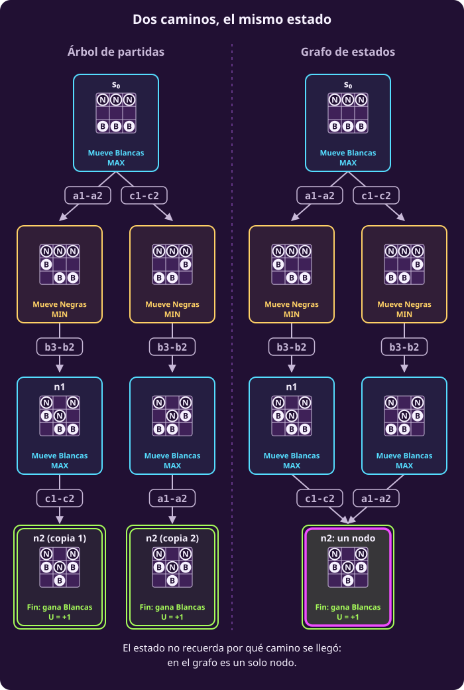

# El juego como grafo

**¿Cómo se ve el juego completo, y quién lo dibuja?**

Al terminar podrás:

- **Escribir el grafo** de cualquier juego de esta clase a partir de sus siete piezas.
- **Leer una partida** como un camino en ese grafo.
- **Distinguir** el árbol de partidas del grafo de estados.
- **Decir qué recibe un algoritmo** como entrada: las reglas para generar el grafo, no el grafo.

> **Las reglas, en cuatro líneas.** Tablero de 3×3; Blancas (B) abajo en la fila 1 y Negras (N) arriba en la fila 3. Empiezan Blancas. Un peón avanza una casilla si está vacía o captura en diagonal hacia delante. Gana quien llega a la fila del rival, captura todos los peones rivales o deja al rival sin jugada; ganar vale $+1$ y perder, $-1$.

> **Supuestos de esta página.** Los mismos de [[escribir-el-juego|Escribir el juego]]: dos jugadores por turnos, sin azar, todo a la vista, finito (cada estado tiene un número finito de jugadas y toda partida termina) y suma cero.

---

## 1 · Del modelo al grafo

**Piensa: con las siete piezas, ¿ya está decidido cuántos nodos y cuántas flechas tiene el grafo?**

Sí. En la página anterior cada pieza le agregó algo al dibujo. Ahora lo escribimos de una vez y en general.

::: definition {#jue-c1-grafo-del-juego title="Grafo del juego"}
El **grafo del juego** $(S,\ s_0,\ S_F,\ \mathrm{Pl},\ A,\ T,\ U)$ es el grafo dirigido $G=(S,E)$: sus nodos son los estados y sus aristas son

$$E=\bigl\{\bigl(s,\ a,\ T(s,a)\bigr) : s\notin S_F,\ a\in A(s)\bigr\}.$$

Cada arista va de $s$ a $T(s,a)$ y lleva el nombre de su jugada $a$. Cada nodo lleva una etiqueta:

- si $s\notin S_F$, quién mueve, $\mathrm{Pl}(s)$: MAX o MIN;
- si $s\in S_F$, su pago $U(s)$.
:::

- **Una arista por jugada, no por hijo.** Por eso aquí cada arista es una terna $(s,a,T(s,a))$ y no un par $(u,v)$: lleva el nombre de su jugada. Si dos jugadas distintas llevan al mismo estado, son dos aristas con nombres distintos. El dibujo puede abreviarlas en una flecha, pero el grafo guarda las dos.

**Tres propiedades se leen directamente de la definición:**

1. **La raíz del grafo completo es $s_0$.** Todo estado se alcanza desde $s_0$, porque $S$ son los estados alcanzables.
2. **Las hojas son exactamente los finales.** De un final no sale ninguna arista, y de un no final sale al menos una, porque $A(s)$ nunca está vacío.
3. **Una partida es un camino de la raíz a una hoja.** Cada jugada recorre una arista y la partida termina al llegar a un final.

**En hexapawn hay una propiedad más: no hay ciclos.** Los peones solo avanzan, y ninguna jugada devuelve a un estado anterior.

- **En ajedrez, el tablero sí se repite.** Por eso existe la regla de tablas por repetición.
- **Eso no basta para repetir el estado completo.** Un estado de ajedrez guarda también lo que la historia decide, como las posiciones ya ocurridas.
- **Un ciclo de estados completos permitiría una partida sin fin.** Aquí lo excluye el supuesto de que toda partida termina.

---

## 2 · El subgrafo de n1, nodo por nodo

**Piensa: el grafo entero de hexapawn tiene 135 nodos; ¿hace falta dibujarlo todo para estudiar una decisión?**

No. Basta el pedazo que cuelga del estado donde se decide.

::: definition {#jue-c1-subgrafo title="Subgrafo de un estado"}
El **subgrafo de un estado** $s$ son los estados que se alcanzan desde $s$, con las aristas entre ellos. Es otra vez el grafo de un juego: el mismo juego, empezando en $s$ en lugar de en $s_0$.
:::

**La raíz de una búsqueda no siempre es $s_0$.** Cuando un algoritmo decide una jugada, parte del estado donde le toca decidir; a ese estado lo llamamos $s_{\text{raíz}}$, la **raíz de la búsqueda**.

- **$s_0$ es el estado inicial del juego.** Es uno solo y no cambia durante la partida.
- **$s_{\text{raíz}}$ cambia con cada decisión.** Solo al empezar la partida coincide con $s_0$; después, es el estado al que se llegó.

Tomamos **n1**, el estado tras a1-a2 y b3-b2, como raíz, y dibujamos su subgrafo entero, sin dejar fuera ningún nodo.

::: figure {#jue-c1-subgrafo-n1 title="El subgrafo de n1"}

:::

**Cómo leerlo:**

- **Los nodos van de n1 a n13** en el orden de un recorrido en profundidad: primero un hijo y todo lo que cuelga de él, luego el siguiente. Cada nodo es un estado: tablero y turno.
- **Hay 7 finales, con borde doble:** n2, n5, n9, n10, n11, n12 y n13. Seis valen $+1$ y uno, n13, vale $-1$.
- **Hay 12 aristas, una por jugada.** Dentro de este dibujo, cada nodo salvo n1 tiene un solo padre: el subgrafo de n1 es un árbol.
- **En el grafo entero no pasa lo mismo.** A n2 también se llega por otro camino, como muestra la sección 3.

::: exercise {#jue-c1-ej-partida title="Decide qué partida es este camino"}
1. Escribe las jugadas del camino n1 → n3 → n6 → n7 → n8 → n9 (la flecha se lee «y luego»: de un nodo a su hijo) y quién hace cada una.
2. ¿Cómo termina esa partida?
3. ¿Existe en este grafo una partida desde n1 que gane Negras? Escribe su camino.
:::

::: hint {#jue-c1-pista-partida of="jue-c1-ej-partida" title="Lee las flechas"}
Cada flecha del dibujo lleva el nombre de su jugada, y la etiqueta del nodo de donde sale dice quién la hace: MAX es Blancas y MIN es Negras.
:::

::: answer {#jue-c1-resp-partida of="jue-c1-ej-partida"}
1. c1xb2 (Blancas), c3-c2 (Negras), b1xc2 (Blancas), a3xb2 (Negras) y a2-a3 (Blancas).
2. Blancas llega a la fila 3 con a2-a3: gana Blancas y $U(\text{n9})=+1$.
3. Sí: n1 → n3 → n13, con c1xb2 y c3xb2. En n13 a Blancas no le queda jugada, así que gana Negras y $U(\text{n13})=-1$. Que exista un camino así no quiere decir que Negras pueda forzarlo: Blancas podía jugar c1-c2 en n1 y ganar de inmediato. Qué puede forzar cada jugador es justo lo que dice el valor de un estado (sección 5).
:::

---

## 3 · Árbol de partidas y grafo de estados

**Piensa: si dos partidas distintas llegan al mismo tablero con el mismo turno, ¿son dos nodos o uno?**

Depende de qué se dibuje. Hay dos formas de dibujar un juego, y conviene distinguirlas.

::: definition {#jue-c1-arbol-grafo title="Árbol de partidas y grafo de estados"}
- En el **grafo de estados**, cada estado aparece **una sola vez**, aunque se llegue a él por varios caminos. Es el grafo de la sección 1.
- En el **árbol de partidas**, cada nodo es un **camino desde la raíz**: el mismo estado aparece una vez por cada orden de jugadas que llega a él.

Cuando dos caminos distintos llegan al mismo estado, se dice que hay una **transposición**.
:::

**Hexapawn tiene transposiciones.** Jugar a1-a2, b3-b2 y c1-c2 deja el mismo tablero, con el mismo turno, que jugar c1-c2, b3-b2 y a1-a2. Es justamente el final n2.

::: figure {#jue-c1-transposicion title="Dos caminos, el mismo estado"}

:::

**Por qué en el grafo es un solo nodo.** El estado no guarda el camino entero: guarda lo suficiente para seguir **sin mirar la historia**. Si dos caminos dejan el mismo estado completo, el futuro desde ahí es el mismo.

- **En hexapawn, el estado completo es tablero y turno.** Por eso basta que coincidan los dos.
- **En ajedrez, el estado guarda además parte de la historia.** Enroques, captura al paso, el contador de jugadas y lo necesario para reconocer repeticiones: dos caminos transponen solo si coinciden también en eso.

**Cuánto cambia.** En hexapawn, el árbol de partidas completo tiene **252 nodos** y el grafo de estados, **135**. Si un algoritmo recuerda qué estados ya valoró, trabaja sobre el grafo y no repite cuentas.

---

## 4 · ¿El grafo ya está dibujado?

**Piensa: cuando un programa juega ajedrez, ¿alguien le entregó antes el grafo con todos los estados?**

No. Y esta es la idea que más confunde la primera vez, así que la decimos con todas sus letras:

> **Los algoritmos de esta unidad no reciben el grafo. Reciben las reglas** ($s_0$, $S_F$, $\mathrm{Pl}$, $A$, $T$ y $U$) **y el estado donde les toca decidir.** Con eso **generan** los nodos que necesitan, expandiéndolos uno por uno.

Recuerda que **expandir** un nodo $s$ es calcular $A(s)$ y, para cada jugada, $T(s,a)$: así aparecen sus hijos. En los pasos de la página anterior, los nodos punteados existían en el juego pero todavía nadie los había expandido.

**Hay dos maneras de usar las reglas:**

::: table {#jue-c1-explicito-implicito title="Dos formas de tener el grafo"}
| | Grafo explícito | Grafo implícito |
|---|---|---|
| **Qué se hace** | Se expanden **todos** los estados antes de jugar | Se expande un estado **cuando hace falta** |
| **Qué se guarda** | El grafo entero | Depende del método |
| **En hexapawn** | Posible: 135 estados | También posible |
| **En ajedrez** | Imposible: del orden de $10^{44}$ posiciones | La única opción |
:::

- **Las dos formas describen el mismo grafo.** Lo que cambia es **cuándo** se calcula cada nodo y **cuánto** se guarda.
- **Implícito no quiere decir «solo el camino».** Un recorrido en profundidad guarda solo el camino que está mirando; otros métodos guardan más, por ejemplo los estados ya valorados.

En toda la unidad, salvo que digamos otra cosa, el grafo es **implícito**: el algoritmo parte de $s_{\text{raíz}}$ y genera lo demás con $A$ y $T$.

::: exercise {#jue-c1-ej-entrada title="Decide qué recibe el algoritmo"}
Un programa va a decidir la primera jugada de Blancas en hexapawn.

1. ¿Qué datos necesita recibir?
2. ¿Necesita recibir la lista de los 135 estados?
3. ¿Qué operación hace cada vez que llega a un estado que no es final?
:::

::: hint {#jue-c1-pista-entrada of="jue-c1-ej-entrada" title="Piensa en el ajedrez"}
Lo que recibe tiene que servir también para un juego cuyo grafo no cabe en ninguna computadora.
:::

::: answer {#jue-c1-resp-entrada of="jue-c1-ej-entrada"}
1. Las reglas y el estado donde decide, que aquí es $s_{\text{raíz}}=s_0$: cómo reconocer si $s\in S_F$ y cómo calcular $\mathrm{Pl}$, $A$, $T$ y $U$ para cualquier estado. Reconocer un final no exige recibir la lista de todos.
2. No. Puede generar cada estado cuando lo necesita. En hexapawn podría generarlos todos antes, pero en ajedrez no.
3. Lo **expande**: calcula $A(s)$ y, para cada jugada, $T(s,a)$.
:::

### No recibir el grafo no es no recorrerlo

**Piensa: si el algoritmo no recibe el grafo, ¿quiere decir que no lo recorre?**

No. «No recibe el grafo» habla de la **entrada**: nadie le entrega los nodos. Pero el algoritmo sí **genera** nodos y los recorre.

**Lo que genera tiene nombre: el árbol de búsqueda.** Es la parte del árbol de partidas que un algoritmo genera desde $s_{\text{raíz}}$ para decidir. Lo que distingue a los métodos de la unidad es **cuánto** generan y **si llegan a los finales**.

- **Una hoja del árbol de búsqueda no siempre es un final.** Puede ser un estado no final que nadie ha expandido todavía.
- **La poda ahorra porque el grafo no estaba dado.** Podar es dejar sin generar una rama que no puede cambiar la decisión; lo que más se ahorra es justo generarla.
- **Con el grafo ya dibujado, podar ahorraría menos.** Todavía se saltaría visitas, pero el trabajo de construir las ramas ya estaría hecho.

[[un-arbol-todos-los-algoritmos|La radiografía]], al final de la unidad, compara qué genera y qué número da cada método.

---

## 5 · Resolver el juego es llenar el grafo de números

**Piensa: los finales ya tienen su número, $U$; ¿qué número le falta a cada uno de los demás nodos?**

Su **valor**: el pago para MAX si, desde ese estado, los dos juegan lo mejor. **Resolver el juego** es ponerle a cada nodo ese número.

- **En un final, el valor es su pago $U$.** No hay nada que decidir.
- **En los demás, se calcula de los finales hacia la raíz.** Es el método del [[opt-objetivo-juego-practica|ejemplo del juego]] de la unidad de optimización: máximos en los nodos de MAX y mínimos en los de MIN, con todos los números desde MAX.
- **Sobre el grafo explícito entero, se llama análisis hacia atrás.** Pone su $U$ a cada final y etiqueta los nodos de los finales hacia atrás, hasta $s_0$; en el subgrafo de una decisión, hasta $s_{\text{raíz}}$.
- **Así se construyen las tablas de finales de ajedrez.** Son todas las posiciones con pocas piezas, generadas y resueltas de antemano.

**Punto de control:** deberías poder escribir los nodos y las aristas del grafo de un juego a partir de sus piezas, y leer una partida como un camino de la raíz a una hoja. También, explicar una transposición, distinguir $s_0$ de $s_{\text{raíz}}$ y decir qué recibe un algoritmo como entrada y qué genera.

---

## Lo que hay que llevarse

- **El grafo del juego tiene un nodo por estado y una arista por jugada:** $G=(S,E)$ con $E=\{(s,a,T(s,a))\}$. Las hojas son los finales y una partida es un camino de la raíz a una hoja.
- **El árbol de partidas repite un estado por cada camino que llega a él;** el grafo de estados lo guarda una vez. En hexapawn, 252 nodos contra 135.
- **Un algoritmo no recibe el grafo:** recibe las reglas y genera los nodos al expandirlos, desde la raíz de su búsqueda, $s_{\text{raíz}}$. Tener el grafo entero es posible en hexapawn e imposible en ajedrez.
- **No recibir el grafo no es no recorrerlo:** cada método genera su propio árbol de búsqueda, y la poda ahorra justo lo que no genera.
- **Resolver el juego es ponerle a cada estado su valor:** el pago para MAX si los dos juegan lo mejor, calculado de los finales hacia atrás.

Continúa con [[diagnosticar-el-juego|diagnosticar el juego]].
