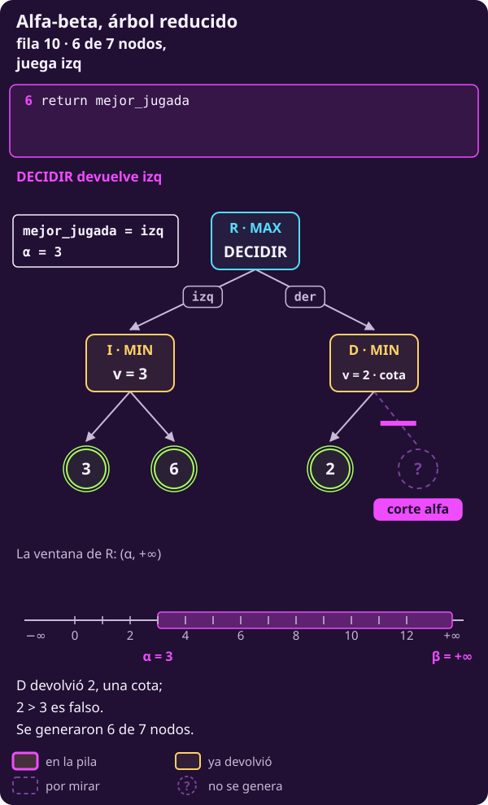
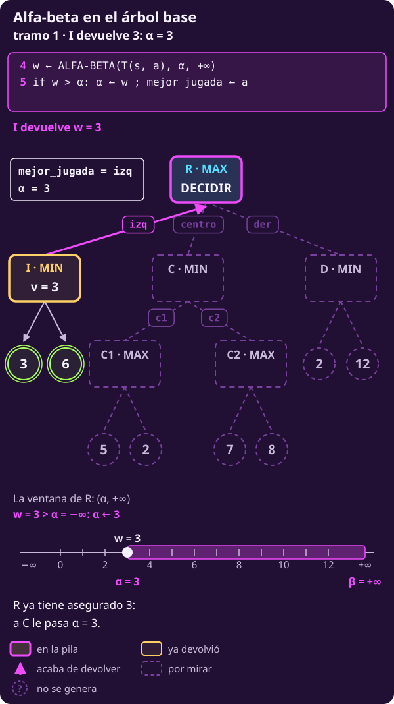
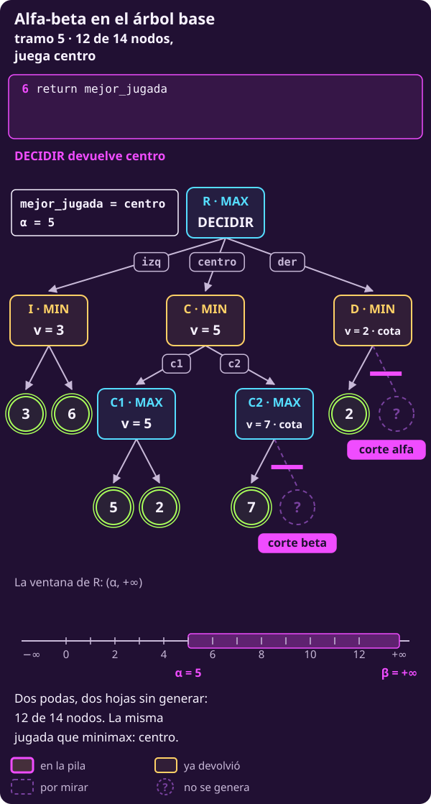
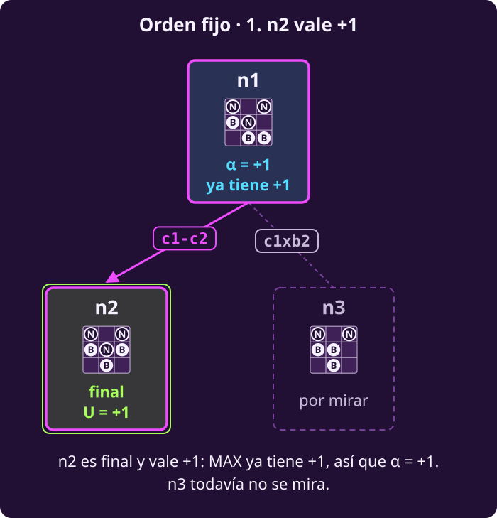

# Alfa-beta a mano

**¿Cómo dejar ramas sin generar sin cambiar la jugada?**

Al terminar tendrás:

- **Qué son $\alpha$ y $\beta$**, y la regla que dice, en cada nodo, con
  qué número se compara y si poda.
- **El árbol reducido y el árbol base recorridos hijo por hijo**, con la
  comparación de cada `if` y la jugada que va guardando la raíz.
- **Cómo leer lo que devuelve un nodo:** un valor exacto o solo una cota.
- **n1 de hexapawn:** 5 de sus 13 estados, y la misma jugada que minimax.

## Lo que traes

- **El valor, siempre desde MAX.** $V(s)$ es el pago para MAX si los dos
  juegan lo mejor, y $Q(s,a)=V(T(s,a))$. MAX elige el mayor $Q$ y MIN el
  menor (@jue-c2-valor).
- **DECIDIR-MINIMAX y MINIMAX**, líneas 1–20, de
  [[minimax-como-algoritmo|Minimax como algoritmo]]. La raíz guarda
  `mejor_valor` y `mejor_jugada`.
- **Dos números que no se mezclan.** $v$ es lo mejor que ha visto **este**
  nodo entre sus hijos; $w$ es lo que devuelve **un** hijo.
- **El árbol base.** Su raíz R es $s_{\text{raíz}}$; minimax genera sus 14
  nodos, R vale 5 y juega centro.
- **Supuestos:** dos jugadores por turnos, sin azar, todo a la vista y suma
  cero. Lo que MIN busca es lo peor para MAX.

> [!TIP]
> **Míralo correr: alfa-beta en el árbol base**
>
> - **▶ [Animación paso a paso](../_assets/traza_arbol_t.html#alfa-beta)**: el árbol, la línea del
>   código que corre y el valor de cada variable. Avanza con ▶ o con las flechas.
> - **Notebook en Colab**, sección 5: el código de alfa-beta en Python,
>   corriendo; cámbiale un número y mira qué pasa.
>
> 

**Alfa-beta es minimax con poda (*pruning*):** deja de generar una rama en
cuanto lo ya revisado basta para saber que no cambia la decisión de arriba.

- **Qué valor rastrea:** el mismo $V$ que minimax. Un nodo que poda
  devuelve solo una cota: «al menos» o «a lo más».
- **Dónde lo guarda:** cada llamada guarda su $v$ y dos umbrales que
  hereda del camino, $\alpha$ y $\beta$, mientras recorre sus hijos.
- **Cómo sube:** como en minimax, con el máximo en MAX y el mínimo en MIN.
  Al padre solo sube $v$.

---

## 1 · La idea

**Piensa: si ya tienes una jugada que te da 3, ¿necesitas saber cuánto vale
exactamente otra que te da 2 o menos?**

No: te basta saber que no supera a 3.

- **Minimax mira todo**: genera cada estado, hasta los finales.
- **Alfa-beta deja de mirar una rama en cuanto sabe que no cambia la
  decisión de arriba.** Lo que no mira **no lo genera**: ése es el ahorro.
- **Cada nodo carga dos números** de lo que pasó arriba: $\alpha$, lo que
  MAX ya tiene asegurado, y $\beta$, lo que MIN ya tiene asegurado.
- **La raíz entrega lo mismo** que minimax: el mismo valor y, con el mismo
  orden y desempate, la misma jugada.

> **Dado:** un estado $s_{\text{raíz}}$ donde mueve MAX, las reglas
> $S_F$, $\mathrm{Pl}$, $A$, $T$, $U$ y un orden fijo para las jugadas.
>
> **Encontrar:** la jugada que entregaría DECIDIR-MINIMAX, con su valor,
> generando menos estados cuando se pueda.

---

## 2 · Alfa, beta y la regla

**Piensa: para saber que una rama no sirve, ¿qué tiene que recordar cada
nodo de lo que pasó arriba?**

Dos números, los dos **en puntos de MAX**, como $U$.

Las líneas que se citan son las del código de alfa-beta, completo en
[[alfa-beta-como-algoritmo|Alfa-beta como algoritmo]]. Las líneas 1–13
corresponden a las de minimax, ahora con $\alpha$ y $\beta$; las **nuevas
son 14, 15, 22 y 23**. Aquí basta saber qué hace cada una.

::: definition {#jue-c2-alfa-beta title="Alfa y beta"}
**Qué son.** Sea un nodo del recorrido y el camino de la raíz hasta él.

- **$\alpha$ («alfa»)** es el **mayor** valor que algún nodo de **MAX** del
  camino ya tiene asegurado con una jugada revisada.
- **$\beta$ («beta»)** es el **menor** valor que algún nodo de **MIN** del
  camino ya tiene asegurado con una jugada revisada.

**Cómo se calculan.** La raíz empieza con los dos sin nada asegurado; cada
hijo recibe los de su padre en ese momento.

|  | $\alpha$ | $\beta$ |
|---|---|---|
| Dueño | MAX | MIN |
| Empieza en | $-\infty$ | $+\infty$ |
| Se mueve | solo sube | solo baja |
| Lo cambia | MAX, línea 15 | MIN, línea 23 |
| Lo lee | MIN, línea 22 | MAX, línea 14 |

**Qué significan.** Dicen cuándo lo ya revisado basta para descartar una
rama frente a una alternativa del camino. El par se escribe
$(\alpha,\beta)$ y se llama **ventana** (*window*).

**Qué no son.** No son cotas de este nodo: puede valer menos que $\alpha$
o más que $\beta$. Entonces basta saber que su rama no cambia la decisión
de arriba.
:::

::: definition {#jue-c2-t-regla title="La regla de alfa-beta"}
1. **Hereda los dos.** Al generarse, cada nodo recibe el $\alpha$ y el
   $\beta$ que su padre tiene en ese momento (líneas 4, 12 y 20). **El suyo
   también empieza heredado**: por ejemplo, un nodo de MAX debajo de uno
   de MIN arranca con el $\alpha$ que viene de la raíz.
2. **Lee el del rival.** Después de cada hijo compara su $v$ con el número
   del **rival**:
   - un nodo de **MAX** compara $v$ con $\beta$: si $v\ge\beta$, poda los
     hijos que le faltan (línea 14, **corte beta**);
   - un nodo de **MIN** compara $v$ con $\alpha$: si $v\le\alpha$, poda
     los hijos que le faltan (línea 22, **corte alfa**).

   **El número del rival no cambia mientras el nodo trabaja**: MAX nunca
   escribe $\beta$ y MIN nunca escribe $\alpha$; solo lo leen en su `if`.
3. **Actualiza el suyo.** Si no poda, MAX sube $\alpha$ (línea 15) y MIN
   baja $\beta$ (línea 23). Es el único de los dos que cambia.
4. **Al padre solo sube $v$**, y le llega como su $w$. Las $\alpha$ y $\beta$
   que el hijo cambió **se pierden al regresar**: el padre sigue con las
   suyas.

**El igual cuenta**: $v\ge\beta$ y $v\le\alpha$. Un empate con lo que el
rival ya tiene no le sirve a nadie.

El corte se llama como el número que lo provoca: el **alfa** pasa en un
nodo de **MIN**; el **beta**, en uno de **MAX**.
:::

**Ejemplo mínimo, sin árbol.** Un juego paga de 0 a 10, siempre desde
MAX. Un nodo de MAX con dos hijos finales llega con $\beta=4$: más arriba,
MIN ya tiene una jugada que le da 4.

::: table {#jue-c2-tab-abstracto-alfa-beta title="Un nodo de MAX que llega con β = 4"}
| Caso | 1.er hijo | ¿Poda? | Devuelve |
|---|---|---|---|
| $a$ | 6 | Sí: $6\ge4$ | 6: «al menos 6» |
| $b$ | 4 | Sí: $4\ge4$ | 4: «al menos 4» |
| $c$ | 3 | No: $3<4$ | Sigue con el 2.º |
:::

- **En $a$, el segundo hijo no se genera.** Podría valer mucho más, pero
  MIN ya escogió no venir aquí.
- **En $c$ todavía no se sabe:** el segundo hijo podría subir $v$ hasta 4
  o más.

**Decide la comparación con $\beta$, no qué tan grande es el número.**

> [!NOTE]
> **El puente con «$\alpha\ge\beta$».** Los libros dicen «se poda cuando
> $\alpha\ge\beta$». El código compara $v$ con el número del rival. Es lo
> mismo, un paso antes: en un nodo de MAX con $v\ge\beta$, si no podara,
> la línea 15 haría $\alpha\leftarrow v\ge\beta$. La línea 14 poda justo
> antes (y la 22, igual, en uno de MIN).

---

## 3 · Cómo leer las trazas

**Piensa: ¿qué hay que anotar en cada paso para no perder la cuenta?**

La ventana del nodo que trabaja, su $v$, el $w$ que llega y la comparación
del `if`. En la raíz, `mejor_valor` se llama $\alpha$ y se le pasa a cada
hijo.

**Las líneas que citan las trazas:**

| Dónde | Líneas | Qué hace |
|---|---|---|
| Raíz | 2 | $\alpha\leftarrow-\infty$; sin jugada |
| Raíz | 4–5 | Recibe $w$; si $w>\alpha$, cambia de jugada |
| Raíz | 6 | Entrega `mejor_jugada` |
| MAX · MIN | 10 · 18 | $v$ empieza en $-\infty$ · $+\infty$ |
| MAX | 12–15 | Recibe $w$; 14 poda si $v\ge\beta$; 15 sube $\alpha$ |
| MIN | 20–23 | Recibe $w$; 22 poda si $v\le\alpha$; 23 baja $\beta$ |

**Las columnas.** Es la tabla de la traza de minimax con dos columnas más.
Una fila al entrar a un nodo interno y una por cada hijo que regresa; las
hojas van plegadas en la columna $w$.

- **línea · pila:** qué líneas corren y la pila de llamadas. Un hijo que
  regresa a un nodo de MAX es 12–15 (o 12–14 si poda); a uno de MIN,
  20–23 (o 20–22). En la raíz, 4–5.
- **$(\alpha,\beta)$:** la ventana del último nodo de la pila al terminar
  la fila.
- **poda:** la comparación del `if`, **poda o no**: «3≤−∞ no», «7≥5 sí».
  En la raíz es la línea 5: «3>−∞ sí» cambia la jugada; «2>5 no», no.
- **v:** en las filas de R es `mejor_valor`, que aquí se llama $\alpha$.
- **jugada:** `mejor_jugada` en ese momento; «—» si todavía no hay. En
  una fila ✗ no corre nada, así que sus columnas van en «—».
- **Fila ✗:** está en la traza de minimax y no en ésta: su hoja (en
  cursiva) no se genera. Así cada fila lleva el mismo número que en la
  traza de minimax del mismo árbol.

La traza de minimax del árbol base está en
[[minimax-como-algoritmo|Minimax como algoritmo]]. La del árbol reducido no
se escribe: es la del árbol base sin la rama del centro, con las filas
renumeradas.

---

## 4 · Etapa 1: el árbol reducido

> **▶ [Recorre esta traza paso a paso](../_assets/traza_arbol_t.html#alfa-beta-t1)** — el árbol, el pseudocódigo con la línea que corre y el valor de cada variable.

**Piensa: ¿en qué momento MAX ya sabe que la rama de la derecha no le
sirve?**

Cuando D muestra que MIN puede dejarlo en 2, y R ya tiene 3 por I.

**El árbol reducido** tiene siete nodos. Arriba, R (MAX). Con
$\text{izq}$ llega a I (MIN), con hojas 3 y 6; con $\text{der}$, a D
(MIN), con hojas 2 y 12. Minimax: I vale 3, D vale 2, R vale **3** y juega
**izq**.

### Tramo 1 · La rama izq

| # | línea · pila | $(\alpha ,\beta )$ | $v$ | $w$ | poda | jugada |
|---|---|---|---|---|---|---|
| 1 | 2 · R | $(-\infty,+\infty)$ | $-\infty$ |  |  | — |
| 2 | 18 · R›I | $(-\infty,+\infty)$ | $+\infty$ |  |  | — |
| 3 | 20–23 · R›I | $(-\infty,3)$ | 3 | 3 | $3\le -\infty$ no | — |
| 4 | 20–23 · R›I | $(-\infty,3)$ | 3 | 6 | $3\le -\infty$ no | — |
| 5 | 4–5 · R | $(3,+\infty)$ | 3 | 3 (I) | $3>-\infty$ sí | izq |

::: figure {#jue-c2-t1-ab-1 title="Árbol reducido, fila 5: I devuelve 3 y R sube α"}

:::

- **I es de MIN y lee $\alpha=-\infty$:** $3\le-\infty$ es falso, así que
  nunca poda. Baja su $\beta$ a 3.
- **Fila 5:** R recibe $w=3$; $3>-\infty$, así que $\alpha\leftarrow3$ y
  `mejor_jugada ← izq` (línea 5).

### Tramo 2 · D poda

| # | línea · pila | $(\alpha ,\beta )$ | $v$ | $w$ | poda | jugada |
|---|---|---|---|---|---|---|
| 6 | 18 · R›D | $(3,+\infty)$ | $+\infty$ |  |  | izq |
| 7 | 20–22 · R›D | $(3,+\infty)$ | 2 | 2 | $2\le 3$ sí | izq |
| 8 ✗ | R›D | — | — | $\textit{12}$ | — | — |
| 9 | 4–5 · R | $(3,+\infty)$ | 3 | 2 (D) | $2>3$ no | izq |
| 10 | 6 · R | $(3,+\infty)$ | 3 |  |  | izq |

::: figure {#jue-c2-t1-ab-2 title="Árbol reducido, fila 7: el corte alfa en D"}

:::

**D es de MIN: compara su $v=2$ con $\alpha=3$, el número de MAX que
heredó; $2\le3$ → corte alfa, línea 22.**

- **En palabras:** MIN ya puede dejar a MAX en 2 o menos aquí, y MAX tiene
  3 por la izquierda. MAX nunca entrará a D.
- **Fila 8 ✗: la hoja 12 no se genera.** Valga 100 o $-50$, D vale a lo
  más 2. D devuelve 2.

::: figure {#jue-c2-t1-ab-3 title="Árbol reducido, fila 10: 6 de 7 nodos"}

:::

**Fila 9:** R recibe $w=2$; $2>3$ es falso: se queda **izq**. Se generaron
**6 de 7** nodos.

**El orden decide el ahorro.** Con D primero, R llega a I con $\alpha=2$.
I ve 3: ¿$3\le2$? No, así que no poda y genera también la hoja 6: se
generan **los 7**.

---

## 5 · Etapa 2: se agrega el centro

> **▶ [Recorre esta traza paso a paso](../_assets/traza_arbol_t.html#alfa-beta)** — el árbol, el pseudocódigo con la línea que corre y el valor de cada variable.

**Piensa: si MIN también puede asegurarse algo, ¿quién poda entonces?**

Un nodo de MAX que alcanza el $\beta$ heredado: MIN ya tiene una
alternativa igual o mejor para él.

**El árbol base** es el reducido con un hijo más de R, en medio: con
$\text{centro}$ llega a C (MIN), que tiene dos hijos de MAX, C1 (hojas 5 y
2) y C2 (hojas 7 y 8). Catorce nodos; las dos hojas 2 se distinguen por
posición, una bajo C1 y otra bajo D. Minimax: I = 3, C1 = 5, C2 = 8,
C = 5, D = 2; R vale **5** y juega **centro**.

La traza tiene las 20 filas de la de DECIDIR-MINIMAX en el árbol base, dos
de ellas con ✗.

### Tramo 1 · La rama izq

| # | línea · pila | $(\alpha ,\beta )$ | $v$ | $w$ | poda | jugada |
|---|---|---|---|---|---|---|
| 1 | 2 · R | $(-\infty,+\infty)$ | $-\infty$ |  |  | — |
| 2 | 18 · R›I | $(-\infty,+\infty)$ | $+\infty$ |  |  | — |
| 3 | 20–23 · R›I | $(-\infty,3)$ | 3 | 3 | $3\le -\infty$ no | — |
| 4 | 20–23 · R›I | $(-\infty,3)$ | 3 | 6 | $3\le -\infty$ no | — |
| 5 | 4–5 · R | $(3,+\infty)$ | 3 | 3 (I) | $3>-\infty$ sí | izq |

::: figure {#jue-c2-t-ab-1 title="Árbol base, fila 5: I devuelve 3"}

:::

Igual que en el árbol reducido: I devuelve 3, y en la fila 5 R pasa a
$\alpha=3$ con **izq**.

### Tramo 2 · C1, y el α que se pierde

| # | línea · pila | $(\alpha ,\beta )$ | $v$ | $w$ | poda | jugada |
|---|---|---|---|---|---|---|
| 6 | 18 · R›C | $(3,+\infty)$ | $+\infty$ |  |  | izq |
| 7 | 10 · R›C›C1 | $(3,+\infty)$ | $-\infty$ |  |  | izq |
| 8 | 12–15 · R›C›C1 | $(5,+\infty)$ | 5 | 5 | $5\ge +\infty$ no | izq |
| 9 | 12–15 · R›C›C1 | $(5,+\infty)$ | 5 | 2 | $5\ge +\infty$ no | izq |
| 10 | 20–23 · R›C | $(3,5)$ | 5 | 5 (C1) | $5\le 3$ no | izq |

::: figure {#jue-c2-t-ab-2 title="Árbol base, fila 10: C1 devuelve 5 y C baja β"}

:::

- **Filas 6–7:** C hereda $(3,+\infty)$, y C1 lo mismo. El $\alpha=3$ de
  C1 es **suyo**, pero empezó heredado de R.
- **Filas 8–9:** C1 es de MAX y lee $\beta=+\infty$: «5≥+∞ no». Sube
  **su** $\alpha$ a 5 (línea 15) y devuelve $v=5$.
- **Fila 10: el $\alpha=5$ de C1 se pierde al regresar.** A C solo le
  llega $w=5$, y sigue con su $\alpha=3$.

**C es de MIN: compara su $v=5$ con $\alpha=3$; $5\le3$ es falso → no
poda, y baja su $\beta$ a 5 (línea 23).** C queda con $(3,5)$.

### Tramo 3 · El corte beta en C2

| # | línea · pila | $(\alpha ,\beta )$ | $v$ | $w$ | poda | jugada |
|---|---|---|---|---|---|---|
| 11 | 10 · R›C›C2 | $(3,5)$ | $-\infty$ |  |  | izq |
| 12 | 12–14 · R›C›C2 | $(3,5)$ | 7 | 7 | $7\ge 5$ sí | izq |
| 13 ✗ | R›C›C2 | — | — | $\textit{8}$ | — | — |

::: figure {#jue-c2-t-ab-3 title="Árbol base, fila 12: el corte beta en C2"}

:::

**C2 es de MAX: compara su $v=7$ con $\beta=5$, el número de MIN que
heredó; $7\ge5$ → corte beta, línea 14.**

- **En palabras:** MAX ya puede conseguir 7 o más en C2, y MIN tiene 5 con
  c1. MIN nunca dejará que la partida llegue a C2.
- **Fila 13 ✗: la hoja 8 no se genera.** C2 devuelve 7.

### Tramo 4 · C devuelve 5 y D poda

| # | línea · pila | $(\alpha ,\beta )$ | $v$ | $w$ | poda | jugada |
|---|---|---|---|---|---|---|
| 14 | 20–23 · R›C | $(3,5)$ | 5 | 7 (C2) | $5\le 3$ no | izq |
| 15 | 4–5 · R | $(5,+\infty)$ | 5 | 5 (C) | $5>3$ sí | centro |
| 16 | 18 · R›D | $(5,+\infty)$ | $+\infty$ |  |  | centro |
| 17 | 20–22 · R›D | $(5,+\infty)$ | 2 | 2 | $2\le 5$ sí | centro |
| 18 ✗ | R›D | — | — | $\textit{12}$ | — | — |

::: figure {#jue-c2-t-ab-4 title="Árbol base, fila 17: el corte alfa en D"}

:::

- **Fila 14:** C recibe la cota 7 y la trata como cualquier $w$:
  $\min(5,7)=5$; «5≤3 no». C devuelve 5.
- **Fila 15:** en R, $5>3$: $\alpha$ sube a 5 y la jugada pasa a
  **centro**.
- **Fila 17: D es de MIN.** Compara su $v=2$ con $\alpha=5$, el número de
  MAX que heredó; $2\le5$ → corte alfa, línea 22. En la fila 18 ✗, la hoja
  12 no se genera; D devuelve 2.

### Tramo 5 · La raíz decide

| # | línea · pila | $(\alpha ,\beta )$ | $v$ | $w$ | poda | jugada |
|---|---|---|---|---|---|---|
| 19 | 4–5 · R | $(5,+\infty)$ | 5 | 2 (D) | $2>5$ no | centro |
| 20 | 6 · R | $(5,+\infty)$ | 5 |  |  | centro |

::: figure {#jue-c2-t-ab-5 title="Árbol base, fila 20: 12 de 14 nodos"}

:::

- **Fila 19:** en R, $2>5$ es falso: se queda **centro**.
- **En resumen:** `mejor_jugada` fue — → izq (fila 5) → centro (fila 15).
  DECIDIR devuelve **centro**, como minimax, con **12 de 14** nodos.

**Una cota no es un valor.** C2 devolvió **7**, pero vale **8**: no miró
la hoja 8. Lo que devuelve un nodo se lee contra la ventana con la que
**llegó**, $(\alpha_0,\beta_0)$, con $\alpha_0<\beta_0$; $V$ es el valor
exacto de ese nodo:

- **$w\ge\beta_0$ asegura $V\ge w$.** C2 llegó con $(3,5)$ y devolvió 7:
  vale al menos 7.
- **$w\le\alpha_0$ asegura $V\le w$.** D llegó con $(5,+\infty)$ y
  devolvió 2: vale a lo más 2. Aquí vale justo 2, pero la búsqueda no lo
  demuestra.
- **$\alpha_0<w<\beta_0$ asegura $V=w$.** C llegó con $(3,+\infty)$ y
  devolvió 5: vale 5.

A C le basta la cota de C2: cualquier cosa $\ge5$ la descarta. **No podar
en un nodo no basta para que su número sea exacto:** una poda más abajo
pudo dejarle solo una cota.

---

## 6 · La ventana

**Piensa: en el árbol base, ¿qué tienen en común los dos números que
provocaron cada poda?**

Los dos son del **rival** del nodo que poda, y los dos vienen de una
jugada ya revisada más arriba. Juntos, $\alpha$ y $\beta$ marcan los
valores que todavía importan.

::: figure {#jue-c2-ab-ventana title="La ventana (α, β)"}

:::

- **La ventana $(\alpha,\beta)$ son los valores estrictamente entre
  $\alpha$ y $\beta$**: los únicos que pueden cambiar la decisión de
  arriba. Se escribe con paréntesis porque **los extremos no están
  dentro**: tocar uno ya poda.
- **Sale por la izquierda** ($v\le\alpha$) en un nodo de MIN: corte alfa.
  **Sale por la derecha** ($v\ge\beta$) en uno de MAX: corte beta.
- **En la raíz** es $(-\infty,+\infty)$. **Al bajar solo se encoge**: el
  hijo hereda la de su padre, y dentro de cada nodo $\alpha$ solo sube y
  $\beta$ solo baja.

---

## 7 · El juego real: n1 de hexapawn

**Piensa: si Blancas ya tiene una jugada que gana, ¿necesita saber cuánto
vale exactamente la otra?**

No: le basta saber que la otra no gana más. Minimax generó los 13 estados
de n1 y obtuvo $V(\text{n1})=+1$ con $\text{c1}\textbf{-}\text{c2}$.
Ahora, la misma regla, con las jugadas en el orden fijo.

::: figure {#jue-c2-ab-fijo-1 title="n1, parte 1: n2 da +1"}

:::

::: figure {#jue-c2-ab-fijo-2 title="n1, parte 2: el corte alfa en n3"}

:::

- **n2 vale $+1$:** en la línea 5, $+1>-\infty$, y la raíz sube a
  $\alpha=+1$ con $\text{c1}\textbf{-}\text{c2}$.
- **n3 hereda $(+1,+\infty)$;** n4 devuelve $+1$ (su único hijo, n5, vale
  $+1$).
- **n3 es de MIN:** compara su $v=+1$ con $\alpha=+1$, el número de MAX
  que heredó; $+1\le+1$ → corte alfa, línea 22. n6, lo que cuelga de él, y
  n13 no se generan.
- **Ojo: la raíz no poda.** Con $\alpha=+1$ ningún hijo puede mejorarla,
  pero DECIDIR no tiene línea de poda. Poda el primer nodo de MIN que
  hereda ese $\alpha$ y ve un $+1$.
- **n3 devuelve $+1$, pero vale $-1$:** llegó con $\alpha_0=+1$, así que
  su $+1$ es una cota, «a lo más $+1$». En la raíz, $+1>+1$ es falso: se
  queda $\text{c1}\textbf{-}\text{c2}$.
- **Con un $\ge$, la raíz elegiría $\text{c1}\textbf{x}\text{b2}$, que
  pierde.**

::: figure {#jue-c2-ab-fijo title="Alfa-beta en n1 con el orden fijo"}

:::

**$+1$ con $\text{c1}\textbf{-}\text{c2}$**, como minimax, con **5** de
los 13 estados. Con las jugadas en el orden inverso se generan 8: el orden
decide cuánto se ahorra.

---

## 8 · Ejercicios

::: exercise {#jue-c2-t-ej-tabla title="Completa la traza del árbol base con el centro primero"}
Mismo árbol base, pero R revisa sus jugadas en el orden **centro, izq,
der** (dentro de C, C1 y C2, nada cambia). La numeración es la de la traza
de minimax en ese mismo orden. Las filas 1–11 van a medio llenar.

| # | línea · pila | $(\alpha ,\beta )$ | $v$ | $w$ | poda | jugada |
|---|---|---|---|---|---|---|
| 1 | 2 · R | $(-\infty,+\infty)$ | $-\infty$ |  |  | — |
| 2 | 18 · R›C | ? | $+\infty$ |  |  | — |
| 3 | 10 · R›C›C1 | $(-\infty,+\infty)$ | $-\infty$ |  |  | — |
| 4 | 12–15 · R›C›C1 | ? | 5 | 5 | ? | — |
| 5 | 12–15 · R›C›C1 | $(5,+\infty)$ | 5 | 2 | $5\ge +\infty$ no | — |
| 6 | 20–23 · R›C | ? | 5 | 5 (C1) | ? | — |
| 7 | 10 · R›C›C2 | ? | $-\infty$ |  |  | — |
| 8 | ? · R›C›C2 | $(-\infty,5)$ | 7 | 7 | ? | — |
| 9 ✗ | R›C›C2 | — | — | ? | — | — |
| 10 | 20–23 · R›C | $(-\infty,5)$ | 5 | 7 (C2) | $5\le -\infty$ no | — |
| 11 | 4–5 · R | ? | 5 | 5 (C) | ? | ? |

1. Llena los «?».
2. Escribe las filas 12 a 20, con sus ✗.
3. ¿Cuántos de los 14 nodos se generan? ¿Dónde se poda, con qué corte y
   qué no se genera?
:::

::: hint {#jue-c2-t-pista-tabla of="jue-c2-t-ej-tabla" title="Qué cambia al ir primero"}
C llega con $(-\infty,+\infty)$: nadie tiene nada asegurado todavía. Pero
después de C, la raíz ya tiene $\alpha=5$, e I y D lo heredan. En cada
fila de poda, di qué nodo es, con qué número del rival compara y en qué
línea.
:::

::: answer {#jue-c2-t-resp-tabla of="jue-c2-t-ej-tabla"}
En negrita, lo que era «?»; las filas 12–20 son las que faltaban.

| # | línea · pila | $(\alpha ,\beta )$ | $v$ | $w$ | poda | jugada |
|---|---|---|---|---|---|---|
| 1 | 2 · R | $(-\infty,+\infty)$ | $-\infty$ |  |  | — |
| 2 | 18 · R›C | $\mathbf{(-\infty,+\infty)}$ | $+\infty$ |  |  | — |
| 3 | 10 · R›C›C1 | $(-\infty,+\infty)$ | $-\infty$ |  |  | — |
| 4 | 12–15 · R›C›C1 | $\mathbf{(5,+\infty)}$ | 5 | 5 | **5≥+∞ no** | — |
| 5 | 12–15 · R›C›C1 | $(5,+\infty)$ | 5 | 2 | $5\ge +\infty$ no | — |
| 6 | 20–23 · R›C | $\mathbf{(-\infty,5)}$ | 5 | 5 (C1) | **5≤−∞ no** | — |
| 7 | 10 · R›C›C2 | $\mathbf{(-\infty,5)}$ | $-\infty$ |  |  | — |
| 8 | $\textbf{12–14}$ · R›C›C2 | $(-\infty,5)$ | 7 | 7 | **7≥5 sí** | — |
| 9 ✗ | R›C›C2 | — | — | $\textit{8}$ | — | — |
| 10 | 20–23 · R›C | $(-\infty,5)$ | 5 | 7 (C2) | $5\le -\infty$ no | — |
| 11 | 4–5 · R | $\mathbf{(5,+\infty)}$ | 5 | 5 (C) | **5>−∞ sí** | $\textbf{centro}$ |
| 12 | 18 · R›I | $(5,+\infty)$ | $+\infty$ |  |  | centro |
| 13 | 20–22 · R›I | $(5,+\infty)$ | 3 | 3 | $3\le 5$ sí | centro |
| 14 ✗ | R›I | — | — | $\textit{6}$ | — | — |
| 15 | 4–5 · R | $(5,+\infty)$ | 5 | 3 (I) | $3>5$ no | centro |
| 16 | 18 · R›D | $(5,+\infty)$ | $+\infty$ |  |  | centro |
| 17 | 20–22 · R›D | $(5,+\infty)$ | 2 | 2 | $2\le 5$ sí | centro |
| 18 ✗ | R›D | — | — | $\textit{12}$ | — | — |
| 19 | 4–5 · R | $(5,+\infty)$ | 5 | 2 (D) | $2>5$ no | centro |
| 20 | 6 · R | $(5,+\infty)$ | 5 |  |  | centro |

Se generan **11 de 14** nodos, con **tres podas**:

- **C2 es de MAX:** compara su $v=7$ con $\beta=5$; $7\ge5$ → corte beta,
  línea 14. No se genera la hoja 8.
- **I es de MIN:** compara su $v=3$ con $\alpha=5$; $3\le5$ → corte alfa,
  línea 22. No se genera la hoja 6.
- **D es de MIN:** compara su $v=2$ con $\alpha=5$; $2\le5$ → corte alfa,
  línea 22. No se genera la hoja 12.

Uno menos que con izq primero (12): **la mejor jugada primero poda más**.
:::

::: exercise {#jue-c2-t-ej-empate-raiz title="Decide la regla del empate en la raíz"}
Cambia D en el árbol base: sus hojas son ahora **5 y 1** (en ese orden).
Lo demás queda igual.

1. ¿Con qué ventana llega D? ¿Poda tras su primera hoja? ¿Qué devuelve, y
   cuánto vale de verdad?
2. En la raíz, la línea 5 dice `if w > α`. ¿Qué jugada entrega
   DECIDIR-ALFA-BETA?
3. ¿Y si la línea 5 dijera `if w ≥ α`? ¿Cuánto obtendría MAX?
:::

::: hint {#jue-c2-t-pista-empate-raiz of="jue-c2-t-ej-empate-raiz" title="El igual poda abajo, no arriba"}
D es de MIN y hereda el $\alpha$ de R después de C. Recuerda que en la
línea 22 el igual cuenta. Después, compara lo que D devuelve con el
$\alpha$ de R.
:::

::: answer {#jue-c2-t-resp-empate-raiz of="jue-c2-t-ej-empate-raiz"}
1. **D llega con $(5,+\infty)$.** D es de MIN: compara su $v=5$ con
   $\alpha=5$; $5\le5$ → corte alfa, línea 22, y la hoja 1 no se genera.
   D devuelve **5**, una cota («a lo más 5»); de verdad vale
   $\min(5,1)=1$.
2. **Se queda centro.** $5>5$ es falso, y centro vale 5. Correcto.
3. **Con $\ge$, MAX obtendría 1.** $5\ge5$ elegiría **der**, que vale
   **1**, en vez de 5. **Un hijo que podó devuelve una cota, y una cota
   que empata no debe ganar.** Por eso la línea 5 es estricta.
:::

**Punto de control:** deberías poder recorrer un árbol pequeño con
DECIDIR-ALFA-BETA y anotar $(\alpha,\beta)$ al llegar a cada nodo. En cada
`if`, di «este nodo es de …, compara su $v$ con … del rival, línea …». Al
final, di qué nodos no se generan, qué jugada sale y qué números son
cotas.

## Lo que hay que llevarse

- **La regla:** cada nodo hereda $(\alpha,\beta)$; 14 y 22 leen el número
  del rival y podan; 15 y 23 actualizan el propio (@jue-c2-t-regla). Al
  padre solo sube $v$.
- **$\alpha$ y $\beta$ son umbrales del camino**, en puntos de MAX: lo que
  MAX y MIN ya tienen asegurado con otra jugada. La ventana no incluye sus
  extremos: **el igual poda**.
- **Lo que devuelve un nodo se lee contra su ventana de entrada:** al
  menos, a lo más o exacto. C2 devolvió 7 y vale 8. Por eso la raíz cambia
  de jugada solo con $w>\alpha$.
- **El orden decide el ahorro:** en el árbol base, 12 de 14 con izq primero
  y 11 con centro primero; n1, 5 de 13.

Continúa con [[alfa-beta-como-algoritmo|Alfa-beta como algoritmo]].
