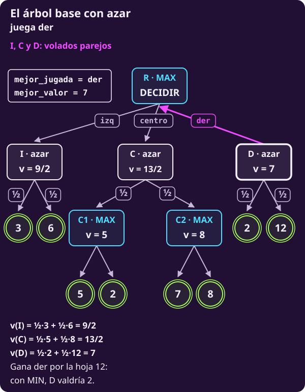
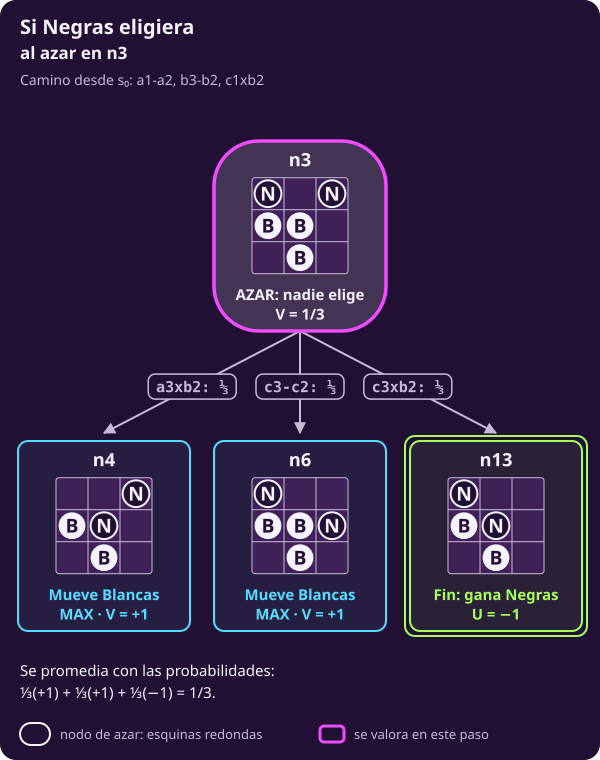

# Cuando decide un dado: expectiminimax

**¿Qué cambia si un nodo no lo decide nadie?**

Cambia una operación: ese nodo no toma el máximo ni el mínimo, sino el
**promedio ponderado** de sus hijos. Minimax con nodos de azar se llama
**expectiminimax**.

Al terminar tendrás:

- **un tercer tipo de nodo**, el de azar, y la regla para valorarlo;
- **el pseudocódigo y el Python de expectiminimax**, con su traza en el
  árbol base con dados;
- sus **propiedades** y sus **casos borde**, y los dos errores de modelado
  más comunes con el azar.

## Lo que traes

- **Las reglas generan el juego.** $S_F$ reconoce finales
  (@jue-c1-finales); $\mathrm{Pl}(s)$ lee quién mueve (@jue-c1-pl); $A(s)$
  enumera jugadas (@jue-c1-acciones); $T(s,a)$ produce el siguiente estado
  (@jue-c1-transicion); $U$ paga los finales, siempre desde MAX
  (@jue-c1-utilidad).
- **El valor se mide desde MAX.** $V(s)$ es el pago para MAX si los dos
  juegan lo mejor desde $s$, y $Q(s,a)=V(T(s,a))$ valora una jugada
  (@jue-c1-valor-jugada-estrategia). MAX elige el mayor $Q$ y MIN, el menor
  (@jue-c2-valor).
- **Ya tienes el algoritmo sin azar.** DECIDIR-MINIMAX y MINIMAX están en
  [[minimax-como-algoritmo|Minimax como algoritmo]]; esta página les agrega
  un caso. [[alfa-beta|Alfa-beta]] poda las ramas que ya no pueden cambiar
  la decisión.

> **Las reglas, en cuatro líneas.** Tablero de 3×3; Blancas (B) abajo en la
> fila 1 y Negras (N) arriba en la fila 3. Empiezan Blancas. Un peón avanza
> una casilla si está vacía o captura en diagonal hacia delante. Gana quien
> llega a la fila del rival, captura todos los peones rivales o deja al rival
> sin jugada; ganar vale $+1$ y perder, $-1$.

> **Supuestos de esta página.** Los de
> [[escribir-el-juego|Escribir el juego]] **salvo uno**: ya no es
> determinista. Algunos nodos los decide el azar, con probabilidades
> conocidas. En [[diagnosticar-el-juego|Diagnosticar el juego]], un juego
> así pedía un árbol con nodos de azar.

> [!TIP]
> **Míralo correr: expectiminimax en el árbol base**
>
> - **▶ [Animación paso a paso](../_assets/traza_arbol_t.html#azar)**: el árbol, la línea del
>   código que corre y el valor de cada variable. Avanza con ▶ o con las flechas.
> - **Notebook en Colab**, sección 4: el mismo Python de esta página,
>   corriendo; cámbiale un número y mira qué pasa.
>
> [](https://colab.research.google.com/github/raya-lucaria/ia_o26/blob/main/course/7_juegos/_assets/01_decidir_en_el_arbol_t.ipynb)

---

## 1 · El problema, en general, cuando hay azar

**Piensa: ¿qué le falta al juego de la clase 1 para poder describir un
dado?**

Una sola pieza: **las probabilidades**. Un juego con azar es la tupla de
@jue-c1-juego con una pieza más, $\Pr$:

$$\bigl(S,\ s_0,\ S_F,\ \mathrm{Pl},\ A,\ T,\ \Pr,\ U\bigr).$$

Las demás piezas **conservan su función**, pero algunas definiciones se
amplían. La principal: **el estado guarda también quién controla la
siguiente transición**, y $\mathrm{Pl}(s)$ lo lee. Ese control puede ser de
MAX, de MIN o del azar.

::: table {#jue-c2-azar-cambia title="Qué cambia cuando hay azar"}
| Pieza | Con azar |
|---|---|
| $S$, $s_0$ | Se amplían: el estado guarda si toca tirar |
| $\mathrm{Pl}(s)$ | MAX, MIN o **AZAR**: quién controla la transición |
| $A(s)$ | En un nodo de azar, los **resultados** posibles |
| $T(s,a)$ | Lleva cada jugada o resultado a su estado |
| $\Pr(a\mid s)$ | **Nueva:** la probabilidad de cada resultado en $s$; suman 1 |
| $S_F$, $U$ | Igual: $U$ paga los finales desde MAX |
| $V(s)$ | Lo que MAX obtiene **en esperanza**. *Antes, lo que asegura* |
| Ser racional | Buscar la mayor utilidad **esperada** |
:::

Sin azar, la utilidad esperada y la asegurada eran la misma; con azar se
separan.

> **Repaso de valor esperado.** Si un resultado aleatorio vale
> $x_1,\dots,x_n$ con probabilidades $p_1,\dots,p_n$, que suman 1, su
> **valor esperado** es $E[x]=p_1x_1+\cdots+p_nx_n$. Es el promedio
> ponderado: lo que obtendrías en promedio si repitieras la situación muchas
> veces. Por ejemplo, ganar 6 con probabilidad $1/2$ y 0 con $1/2$ vale en
> promedio 3.

Con eso, el problema de la unidad (@jue-c1-problema) se escribe igual,
salvo por una palabra:

::: definition {#jue-c2-problema-azar title="El problema, con azar"}
**Dado:** las reglas del juego con azar,
$\bigl(S,\ s_0,\ S_F,\ \mathrm{Pl},\ A,\ T,\ \Pr,\ U\bigr)$, con las
probabilidades conocidas.

**Encontrar:** en cada estado no final $s$ donde le toca a MAX, una jugada

$$a^{∗}\in\operatorname*{arg\,max}_{a\in A(s)} Q(s,a),\qquad Q(s,a)=V\bigl(T(s,a)\bigr),$$

donde $V$ toma el máximo en los nodos de MAX, el mínimo en los de MIN y la
**esperanza** en los de azar. La regla @jue-c2-valor-esperado lo escribe
completo.

**Qué significa:** MAX elige la jugada con la mayor utilidad **esperada**,
suponiendo que MIN es racional y que el azar sigue sus probabilidades. Es
la definición de racional de @jue-c1-racional, que ya decía «la jugada que
**espera** que le dé la mayor utilidad»: con azar, esa palabra trabaja.

**Qué no es:** no garantiza ganar ninguna partida concreta. Un dado puede
salir mal; lo que se maximiza es la utilidad esperada.
:::

**Lo que dicen las reglas y lo que elige alguien.** En un nodo de azar,
$\Pr$ es un **dato** del juego, como $T$. Nadie la elige: viene en el
reglamento (un dado justo da $1/6$ a cada cara) o en lo que sabemos del
rival.

Hexapawn no tiene dados. Para ver el azar sin cambiar de juego, le
agregamos dos cosas: un volado antes de empezar y un rival que mueve sin
pensar. Los dos son **casos de este problema**.

---

## 2 · El algoritmo, de principio a fin

### Expectiminimax

**Expectiminimax recorre el árbol hasta los finales, como minimax, y en
los nodos de azar sube una esperanza.** Cada nodo vale lo que MAX obtiene
en promedio desde ahí si los dos juegan lo mejor.

- **Qué valor rastrea:** $V(s)$, ahora el pago **esperado** para MAX bajo
  juego óptimo; el de una jugada o un resultado es el de su hijo,
  $Q(s,a)=V(T(s,a))$.
- **Dónde lo guarda:** en la $v$ de cada llamada abierta, como minimax; en
  la raíz, en mejor_valor.
- **Cómo sube:** máximo en MAX, mínimo en MIN y **suma ponderada por
  $\Pr(a\mid s)$** en AZAR.
- **A qué converge:** no necesita converger. Las probabilidades son dato:
  calcula esperanzas exactas, sin muestrear.

::: figure {#jue-c2-fig-flujo-expectiminimax title="Expectiminimax, en palabras"}

:::

#### 1 · Exploración: cómo obtiene su número

**Los pasos.** Son los de minimax, en profundidad y en el orden de $A(s)$,
con un caso más al subir:

1. **Bajar.** Genera los hijos del nodo y baja por el primero, hasta un
   final.
2. **Valorar el final.** Su valor es su pago: $V(s)=U(s)$.
3. **Subir el valor.** En MAX se queda con el mayor; en MIN, con el menor;
   en AZAR **suma** $\Pr(a\mid s)$ por el valor del hijo.
4. **Cerrar el nodo.** Con todos sus hijos revisados, su valor queda fijo.
   **Un nodo de azar necesita todos sus resultados:** cada uno pesa en la
   suma.

**El nodo de azar.**

**Piensa: si un volado decide quién empieza, ¿quién elige en ese primer
nodo?**

Nadie. Antes de la primera jugada se tira una moneda, y esa transición no
la controla ningún jugador: la controla el **azar**, con probabilidades
conocidas.

::: definition {#jue-c2-nodo-azar title="Nodo de azar"}
En un juego con azar, $\mathrm{Pl}(s)$ dice quién controla la siguiente
transición:

$$\mathrm{Pl}: S\setminus S_F\to\{\text{MAX},\ \text{MIN},\ \text{AZAR}\}.$$

En un estado con $\mathrm{Pl}(s)=\text{AZAR}$:

- $A(s)$ son los **resultados posibles**: las caras del dado, los lados de
  la moneda. Un resultado $a$ es la etiqueta de una transición, no una
  jugada que alguien elija;
- cada resultado $a\in A(s)$ ocurre con probabilidad $\Pr(a\mid s)>0$, y
  esas probabilidades suman 1. Un resultado imposible no entra en $A(s)$;
- $T(s,a)$ sigue siendo el estado al que se llega con ese resultado.

**Qué significa:** el estado incluye esa fase, «toca tirar», igual que
incluye el turno; $\mathrm{Pl}$ la lee como lee el turno (@jue-c1-pl).

**Qué no es:** un nodo de azar no es un jugador. No quiere nada: no busca
valores altos ni bajos.
:::

**La regla.** Con eso, la regla de @jue-c2-valor gana un renglón:

::: definition {#jue-c2-valor-esperado title="Valor con nodos de azar"}
| Nodo | Su valor |
|---|---|
| Final | $\mathbf{V(s)=U(s)}$ |
| $\mathrm{Pl}(s)=$ MAX | $\mathbf{V(s)=\max_{a\in A(s)} Q(s,a)}$ |
| $\mathrm{Pl}(s)=$ MIN | $\mathbf{V(s)=\min_{a\in A(s)} Q(s,a)}$ |
| $\mathrm{Pl}(s)=$ AZAR | $\mathbf{V(s)=\sum_{a\in A(s)}\Pr(a\mid s)\,Q(s,a)}$ |

El último renglón es una esperanza exacta, $E[Q(s,a)]$ con $a$ sorteado
según $\Pr(\cdot\mid s)$. No lleva gorro: se enumeran todos los
resultados, no se estima nada.

**Qué significa:** quien tiene intereses, optimiza; lo que no los tiene, se
promedia.

**Qué no es:** con azar, $V(s)$ ya no es lo que MAX asegura **en cada
partida**. Una estrategia óptima le asegura al menos $V(s)$ **en utilidad
esperada**, bajo ese modelo de azar.
:::

**Dos nombres.** **Expectiminimax** tiene nodos de MAX, MIN y AZAR;
**expectimax** solo de MAX y AZAR. Los dos enumeran esperanzas exactas.

**Cada parte tiene su papel:**

- **El pago $U(s)$ detiene la cuenta:** al llegar a un final ya no hay
  nada que calcular.
- **MAX y MIN eligen:** MAX se queda con el mayor $Q$; MIN, con el menor,
  siempre medido desde MAX.
- **La probabilidad pondera cada resultado:** un hijo aporta
  $\Pr(a\mid s)\,Q(s,a)$ a la suma, y ninguno se puede omitir.

**Ejemplo mínimo.** MAX elige entre $a$ y $b$, y debajo de cada una hay el
mismo par de finales, $+1$ y $-1$. Solo cambia quién decide:

::: table {#jue-c2-tab-abstracto-azar title="El mismo par de finales, dos nodos distintos"}
| Jugada | Quién decide | $Q$ |
|---|---|---:|
| $a$ | MIN | $-1$ |
| $b$ | Un volado parejo | $\tfrac12(+1)+\tfrac12(-1)=0$ |
:::

**MAX juega $b$.** Si $b$ también fuera de MIN, valdría $-1$ como $a$.
**Donde decide un rival se toma el mínimo; donde decide el azar, el
promedio.**

**Primer ejemplo: un volado decide quién empieza.** El juego nuevo empieza
antes del tablero: su estado inicial $s_0$ es el volado, con el tablero
inicial y la transición en manos del azar. Con águila empieza Blancas; con
sol, Negras:

- **Águila, probabilidad $1/2$:** lleva a $s_B=T(s_0,\text{águila})$, el
  inicio de siempre. $V(s_B)=-1$: gana quien juega segundo.
- **Sol, probabilidad $1/2$:** lleva a $s_N=T(s_0,\text{sol})$. Ahora
  Blancas juega segundo, y por simetría gana: $V(s_N)=+1$.

Como nadie elige, se **promedia**:

$$V(s_0)=\tfrac12V(s_B)+\tfrac12V(s_N)=\tfrac12(-1)+\tfrac12(+1)=0.$$

El volado vuelve **justo** un juego que no lo era: ninguno de los dos tiene
ventaja antes de tirar la moneda.

**El código.**

**Piensa: ¿cuántas líneas hay que agregarle a DECIDIR-MINIMAX y MINIMAX?**

Seis, todas al final: el caso del azar. Las líneas 1 a 20 son las de
[[minimax-como-algoritmo|Minimax como algoritmo]]; solo la 15 deja de ser
un «else» a secas, porque ahora hay un tercer caso.

**El invariante:** tras cada hijo terminado, $v$ es el máximo (en MAX), el
mínimo (en MIN) o la **suma ponderada parcial** (en AZAR) de los valores
recibidos. Solo al cerrar el último hijo vale $V(s)$.

```text
INPUT   un estado s donde mueve MAX; las
        reglas S_F, Pl, A, T y U de un juego
        finito por turnos, con
        Pl(s) ∈ {MAX, MIN, AZAR}; y las
        probabilidades Pr(a | s). No recibe
        el grafo.
OUTPUT  una jugada de A(s) con el mayor
        valor esperado.

 1 function DECIDIR-EXPECTIMINIMAX(s)
 2   mejor_valor ← −∞ ; mejor_jugada ← ninguna
 3   for each a in A(s)
       # cuánto vale a, en esperanza
 4     w ← EXPECTIMINIMAX(T(s, a))
       # estricto: un empate deja la primera
 5     if w > mejor_valor:
         mejor_valor ← w ; mejor_jugada ← a
 6   return mejor_jugada      # la jugada, no w

 7 function EXPECTIMINIMAX(s)
 8   if s ∈ S_F: return U(s)  # final: su U
 9   if Pl(s) = MAX
10     v ← −∞
11     for each a in A(s)
12       w ← EXPECTIMINIMAX(T(s, a))
13       v ← max(v, w)        # el mayor
14     return v
15   else if Pl(s) = MIN
16     v ← +∞
17     for each a in A(s)
18       w ← EXPECTIMINIMAX(T(s, a))
19       v ← min(v, w)        # el menor
20     return v
21   else                     # Pl(s) = AZAR
     # nadie elige: se suman todos
22     v ← 0                  # suma, no ±∞
23     for each a in A(s)     # a: un resultado
24       w ← EXPECTIMINIMAX(T(s, a))
25       v ← v + Pr(a | s) · w   # pesa su Pr
26     return v               # valor esperado
```

El mismo procedimiento en Python, línea por línea. `pr(s, a)` es
$\Pr(a\mid s)$; el número entre paréntesis es la línea del pseudocódigo:

```python
from math import inf

# Las reglas: es_final(s), pl(s), acciones(s),
# transicion(s, a), utilidad(s) y pr(s, a).
# pl(s) da "MAX", "MIN" o "AZAR".

def decidir_expectiminimax(s):  # (1)
    # (2) Aún no ha visto ninguna jugada.
    mejor_valor = -inf
    mejor_jugada = None
    for a in acciones(s):       # (3)
        # (4) ¿Cuánto vale a, en promedio?
        w = expectiminimax(transicion(s, a))
        # (5) Solo si mejora estrictamente.
        if w > mejor_valor:
            mejor_valor = w
            mejor_jugada = a
    return mejor_jugada         # (6) jugada

def expectiminimax(s):          # (7)
    if es_final(s):             # (8) su U
        return utilidad(s)
    if pl(s) == "MAX":          # (9)
        v = -inf                # (10)
        for a in acciones(s):   # (11)
            w = expectiminimax(  # (12)
                transicion(s, a))
            v = max(v, w)       # (13) mayor
        return v                # (14)
    elif pl(s) == "MIN":        # (15)
        v = inf                 # (16)
        for a in acciones(s):   # (17)
            w = expectiminimax(  # (18)
                transicion(s, a))
            v = min(v, w)       # (19) menor
        return v                # (20)
    else:                       # (21) AZAR
        v = 0                   # (22) desde 0
        for a in acciones(s):   # (23) todos
            w = expectiminimax(  # (24)
                transicion(s, a))
            v = v + pr(s, a) * w  # (25)
        return v                # (26)
```

::: table {#jue-c2-t-que-cambia-azar title="Qué cambia respecto de minimax"}
| Líneas | Qué hacen |
|---|---|
| 1–14 y 16–20 | Lo mismo que en minimax |
| 15 | Pregunta si mueve MIN |
| 22 | $v$ empieza en 0, no en $\mp\infty$ |
| 25 | **Suma** $\Pr(a\mid s)\cdot w$ de todos los hijos |
:::

Igual que minimax, **recibe las reglas y genera los estados** mientras
recorre. En un nodo de azar hay que valorar **todos** los resultados,
porque todos cuentan en el promedio.

**El ejemplo: el árbol base con dados.**

**Piensa: si I, C y D los decidiera una moneda, ¿seguiría ganando centro?**

No: gana der. Toma el árbol base de
[[minimax-como-algoritmo|Minimax como algoritmo]] y cambia una sola cosa:
**I, C y D son nodos de azar**, cada hijo con probabilidad $\tfrac12$. R,
C1 y C2 siguen siendo de MAX.

::: figure {#jue-c2-t-fig-azar title="El árbol base con I, C y D de azar"}

:::

> **▶ [Recorre esta traza paso a paso](../_assets/traza_arbol_t.html#azar)** — el árbol, el pseudocódigo con la línea que corre y el valor de cada variable.

**Cómo leer la traza.** Tiene el formato de
[[minimax-como-algoritmo|Minimax como algoritmo]], con dos cambios:

- **Una fila al entrar a un nodo de azar** (línea 22, $v=0$) y **una por
  cada hijo que regresa** (líneas 24–25 en el azar, 4–5 en la raíz).
- **C1 y C2 se valoran como en minimax** y aquí solo devuelven su $w$.
- **En las filas de R**, $v$ es mejor_valor, y la columna jugada lleva
  mejor_jugada («—» si ninguna).

**Tramo 1 · izq**

::: table {#jue-c2-t-traza-azar title="Traza de DECIDIR-EXPECTIMINIMAX en el árbol base"}
| # | línea · pila | v | w | jugada |
|---:|---|---:|---|---|
| 1 | 2 · R | −∞ |  | — |
| 2 | 22 · R›I | 0 |  | — |
| 3 | 24–25 · R›I | 3/2 | 3 | — |
| 4 | 24–25 · R›I | 9/2 | 6 | — |
| 5 | 4–5 · R | 9/2 | 9/2 (I) | izq |
:::

- **Fila 3:** la hoja 3 pesa $\tfrac12$: $v=0+\tfrac12\cdot3=3/2$.
- **Fila 5:** $9/2>-\infty$: mejor_jugada pasa a **izq**.

**Tramo 2 · centro**

| # | línea · pila | v | w | jugada |
|---:|---|---:|---|---|
| 6 | 22 · R›C | 0 |  | izq |
| 7 | 24–25 · R›C | 5/2 | 5 (C1) | izq |
| 8 | 24–25 · R›C | 13/2 | 8 (C2) | izq |
| 9 | 4–5 · R | 13/2 | 13/2 (C) | centro |

- **Fila 8:** C completa $\tfrac12\cdot5+\tfrac12\cdot8=13/2$.
- **Fila 9:** $13/2>9/2$: mejor_jugada pasa a **centro**.

**Tramo 3 · der**

| # | línea · pila | v | w | jugada |
|---:|---|---:|---|---|
| 10 | 22 · R›D | 0 |  | centro |
| 11 | 24–25 · R›D | 1 | 2 | centro |
| 12 | 24–25 · R›D | 7 | 12 | centro |
| 13 | 4–5 · R | 7 | 7 (D) | der |
| 14 | 6 · R | 7 |  | der |

- **Fila 11:** $v=1$ es una **suma ponderada parcial**, $\tfrac12\cdot2$; no
  es el promedio de D.
- **Fila 12:** la hoja 12 completa la suma: $1+\tfrac12\cdot12=7$.
- **Fila 13:** $7>13/2$: mejor_jugada pasa a **der**, y la línea 6 la
  devuelve.

**En resumen:** mejor_jugada pasó de **ninguna → izq → centro → der**, y
el recorrido generó los mismos **14 nodos** que minimax. Con MIN en I, C y
D, minimax jugaba centro (5): D valía 2, el peor de sus hijos.

**Con azar gana der, gracias a la hoja 12.** A un MIN esa hoja no le
cambia nada: con el 2, D ya vale 2. A un promedio sí: cada hoja mueve el
resultado.

::: exercise {#jue-c2-t-ej-azar title="Cambia una moneda"}
En D, la hoja 2 sale ahora con probabilidad $\tfrac35$ y la hoja 12 con
$\tfrac25$. Lo demás no cambia.

1. ¿Cuánto vale D? ¿Qué jugada devuelve DECIDIR-EXPECTIMINIMAX(R)?
2. Si la hoja 2 sale con probabilidad $p$, ¿desde qué $p$ deja de jugar
   der?
:::

::: hint {#jue-c2-t-pista-azar of="jue-c2-t-ej-azar" title="Solo cambia el tramo de D"}
I y C no cambian. La línea 25 en D suma $\Pr(a\mid s)\cdot w$ con las
nuevas probabilidades, y la línea 5 compara ese número con $13/2$.
:::

::: answer {#jue-c2-t-resp-azar of="jue-c2-t-ej-azar"}
1. $V(\text{D})=\tfrac35\cdot2+\tfrac25\cdot12=6$. Como $6>13/2$ es falso,
   la línea 5 no cambia de jugada: devuelve **centro**.
2. $V(\text{D})=2p+12(1-p)=12-10p$, que es mayor que $13/2$ solo si
   $p<\tfrac{11}{20}$. Con $p=\tfrac{11}{20}$ empatan en $13/2$ y gana
   centro, que llegó primero: el $>$ de la línea 5 es estricto.
:::

**Ahora en hexapawn: un rival que mueve al azar.**

**Piensa: si sabes que Negras mueve sin pensar, eligiendo cualquier jugada
con la misma probabilidad, ¿sigue siendo un nodo MIN?**

> **El problema de esta parte.**
>
> **Dado:** el juego de hexapawn y un dato sobre el rival: Negras elige
> cada jugada al azar, todas con la misma probabilidad.
>
> **Encontrar:** cuánto vale n3 en promedio para Blancas, y qué apertura le
> conviene a Blancas en el inicio.

No. Un rival así no busca nada: es un dado con forma de persona. Es **un
modelo nuevo**: los estados con turno de Negras los controla el AZAR, con
$\Pr(a\mid s)=1/|A(s)|$: $1/2$ si tiene dos jugadas, $1/3$ si tiene tres.
Así queda n3, donde Negras tiene tres:

::: figure {#jue-c2-azar-n3 title="Si Negras eligiera al azar en n3"}

:::

$$V(\text{n3})=\tfrac13(+1)+\tfrac13(+1)+\tfrac13(-1)=\tfrac13.$$

Contra la Negras de [[minimax|Minimax a mano]], n3 valía $-1$. Contra una
que mueve al azar, vale $1/3$: Negras solo encuentra la captura ganadora
una de cada tres veces.

**El juego completo cambia más.** Con minimax, las tres aperturas de
Blancas valen $-1$: da igual cuál juegue. Si **todas** las jugadas de Negras
son al azar y Blancas sigue maximizando, la computadora calcula:

::: table {#jue-c2-rival-azar title="Las aperturas contra una Negras que mueve al azar"}
| Primera jugada | Contra Negras perfecta | Contra Negras al azar |
|---|---:|---:|
| $\text{a1}\textbf{-}\text{a2}$ | −1 | 5/9 |
| $\text{b1}\textbf{-}\text{b2}$ | −1 | 3/4 |
| $\text{c1}\textbf{-}\text{c2}$ | −1 | 5/9 |
:::

Contra un rival al azar, **$\text{b1}\textbf{-}\text{b2}$ es la mejor
apertura**. Minimax no podía decirlo: para él, las tres pierden igual.

- **Es expectimax:** solo hay nodos de MAX y de AZAR.
- **Su valor es el de ese modelo**, no el $V$ minimax de hexapawn: si
  Negras en realidad juega bien, el $3/4$ no se cumple.

**En el árbol de resultados.** El mismo algoritmo corre en el árbol de
juguete con finales $+1$, $0$ y $-1$, de 15 nodos, con una sola cosa
cambiada: **en D decide un dado parejo de tres caras**, no MIN.

::: figure {#jue-c2-fig-resultados-expectiminimax title="Expectiminimax en el árbol de resultados con un dado en D: juega der"}

:::

- **D vale el promedio de sus hojas:** $(-1+1+1)/3=1/3$. Supera el $0$ de
  centro y el $-1$ de I, así que juega **der** y genera los 15 nodos.
- **El $1/3$ es exacto, pero para otro juego.** No corrige a minimax: con
  MIN en D, der vale $-1$ y se juega centro.
- **Por eso D tiene tres hijos:** con dos, el dado nunca cambiaba la
  jugada.

::: exercise {#jue-c3-cmp-ej-dado title="Calcula el dado con otra hoja"}
Cambia d3 de ${+1}$ a ${-1}$, con el dado parejo en D.

1. ¿Cuánto vale D?
2. ¿Qué jugada entrega expectiminimax?
:::

::: hint {#jue-c3-cmp-pista-dado-1 of="jue-c3-cmp-ej-dado" title="Cuántas caras pierden"}
¿Cuántas de las tres caras dan ${-1}$ ahora, y cuántas ${+1}$?
:::

::: answer {#jue-c3-cmp-resp-dado of="jue-c3-cmp-ej-dado"}
1. D vale ${(-1+1-1)/3=-1/3}$.
2. **Centro**, con $0$: ${-1/3}$ ya no supera a centro. El dado solo cambia
   la jugada si el promedio de D le gana a lo que MAX obtiene en otra
   rama.
:::

#### 2 · Elección: qué jugada juega

**Cuando la raíz cerró todas sus jugadas**, juega la de **mayor $Q$
esperado**. Si varias empatan, juega la primera en el orden de $A(s)$: el
$>$ de la línea 5 es estricto.

::: table {#jue-c2-tab-eleccion-azar title="Explorar y jugar con expectiminimax"}
| Decisión | Qué compara | Cuándo |
|---|---|---|
| Explorar | $Q$; máximo, mínimo o esperanza | En cada nodo |
| Jugar | $Q$ esperado; mejora estricta | Al cerrar la raíz |
:::

- **Explorar y jugar usan el mismo número.** La elección es la regla del
  máximo aplicada en la raíz, guardando qué jugada lo alcanzó.
- **Solo MAX y MIN eligen.** En un nodo de azar no hay jugada que
  entregar: el resultado lo decide el dado.

#### 3 · Propiedades

- **Número que da:** el $Q$ esperado exacto de cada jugada de la raíz y
  $V(s_{\text{raíz}})$ del juego con azar. El algoritmo no tira dados:
  enumera todos los resultados con su $\Pr(a\mid s)$.
- **Usa EVAL:** no. Solo lee la $U$ de los finales; su escala importa,
  porque se promedia.
- **Garantía:** calcula exactamente la utilidad esperada óptima con
  probabilidades conocidas. Siguiendo su jugada, MAX obtiene al menos $V$
  en esperanza contra cualquier MIN; no garantiza el resultado de una
  partida.
- **Se puede interrumpir:** no es *anytime*. Como minimax, entrega solo al
  cerrar la raíz; interrumpido, no garantiza nada.
- **Complejidad:** genera cada nodo una vez: tiempo $O(b^m)$ y memoria
  $O(bm)$, donde $b$ cuenta también resultados del azar y $m$, decisiones
  y tiradas.
- **Frente a los demás:** si en el mismo árbol se cambia MIN por AZAR, no
  genera más nodos que minimax (14 y 14 en el árbol base); agregar tiradas
  sí agranda el árbol, y el volado lo duplica. Conviene en juegos chicos
  con dado o volado que caben enteros, como hexapawn con volado. En
  backgammon no cabe: TD-Gammon miraba dos jugadas y estimaba el resto.
- **Supuestos:** árbol finito, por turnos, todo a la vista, dos jugadores
  de suma cero o constante, y un azar con probabilidades conocidas y
  fijas.

#### 4 · Casos borde

- **Empate en la raíz:** entrega la primera de las empatadas, como
  minimax; con $p=11/20$ en @jue-c2-t-ej-azar gana centro.
- **Una sola jugada o un dado de una cara:** queda forzada. Un nodo de azar
  con un solo resultado, de probabilidad 1, copia el valor de su hijo.
- **Un resultado de probabilidad 0:** no entra en $A(s)$; no pesa en la
  suma.
- **La raíz ya es final:** EXPECTIMINIMAX devuelve su $U$, pero DECIDIR no
  tiene jugada que devolver.
- **La raíz es de azar, como el volado:** no hay jugada que decidir; solo
  se calcula $V(s_0)$ con EXPECTIMINIMAX.
- **MIN se equivoca:** MAX obtiene más que $V$ en esperanza, nunca menos.
- **Finales a distintas profundidades:** no prefiere ganar pronto ni perder
  tarde, salvo que $U$ lo codifique.
- **Una jugada aún sin revisar:** su $Q$ es desconocido, no cero. Por eso
  una interrupción no garantiza la jugada.
- **Una respuesta certera que llega tarde:** en MIN baja el mínimo en
  cuanto regresa; en AZAR pesa solo su probabilidad.
- **La poda de alfa-beta no se traslada tal cual.** Una jugada segura vale
  3; otra da 0 o 10 al 50 %. Ver el 0 no permite descartarla: vale 5. Con
  cotas conocidas de $U$ hay extensiones que sí podan (*-minimax, Ballard
  1983).
- **Probabilidades estimadas:** si $\Pr(a\mid s)$ viene de observar al
  rival, el cálculo es exacto para el modelo, pero el modelo puede estar
  equivocado.
- **Dos jugadores, suma no constante:** cada final lleva $(U_1,U_2)$; el
  segundo maximiza $U_2$, que no necesariamente minimiza $U_1$.
- **Más jugadores:** con $(U_1,\dots,U_n)$, quien mueve maximiza su
  componente, como en $\max^n$, y AZAR promedia componente por componente.
  Se pierde la garantía escalar de minimax.

---

#### Intuición

**Dos errores de modelado.**

**Piensa: ¿qué pasa si te equivocas de tipo de nodo?**

Hay dos maneras de equivocarse, una en cada dirección:

::: table {#jue-c2-errores-azar title="Confundir el azar con un rival, y al revés"}
| Error | Lo que calculas | Efecto |
|---|---|---|
| MIN donde Negras mueve al azar | Tres aperturas de $-1$ | Demasiado prudente |
| AZAR donde Negras juega perfecto | $\text{b1}\textbf{-}\text{b2}$ gana con $p=7/8$ | Demasiado optimista |
:::

- **Tratar al azar como rival:** te da igual qué apertura jugar y pierdes
  lo que hacía mejor a $\text{b1}\textbf{-}\text{b2}$. Supones lo peor de
  algo que no quiere nada.
- **Tratar al rival como azar:** crees que ganas con probabilidad $7/8$ y,
  contra Negras perfecta, pierdes siempre. Le das a un rival de verdad la torpeza de
  un dado.

 La regla es la de la definición: **quien
tiene intereses, optimiza; lo que no los tiene, se promedia.**

El segundo error tiene un pariente con nombre: **Monte Carlo plano**, que
estima jugando partidas al azar, supone que el rival mueve al azar, y
también MAX después de su primera jugada. Su número es el de ese juego, no
$V$.

**Con azar importan las distancias.**

**Piensa: si cambias los números de los finales sin cambiar su orden,
¿cambia la decisión?**

Con minimax, no: elegir el máximo o el mínimo solo depende del orden. Con
azar, sí, porque un promedio depende de **cuánto** valen los finales.

- **En el árbol base:** si la hoja 12 valiera 9, seguiría siendo la mayor
  y minimax no cambiaría. Pero D bajaría a $\tfrac12\cdot2+\tfrac12\cdot9=11/2<13/2$,
  y expectiminimax jugaría centro.
- **En hexapawn con empate:** en la variante de la
  [[tarea-leer-y-escribir|tarea de la clase 1]], quedarse sin jugada es
  empate y vale 0. Si Blancas elige entre un **empate seguro** y un
  **volado** entre ganar y perder, con $+1$ y $-1$ el volado vale
  $\tfrac12(+1)+\tfrac12(-1)=0$, igual que el empate.
- **Mover un solo resultado cambia la decisión:** con ganar $+1$ y perder
  $-2$, el orden no cambia, pero el volado vale
  $\tfrac12(+1)+\tfrac12(-2)=-\tfrac12$. Ahora conviene el empate.

Por eso, con azar, la utilidad tiene que medir **cuánto** se prefiere cada
resultado, no solo cuál es mejor. El cambio de escala de
[[escribir-el-juego|Escribir el juego]], que pasa 1, ½ y 0 a $+1$, 0 y $-1$,
sigue siendo seguro: estira todas las distancias por igual. Lo que cambia la
decisión es mover un resultado más que los otros, como aquí el de perder.

**Decide lo que MAX obtiene en esperanza, no el peor final ni el mejor.**

---

#### Ejercicios

**Piensa: ¿puedes pasar de un valor esperado a una probabilidad de ganar, y
decidir cuándo vale la pena arriesgar?**

::: exercise {#jue-c2-ej-probabilidad title="Decide qué probabilidad de ganar da el valor"}
Con $U=\pm1$ y sin empates, un valor esperado $V$ y la probabilidad $p$ de
que gane Blancas cumplen $V=p\cdot(+1)+(1-p)\cdot(-1)$.

1. Despeja $p$ en función de $V$.
2. ¿Con qué probabilidad gana Blancas en n3 contra una Negras al azar?
3. ¿Y con cada apertura de @jue-c2-rival-azar?
:::

::: hint {#jue-c2-pista-probabilidad of="jue-c2-ej-probabilidad" title="Una ecuación lineal"}
Desarrolla el lado derecho: queda $V=2p-1$. Despeja $p$ y sustituye cada
valor de la tabla.
:::

::: answer {#jue-c2-resp-probabilidad of="jue-c2-ej-probabilidad"}
1. $V=2p-1$, así que $p=\dfrac{V+1}{2}$.
2. En n3, $p=\dfrac{1/3+1}{2}=\dfrac23$.
3. $\text{a1}\textbf{-}\text{a2}$ y $\text{c1}\textbf{-}\text{c2}$:
   $p=\dfrac{5/9+1}{2}=\dfrac79$. $\text{b1}\textbf{-}\text{b2}$:
   $p=\dfrac{3/4+1}{2}=\dfrac78$. Abriendo por el centro, Blancas tiene
   probabilidad $7/8$ de ganar si sigue jugando óptimamente contra ese
   rival uniforme.
:::

::: exercise {#jue-c2-ej-escala title="Decide si tiras el volado"}
Ganar vale $+1$ y empatar, 0. ¿Para qué valores de perder, $-L$ con $L>0$,
conviene el volado sobre el empate seguro? ¿Qué pasa en el límite?
:::

::: hint {#jue-c2-pista-escala of="jue-c2-ej-escala" title="Compara con cero"}
El volado vale $\tfrac12(+1)+\tfrac12(-L)$. ¿Cuándo es mayor que 0?
:::

::: answer {#jue-c2-resp-escala of="jue-c2-ej-escala"}
El volado vale $\dfrac{1-L}{2}$. Es mayor que 0 cuando $L<1$: **conviene si
perder cuesta menos de lo que vale ganar**. Con $L=1$ empatan, y con
$L>1$ conviene el empate. El orden «perder < empatar < ganar» es el mismo en
los tres casos; lo que cambia la decisión es la distancia entre ellos.
:::

**Punto de control:** deberías poder valorar un árbol con nodos MAX, MIN y
de azar, decir para cada nodo si se maximiza, se minimiza o se promedia, y
explicar qué error comete quien confunde un rival con el azar.

> [!NOTE]
> **Lo que ya viste.** Los algoritmos de la unidad hasta esta página, en el orden del curso.
>
> | Algoritmo | Qué número da |
> |---|---|
> | Minimax | $V$; lo garantiza |
> | **Expectiminimax (estás aquí)** | **El $V$ del juego con dado; lo garantiza** |
>
> **Lo que viene.**
>
> - **Alfa-beta**: la misma jugada que mirar todo, sin generar las ramas que ya no pueden cambiar la decisión. Clase 2, [[alfa-beta|Alfa-beta a mano]].
> - **Minimax con corte**: mirar unas cuantas jugadas y estimar a ojo lo que queda debajo, para cuando el árbol no cabe. Clase 3, [[cortar-y-evaluar|Cortar y evaluar a mano]].
> - **Búsqueda de quietud**: no detenerse a estimar a mitad de un intercambio de capturas. Clase 3, [[mas-alla-del-horizonte|Más allá del horizonte]].
> - **Profundización iterativa**: buscar cada vez un poco más hondo, con una jugada siempre lista para cuando se acabe el tiempo. Clase 3, [[jugar-contra-el-reloj|Jugar contra el reloj]].
> - **Monte Carlo plano**: estimar cada jugada jugando muchas partidas al azar hasta el final, sin escribir ninguna estimación. Clase 3, [[simular-en-vez-de-evaluar|Simular en vez de evaluar]].
> - **MCTS con UCT**: construye un árbol: elige por puntaje dentro de él, lo hace crecer, simula desde la hoja y sube el resultado; manda más partidas a lo que va mejor sin dejar de probar lo otro. Clase 3, [[simular-en-vez-de-evaluar|Simular en vez de evaluar]].

## Lo que hay que llevarse

- **Con azar, el juego gana una pieza,** $\Pr(a\mid s)$, y el estado guarda
  quién controla la transición: MAX, MIN o AZAR. MAX busca la mayor
  utilidad **esperada**, no la asegurada.
- **Un nodo de azar no elige:** se valora con la esperanza exacta
  $\sum_a\Pr(a\mid s)\,Q(s,a)$. El volado vale 0; contra una Negras al azar
  la mejor apertura es $\text{b1}\textbf{-}\text{b2}$, con $3/4$.
- **Expectiminimax es DECIDIR y MINIMAX con un caso más:** $v$ empieza en
  0 y suma $\Pr(a\mid s)\cdot w$ de **todos** los hijos. En el árbol base
  con monedas juega der (7), gracias a la hoja 12 que a un MIN no le
  cambiaba nada.
- **Tratar al azar como rival te vuelve demasiado prudente;** tratar a un
  rival como azar, demasiado optimista.
- **Con azar importan las distancias** entre utilidades, no solo su orden.

Continúa con [[tarea-mirar-todo-y-podar|la tarea de la clase 2]].
