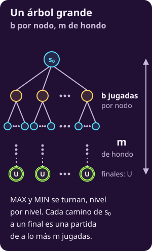
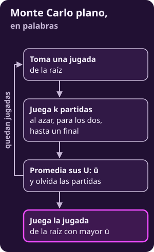
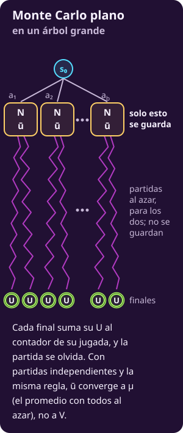
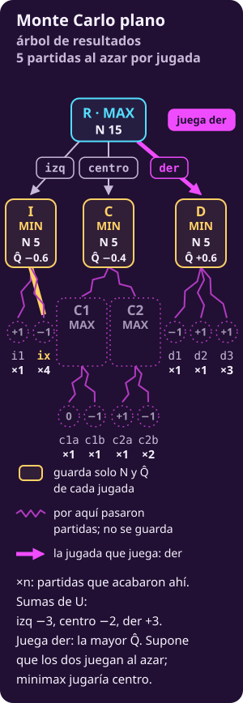
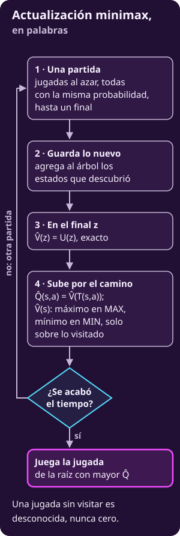

# Simular partidas: promedios y actualización minimax

**¿Cómo puedes elegir una jugada sin recorrer todo el árbol ni escribir una función de evaluación?**

Puedes simular partidas hasta un final. El número que obtengas dependerá de cómo uses sus resultados.

- **Con Monte Carlo plano**, calcularás promedios que estiman el resultado de jugar al azar.
- **Con actualización minimax**, guardarás lo descubierto y subirás máximos y mínimos.
- **Con las trazas**, distinguirás una estimación, una jugada desconocida y un valor demostrado.

## Lo que traes

- **Las reglas generan el juego.** $S_F$ reconoce finales (@jue-c1-finales); $\mathrm{Pl}(s)$ lee quién mueve (@jue-c1-pl); $A(s)$ enumera jugadas (@jue-c1-acciones); $T(s,a)$ produce el siguiente estado (@jue-c1-transicion); $U$ paga los finales (@jue-c1-utilidad): $+1$ si gana MAX, $-1$ si gana MIN y $0$ si empatan.
- **El valor se mide desde MAX.** $V(s)$ supone juego óptimo de ambos; $Q(s,a)=V(T(s,a))$ valora una jugada (@jue-c1-valor-jugada-estrategia).
- **Cada turno tiene su operador.** MAX elige el mayor $Q$; MIN, el menor; AZAR promedia con $\Pr(a\mid s)$ (@jue-c2-valor-esperado).
- **El corte necesita una evaluación.** En [[cortar-y-evaluar|Cortar y evaluar]], $\mathrm{EVAL}$ estima lo que queda debajo de la frontera.

> **Las reglas del 4×4.** Las columnas son a–d y las filas, 1–4. Blancas (B, MAX) empieza con cuatro peones en la fila 1; Negras (N, MIN), en la fila 4.
>
> Empiezan Blancas. Un peón avanza una casilla vacía o captura en diagonal hacia delante. Gana quien llega a la fila rival, captura todo o deja al rival sin jugada. $U=+1$ si gana Blancas y $U=-1$ si gana Negras.

> **Supuestos.** Son juegos de dos jugadores por turnos, deterministas, de información perfecta y de suma cero (o constante). Buscar todos los finales cuesta demasiado y no tenemos una $\mathrm{EVAL}$ confiable. Jugar una partida al azar hasta el final sí resulta barato.

---

## 1 · Un árbol que no cabe

**Piensa: sin EVAL y sin tiempo para explorar todo, ¿qué sigue disponible?**

Siguen disponibles las reglas: con ellas se termina una partida y se lee su pago.

En este árbol, MAX y MIN alternan. Cada nodo tiene hasta $b$ jugadas y ninguna partida supera $m$. Los «…» indican que el dibujo continúa.

$$
\mathbf{U(s)}=
\begin{cases}
+1 & \text{si gana MAX},\\
0 & \text{si empatan},\\
-1 & \text{si gana MIN}.
\end{cases}
$$

- **El pago existe solo en los finales.** Un estado intermedio tiene valor $V$, pero todavía no tiene $U$.
- **La perspectiva permanece fija.** $+1$ favorece a MAX y $-1$ favorece a MIN, sin importar quién mueve.

::: figure {#jue-c3-mcg-fig-arbol title="Un árbol de juego grande"}

:::

### Qué cuesta cada alternativa

- **Minimax recorre todo.** Examina del orden de $b^m$ nodos.
- **Alfa-beta ahorra mediante poda.** Con orden perfecto baja a cerca de $b^{m/2}$; el crecimiento sigue siendo exponencial.
- **El corte reduce la profundidad.** Se detiene en $d$, pero depende de una buena $\mathrm{EVAL}$.

Una partida cuesta del orden de $m$ jugadas, frente a $b^m$ para explorar todas las continuaciones. Aquí suponemos que el presupuesto alcanza para muchas partidas.

> **Dado:** un estado no final $s_{\text{raíz}}$ donde mueve MAX, las reglas y un presupuesto de simulaciones. No hay función de evaluación.
>
> **Encontrar:** una jugada para MAX con la información reunida antes de agotar el presupuesto.

---

## 2 · Tres preguntas sobre una jugada

**Piensa: ¿qué significa decir que una jugada «vale» cierto número?**

Depende de cómo continuarán los dos jugadores. Llama $s'=T(s,a)$ al estado que resulta de jugar $a$ desde $s$.

| Pregunta | Número | Continuación |
|---|---|---|
| ¿Cuánto asegura MAX? | $Q(s,a)=V(s')$ | Ambos juegan óptimamente |
| ¿Cuánto paga al azar? | $Q_{\text{azar}}(s,a)$ | Ambos eligen uniformemente |
| ¿Qué estima el algoritmo? | $\widehat Q(s,a)$ | Depende de lo observado |

- **Los números sin gorro son exactos.** $Q$ y $Q_{\text{azar}}$ responden preguntas distintas sobre el mismo juego.
- **El gorro indica una estimación.** Cada algoritmo debe declarar qué valor intenta estimar y cómo cambia con los datos.

Para calcular $Q_{\text{azar}}$, tratamos a ambos jugadores como dados uniformes después de la jugada inicial:

$$
\mathbf{
V_{\text{azar}}(s)=
\begin{cases}
U(s) & \text{si }s\in S_F,\\
\displaystyle\sum_{a\in A(s)}
\frac{V_{\text{azar}}(T(s,a))}{|A(s)|}
& \text{si }s\notin S_F,
\end{cases}}
$$

$$
\mathbf{Q_{\text{azar}}(s,a)=V_{\text{azar}}(s')=E[U\mid s']}.
$$

La esperanza supone jugadas uniformes desde $s'$. **Cada camino pesa el producto de $1/|A(s)|$** en los estados que atraviesa. Por eso, en general, no basta promediar las hojas sin ponderarlas.

---

## 3 · Dos maneras de simular

Las dos fichas simulan partidas al azar hasta un final. Cambia qué guardan y cómo suben los resultados.

### Monte Carlo plano

**Piensa: ¿qué puedes aprender jugando muchas partidas al azar desde la misma jugada?**

Su pago promedio contra continuaciones al azar. Monte Carlo plano guarda ese promedio por jugada de la raíz, sin construir un árbol de búsqueda.

- **Qué valor rastrea:** $\widehat Q(s_{\text{raíz}},a)$ estima $Q_{\text{azar}}(s_{\text{raíz}},a)$.
- **Dónde lo guarda:** conserva un contador $N(s_{\text{raíz}},a)$ y una suma de pagos por jugada de la raíz.
- **Cómo sube:** no respalda valores entre estados: cada pago actualiza únicamente la jugada inicial.
- **A qué converge:** cada promedio converge a $Q_{\text{azar}}$ con probabilidad 1, si recibe infinitas simulaciones independientes bajo la misma regla de continuación.

::: figure {#jue-c3-fig-flujo-mc-plano title="Monte Carlo plano, en palabras"}

:::

::: definition {#jue-c3-simulacion title="Simulación"}
**Qué es.** Una simulación (*rollout*) recorre una partida desde un estado hasta un final. En cada turno elige uniformemente entre las jugadas legales.

**Cómo se calcula.** Su resultado es el pago $U$ del final. El promedio de muchas simulaciones desde $s'=T(s_{\text{raíz}},a)$ es $\widehat Q(s_{\text{raíz}},a)$.

**Qué significa.** Estima $Q_{\text{azar}}$: lo que paga la jugada cuando después ambos juegan al azar.

**Qué no es.** No demuestra cuánto asegura MAX. Una jugada puede ganar casi todas las simulaciones y perder contra una respuesta certera.
:::

Una **simulación** recorre una partida; una **corrida** ejecuta el algoritmo completo, con todas sus simulaciones.

#### 1 · Exploración: cómo obtiene su número

**La regla.** Fija un entero $k\ge1$. Para cada jugada $a$, en el orden dado, calcula $s'=T(s_{\text{raíz}},a)$ y repite:

1. **Simula hasta un final.** Desde $s'$, ambos eligen uniformemente; al terminar, lee $U$. Si $s'$ ya es final, toma directamente su pago.
2. **Actualiza la jugada inicial.** Suma $U$ a su acumulado y aumenta $N(s_{\text{raíz}},a)$ en una visita.
3. **Completa el presupuesto.** Repite hasta reunir $k$ simulaciones de esa jugada; después pasa a la siguiente.

$$
\mathbf{n=|A(s_{\text{raíz}})|\,k\le b\,k}
$$

$$
\mathbf{\widehat Q(s_{\text{raíz}},a)=\frac{\sum U}{N(s_{\text{raíz}},a)}}
$$

- **La suma incluye solo las partidas de $a$.** Una victoria aporta $+1$; una derrota, $-1$; un empate, $0$.
- **Cada simulación recorre un camino.** Los estados intermedios se olvidan; distintos recorridos pueden repetir exactamente las mismas jugadas.
- **El invariante está en la raíz.** El contador y la suma corresponden a todas las simulaciones terminadas de esa jugada, siempre desde MAX.

::: figure {#jue-c3-mcg-fig-mc-plano title="Monte Carlo plano en un árbol grande"}

:::

---

**Recorrido: calcular un promedio.**

**Piensa: MAX gana 7 de 10 simulaciones y pierde 3. ¿Qué promedio obtiene?**

Obtiene $0.4$, porque cada victoria suma $+1$ y cada derrota suma $-1$:

$$
\widehat Q=\frac{7\cdot(+1)+3\cdot(-1)}{10}=0.4.
$$

::: exercise {#jue-c3-ej-cinco title="Calcula dos promedios"}
Desde una jugada se completan 5 simulaciones.

1. **Primera muestra.** MAX gana 3 y pierde 2. ¿Cuánto vale $\widehat Q$?
2. **Segunda muestra.** MAX gana 2 y pierde 3. ¿Cuánto vale ahora?
:::

::: hint {#jue-c3-pista-cinco-1 of="jue-c3-ej-cinco" title="Qué suma cada partida"}
Escribe primero cuánto aporta una victoria y cuánto aporta una derrota.
:::

::: answer {#jue-c3-resp-cinco of="jue-c3-ej-cinco"}
1. **La primera da $0.2$.** $\widehat Q=(3-2)/5=0.2$.
2. **La segunda da $-0.2$.** $\widehat Q=(2-3)/5=-0.2$.

Cambiar una sola victoria por derrota mueve el promedio $0.4$. **Con pocas simulaciones, el número todavía brinca mucho.**
:::

**Recorrido: la posición de la clase.**

**Piensa: ¿la jugada con mejor promedio al azar también gana contra Negras jugando bien?**

Aquí sí: $\text{d2}\textbf{-}\text{d3}$.

La tabla calcula $Q_{\text{azar}}$ exactamente, sin muestrear, y muestra sus decimales redondeados. «Corte» usa profundidad 1 y la escala de $\mathrm{EVAL}$, con finales multiplicados por 100.

::: table {#jue-c3-simulaciones title="Lo que paga cada jugada al azar en la posición de la clase"}
| Jugada | $Q_{\text{azar}}(s,a)$ | Corte | $Q(s,a)$ |
|---|---:|---:|---:|
| $\text{a1}\textbf{-}\text{a2}$ | 0.21 | 2 | −1 |
| $\text{d2}\textbf{-}\text{d3}$ | **0.89** | 2 | +1 |
| $\text{d2}\textbf{x}\text{c3}$ | 0.15 | **13** | −1 |
:::

$Q_{\text{azar}}$ y $Q$ están en la escala de $U$, entre $-1$ y $+1$. La columna «Corte» está en otra escala.

**Aquí simular acierta:** favorece el avance ganador y deja última la captura. Las partidas incluyen muchas recapturas de Negras; así revelan que el peón adicional no dura.

**Recorrido: el árbol de resultados.**

**Piensa: ¿puede el promedio más alto recomendar una jugada que pierde?**

Sí. En este árbol recomendará der, aunque MAX debe jugar centro.

- **La raíz R pertenece a MAX.** Sus jugadas izq, centro y der llevan a I, C y D, donde mueve MIN.
- **I ofrece dos finales.** Sus pagos son $\text{i1}=+1$ e $\text{ix}=-1$.
- **C ofrece dos estados de MAX.** C1 tiene $\text{c1a}=0$ y $\text{c1b}=-1$; C2 tiene $\text{c2a}=+1$ y $\text{c2b}=-1$.
- **D ofrece tres finales.** Sus pagos son $\text{d1}=-1$, $\text{d2}=+1$ y $\text{d3}=+1$.

| Jugada | Cálculo con ambos al azar | $Q_{\text{azar}}$ | $Q$ |
|---|---|---:|---:|
| izq | $(1-1)/2$ | $0$ | $-1$ |
| centro | $((-1/2)+0)/2$ | $-1/4$ | $0$ |
| der | $(-1+1+1)/3$ | $1/3$ | $-1$ |

En centro, C1 promedia $(0-1)/2=-1/2$ y C2 promedia $(1-1)/2=0$. MAX se equivoca la mitad de las veces en ambos.

Con juego óptimo, MIN responde ix en I y d1 en D. En C elige C1, donde MAX asegura el empate con c1a.

**La cuenta que tienta:** si solo MIN jugara al azar, C1 valdría $0$ y C2 valdría $+1$. Centro daría $1/2$ y sería preferible a der. Las simulaciones uniformes también hacen jugar al azar a MAX.

> **Dado:** este árbol, 5 simulaciones por jugada, semilla 0 y orden izq, centro, der.
>
> **Encontrar:** los promedios y la jugada entregada. Cada tramo muestra el acumulado de una jugada.

**Tramo 1 · Simular izq.**

| # | Final | $U$ | Suma | $\widehat Q$ |
|---:|---|---:|---:|---:|
| 1 | ix | −1 | −1 | $-1$ |
| 2 | ix | −1 | −2 | $-1$ |
| 3 | i1 | +1 | −1 | $-1/3$ |
| 4 | ix | −1 | −2 | $-1/2$ |
| 5 | ix | −1 | −3 | $-3/5$ |

**Fila 3:** una victoria sube el promedio, aunque MIN conserva la respuesta ix que hace perder a MAX.

**Tramo 2 · Simular centro.**

| # | Final | $U$ | Suma | $\widehat Q$ |
|---:|---|---:|---:|---:|
| 6 | c2b | −1 | −1 | $-1$ |
| 7 | c2b | −1 | −2 | $-1$ |
| 8 | c1a | 0 | −2 | $-2/3$ |
| 9 | c2a | +1 | −1 | $-1/4$ |
| 10 | c1b | −1 | −2 | $-2/5$ |

**Fila 10:** centro termina con $-2/5$, por encima del $-3/5$ de izq. El promedio incluye errores de MAX, como elegir c1b.

**Tramo 3 · Simular der y elegir.**

| # | Final | $U$ | Suma | $\widehat Q$ |
|---:|---|---:|---:|---:|
| 11 | d3 | +1 | +1 | $1$ |
| 12 | d3 | +1 | +2 | $1$ |
| 13 | d3 | +1 | +3 | $1$ |
| 14 | d1 | −1 | +2 | $1/2$ |
| 15 | d2 | +1 | +3 | $3/5$ |

**Fila 14:** apareció la refutación d1, pero solo redujo el promedio. Al terminar, las sumas son $-3,-2,+3$ y los promedios, $-3/5,-2/5,3/5$. **Entrega der.**

::: figure {#jue-c3-fig-resultados-mc-plano title="Monte Carlo plano: 5 simulaciones por jugada, juega der"}

:::

**Repetir la corrida.**

**Piensa: ¿más simulaciones corregirán esta elección?**

No. La tabla reúne 1000 corridas con semillas distintas. «Sims» indica simulaciones por jugada; cada celda cuenta las corridas que entregaron esa jugada.

::: table {#jue-c3-cmp-reparto-mc title="Qué entrega Monte Carlo plano en 1000 corridas"}
| Sims | izq | centro | der |
|---:|---:|---:|---:|
| 5 | 353 | 106 | 541 |
| 10 | 269 | 53 | 678 |
| 50 | 39 | 1 | 960 |
:::

Con 5, 10 y 50 simulaciones por jugada, el empate decidió 233, 157 y 15 corridas, respectivamente. El desempate favorece la primera jugada en el orden izq, centro, der.

Con pocas simulaciones influyen el ruido y los empates. Con 50, casi todas entregan der: **más simulaciones lo vuelven más seguro de la jugada equivocada.**

---

#### 2 · Elección: qué jugada juega

Al terminar, MAX entrega la jugada de mayor $\widehat Q(s_{\text{raíz}},a)$. En empate, entrega la primera en el orden dado.

| Decisión | Qué compara | Usa resultados |
|---|---|---|
| Explorar | Completa $k$ por jugada | No |
| Jugar | Elige el mayor promedio | Sí |

- **El reparto es fijo.** Una jugada que parece mala recibe tantas simulaciones como una que parece buena.
- **Una interrupción deja cantidades desiguales.** Compara promedios entre jugadas muestreadas, nunca sumas; una jugada sin muestras sigue desconocida.

#### 3 · Propiedades

- **Número que da:** estima $Q_{\text{azar}}$ por jugada de la raíz; en general, no estima $Q$.
- **Usa EVAL:** no. Genera jugadas, reconoce finales y lee $U$, sin multiplicar por 100.
- **Garantía:** con regla fija, muestras independientes y $k\to\infty$, los promedios convergen a $Q_{\text{azar}}$. Ningún presupuesto garantiza la jugada minimax.
- **Se puede interrumpir:** sí (*anytime*); puede entregar desde la primera muestra, entre las jugadas observadas; comparar todas exige al menos una simulación por jugada.
- **Complejidad:** si elegir y aplicar una jugada cuesta $O(1)$, una simulación cuesta $O(m)$ y las $n$ cuestan $O(nm)$. Los contadores y sumas ocupan $O(b)$ de memoria, más la partida en curso.
- **Frente a los demás:** usa finales, como minimax, pero muestrea en lugar de recorrer $O(b^m)$ nodos; evita diseñar EVAL a cambio de responder otra pregunta. Brügmann exploró Monte Carlo en Go en 1993; fue una vía experimental entre 1993 y 2005.
- **Supuestos:** con dos jugadores y suma cero o constante, un pago desde MAX basta. Con suma no constante o más jugadores, puede promediar $(U_1,\dots,U_n)$ contra jugadores al azar fijos; eso no es $\max^n$ ni garantiza un equilibrio.

::: table {#jue-c3-eval-contra-mcts title="Cortar y evaluar contra Monte Carlo plano"}
| Rasgo | Cortar y evaluar | Monte Carlo plano |
|---|---|---|
| Necesita | Reglas y $\mathrm{EVAL}$ | Reglas: $A,T,S_F,U$ |
| Se detiene | En profundidad $d$ | En finales |
| Calcula | Minimax del árbol truncado | Estimación de $Q_{\text{azar}}$ |
| Se afina con | Más $d$; mejor $\mathrm{EVAL}$ | Más simulaciones |
:::

Aumentar las simulaciones afina $Q_{\text{azar}}$; no lo convierte en $Q$. El Go ilustra por qué interesa prescindir de una evaluación escrita a mano.

#### 4 · Casos borde

- **Una sola jugada.** Ya está decidida; simularla solo estima cuánto paga con continuaciones al azar.
- **Un hijo final.** Todas sus simulaciones devuelven el mismo $U$; su valor es exacto desde la primera visita.
- **Empate de promedios.** Gana la primera jugada; así se decidieron 233 de las 1000 corridas con 5 simulaciones.
- **Una jugada no visitada.** No tiene promedio; asignarle 0 inventaría un dato.
- **Una respuesta certera tardía.** Actualiza el promedio en $1/N$ de la distancia al nuevo pago, aunque esa respuesta refute la jugada.
- **Finales a distinta profundidad.** Cada simulación termina al reconocer su final; igual $k$ puede costar distinto tiempo. No se favorece ganar pronto, salvo que $U$ lo indique.
- **Un final frente a EVAL.** Aquí siempre se usa $U$; la comparación entre $\mathrm{EVAL}$ y $100\cdot U$ pertenece al método con corte.
- **Ciclos sin terminación.** Una simulación podría no terminar. Hace falta una regla del juego que determine cómo termina y qué paga.

---

#### Intuición

**Precisión y refutación.**

**Piensa: ¿qué hace más confiable un promedio, y qué deja sin resolver?**

Más muestras reducen su incertidumbre sobre $Q_{\text{azar}}$. No cambian el supuesto de que ambos juegan al azar.

La cota de Hoeffding, que da el margen de error de un promedio, requiere pagos acotados, muestras independientes, una continuación fija y un número de muestras fijado de antemano.

- **El margen rodea $Q_{\text{azar}}$.** No mide la distancia al valor minimax.
- **El margen decrece como $1/\sqrt N$.** Cuatro veces más simulaciones permiten la mitad de margen, manteniendo la misma confianza.
- **El error observado puede aumentar.** Una nueva partida puede alejar el promedio, aunque el margen probable se reduzca.
- **Pocas muestras pueden engañar.** Una jugada mediocre puede encabezar la comparación por suerte.

Ahora MAX elige $a$ o $b$; después MIN elige un final:

| Jugada | Finales de MIN | $Q_{\text{azar}}$ | $Q$ |
|---|---|---:|---:|
| $a$ | $+1,+1,-1$ | $1/3$ | $-1$ |
| $b$ | $0,0$ | $0$ | $0$ |

- **La refutación gana.** MIN puede elegir $-1$ en $a$; su frecuencia durante las simulaciones no cambia esa posibilidad.
- **El promedio favorece $a$.** $(1+1-1)/3=1/3>0$; con muchas simulaciones la elige casi siempre y pierde contra MIN.
- **Más respuestas favorables agrandan la distancia.** Con una sola refutación, $Q_{\text{azar}}$ se acerca a $+1$ mientras $Q$ permanece en $-1$.

**Converge, pero al número equivocado para decidir contra juego óptimo.**

**Quién juega al azar.**

**Piensa: las tres aperturas de hexapawn valen $-1$. ¿Sus promedios al azar también son negativos?**

No: los tres son positivos. Negras puede asegurar la victoria, pero se equivoca seguido al elegir uniformemente.

::: table {#jue-c3-hexapawn-azar title="Hexapawn: uno o ambos jugadores al azar"}
| Apertura | Ambos al azar: $Q_{\text{azar}}$ | Solo Negras al azar |
|---|---:|---:|
| $\text{a1}\textbf{-}\text{a2}$ | 7/36 | 5/9 |
| $\text{b1}\textbf{-}\text{b2}$ | 5/24 | 3/4 |
| $\text{c1}\textbf{-}\text{c2}$ | 7/36 | 5/9 |
:::

En la última columna Blancas elige lo mejor, como en [[cuando-decide-un-dado|Cuando decide un dado]]. Por eso $\text{b1}\textbf{-}\text{b2}$ tiene tres números: $-1$, $5/24$ y $3/4$.

::: remark {#jue-c3-cmp-v-no-es-u title="El azar del juego y el azar del algoritmo"}
**El ejemplo mínimo.** MIN elige entre finales $+1$ y $-1$. Su valor es $V=-1$, pero $V_{\text{azar}}=0$: el promedio uniforme sí converge, a 0.

**El azar del juego.** Expectiminimax promedia transiciones que las reglas asignan a un dado. En los turnos de los jugadores mantiene sus elecciones óptimas.

**El azar del algoritmo.** Monte Carlo plano simula decisiones aleatorias, aunque el juego no tenga dados. Su límite es $Q_{\text{azar}}$, que puede diferir de $Q$.

**La misma cuenta puede responder otra pregunta.** En D, el promedio $1/3$ sería su valor si decidiera un dado uniforme. Con MIN decidiendo, $Q(\text{der})=-1$.
:::

---

#### Ejercicios

::: exercise {#jue-c3-ej-promedio title="Traduce una esperanza a partidas ganadas"}
Sin empates, $U=\pm1$ y $p=(Q_{\text{azar}}+1)/2$, donde $p$ es la probabilidad de victoria de MAX.

1. **El avance ganador.** Si $\text{d2}\textbf{-}\text{d3}$ tiene $Q_{\text{azar}}=8/9$, ¿con qué probabilidad gana Blancas al azar?
2. **La apertura de hexapawn.** Si $\text{b1}\textbf{-}\text{b2}$ tiene $Q_{\text{azar}}=5/24$, ¿qué fracción gana? ¿Por qué es compatible con $Q=-1$?
3. **Una muestra observada.** Si sustituyes $Q_{\text{azar}}$ por $\widehat Q$, ¿qué representa la cuenta?
:::

::: hint {#jue-c3-pista-promedio-1 of="jue-c3-ej-promedio" title="Qué supone cada número"}
Identifica primero quién juega al azar. Después distingue una esperanza exacta de un promedio calculado con una muestra.
:::

::: answer {#jue-c3-resp-promedio of="jue-c3-ej-promedio"}
1. **La probabilidad es $17/18$.** $(8/9+1)/2=17/18$: gana 17 de cada 18 partidas en promedio, sin garantizar esa frecuencia en cada muestra.
2. **La probabilidad es $29/48$.** $(5/24+1)/2=29/48$, un poco más de 6 de cada 10; $Q=-1$ supone que Negras responde óptimamente.
3. **Sale una proporción observada.** Es la fracción de victorias en esa muestra; no la probabilidad verdadera.

El $3/4$ de [[cuando-decide-un-dado|Cuando decide un dado]] corresponde a otro supuesto: Blancas elige óptimamente y solo Negras juega al azar.
:::

::: exercise {#jue-c3-ej-cambio title="Señala qué método hay que rehacer"}
Cambia una regla del 4×4: cada peón puede avanzar dos casillas en su primera jugada.

1. **Monte Carlo plano.** Con las reglas actualizadas, ¿puede conservar su procedimiento?
2. **Cortar y evaluar.** ¿Qué pieza debes revisar y por qué?
:::

::: hint {#jue-c3-pista-cambio-1 of="jue-c3-ej-cambio" title="Quién escribió cada pieza"}
Distingue el procedimiento de búsqueda, las reglas que consulta y la evaluación diseñada para el juego anterior.
:::

::: answer {#jue-c3-resp-cambio of="jue-c3-ej-cambio"}
1. **Sí.** Si $A,T,S_F,U$ describen el juego nuevo, sus simulaciones ya lo siguen.
2. **Debes revisar EVAL.** Un peón más rápido puede cambiar el valor de avanzar. El procedimiento minimax con corte sigue siendo el mismo.
:::

::: exercise {#jue-c3-cmp-ej-cambia-hoja title="Cambia una hoja y mira quién se mueve"}
En el árbol de resultados, cambia solo $\text{d2}$ a $-1$.

1. **Juego óptimo.** ¿Cambia $V$ o la jugada que lo alcanza?
2. **D como dado uniforme.** ¿Cuánto vale D y qué juega MAX? ¿Por qué cambiar d3 produciría lo mismo?
3. **Monte Carlo plano.** Con muchas simulaciones, ¿qué entrega y cuánto vale contra MIN?
:::

::: hint {#jue-c3-cmp-pista-cambia-hoja of="jue-c3-cmp-ej-cambia-hoja" title="Una pregunta por número"}
MIN ya podía responder d1. Para el dado, cuenta los pagos; para Monte Carlo plano, compara los tres $Q_{\text{azar}}$.
:::

::: answer {#jue-c3-cmp-resp-cambia-hoja of="jue-c3-cmp-ej-cambia-hoja"}
1. **No cambia.** $V=0$ por centro; der sigue valiendo $-1$ porque MIN ya elegía d1.
2. **D vale $-1/3$.** $(-1-1+1)/3=-1/3$, así que MAX elige centro y obtiene $0$. Cambiar d3 deja la misma distribución de pagos.
3. **Entrega izq.** Sus límites son $0,-1/4,-1/3$; gana el primero. Sin embargo, izq vale $-1$ contra la respuesta ix.
:::

::: exercise {#jue-c3-cmp-ej-mas-sims title="Predice con un millón de simulaciones"}
Con un millón de simulaciones por jugada, ¿qué entregaría Monte Carlo plano en casi todas las corridas del árbol de resultados? ¿Qué nodos deben dejar de elegir al azar para favorecer centro?
:::

::: hint {#jue-c3-cmp-pista-mas-sims-1 of="jue-c3-cmp-ej-mas-sims" title="A dónde se acerca cada promedio"}
Compara $0,-1/4,1/3$. Después cambia quién decide en C1 y C2, o en I y D.
:::

::: answer {#jue-c3-cmp-resp-mas-sims of="jue-c3-cmp-ej-mas-sims"}
**Entregaría der**, cuyo $Q_{\text{azar}}=1/3$ es el mayor. El problema persiste cuando desaparece el ruido.

- **MAX decide en C1 y C2.** Centro sube a $1/2$ y supera el $1/3$ de der.
- **MIN decide en I y D.** Izq y der bajan a $-1$, por debajo del $-1/4$ de centro.
- **Un solo nodo no basta.** Si únicamente MIN decide en D, der baja, pero izq conserva $0$ y supera a centro.
:::

**La pregunta cambia:** podemos usar el azar para descubrir continuaciones y mantener las elecciones de MAX y MIN al valorar lo descubierto.

---

### Monte Carlo con actualización minimax

**Piensa: ¿puedes conservar las mismas partidas al azar y valorar sus respuestas como lo harían MAX y MIN?**

Sí: guarda los estados descubiertos y sube máximos y mínimos. Kocsis y Szepesvári (2006), *Bandit based Monte-Carlo Planning*, llaman a este método *Monte-Carlo planning with minimax value update* (MMMC).

Converge casi seguramente a $V$ en un árbol finito, determinista y de ramificación finita, con simulaciones independientes y sin límite que eligen al azar entre todas las jugadas legales. Cada simulación llega a un final real con pago exacto, se conserva lo descubierto y la frontera no se sustituye por EVAL.

- **Qué valor rastrea:** guarda $\widehat Q(s,a)$ por jugada visitada y $\widehat V(s)$ por estado descubierto; estima $Q$ y $V$.
- **Dónde lo guarda:** construye un árbol de búsqueda desde $s_{\text{raíz}}$, incorporando los estados recorridos.
- **Cómo sube:** copia el valor del hijo y combina con máximo en MAX o mínimo en MIN.
- **A qué converge:** casi seguramente a $V$, con las condiciones recién descritas.

::: figure {#jue-c3-fig-flujo-mmmc title="Monte Carlo con actualización minimax, en palabras"}

:::

::: definition {#jue-c3-actualizacion-minimax title="Monte Carlo con actualización minimax"}
**Qué es.** Muestrea partidas uniformemente, conserva lo descubierto y aplica minimax sobre las continuaciones visitadas.

**Cómo se calcula.** En un final $z$, $\widehat V(z)=U(z)$. Una jugada visitada copia $\widehat Q(s,a)=\widehat V(T(s,a))$; cada padre toma máximo o mínimo según su turno.

**Qué significa.** El azar decide qué se descubre. El respaldo representa las elecciones de los jugadores sobre la parte conocida.

**Qué no es.** No promedia el $U$ crudo por jugada. Esos promedios seguirían estimando $Q_{\text{azar}}$, aunque después eligieras el mayor.
:::

#### 1 · Exploración: cómo obtiene su número

**La regla.** Cada repetición realiza estos pasos:

1. **Simula uniformemente.** Desde la raíz, ambos jugadores eligen entre todas sus jugadas legales hasta alcanzar un final real $z$.
2. **Conserva lo descubierto.** Agrega los estados nuevos del camino sin borrar los anteriores.
3. **Respalda desde el final.** Asigna $\widehat V(z)=U(z)$ y recalcula los antecesores hasta la raíz mediante respaldo minimax (*minimax backup*).

Para cada jugada visitada:

$$
\mathbf{\widehat Q(s,a)=\widehat V(T(s,a))}
$$

| Quién mueve | Regla de respaldo |
|---|---|
| MAX | $\mathbf{\widehat V(s)=\max_{a\text{ visitada}}\widehat Q(s,a)}$ |
| MIN | $\mathbf{\widehat V(s)=\min_{a\text{ visitada}}\widehat Q(s,a)}$ |

- **El invariante conserva la perspectiva.** Todo número mide el pago de MAX; el signo nunca cambia al subir.
- **Lo desconocido sigue desconocido.** Una jugada no visitada se marca «?», nunca 0; si ninguna se conoce, también $\widehat V$ es desconocido.
- **El respaldo suele ser provisional.** Faltan alternativas que podrían cambiarlo. A veces se puede declarar exacto antes de verlas todas: lo explica «Cuándo queda resuelto un nodo», en esta misma página.

**Ejemplo mínimo:** MIN tiene tres jugadas y los pagos posibles están entre $-1$ y $+1$.

- **Primer caso.** Visita un final $+1$: $\widehat V=+1$ es provisional. Las otras dos jugadas podrían ofrecer menos.
- **Segundo caso.** Descubre un final $-1$: $\widehat V=\min(+1,-1)=-1$ ya es exacto. Ninguna respuesta desconocida puede bajarlo.

Si las desconocidas valieran 0, el primer caso devolvería $\widehat V=0$: un número que ninguna visita aportó.

---

**Recorrido: una refutación tardía.**

**Piensa: después de 29 partidas favorables aparece una respuesta que derrota a MAX. ¿Cuánto cambia la jugada?**

El respaldo incorpora esa respuesta de inmediato. Un promedio solo añade otra observación.

> **Dado:** MAX elige A o B. A lleva a MIN, que elige p ($+10$), q ($+10$) o r. Tras r está x, donde MAX solo puede ir a un final $-30$.
>
> B termina con $-10$. Esta escala de pagos es propia del ejemplo.
>
> **Encontrar:** qué entrega cada método al descubrir r.

La decisión correcta es B:

$$
Q(A)=\min(10,10,-30)=-30
$$

$$
Q(B)=-10,\qquad V=-10
$$

Monte Carlo plano acaba prefiriendo A:

$$
Q_{\text{azar}}(A)=\frac{10+10-30}{3}=-\frac{10}{3}>-10.
$$

Con presupuesto finito puede entregar B por azar. Su límite favorece A.

**Tramo 1 · Las partidas favorables.**

La siguiente es una **secuencia impuesta de 31 simulaciones**, no una corrida aleatoria. Ambos operadores reciben exactamente los mismos caminos.

::: table {#jue-c3-tab-refutacion title="Secuencia impuesta: descubrir tarde la refutación"}
| Sim. | Pago | Promedio de A | Minimax de A |
|---|---|---:|---:|
| 1 | B: $-10$ | ? | ? |
| 2–30 | A: $+10$ | $10$ | $10$ |
| 31 | A, r, x: $-30$ | $8.67$ | $-30$ |
:::

Las 29 partidas favorables alternan p y q. De la simulación 2 a la 30, los dos entregan A; la primera simulación, con solo B conocida, entrega B. La 31 lleva el promedio a $(29\cdot10-30)/30=26/3\approx8.67$.

**En la simulación 31**, el respaldo minimax salta a $-30$ y entrega B. El promedio conserva A; incluso su límite $-10/3$ seguirá por encima de B.

**Tramo 2 · Subir la respuesta certera.**

::: table {#jue-c3-tab-propagacion title="Respaldo de la simulación 31"}
| Estado | Antes | Después | Resuelto |
|---|---|---|---|
| x (MAX, una jugada) | ? | $-30$ | Sí: un final |
| Tras A (MIN) | $10$ | $-30$ | Sí: el mínimo posible |
| Raíz (MAX) | $10$: A | $-10$: B | Sí: A y B exactas |
:::

- **Las cuentas:** tras A, $\min(10,10,-30)=-30$; en la raíz, $\max(-30,-10)=-10$.
- **El final fija su arista.** La jugada que llega directamente a él tiene $\widehat Q=U$ desde la primera visita.
- **El antecesor requiere una prueba.** Antes de la simulación 31, A parecía valer $10$ porque faltaba la respuesta r.

**Tramo 3 · Comparar una corrida real.**

Con semilla 0 y 60 simulaciones, la primera visita a r ocurre en la novena. Aquí la raíz también se muestrea uniformemente; no se fija $k$ por jugada.

- **La actualización minimax cambia a B.** En la novena, A pasa de $10$ a $-30$; entrega B hasta la simulación 60.
- **El promedio empata en la novena.** A recibió $+10$ y $-30$, por lo que vale $-10$; el desempate con B favorece A.
- **El promedio termina prefiriendo A.** Tras 60 simulaciones, A recibió 29 y su media es $-150/29\approx-5.17$.

**Un anticipo de UCT.** El tercer panel es UCT, que se estudia en [[monte-carlo-en-un-arbol-grande|MCTS con UCT]]. Cada **vuelta** baja por su árbol: MAX elige el mayor $\widehat Q+\text{bono}$ y MIN el menor $\widehat Q-\text{bono}$, con un bono de peso $c>0$. Después simula hasta un final y promedia ese pago en el camino. Al final entrega la jugada más visitada.

::: figure {#jue-c3-fig-refutacion title="La refutación descubierta tarde: promedio, actualización minimax y UCT"}
![Tres paneles con los mismos ejes sobre el árbol de la refutación (A con +10, +10 y −30; B con −10). Primero, el promedio de la secuencia impuesta: Q̂(A) se queda en 10 y baja a 8.67 tras el −30, con su límite −10/3 marcado arriba de B. Segundo, la actualización minimax: Q̂(A) salta de 10 a −30 y la jugada entregada cambia a B. Tercero, una corrida real de UCT con pagos divididos entre 30, c = 1, semilla 0 y 60 vueltas, dibujada de vuelta en la escala del juego. Su promedio de A baja poco a poco desde la vuelta 5 y queda debajo del de B en la 13; termina en −20. B es la más visitada desde la vuelta 15](../_assets/jue-c3-refutacion-tres.svg)
:::

El panel de UCT usa pagos divididos entre 30, rango $[-1,1]$, $c=1$, semilla 0 y 60 vueltas. Descubre $-30$ en la vuelta 5; su promedio de A queda debajo del de B en la vuelta 13.

UCT cambia la selección de las continuaciones y sigue promediando. **Descubrir una refutación no convierte ese promedio en un mínimo.**

**Recorrido: el árbol de resultados.**

**Piensa: ¿qué entrega el respaldo minimax con partidas uniformes en el árbol de resultados?**

Centro desde la primera simulación de esta corrida. Su valor queda demostrado en la 12; la raíz completa queda resuelta en la 17.

> **Dado:** el árbol de resultados, semilla 0 y simulaciones uniformes desde la raíz.
>
> **Encontrar:** las estimaciones tras cada simulación y cuándo quedan resueltas.

Cada fila es una simulación. Las columnas izq, centro y der muestran $\widehat Q(R,a)$; «?» significa desconocida y ✓ significa exacta. En las 17 filas se entrega centro, la mayor $\widehat Q$ conocida.

**Tramo 1 · Aparecen centro y der.**

| # | Final · $U$ | izq | centro | der |
|---:|---|---:|---:|---:|
| 1 | c2a · $+1$ | ? | 1 | ? |
| 2 | c2b · $-1$ | ? | 1 | ? |
| 3 | c2b · $-1$ | ? | 1 | ? |
| 4 | d1 · $-1$ | ? | 1 | $-1$ ✓ |
| 5 | d1 · $-1$ | ? | 1 | $-1$ ✓ |
| 6 | c1a · $0$ | ? | 0 | $-1$ ✓ |

- **Fila 1.** C2 queda resuelto en $+1$, el máximo posible. C solo conoce ese hijo y conserva un $1$ provisional.
- **Fila 2.** $\max(1,-1)=1$: C2 no cambia. Un promedio sí habría bajado.
- **Fila 4.** D queda resuelto en $-1$: MIN encontró el mínimo posible sin visitar d2 ni d3.
- **Fila 6.** C1 recibe un $0$ provisional; C toma $\min(0,1)=0$.

**Tramo 2 · Centro queda resuelto.**

| # | Final · $U$ | izq | centro | der |
|---:|---|---:|---:|---:|
| 7 | d2 · $+1$ | ? | 0 | $-1$ ✓ |
| 8 | d3 · $+1$ | ? | 0 | $-1$ ✓ |
| 9 | d1 · $-1$ | ? | 0 | $-1$ ✓ |
| 10 | c1a · $0$ | ? | 0 | $-1$ ✓ |
| 11 | d2 · $+1$ | ? | 0 | $-1$ ✓ |
| 12 | c1b · $-1$ | ? | 0 ✓ | $-1$ ✓ |

- **Filas 7 y 8.** Los nuevos $+1$ no cambian el mínimo de D. Un promedio habría subido.
- **Fila 12.** C1 completa sus hijos: $\max(0,-1)=0$ es exacto. Como C2 ya estaba resuelto, C también queda resuelto.

**Tramo 3 · La raíz queda resuelta.**

| # | Final · $U$ | izq | centro | der |
|---:|---|---:|---:|---:|
| 13 | c2a · $+1$ | ? | 0 ✓ | $-1$ ✓ |
| 14 | d2 · $+1$ | ? | 0 ✓ | $-1$ ✓ |
| 15 | c2a · $+1$ | ? | 0 ✓ | $-1$ ✓ |
| 16 | d1 · $-1$ | ? | 0 ✓ | $-1$ ✓ |
| 17 | ix · $-1$ | $-1$ ✓ | 0 ✓ | $-1$ ✓ |

- **Filas 13 a 16.** Nada cambia: el muestreo uniforme sigue entrando en ramas resueltas.
- **Fila 17.** Ix resuelve I en $-1$; las tres jugadas ya son exactas y $\widehat V(R)=0=V(R)$.

El resultado es $\widehat Q=(-1,0,-1)=Q$. No hizo falta visitar i1; el árbol completo aparece hasta la simulación 23.

Con las mismas 17 partidas, Monte Carlo plano obtiene $(-1,0,0)$ y entrega centro por desempate. Sus límites $(0,-1/4,1/3)$ favorecen der; coincidir ahora no significa converger al mismo objetivo.

La figura congela la corrida tras la fila 10: izq desconocida y centro todavía provisional.

::: figure {#jue-c3-fig-mmmc-arbol title="Actualización minimax en el árbol de resultados tras 10 simulaciones (semilla 0)"}

:::

**Cuándo queda resuelto un nodo.**

**Piensa: ¿un $-1$ basta para dejar de buscar?**

En un nodo de MIN, sí, si es un valor demostrado y $-1$ es el menor pago posible. Para MAX, la condición equivalente usa $+1$.

- **Todos los hijos son exactos.** Su máximo o mínimo también lo es.
- **Un hijo exacto alcanza el extremo favorable.** Ya determina el valor del padre, aunque falten otras jugadas.
- **Un promedio extremo no demuestra nada.** La frecuencia observada no descarta respuestas todavía desconocidas.

La implementación mantiene estas marcas, pero sigue muestreando hasta completar el presupuesto. Reconocer un nodo resuelto permite detener su búsqueda; no significa que toda corrida lo haga automáticamente.

La profundización iterativa puede detenerse con una victoria demostrada de 100. Si alfa-beta arranca con ventana $(-1,+1)$ en vez de $(-\infty,+\infty)$, un $+1$ en un hijo de MAX ya provoca la poda.

MCTS-Solver, de Winands, Björnsson y Saito (2008), incorpora pruebas de valores resueltos a MCTS. La interpretación de un mínimo como interés del rival requiere suma cero o constante.

---

#### 2 · Elección: qué jugada juega

MAX entrega la jugada con mayor $\widehat Q$ disponible en la raíz.

::: table {#jue-c3-tab-eleccion-mc title="Explorar y jugar con actualización minimax"}
| Decisión | Regla | Usa resultados |
|---|---|---|
| Explorar | Muestrea jugadas uniformemente | No |
| Jugar | Elige la mayor $\widehat Q$ conocida | Sí |
:::

- **Un empate conserva el orden.** Entrega la primera jugada que alcanza el mejor valor.
- **Sin muestras hay una salida definida.** Entrega la primera jugada legal.
- **Una desconocida no compite.** Por eso la primera fila entrega centro aunque izq y der sigan en «?».

#### 3 · Propiedades

- **Número que da:** estima $Q$ y $V$ con respaldos del árbol descubierto; los valores resueltos son exactos.
- **Usa EVAL:** no. Lee pagos terminales exactos en la escala de $U$.
- **Garantía:** converge casi seguramente a $V$ bajo esas condiciones. Con presupuesto finito puede equivocarse: en los experimentos de Kocsis y Szepesvári, falló más que Monte Carlo plano, pese a su convergencia eventual.
- **Se puede interrumpir:** sí, desde la primera simulación, con la mayor $\widehat Q$ conocida; sin ninguna, entrega la primera jugada legal.
- **Complejidad:** simular cuesta $O(m)$ y revisar hasta $b$ hijos por estado del camino, $O(bm)$; con $n$ simulaciones, $O(nbm)$. Cada una descubre a lo más $m+1$ estados: memoria $O(nm)$, sin superar el árbol completo.
- **Frente a los demás:** muestrea como Monte Carlo plano y respalda como minimax. En el peor caso necesita descubrir todo el árbol, y no poda como alfa-beta.
- **Supuestos:** con dos jugadores y suma cero o constante, MIN minimiza el pago de MAX. Con suma no constante o más jugadores, el respaldo se generaliza a $\max^n$: quien mueve maximiza su componente y copia el vector elegido, con un desempate fijo.

Esa generalización da un equilibrio en árboles finitos de información perfecta y por turnos, sin la garantía escalar de minimax.

**El contrato de convergencia** supone simulaciones independientes y sin límite, y exige estas condiciones simultáneas:

1. **El árbol es finito.** El juego es determinista y tiene ramificación finita.
2. **Ninguna jugada queda oculta.** $A(s)$ enumera todas las legales; el muestreo uniforme mantiene positiva y fija la probabilidad de cada una.
3. **Las partidas terminan realmente.** Toda simulación llega a un final con pago exacto.
4. **Lo descubierto se conserva.** Los respaldos reutilizan los estados y sus valores.
5. **La frontera no queda sustituida por EVAL.** Un corte permanente cambiaría el problema resuelto.

Cada camino tiene probabilidad positiva de aparecer en cada simulación. En un árbol finito, casi seguramente se descubren todos; entonces el respaldo calcula minimax exacto.

#### 4 · Casos borde

- **Una jugada termina directamente.** Su $\widehat Q=U$ es exacta desde la primera visita, incluso si el final ya estaba guardado.
- **Solo hay una jugada.** Se copia el valor del hijo, como en x; su exactitud depende de la del hijo.
- **Aparece una respuesta certera.** Se incorpora en ese mismo respaldo; solo cambia los antecesores cuyo máximo o mínimo resulte afectado.
- **Falta una jugada.** Se mantiene desconocida; introducir 0 puede elevar artificialmente un máximo o reducir un mínimo.
- **Hay varios óptimos.** $\widehat V$ puede converger aunque existan empates; el orden fija la jugada entregada.
- **Los finales tienen distinta profundidad.** El algoritmo no prefiere ganar pronto, salvo que $U$ lo indique; sí cambia el costo del recorrido.
- **Se impone una frontera con EVAL.** El límite es el minimax truncado. En la escala normalizada del corte, un final se revisa primero y aporta $100\cdot U$.
- **Hay ciclos.** Hace falta una regla de terminación que produzca un árbol finito. Sin ella, no se afirma convergencia.

---

#### Intuición

**Una respuesta no es un voto.**

- **El promedio cuenta frecuencias.** Una refutación pesa como una observación entre todas las anteriores.
- **Minimax representa decisiones.** MIN puede elegir la refutación cada vez, aunque el muestreo apenas la haya descubierto.
- **Un salto puede ser informativo.** Una hoja nueva puede cambiar varios respaldos de inmediato; antes del salto, sus valores eran provisionales.

**El máximo también puede engañar.**

::: remark {#jue-c3-sesgo-maximo title="El sesgo del máximo"}
**Qué ocurre.** El máximo de estimaciones insesgadas puede quedar sesgado hacia arriba; el mínimo, hacia abajo. Elegir la muestra más favorable selecciona también su suerte.

**Ejemplo mínimo.** Dos jugadas tienen media 0. Cada una produce independientemente una muestra $+1$ o $-1$, con igual probabilidad.

Entre los cuatro pares posibles, el máximo vale $-1$ una vez y $+1$ tres veces:

$$
E[\max]=\frac{-1+1+1+1}{4}=\frac12
$$

$$
E[\min]=-\frac12
$$

**Qué significa.** El máximo verdadero de las medias es 0, pero el máximo observado tiene esperanza $1/2$. Esto importa al respaldar promedios ruidosos.

**Qué no ocurre en un final determinista.** Su pago exacto no tiene ese ruido. En nuestra variante, el riesgo provisional viene de las continuaciones todavía desconocidas.
:::

#### Ejercicios

::: exercise {#jue-c3-cmp-ej-puede-salir title="Señala dónde se puede dejar de buscar"}
En cada caso, decide si pueden omitirse las demás alternativas y explica por qué.

1. **Monte Carlo plano.** Una jugada de la raíz lleva 3 simulaciones ganadas y $\widehat Q=+1$.
2. **Minimax con corte.** Un hijo devuelve 36, la mayor $\mathrm{EVAL}$ de la posición de la clase.
3. **Alfa-beta sin corte.** Un hijo de la raíz de MAX devuelve $+1$, en un juego con pagos entre $-1$ y $+1$.
4. **D como dado.** En el árbol de resultados, el primer resultado examinado de D es $\text{d1}=-1$.
:::

::: hint {#jue-c3-cmp-pista-puede-salir-1 of="jue-c3-cmp-ej-puede-salir" title="Dos preguntas por caso"}
¿El número acredita el mejor pago posible para quien decide? ¿Proviene de un respaldo exacto, una cota suficiente, una evaluación o un promedio?
:::

::: answer {#jue-c3-cmp-resp-puede-salir of="jue-c3-cmp-ej-puede-salir"}
1. **No.** Tres victorias no descartan una respuesta que refute la jugada.
2. **No.** 36 es una estimación y está debajo del pago terminal ganador de 100.
3. **Sí.** El hijo entró con $\beta=+\infty$; si $+1>\alpha$, es exacto y nada supera $+1$. Si $\alpha$ ya era $+1$, una jugada previa ya acreditaba la victoria.
4. **No.** D no elige el resultado favorable: promedia sus tres resultados. Falta conocer los demás pagos.
:::

::: exercise {#jue-c3-ej-mmmc title="Llena las dos estimaciones con las mismas partidas"}
Cuatro simulaciones del árbol de resultados terminan en d2 ($+1$), c1a ($0$), d1 ($-1$) y d3 ($+1$), en ese orden.

1. **Traza los respaldos.** Escribe $\widehat Q$ para izq, centro y der después de cada simulación; usa «?» para lo desconocido.
2. **Decide y certifica.** ¿Qué entrega tras la cuarta y qué números son exactos?
3. **Cambia el operador.** ¿Qué entrega Monte Carlo plano con las mismas partidas?
:::

::: hint {#jue-c3-pista-mmmc-1 of="jue-c3-ej-mmmc" title="Quién mueve en D"}
D pertenece a MIN. Compara lo que sabe tras d2 con lo que sabe al aparecer d1; después calcula el promedio de esos pagos.
:::

::: answer {#jue-c3-resp-mmmc of="jue-c3-ej-mmmc"}
| # | Final | izq | centro | der |
|---:|---|---:|---:|---:|
| 1 | d2 | ? | ? | 1 |
| 2 | c1a | ? | 0 | 1 |
| 3 | d1 | ? | 0 | $-1$ ✓ |
| 4 | d3 | ? | 0 | $-1$ ✓ |

1. **La traza está arriba.** D cambia al descubrir d1; d3 ya no puede modificar su mínimo.
2. **Entrega centro.** Solo der es exacta; centro sigue provisional porque faltan c1b y C2.
3. **El promedio entrega der.** $(1-1+1)/3=1/3$ supera el $0$ de centro. Tras la tercera simulación empataban en 0 y entregaba centro por orden.
:::

---

## 4 · Converge a lo que simulas

**Piensa: si todos usan pagos terminales, ¿por qué sus límites pueden diferir?**

Porque importan tanto las continuaciones que seleccionan como la forma de actualizar sus valores.

::: table {#jue-c3-tab-que-guarda-mc title="Converge a lo que simulas"}
| Algoritmo | Qué guarda | Cómo sube | Límite |
|---|---|---|---|
| Monte Carlo plano | $N$ y suma en la raíz | No respalda entre estados | $Q_{\text{azar}}$ |
| Actualización minimax | $\widehat Q$ y $\widehat V$ | Máximo y mínimo | $Q$ y $V$, bajo su contrato |
| UCT | $N(s,a),\widehat Q(s,a),N(s)$ | Promedia el mismo $U$ | $Q$ y $V$: árbol finito, $c>0$ fija, vueltas sin límite |
:::

**El promedio al azar sí converge, pero al valor de jugar al azar.** La actualización minimax converge a $V$ bajo su contrato, aunque puede requerir descubrir todo el árbol.

UCT pertenece a MCTS, la búsqueda en árbol de Monte Carlo. Construye su árbol con **vueltas**, guarda visitas y promedios por arista y promedia el mismo $U$, sin máximos ni mínimos: lo que cambia es que reparte las vueltas hacia lo que va mejor.

En el árbol de resultados, con $c=1$ y semilla 0, centro tiene $N=26$ y $\widehat Q=0$ tras 40 vueltas. Coincide con $Q=0$ por casualidad: en la vuelta 100, su promedio es $1/83$.

::: figure {#jue-c3-fig-tres-mc title="Los tres Monte Carlo en el árbol de resultados"}
![Los tres Monte Carlo en el árbol de resultados, por jugada de la raíz izq, centro y der. Exactos: Q = −1, 0, −1 y Q_azar = 0, −1/4, 1/3. Con 40 partidas o vueltas y semilla 0. Monte Carlo plano, en una variante con la raíz también al azar (N 8, 14 y 18; la ficha usa k fijo por jugada), da +0.75, 0 y +0.22 y entrega izq. La actualización minimax, con las mismas partidas, da −1, 0, −1 y entrega centro; UCT con c = 1 da −0.6, 0 y −0.33 y entrega centro, la más visitada. Con más simulaciones, el plano iría a der](../_assets/jue-c3-tres-mc.svg)
:::

**Punto de control:** calcula ambos respaldos para una lista de simulaciones. Distingue valores desconocidos, provisionales y exactos; explica qué entrega cada método y a qué número converge.

> [!NOTE]
> **Lo que ya viste.** Los algoritmos de la unidad hasta esta página, en el orden del curso.
>
> | Algoritmo | Qué número da |
> |---|---|
> | Minimax | $V$; lo garantiza |
> | Alfa-beta | $V$ en la raíz; lo garantiza |
> | Expectiminimax | El $V$ del juego con dado; lo garantiza |
> | Minimax con corte | Valor con corte; no garantiza $V$. Con todos los finales, da $M\cdot V$ |
> | Búsqueda de quietud | Valor con quietud; no garantiza $V$. Con todos los finales antes de activar la quietud, da $M\cdot V$ |
> | Profundización iterativa | Valor con corte de la última búsqueda; no garantiza $V$. Con todos los finales, da $M\cdot V$ |
> | **Monte Carlo plano (estás aquí)** | **$\widehat Q$, que estima $Q_{\text{azar}}$; no garantiza $V$** |
> | **Monte Carlo con actualización minimax (estás aquí)** | **$\widehat Q$ y $\widehat V$; no garantiza $V$ (converge a él bajo su contrato: árbol finito, todas las jugadas, finales reales)** |

## Lo que hay que llevarse

- **Monte Carlo plano** estima cada jugada de la raíz con el promedio de
  simulaciones al azar hasta el final. No necesita $\mathrm{EVAL}$: solo
  las reglas.
- **Ese promedio converge a $Q_{\text{azar}}$**, expectiminimax con los dos
  como dados, no a $Q$. En la posición de la clase acierta
  ($\text{d2}\textbf{-}\text{d3}$, ${8/9}$, 17 de cada 18 partidas); en
  hexapawn, $\text{b1}\textbf{-}\text{b2}$ da ${5/24}$ aunque vale ${-1}$.
- **Más simulaciones no arreglan una refutación.** En el árbol de
  resultados entrega der (${1/3}$; 960 de 1000 corridas con 50
  simulaciones por jugada), que vale ${-1}$. En la refutación, el promedio pasa de 10 a
  8.67, y su límite, ${-10/3}$, sigue arriba de ${-10}$.
- **La actualización minimax** usa las mismas partidas, guarda lo
  descubierto y sube: ${\widehat V(z)=U(z)}$, ${\widehat Q(s,a)=\widehat V(T(s,a))}$,
  máximo en MAX y mínimo en MIN. Las jugadas no visitadas son desconocidas,
  nunca cero. La refutación la lleva a ${-30}$ en el mismo respaldo.
- **Converge a $V$** en un árbol finito, determinista y de ramificación
  finita, con todas las jugadas posibles, finales reales y lo descubierto
  guardado. En el árbol de resultados, con semilla 0, queda resuelta en 17 simulaciones;
  en el peor caso hay que descubrir todo el árbol.
- **Muestrear parejo es caro:** las dos reparten las simulaciones sin mirar
  lo que ya saben. ¿Y si se gastaran donde importa?

Continúa con [[monte-carlo-en-un-arbol-grande|MCTS con UCT]].
