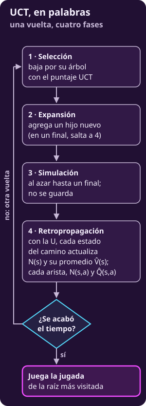
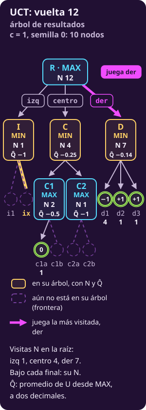
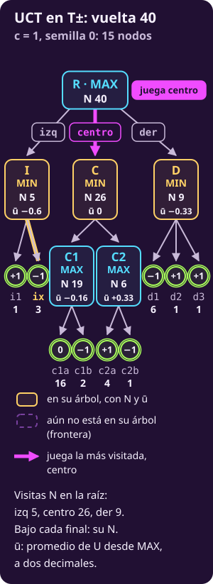

# MCTS con UCT

**¿Cómo gastas un presupuesto de vueltas donde más importa?**

Construyes un árbol poco a poco y mandas más vueltas a lo que va mejor, sin dejar de probar lo demás.

- **MCTS** es la familia: cada vuelta selecciona, expande, simula y retropropaga.
- **UCT** es el miembro que selecciona con un promedio más un bono.
- **Con las trazas**, verás cómo un promedio llega a parecerse a un mínimo, y por qué se entrega la jugada más visitada.

## Lo que traes

- **Las reglas generan el juego.** $S_F$ reconoce finales (@jue-c1-finales); $\mathrm{Pl}(s)$ lee quién mueve (@jue-c1-pl); $A(s)$ enumera jugadas; $T(s,a)$ produce el siguiente estado; $U$ paga los finales (@jue-c1-utilidad): $+1$ si gana MAX, $-1$ si gana MIN y $0$ si empatan.
- **El valor se mide desde MAX.** $V(s)$ supone juego óptimo de ambos; $Q(s,a)=V(T(s,a))$ valora una jugada (@jue-c1-valor-jugada-estrategia). MAX elige el mayor $Q$ y MIN el menor.
- **Simular es barato.** Una simulación (@jue-c3-simulacion) juega al azar hasta un final y lee su $U$.
- **Dos maneras de usar las simulaciones.** En [[simular-en-vez-de-evaluar|Simular partidas]], Monte Carlo plano promedia y converge a $Q_{\text{azar}}$; la actualización minimax (@jue-c3-actualizacion-minimax) guarda lo descubierto y sube máximos y mínimos.
- **Las dos muestrean parejo.** Reparten las simulaciones sin mirar lo que ya saben.

> [!TIP]
> **Míralo correr**
>
> **▶ [El mismo árbol, todos los algoritmos](../_assets/un_arbol_todos.html)**: elige UCT y mira, vuelta por vuelta, qué nodos agrega y qué jugada entregaría.

---

## 1 · Gastar donde importa

**Piensa: si tienes tiempo para 1000 vueltas y tres jugadas, ¿las repartirías por igual?**

No conviene. Repartir parejo gasta lo mismo en jugadas buenas y malas. MCTS **construye un árbol poco a poco** y manda más vueltas a lo que va mejor.

::: definition {#jue-c3-uct title="MCTS y UCT"}
**Qué es.** MCTS, la búsqueda en árbol de Monte Carlo (*Monte Carlo Tree Search*), es una familia de algoritmos. Cada **vuelta** recorre cuatro fases: selección, expansión, simulación y retropropagación.

**Cómo se calcula.** Los miembros difieren en cómo seleccionan y cómo suben los resultados. UCT (*Upper Confidence bounds applied to Trees*) selecciona con la regla UCB: promedio más bono. Después promedia el mismo $U$ en todo el camino.

**Qué significa.** UCT reparte las vueltas: muchas hacia lo que va bien y algunas hacia lo poco probado.

**Qué no es.** UCT no sube máximos ni mínimos; eso lo hace la actualización minimax, que selecciona al azar. Tampoco usa una $\mathrm{EVAL}$ escrita a mano.
:::

> **Dado:** un estado no final $s_{\text{raíz}}$ donde mueve MAX, las reglas y un presupuesto de vueltas. No hay función de evaluación.
>
> **Encontrar:** una jugada para MAX, con las vueltas concentradas donde más informan.

**Tres unidades de trabajo.**

- **Una vuelta (*iteration*) recorre las cuatro fases.** Puede terminar sin simular si llega a un final guardado.
- **Una simulación juega desde el hijo nuevo hasta un final.** Ambos eligen al azar.
- **Una corrida ejecuta el presupuesto completo.** Contiene muchas vueltas; su semilla fija las elecciones al azar.

**Tres partes del árbol que se parecen.**

- **Hoja de su árbol:** un nodo guardado sin hijos agregados todavía. Puede tener muchas jugadas legales pendientes.
- **Final del juego:** ya tiene su $U$, dado por las reglas.
- **Frontera:** las jugadas legales que salen de nodos guardados y aún no se agregan. No es un nivel parejo: sigue el contorno irregular del árbol.

El $U$ que sube es el mismo de siempre, y solo un final lo tiene:

$$
\mathbf{U(s)}=
\begin{cases}
+1 & \text{si gana MAX},\\
0 & \text{si empatan},\\
-1 & \text{si gana MIN}.
\end{cases}
$$

Los ejemplos con otra escala de pagos la declaran.

---

## 2 · La ficha de UCT

### UCT

**Piensa: ¿qué número necesita UCT para decidir por dónde bajar?**

Uno por jugada: cuántas veces la tomó y cuánto pagaron, en promedio, esas vueltas.

- **Qué valor rastrea:** $\widehat Q(s,a)$, el promedio de los pagos de las vueltas que tomaron la jugada $a$ en $s$; estima $Q(s,a)$, siempre desde MAX.
- **Dónde lo guarda:** por arista, $N(s,a)$ y $\widehat Q(s,a)$; por estado, $N(s)$ y $\widehat V(s)$, el promedio de los pagos de las vueltas que pasaron por $s$. Empieza con solo la raíz.
- **Cómo sube:** el **mismo $U$** de cada vuelta entra en el promedio de cada estado y de cada arista del camino. Promedia; no toma máximos ni mínimos.
- **A qué converge:** en un árbol finito, con $c>0$ fija y vueltas sin límite, cada $\widehat Q(s,a)$ tiende a $Q(s,a)$. Con un presupuesto fijo, no hay garantía.

**Otra notación.** Otros textos escriben $Q(s,a)$ para el promedio. Aquí $Q$ es el valor exacto y el gorro marca la estimación.

**Un dibujo, dos lecturas.** En nuestros árboles cada hijo tiene un solo padre: las vueltas que cruzan la arista $(s,a)$ son las mismas que pasan por $s'=T(s,a)$. Por eso $N(s,a)=N(s')$ y $\widehat Q(s,a)=\widehat V(s')$, y las figuras dibujan junto al hijo su $N$ y su $\widehat V$: es una representación, no otra definición.

::: figure {#jue-c3-fig-flujo-uct title="UCT, en palabras"}

:::

#### 1 · Exploración: cómo obtiene su número

**Las cuatro fases.** Cada vuelta hace, en orden:

1. **Selección (*selection*).** Desde la raíz, baja por los nodos guardados. En un nodo con todos sus hijos agregados, elige con el puntaje UCT. Se detiene en el primer nodo con una jugada sin agregar, o en un final.
2. **Expansión (*expansion*).** Agrega la primera jugada pendiente, en el orden dado, como **un hijo nuevo**: a lo más un nodo por vuelta. Si llegó a un final, no agrega nada.
3. **Simulación (*rollout*).** Desde el hijo nuevo, juega al azar para los dos hasta un final. Ese camino no se guarda, como en Monte Carlo plano. Si el hijo nuevo ya es final, toma su $U$ sin simular.
4. **Retropropagación (*backpropagation*).** Sube ese $U$ hasta la raíz. Cada estado del camino suma una visita a $N(s)$ y mete $U$ en su $\widehat V(s)$; cada arista suma una a $N(s,a)$ y mete $U$ en su $\widehat Q(s,a)$.

**El signo no cambia al subir:** todo se mide desde MAX, también donde mueve MIN.

::: figure {#jue-c3-mcg-fig-uct-fases title="Las fases de UCT en un árbol grande"}

:::

**El puntaje de la selección**, con $\text{bono}=c\sqrt{\ln N(s)/N(s,a)}$ y $c>0$:

| Quién mueve | Elige | Puntaje |
|---|---|---|
| MAX | El mayor | $\mathbf{\widehat Q(s,a)+c\sqrt{\ln N(s)/N(s,a)}}$ |
| MIN | El menor | $\mathbf{\widehat Q(s,a)-c\sqrt{\ln N(s)/N(s,a)}}$ |

- **El promedio aprovecha (*exploitation*).** Es lo que ya se vio de esa jugada.
- **El bono explora (*exploration*).** Premia lo poco visitado y se encoge al crecer $N(s,a)$.
- **MIN usa la otra cola.** Minimizar $\widehat Q-\text{bono}$ equivale a maximizar $-\widehat Q+\text{bono}$; $c$ no cambia de signo.
- **Nunca se calcula con $N(s,a)=0$.** Una jugada sin visitas se atiende antes, en la expansión.

**Ejemplo mínimo en un nodo de MAX.**

| Jugada | $\widehat Q$ | Bono | Puntaje |
|---|---:|---:|---:|
| $a$ | $0.5$ | $0.1$ | $0.6$ |
| $b$ | $0.2$ | $0.3$ | $0.5$ |

**Decide la suma:** MAX selecciona $a$, aunque $b$ tenga más bono. Con bono $0.6$, $b$ sumaría $0.8$ y sería la seleccionada.

**El bono, en corto.** Es grande con pocas visitas, y crece despacio si el padre sigue recibiendo vueltas y la jugada no: así vuelve a probarse una jugada olvidada. $c$ fija cuánto pesa (aquí, $c=1$); $s$ es cualquier nodo por el que baja la selección, y $\ln$ es el logaritmo natural.

**La idea viene del bandido:** elegir una y otra vez entre opciones inciertas, sin árbol debajo. Ahí el bono es un margen de error del promedio, del lado que le importa a quien elige.

En un árbol finito con vueltas sin límite, **ninguna jugada se abandona para siempre**. Conforme avanza la búsqueda, pide más confianza antes de dar una jugada por mala. Esto es intuición; [[de-donde-sale-el-bono|De dónde sale el bono]] explica de dónde sale la forma y cuándo no basta.

**El puntaje no es un pago.** Como $\mathrm{EVAL}$, guía la búsqueda; a diferencia de $\mathrm{EVAL}$, no estima ningún valor. Pago, estimación y puntaje son tres números distintos: $U$, $\widehat Q$ y $\widehat Q\pm\text{bono}$.

**Un final que ya está en el árbol.** Si la selección llega a él, solo retropropaga:

- **No expande:** ese final ya es parte del árbol.
- **No simula:** las reglas ya dan su $U$; no hay nada que estimar.
- **Sí cuenta como vuelta:** sube ese $U$, y cada arista del camino suma una visita y actualiza su promedio.

---

**Recorrido: una vuelta a mano.**

**Piensa: tras cuatro vueltas, ¿por dónde baja la quinta y qué cambia al terminar?**

Baja por la jugada de MAX con mejor puntaje y luego por la respuesta de MIN con menor puntaje. Al subir, se actualizan las visitas y los promedios de los estados y las aristas del camino.

> **Dado:** el árbol de la figura, con $c=1$. La raíz R es de MAX; sus hijos a y b son de MIN; a1 y a2, hijos de a, son de MAX. Cada nodo muestra $N$ y $\widehat V$.
>
> **Encontrar:** el camino de la selección y los números tras una vuelta cuya simulación termina en $U=+1$.

Antes de la vuelta, cada nodo distinto de R nació con su propia simulación:

- **a1 y a2:** una vuelta cada uno, con $U=+1$ y $U=-1$.
- **a:** su simulación ($+1$) más las de sus hijos: $N=3$ y suma $+1$, así que $\widehat V(\text{a})=1/3$.
- **b:** una vuelta con $U=-1$.
- **R:** no nació en una expansión ni simula. Suma lo de sus hijos: $N(\text{R})=4$, suma $0$, $\widehat V(\text{R})=0$.

$\widehat V(s)$ es el promedio de las vueltas que pasaron por $s$, no el máximo ni el mínimo de sus $\widehat Q$. Como a tiene un solo padre, $N(\text{R},\text{a})=3$ y $\widehat Q(\text{R},\text{a})=1/3$.

**Paso 1 · Selección en R (MAX, $N=4$).** Los puntajes son a: $1/3+\sqrt{\ln4/3}\approx0.33+0.68=1.01$; b: $-1+\sqrt{\ln4}\approx-1+1.18=0.18$. **Baja a a.**

**Paso 2 · Selección en a (MIN, $N=3$).** Las dos respuestas llevan una visita, con bono $\sqrt{\ln3}\approx1.05$. Los puntajes son a1: $+1-1.05=-0.05$; a2: $-1-1.05=-2.05$. **MIN baja a a2**, donde MAX ganó menos.

**Pasos 3 a 5 · Expansión, simulación y retropropagación.** a2 no tiene hijos: ahí se agrega uno nuevo. Su simulación termina en $U=+1$, que sube por todo el camino:

| Nodo | Antes: $N$, $\widehat V$ | Después: $N$, $\widehat V$ |
|---|---|---|
| R | $4$, $0$ | $5$, $+0.2$ |
| a | $3$, $1/3$ | $4$, $1/2$ |
| a2 | $1$, $-1$ | $2$, $0$ |
| nuevo | — | $1$, $+1$ |

Cada pago mueve un promedio $1/N$ de la distancia hacia ese pago, con $N$ ya incrementado. **Fuera del camino**, a1 y b no cambian. Cada vuelta aporta un pago, que se retropropaga por cada estado y arista del camino. Solo el tramo desde el hijo nuevo hasta el final es la simulación: arriba, la selección eligió el camino.

::: figure {#jue-c3-fig-mcts title="Una vuelta de UCT: la raíz pasa de N 4 a N 5"}
![Cuatro paneles con el mismo árbol; cada nodo dice N, sus visitas, y V̂, el promedio de U de las vueltas que pasaron por él, desde MAX. La raíz es de MAX; sus dos hijos, de MIN. 1, selección: desde la raíz, N 4 y V̂ 0, MAX baja al hijo de N 3 y V̂ +0.33; ahí MIN baja al de N 1 y V̂ −1. 2, expansión: aparece un hijo nuevo bajo ese nodo. 3, simulación: desde el hijo nuevo, una línea quebrada llega a un final con U = +1. 4, retropropagación: cada nodo del camino suma una visita y mete U en su promedio; la raíz pasa a N 5 y V̂ +0.2. Los nodos fuera del camino no cambian](../_assets/jue-c3-mcts-pasos.svg)
:::

::: exercise {#jue-c3-ej-retro title="Completa la vuelta con una derrota"}
Repite la vuelta con el mismo camino y el mismo hijo nuevo, pero la simulación termina en $U=-1$: gana MIN.

1. **El camino.** ¿Qué $N$ y $\widehat V$ quedan en los cuatro nodos, de la raíz al nuevo?
2. **Fuera del camino.** ¿Cambia algún nodo?
3. **La raíz.** ¿Cuánto vale ahora $\widehat V(\text{R})$?
:::

::: hint {#jue-c3-pista-retro-1 of="jue-c3-ej-retro" title="Qué cuenta cada número"}
$N$ suma una visita pase lo que pase. El promedio cambia según el $U$ que sube.
:::

::: answer {#jue-c3-resp-retro of="jue-c3-ej-retro"}
1. **Todos suman una visita y $-1$ a su suma.** R: $N=5$, suma $-1$; a: $N=4$, suma $0$, $\widehat V=0$; a2: $N=2$, $\widehat V=-1$; el nuevo: $N=1$, $\widehat V=-1$.
2. **No.** a1 y b no estaban en el camino.
3. **$\widehat V(\text{R})=-1/5=-0.2$.** Antes de la vuelta valía $0$.
:::

**Sin bono, b quedaría condenada.** Tras **una sola** partida, $\widehat Q(\text{R},\text{b})=-1$. a ya ganó dos y su promedio nunca baja a $-1$. Bajando siempre por el mayor promedio, MAX no volvería a b. El bono le da otra oportunidad: crece con $\ln N(\text{R})$ mientras b no recibe vueltas.

---

**Recorrido: el árbol de resultados.**

**Piensa: en D, tras unas cuantas vueltas, ¿sigue MIN eligiendo al azar?**

No. Donde ya hay árbol, MIN elige por puntaje. Si d2 y d3 dan victorias a MAX, MIN baja por d1; lo mismo hace MAX en C1 y C2.

> **Dado:** el árbol de resultados, con $c=1$ y semilla 0. R es de MAX; izq, centro y der llevan a I, C y D, de MIN.
>
> I tiene i1 $=+1$ e ix $=-1$. C tiene C1 (c1a $=0$, c1b $=-1$) y C2 (c2a $=+1$, c2b $=-1$). D tiene d1 $=-1$, d2 $=+1$ y d3 $=+1$.
>
> **Encontrar:** qué jugada entregaría UCT al terminar cada vuelta.

Con juego óptimo, $Q(\text{R},\cdot)=(-1,0,-1)$ y MAX juega centro. Al final de cada vuelta, la más visitada de la raíz es:

- **izq**, en las vueltas 1 a 3: cada vuelta agrega una jugada de la raíz, y en la 3 las tres empatan con una visita; gana la primera;
- **centro**, de la 4 a la 7;
- **der**, de la 8 a la 17;
- **centro**, desde la 18. En la 18, centro y der empatan 7 a 7, y gana la primera en el orden.

**Vuelta 12.** Las visitas son 1, 4 y 7; el árbol guarda 10 de los 15 nodos. D ya encontró d1 cuatro veces y aun así $\widehat Q(\text{R},\text{der})=-1/7\approx-0.14$: der es la más visitada.

::: figure {#jue-c3-fig-resultados-uct-12 title="UCT en el árbol de resultados tras 12 vueltas: todavía juega der"}

:::

**Vuelta 13: vuelve una jugada olvidada.** Izq perdió su única partida en la vuelta 1. Con $N(\text{R})=12$, su bono ya vale $\sqrt{\ln12}\approx1.58$: su puntaje, $0.58$, supera el $0.54$ de centro. La selección baja por izq sin que nadie lo ordene.

**Vuelta 40.** Las visitas son 5, 26 y 9, y el árbol ya guarda los 15 nodos. Centro es la más visitada, con $\widehat Q(\text{R},\text{centro})=0$. Ese $0$ coincide con $Q$ **por casualidad**: es el promedio de 26 vueltas, no un valor exacto.

::: figure {#jue-c3-fig-resultados-uct-40 title="UCT en el árbol de resultados tras 40 vueltas: ya juega centro"}

:::

Con el árbol completo, nadie juega al azar: cada vuelta baja por puntaje hasta un final ya guardado.

::: exercise {#jue-c3-cmp-ej-uct title="Corta la corrida antes"}
En la corrida de la semilla 0, el tiempo se acaba al terminar la vuelta 12.

1. **La entrega.** ¿Qué jugada entrega UCT?
2. **La corrección.** ¿Por qué no contradice que UCT corrija a Monte Carlo plano?
:::

::: hint {#jue-c3-cmp-pista-uct-1 of="jue-c3-cmp-ej-uct" title="Qué hay en el árbol a esa altura"}
¿Qué entrega UCT cuando se acaba el tiempo? Con 12 vueltas, ¿cuántos de los 15 nodos pueden estar en el árbol?
:::

::: answer {#jue-c3-cmp-resp-uct of="jue-c3-cmp-ej-uct"}
1. **Der**: es la más visitada de la vuelta 8 a la 17.
2. **Cada vuelta agrega a lo más un nodo.** Una vuelta que llega a un final guardado no agrega nada. Tras 12 vueltas hay 10 de los 15 nodos, contando R.

El árbol todavía no cubre el árbol de resultados, y abajo se sigue simulando con los dos al azar. UCT corrige **con vueltas**: cuantas más, menos azar queda arriba.
:::

---

**Recorrido: la refutación, otra vez.**

**Piensa: tras A, MIN tiene dos respuestas de $+10$ y una refutación de $-30$. ¿Necesita UCT que el azar la encuentre una y otra vez?**

No. Bajo A, el árbol agrega las respuestas de MIN. La refutación junta resultados malos para MAX y, por el puntaje, MIN la elige cada vez más.

> **Dado:** MAX elige A o B; tras A, MIN elige $+10$, $+10$ o una refutación que termina en $-30$; B paga $-10$. Así, $Q(A)=-30$, $Q(B)=-10$ y MAX debe jugar B.
>
> **Encontrar:** cuándo deja UCT de preferir A, en una corrida real.

La corrida divide los pagos entre 30, para que queden en $[-1,1]$, y usa $c=1$, semilla 0 y 60 vueltas. Las cifras se leen de vuelta en la escala del juego:

- **Vuelta 5:** aparece el $-30$ por primera vez.
- **Vuelta 13:** $\widehat Q(A)$ queda debajo de $\widehat Q(B)$.
- **Vuelta 15:** B pasa a ser la más visitada, y lo sigue siendo.
- **Vuelta 60:** B lleva 48 visitas y A 12; $\widehat Q(A)=-20$ y $\widehat Q(B)=-10$.

::: figure {#jue-c3-fig-refutacion-uct title="La refutación descubierta tarde: promedio, actualización minimax y UCT"}
![Tres paneles con los mismos ejes sobre el árbol de la refutación (A con +10, +10 y −30; B con −10). Primero, el promedio de la secuencia impuesta: Q̂(A) se queda en 10 y baja a 8.67 tras el −30, con su límite −10/3 marcado arriba de B. Segundo, la actualización minimax: Q̂(A) salta de 10 a −30 y la jugada entregada cambia a B. Tercero, una corrida real de UCT con pagos divididos entre 30, c = 1, semilla 0 y 60 vueltas, dibujada de vuelta en la escala del juego. Su promedio de A baja poco a poco desde la vuelta 5 y queda debajo del de B en la 13; termina en −20. B es la más visitada desde la vuelta 15](../_assets/jue-c3-refutacion-tres.svg)
:::

**El $-20$ todavía no es el $-30$ de minimax, pero ya basta para entregar B.** Una refutación no borra las vueltas anteriores: las diluye. Por eso la corrección es gradual, a diferencia del salto de la actualización minimax.

**Esa convergencia tiene condiciones:** un árbol finito, $c>0$ fija y vueltas sin límite. Con un presupuesto fijo, una refutación todavía puede pasar inadvertida.

---

**Cómo crece el árbol.**

Vuelta tras vuelta, el árbol de UCT crece **desigual**: hondo por las jugadas que van bien, delgado por las demás. Las malas no desaparecen; reciben pocas vueltas.

- **Arriba de la frontera se elige con el puntaje.** MAX y MIN eligen según lo que ya vieron, más el bono.
- **Debajo de la frontera se juega al azar.** Es el tramo de la simulación.
- **La frontera baja de forma desigual.** Donde el árbol se hace hondo, una parte mayor de cada camino se elige con el puntaje.

::: figure {#jue-c3-mcg-fig-uct-crece title="El árbol de UCT crece desigual"}

:::

Así corrige UCT el defecto de Monte Carlo plano, el **rival al azar**. Donde ya construyó árbol, MIN elige lo que parece mejor para él, más un bono. Solo la simulación, debajo del árbol, sigue jugando al azar.

---

#### 2 · Elección: qué jugada juega

**Piensa: cuando se acaba el tiempo, ¿se entrega la jugada de mayor puntaje?**

No. Al terminar, el bono **se quita**: UCT juega la jugada de la raíz con **más visitas** $N(s_{\text{raíz}},a)$, el **hijo más visitado** (*robust child*). Ante un empate, juega la primera en el orden dado.

::: table {#jue-c3-tabla-seleccionar title="Seleccionar no es entregar"}
| Decisión | Cuándo | Compara | Bono |
|---|---|---|---|
| Seleccionar: qué probar | Cada vuelta | Puntajes | Sí |
| Entregar: qué jugar | Al final | Visitas | No |
:::

- **El bono premia la ignorancia.** Eso sirve para aprender, no para jugar de verdad.
- **Las visitas resumen el presupuesto recibido.** Incluyen la expansión y la exploración por el bono, además de las vueltas a jugadas prometedoras. Entregar la más visitada es la regla de esta versión: **las visitas no son pruebas de que una jugada sea mejor.**
- **Un promedio alto con pocas visitas puede ser suerte.** Su margen todavía es ancho.
- **Más visitas no demuestran más valor.** También influyen el bono, el orden y los primeros resultados; con poco presupuesto, la regla puede fallar.

**Un ejemplo: visitas contra promedio.**

::: table {#jue-c3-tab-eleccion-uct title="Visitas contra promedio en la raíz"}
| Jugada | Visitas | $\widehat Q$ |
|---|---:|---:|
| $a$ | $80$ | $0.5$ |
| $b$ | $20$ | $0.6$ |
:::

**UCT juega $a$.** El promedio de $b$ descansa en pocas vueltas; $b$ podría ser mejor, pero la búsqueda no lo ha mostrado.

Si hay una sola jugada óptima y se cumplen las condiciones de convergencia, las dos reglas terminan eligiéndola. Elegir por visitas es la convención de este curso; el artículo original de UCT usa el mayor promedio.

::: exercise {#jue-c3-ej-mcts title="Calcula qué se explora y qué se entrega"}
Tras 100 vueltas, las tres jugadas de la raíz, donde mueve MAX, tienen:

- **x:** $N=60$ visitas, $\widehat Q=0.5$;
- **y:** $N=30$ visitas, $\widehat Q=0.6$;
- **z:** $N=10$ visitas, $\widehat Q=0.2$.

1. **Entregar.** Si el tiempo se acaba ahora, ¿qué jugada se entrega?
2. **Seleccionar.** Si queda tiempo para una vuelta más, calcula el puntaje de cada una con $c=1$ y $\ln 100\approx4.61$. ¿Por cuál baja la selección?
3. **Comparar.** ¿Coinciden las dos respuestas? Explica por qué no hay contradicción.
:::

::: hint {#jue-c3-pista-mcts-1 of="jue-c3-ej-mcts" title="Cuándo se usa cada regla"}
¿Qué regla se aplica cuando el tiempo ya se acabó, y cuál mientras quedan vueltas? ¿Qué número de la lista mira cada una?
:::

::: answer {#jue-c3-resp-mcts of="jue-c3-ej-mcts"}
1. **x:** al final se entrega la jugada con más visitas, y x tiene 60.
2. **La selección baja por y.** Los puntajes son

   $$\begin{aligned}
   x&:\ 0.5+\sqrt{4.61/60}\\
   &\approx0.5+0.28=0.78,\\[4pt]
   y&:\ 0.6+\sqrt{4.61/30}\\
   &\approx0.6+0.39=0.99,\\[4pt]
   z&:\ 0.2+\sqrt{4.61/10}\\
   &\approx0.2+0.68=0.88.
   \end{aligned}$$

   La z recibe el bono más grande, pero su promedio bajo la deja segunda.
3. **No coinciden.** Entregar compara visitas y elige x; seleccionar compara puntajes y elige y. Son reglas para decisiones distintas: una dice qué jugar, la otra dónde gastar la siguiente vuelta.

Una $c$ mayor le da más peso al bono. Con $c=\sqrt2$ la selección ya iría a z, por poco: $1.160$ contra $1.154$. Con $c=2\sqrt2$, con holgura: $2.12$ contra $1.71$.
:::

#### 3 · Propiedades

- **Número que da:** visitas y promedios $\widehat Q(s,a)$, que estiman los $Q$ de minimax; entrega la jugada más visitada.
- **Usa EVAL:** no. Necesita reglas, detección de finales y pagos $U$.
- **Garantía:** en un árbol finito, con $c>0$ fija y vueltas sin límite, los promedios tienden a los valores de minimax. Kocsis y Szepesvári (2006), *Bandit based Monte-Carlo Planning*, lo probaron con una $c$ bastante grande y acotaron qué tan rápido (ver [[de-donde-sale-el-bono|De dónde sale el bono]]). Con presupuesto fijo, ninguna.
- **Se puede interrumpir:** sí (*anytime*); recomienda desde la primera vuelta. Como la profundización iterativa de [[jugar-contra-el-reloj|Hasta dónde mirar]], siempre tiene una jugada lista.
- **Complejidad:** con $b$ jugadas por estado, $h$ la profundidad del árbol guardado y $m$ el largo de una partida, una vuelta cuesta $O(bh+m)$ y $n$ vueltas, $O(n(bh+m))$. Guarda hasta $n+1$ nodos: memoria $O(n)$.
- **Frente a los demás:** usa azar solo debajo de su frontera; Monte Carlo plano lo usa en toda la continuación. La actualización minimax muestrea parejo y sube máximos o mínimos; UCT mejora su selección y promedia.
- **Supuestos:** dos jugadores y suma cero o constante, para que un solo $\widehat Q$ desde MAX baste. Con suma no constante o más jugadores, guarda un $\widehat Q$ por jugador y cada uno selecciona por el suyo; puede dar equilibrios mixtos bajo las condiciones de Sturtevant (2008).

**Esta versión no sortea dentro del árbol.** Expande y desempata en orden fijo; otras versiones sí sortean. **Cubre árboles chicos:** con 40 vueltas ya guarda los 15 nodos del árbol de resultados.

**Ubicar MCTS en la historia.**

**Piensa: Deep Blue y AlphaGo ganaron con búsqueda. ¿Qué pieza cambió de uno a otro?**

La que estima lo que no se alcanza a calcular:

- **Deep Blue venció a Kasparov en 1997.** Buscaba con alfa-beta y una función de evaluación compleja, ajustada en su mayoría a mano: cortar y evaluar.
- **Desde 2006**, cuando Rémi Coulom le dio nombre al método, los programas de Go más fuertes usan MCTS: simular en vez de evaluar. Ejemplos son MoGo (2006), en Go, y MoHex, en Hex.
- **En marzo de 2016, AlphaGo**, de DeepMind, venció 4 a 1 a Lee Sedol, uno de los mejores jugadores de Go del mundo. Combinaba MCTS con **redes neuronales**: una sugería qué jugadas explorar y otra estimaba cuánto valía una posición.
- **AlphaGo mezclaba dos estimaciones.** Al valorar un nodo nuevo, promediaba mitad y mitad ($\lambda=0.5$) la de su red y el resultado de una simulación rápida, guiada por una política sencilla.
- **AlphaGo Zero y AlphaZero, en 2017, quitaron las simulaciones hasta el final.** Una red que aprende jugando contra sí misma sugiere jugadas y valora posiciones.

¿Sigue siendo MCTS sin esas simulaciones? Sí: sigue dando vueltas, con el árbol, las cuentas y la selección por puntaje. Lo que más cambia es la tercera fase: la red valora el hijo nuevo. También guía la selección: su puntaje suma un término que premia la jugada que la red sugiere, así que ya no es el de UCT.

#### 4 · Casos borde

- **Un final ya en su árbol.** No se expande ni se simula; se retropropaga su $U$ exacto.
- **Una jugada no visitada.** Su promedio es desconocido, nunca cero. Con $N(s,a)=0$ el bono sería infinito; por eso la expansión la atiende antes de seleccionar.
- **Una respuesta certera descubierta tarde.** Entra como una observación más y mueve el promedio en proporción a $1/N$. En la vuelta 12, d1 ya dio $-1$ cuatro veces y aun así $\widehat Q(\text{R},\text{der})=-1/7$: juega der. La corrección es gradual.
- **Empate en visitas.** Gana la primera en el orden dado, como centro frente a der en el 7 a 7 de la vuelta 18. Ese empate no es entre óptimos: der vale $-1$.
- **Óptimos empatados.** Las jugadas óptimas acumulan, juntas, casi todas las visitas; la más visitada puede alternar entre ellas.
- **El $0$ por casualidad.** Un promedio puede coincidir con $Q$ sin ser exacto: en la vuelta 100, $\widehat Q(\text{R},\text{centro})=1/83$.
- **Una sola jugada.** Queda forzada; sigue acumulando evidencia en su subárbol.
- **Finales a distinta profundidad.** UCT no prefiere ganar pronto, salvo que $U$ lo indique; sí cambia el costo de cada vuelta.
- **Un final frente a una evaluación.** Aquí siempre se usa $U$. Si una variante valora los nodos nuevos con una estimación, como AlphaGo, un final sigue aportando su $U$ exacto.
- **Presupuesto fijo o ciclos.** Con vueltas contadas no hay garantía; con ciclos sin regla de terminación, el árbol no es finito y no se afirma convergencia.

---

#### Intuición

**Cómo un promedio llega a parecerse a un mínimo.**

**Piensa: minimax sube mínimos; UCT solo promedia. ¿Cómo puede acercarse a $V$?**

Eligiendo cada vez mejor, para que las vueltas de buen juego dominen los promedios.

Un ejemplo abstracto: MAX elige entre $A$ y $B$. Tras $A$, MIN elige entre un final de $+1$ y uno de $-1$; $B$ lleva a un final de $-0.2$. Aquí un final puede valer cualquier número entre $-1$ y $+1$; nada de lo que sigue depende de eso.

- **Minimax juega $B$.** $Q(s,A)=\min(+1,-1)=-1$ y $Q(s,B)=-0.2$, así que $V(s)=-0.2$.
- **Al principio, MIN reparte casi parejo bajo $A$.** Entonces $\widehat Q(s,A)\approx0$ y $A$ parece mejor que $B$.
- **Después, MIN favorece su respuesta buena.** El $-1$ tiene el menor puntaje y cada $-1$ entra también en el promedio de $A$.
- **Con proporciones ilustrativas, no medidas:** si de 1000 vueltas por $A$ solo 10 fueron al $+1$, entonces $\widehat Q(s,A)=(10(+1)+990(-1))/1000=-0.98$.
- **Lo viejo pesa cada vez menos.** Las vueltas de cuando MIN repartía parejo no se borran; las nuevas las diluyen.
- **MAX elige $A$ cada vez menos.** Con $\widehat Q(s,A)$ debajo de $-0.2$, casi todas las vueltas van a $B$; el bono sigue probando $A$ de vez en cuando.
- **El promedio de la raíz tiende a $-0.2$**, que es $V(s)$.
- **Lo mismo ocurre en cada nivel.** En un árbol hondo, el efecto sube desde los finales hacia la raíz. Las mejores jugadas para quien mueve se llevan casi todas las visitas, y el promedio del padre se acerca al suyo.

::: figure {#jue-c3-mcg-fig-mezcla title="Un promedio que se vuelve un mínimo"}

:::

**UCT no reemplaza el promedio por un mínimo: elige cada vez mejor, y así las partidas de buen juego dominan los promedios.**

**El promedio del padre no es el de sus hijos.**

- **El padre mezcla.** $\widehat V(s)$ junta los resultados de todas las jugadas que eligió desde $s$, cada una según cuántas veces la eligió. Incluye también la simulación de cuando $s$ era nuevo.
- **La selección no usa esa mezcla.** Compara cada jugada por su $\widehat Q(s,a)$ con su bono: lo suma en MAX y lo resta en MIN.
- **En el árbol de resultados se ve.** Tras 40 vueltas, $\widehat V(\text{R})=-3/20$, aunque $\widehat Q(\text{R},\text{centro})=0$.
- **La mezcla sigue a las elecciones.** Al mejorar las elecciones, el promedio del padre se acerca al de su mejor jugada.
- **La jugada entregada tampoco sale de esa mezcla.** Es la de la raíz con más visitas.

> [!NOTE]
> **La exploración emerge del bono.** El puntaje decide por dónde bajar: eso es la búsqueda. Cada vuelta suma visitas en $N$: eso es la información, cuánto se ha probado. Su resultado entra en $\widehat Q$: eso es la estimación.
>
> El bono cierra el círculo: donde falta información es grande y atrae la búsqueda. Nadie programa «explora izq»: la vuelta 13 lo hace sola.

**Frente a la actualización minimax.** Las dos convergen a $V$ bajo sus condiciones, por caminos opuestos. La actualización minimax elige al azar y sube máximos y mínimos; UCT elige con cuidado y solo promedia.

---

#### Ejercicios

::: exercise {#jue-c3-cmp-ej-tabla title="Compara dos filas que dicen 0"}
Minimax y UCT, tras 40 vueltas, entregan centro con valor $0$.

1. **Los dos ceros.** ¿Qué es cada uno?
2. **Más vueltas.** Si UCT corriera 1000 vueltas más, ¿podría cambiar su $0$? ¿Y el de minimax?
:::

::: hint {#jue-c3-cmp-pista-tabla-1 of="jue-c3-cmp-ej-tabla" title="De dónde sale cada número"}
¿Cuál de los dos sale de mirar todos los finales, y cuál de promediar vueltas?
:::

::: answer {#jue-c3-cmp-resp-tabla of="jue-c3-cmp-ej-tabla"}
1. **El de minimax es $Q(\text{R},\text{centro})=V(\text{R})$:** lo que MAX asegura contra un MIN que juega perfecto. El de UCT es $\widehat Q(\text{R},\text{centro})$: el promedio de las 26 vueltas que tomaron centro.
2. **El de UCT sí:** cada vuelta suma un pago al promedio; en la vuelta 100 vale $1/83$. El de minimax no: ya miró los 15 nodos y nada lo cambia.
:::

::: exercise {#jue-c3-ej-certera title="Compara dos operadores ante la misma refutación"}
En la corrida de la semilla 0, las siete vueltas que tomaron der hasta la vuelta 12 pagaron $+1,-1,+1,+1,-1,-1,-1$. Cuatro de esos $-1$ vienen de d1, un final.

1. **UCT.** ¿Cuánto vale $\widehat Q(\text{R},\text{der})$?
2. **Actualización minimax.** Con los mismos finales descubiertos, ¿cuánto valdría $\widehat V(\text{D})$? ¿Es exacto?
3. **La corrección.** ¿Por qué UCT no salta a $-1$, y cómo termina corrigiendo?
:::

::: hint {#jue-c3-pista-certera-1 of="jue-c3-ej-certera" title="Quién mueve en D"}
D es de MIN y $-1$ es el menor pago posible. Un promedio cuenta frecuencias; un mínimo representa una decisión.
:::

::: answer {#jue-c3-resp-certera of="jue-c3-ej-certera"}
1. **$\widehat Q(\text{R},\text{der})=-1/7\approx-0.14$.** La suma es $-1$ en 7 vueltas; der sigue siendo la más visitada.
2. **$\widehat V(\text{D})=-1$, exacto.** d1 es un final y MIN no puede bajar de $-1$, así que ninguna respuesta desconocida lo cambia.
3. **UCT promedia:** cada $-1$ pesa $1/N$. La corrección viene de las elecciones: MIN concentra visitas en d1 y MAX manda menos vueltas a der. En la vuelta 40, der lleva 9 visitas contra 26 de centro.
:::

**Punto de control:** deberías poder dar una vuelta de UCT a mano, con $N$ y $\widehat V$ en cada nodo y cualquier resultado. También, calcular el puntaje de una jugada en MAX y en MIN, distinguir seleccionar de entregar, y explicar por qué un promedio de vueltas no es $V$.

> [!NOTE]
> **Lo que ya viste.** Los algoritmos de la unidad hasta esta página, en el orden del curso.
>
> | Algoritmo | Qué número da |
> |---|---|
> | Minimax | $V$; lo garantiza |
> | Alfa-beta | $V$ en la raíz; lo garantiza |
> | Expectiminimax | El $V$ del juego con dado; lo garantiza |
> | Minimax con corte | Valor con corte; no garantiza $V$. Con todos los finales, da $M\cdot V$ |
> | Búsqueda de quietud | Valor con quietud; no garantiza $V$. Con todos los finales antes de activar la quietud, da $M\cdot V$ |
> | Profundización iterativa | Valor con corte de la última búsqueda; no garantiza $V$. Con todos los finales, da $M\cdot V$ |
> | Monte Carlo plano | $\widehat Q$, que estima $Q_{\text{azar}}$; no garantiza $V$ |
> | Monte Carlo con actualización minimax | $\widehat Q$ y $\widehat V$; no garantiza $V$ (converge a él bajo su contrato: árbol finito, todas las jugadas, finales reales) |
> | **MCTS con UCT (estás aquí)** | **$\widehat Q$; no garantiza $V$ (en un árbol finito, con $c>0$ fija y vueltas sin límite, converge a él)** |
>
> Ya viste todos los algoritmos de la unidad. [[un-arbol-todos-los-algoritmos|Radiografía: un árbol, todos los algoritmos]] los pone lado a lado.

## Lo que hay que llevarse

- **MCTS es la familia; UCT, su miembro con UCB.** Cada vuelta selecciona, expande a lo más un nodo, simula al azar y retropropaga el mismo $U$.
- **UCT guarda por arista** $N(s,a)$ y $\widehat Q(s,a)$, y por estado $N(s)$ y $\widehat V(s)$. MAX elige el mayor $\widehat Q+\text{bono}$ y MIN el menor $\widehat Q-\text{bono}$, con $\text{bono}=c\sqrt{\ln N(s)/N(s,a)}$.
- **Pago, estimación y puntaje son distintos.** $U$ paga un final, $\widehat Q$ estima $Q$ y el puntaje solo guía la búsqueda.
- **Un promedio se parece a un mínimo** porque MIN concentra sus visitas en su mejor respuesta. El promedio del padre, en cambio, no es el de sus hijos.
- **La exploración emerge del bono.** En el árbol de resultados, izq vuelve en la vuelta 13; UCT entrega der hasta la 17 y centro desde la 18.
- **Seleccionar no es entregar.** Al final se quita el bono y se juega la más visitada.
- **Converge a $V$** en un árbol finito, con $c>0$ fija y vueltas sin límite. Con presupuesto fijo, ninguna garantía; ¿de dónde sale el bono, y cuánto debe valer $c$?

Continúa con [[de-donde-sale-el-bono|De dónde sale el bono]].
