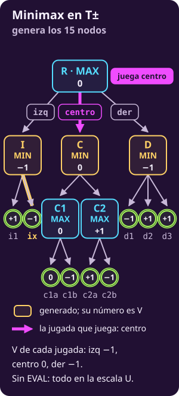
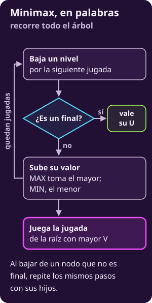
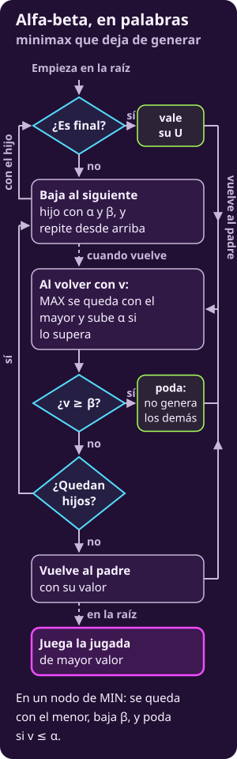
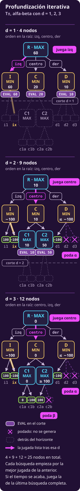
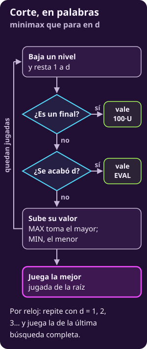

# Radiografía: un árbol, cinco algoritmos

Esta página pone lado a lado los cinco algoritmos de búsqueda de la unidad. Cada uno tiene una ficha con las mismas tres partes, **cómo explora, qué jugada juega y sus propiedades**, y sus figuras sobre el mismo árbol.

**Al final del día, lo que se busca es el valor $V(s)$ de cada estado**: lo que MAX se asegura desde $s$ si los dos juegan lo mejor. **Sobre todo, el $V$ de cada jugada de la raíz**, para jugar la mejor. Cada algoritmo es una manera distinta de **obtenerlo, acotarlo o estimarlo**:

- **Minimax** lo calcula exacto.
- **Alfa-beta** lo calcula exacto para la jugada que elige, con menos trabajo; de las demás puede dar solo cotas.
- **El corte** lo estima: donde se detiene, pone la EVAL.
- **Monte Carlo plano** estima otro número, $\mu$: el promedio si los dos juegan al azar.
- **UCT** da una estimación que, en un árbol finito y con vueltas sin límite, se acerca a $V$.

> [!TIP]
> **Míralo correr**
>
> - **▶ [El mismo árbol, todos los algoritmos](../_assets/un_arbol_todos.html)**: elige un algoritmo y mira qué nodos genera, qué jugada entrega y con qué valor.

## La notación de esta página

Casi todos ya aparecieron en la unidad; son nuevos $\mu$, $k$, $h$ y $n$. Todos están también en [[notacion-juegos|la hoja de notación]].

**El juego**

::: table {#jue-c3-rx-tab-notacion-juego title="Notación: el juego"}
| Símbolo | Qué es |
|---|---|
| $S$, $s$ | Los estados del juego; $s$ es uno cualquiera |
| $s_0$ | Donde MAX decide: la **raíz** de la búsqueda |
| $A(s)$ | Las jugadas permitidas en un estado no final $s$ |
| $T(s,a)$ | Adonde lleva la jugada $a$ desde $s$: un **hijo** $s'$ |
| $U(s)$ | Resultado de un final, desde MAX: $+1$, $-1$ o $0$. Solo en finales |
| $V(s)$ | Lo que MAX se asegura desde $s$ si los dos juegan lo mejor |
| $b$ | El máximo de jugadas permitidas en un estado |
| $m$ | El largo máximo de una partida, en jugadas |
:::

En un final, $V(s)=U(s)$: $+1$ si gana MAX, $-1$ si gana MIN y $0$ si empatan.

**La búsqueda con corte y poda**

::: table {#jue-c3-rx-tab-notacion-busqueda title="Notación: corte y poda"}
| Símbolo | Qué es |
|---|---|
| $\mathrm{EVAL}(s)$ | Estimación de $100\cdot V(s)$ que mira solo $s$, sin generar nada debajo |
| $d$ | La profundidad que queda: cuántas jugadas más, de los dos, se miran |
| $\alpha$ | Lo que MAX ya se asegura en un nodo suyo del camino: un **piso** |
| $\beta$ | Lo mismo para MIN; para MAX, un **techo** |
:::

**La simulación**

::: table {#jue-c3-rx-tab-notacion-simulacion title="Notación: simulación"}
| Símbolo | Qué es |
|---|---|
| $N(s)$ | Cuántas simulaciones, o vueltas, pasaron por $s$ |
| $\bar u(s)$ | El promedio de $U$ en esas simulaciones, siempre desde MAX |
| $\mu(s)$ | El **promedio límite** de $U$ si **los dos** juegan al azar; en general no es $V(s)$ |
| $k$ | Simulaciones por jugada de la raíz, en Monte Carlo plano |
| $n$ | Simulaciones, o vueltas, **en total** |
| $c>0$ | El peso de explorar en el puntaje UCT |
| $h$ | La profundidad que alcanzó el árbol de UCT; a lo más $m$ |
:::

## El problema: un juego, dos dibujos

Los cinco algoritmos resuelven el mismo problema. **Dado** un estado $s_0$ donde mueve MAX y las reglas del juego, **encontrar** una jugada de $A(s_0)$, lo mejor posible con el tiempo que haya.

**El primer dibujo es el de cualquier juego.** MAX y MIN se turnan, un nivel cada uno; cada estado tiene a lo más $b$ jugadas, y ninguna partida pasa de $m$. Las hojas son los finales, con su $U$.

::: figure {#jue-c3-rx-arbol-abstracto title="Un juego cualquiera, en abstracto"}

:::

**El segundo dibujo es un juego concreto, el árbol T±.** Tiene la forma del árbol T de [[minimax-como-algoritmo|Minimax como algoritmo]]. En la raíz R mueve MAX, con tres jugadas: izq, centro y der. Llevan a I, C y D, donde mueve MIN. Cambia en tres cosas:

- **Sus finales dicen quién gana.** Cada hoja vale $+1$, $-1$ o $0$, y hay un solo empate.
- **Tiene una captura.** La segunda respuesta de MIN en I, ix, captura una pieza; eso importa para la búsqueda de quietud.
- **D tiene tres hijos**, no dos. En total, el árbol tiene 15 nodos.

Este dibujo lleva solo las jugadas y los finales en $U$. **No lleva EVAL:** de los cinco algoritmos, solo el corte, con su búsqueda de quietud, la necesita.

::: figure {#jue-c3-rx-arbol-tpm title="El árbol T±: jugadas y finales en U, sin EVAL"}

:::

## La EVAL

Cuando el árbol no cabe, la búsqueda **se corta** a cierta profundidad. En cada estado no final donde se detiene, **estima** su valor con la EVAL, que da $100\cdot V$ aproximado sin mirar debajo.

- **Si un algoritmo usa EVAL, cuenta los finales como $\mathbf{100\cdot U}$.** Una victoria vale $100$, más que cualquier EVAL; una derrota vale $-100$, menos que cualquiera; un empate vale $0$. Funciona porque la EVAL nunca llega a $100$ en valor absoluto: $|\mathrm{EVAL}|<100$.
- **Un final se reconoce antes de cortar.** Aunque ya no quede profundidad, un final vale su $100\cdot U$; nunca se estima.
- **Si un algoritmo no usa EVAL, trabaja directo con $U$**, entre $-1$ y $+1$.

## Explorar contra jugar

Los cinco hacen lo mismo **en dos tiempos**:

1. **Exploran.** Recorren o construyen una parte del árbol para ponerle **un número a cada jugada de la raíz**.
2. **Juegan.** Con esos números eligen **una sola** jugada de la raíz, y la juegan. Cuando el rival responde, vuelven a empezar desde el estado nuevo.

Cambia cómo exploran, qué número sale ($V$ exacto, una cota, el valor con corte o un promedio $\bar u$) y con qué regla eligen. Por eso cada ficha separa «1 · Exploración» de «2 · Elección». **Explorar una jugada no obliga a jugarla:** un algoritmo puede gastar trabajo en una jugada poco probada y al final jugar otra.

**El orden y los empates.** Cuando los hijos se recorren en un orden, es el dado, de izquierda a derecha, salvo que la ficha diga otro. Un empate en la raíz lo gana la primera jugada en el orden que usó esa búsqueda.

## Las cinco fichas

### Minimax (minimax)

Es la búsqueda exacta para juegos de dos jugadores por turnos, de suma cero, sin azar, con todo a la vista y con árbol finito. **Recorre el árbol completo hasta los finales y sube los resultados**: cada nodo vale lo que MAX puede asegurar desde ahí.

#### 1 · Exploración: cómo construye su estimación

Minimax no estima: **calcula el valor exacto de cada jugada de la raíz** con el árbol del juego entero. Antes de recorrerlo conviene separar dos números:

- **El resultado de un final, $U(s)$, lo dan las reglas:** $U=+1$ si gana MAX, $U=-1$ si gana MIN y $U=0$ si empatan.
- **El valor de un nodo, $V(s)$, es lo que MAX puede asegurar desde $s$** si MIN responde siempre lo peor para MAX. No es lo que pasará en una partida real: si MIN se equivoca, MAX puede obtener más; nunca menos.

##### Los pasos

El recorrido es **en profundidad** (*depth-first search*), con los hijos en el orden dado, de izquierda a derecha:

1. **Bajar.** Desde la raíz, genera las jugadas legales del nodo y baja por la primera. Repite en cada nodo nuevo hasta llegar a un final del juego.
2. **Valorar el final.** Un final no se calcula: su valor es su resultado, $V(s)=U(s)$.
3. **Subir el valor (*backup*).** Regresa al padre con el valor del hijo y lo compara con lo mejor que llevaba. Si al padre le quedan jugadas sin revisar, baja por la siguiente.
4. **Cerrar el nodo.** Cuando revisó todos sus hijos, el valor del padre queda fijo y se lo entrega a su propio padre. **Ningún nodo se valora antes de conocer todos sus hijos.**

##### La regla

**La regla para valorar un nodo.** Sea $A(s)$ el conjunto de jugadas legales en $s$ y $T(s,a)$ el hijo al que lleva la jugada $a$. Los finales dan el punto de partida; los demás nodos toman su valor de sus hijos:

| Nodo | Su valor |
|---|---|
| Final | $\mathbf{V(s)=U(s)}$ |
| Mueve MAX | $\mathbf{V(s)=\max_{a\in A(s)} V(T(s,a))}$ |
| Mueve MIN | $\mathbf{V(s)=\min_{a\in A(s)} V(T(s,a))}$ |

Donde mueve MIN se toma el mínimo: es la respuesta más desfavorable para MAX.

Cada parte tiene su papel:

- **El resultado $U(s)$ detiene la cuenta:** al llegar a un final ya no hay nada que calcular.
- **El máximo es la decisión de MAX:** se queda con el hijo que más le asegura, después de revisar **todas** las jugadas de $A(s)$.
- **El valor del hijo ya incluye las respuestas que vienen después:** no basta con que haya un final favorable debajo de una jugada.
- **$V$ aparece a los dos lados del igual:** la regla se usa a sí misma, y por eso se calcula de abajo hacia arriba. Todos los valores se miden desde MAX; **el signo no cambia al subir**.

##### Ejemplo

**Ejemplo en un nodo de MAX.** Tiene dos hijos de MIN, cada uno con dos finales debajo.

| Jugada de MAX | Finales debajo | Valor del hijo |
|---|---|---|
| $a$ | $+1$ y $-1$ | $-1$ |
| $b$ | $0$ y $0$ | $0$ |

MAX juega $b$ y asegura el empate, aunque debajo de $a$ haya una victoria: MIN nunca lo dejaría llegar a ella. Los dos pares de finales promedian $0$, y aun así sus valores son distintos. Si los finales de $a$ fueran $+1$ y $+1$, $a$ valdría $+1$ y MAX jugaría $a$. **Decide lo que MAX puede asegurar, no el mejor final que hay debajo ni el promedio.**

##### Al terminar

**Al terminar el recorrido, minimax generó **todos los nodos del árbol** y la raíz conoce el valor exacto de cada una de sus jugadas.** Para calcularlo no tuvo que conservar el árbol entero en memoria: cada nodo cerrado se descarta en cuanto entrega su valor.

#### 2 · Elección: qué jugada juega

**Cuando la raíz cerró todas sus jugadas**, juega la de **mayor $V$**. Si varias empatan, juega **la primera en el orden dado**: solo cambia de jugada cuando otra vale estrictamente más.

| Decisión | Qué compara | Cuándo |
|---|---|---|
| Exploración: valorar cada nodo | $V$ de los hijos | Durante el recorrido |
| Elección: qué jugar | $V$ de cada jugada | Al cerrar la raíz |

Aquí explorar y elegir usan **el mismo número, $V$**. La elección es la regla del máximo aplicada una vez más, en la raíz, guardando además qué jugada lo alcanzó.

#### 3 · Propiedades

- **Número que da:** el valor $V$ exacto de **cada** jugada de la raíz. No es una estimación ni una cota.
- **Usa EVAL:** no. Siempre llega a los finales, así que le basta $U$. Trabaja en la escala de $U$, sin el ×100.
- **Garantía:** sí: entrega el $V$ de la raíz y una jugada que lo alcanza. Si MAX sigue jugando así en cada turno, obtiene exactamente $V$ contra un MIN que juega bien, y al menos $V$ contra cualquier otro.
- **Se puede interrumpir (*anytime*):** no. Hasta cerrar la raíz no tiene una jugada fiable: una jugada que aún no revisó puede valer más que todas las anteriores.
- **Complejidad:** sean $b$ las jugadas máximas por nodo y $m$ el largo máximo de una partida. Genera hasta $1+b+b^2+\dots+b^m$ nodos, y generar las jugadas de cada nodo cuesta $O(b)$ más: tiempo $O(b^m)$. En memoria solo guarda el camino de la raíz al nodo actual: a lo más $m$ niveles, cada uno con hasta $b$ jugadas pendientes. Memoria: $O(bm)$.
- **Frente a los demás:** es la referencia, y su costo exponencial es lo que obliga a buscar otros. Otro algoritmo puede conservar su $V$ con menos trabajo, estimarlo, o estimar un número distinto.

::: figure {#jue-c3-rx-fig-minimax title="Minimax en T±: genera los 15 nodos y juega centro"}

:::

::: figure {#jue-c3-rx-fig-flujo-minimax title="Minimax, en palabras"}

:::

---

### Alfa-beta (alpha-beta pruning)

Es minimax con poda (*pruning*). **Hace el mismo recorrido, pero deja de generar una rama** en cuanto lo ya revisado basta para saber que no cambia la jugada de la raíz. Con el mismo orden y desempate, entrega la misma jugada y el mismo $V$ que minimax, y puede generar menos nodos.

#### 1 · Exploración: cómo construye su estimación

Alfa-beta recorre el árbol del juego **en profundidad, hijo por hijo y en el orden dado**, como minimax. Cuando llega a un final del juego, devuelve su $U$.

##### La ventana

La diferencia es que cada nodo lleva **dos números** de lo que ya pasó arriba, en el camino desde la raíz. **Los dos se miden desde MAX**, como $U$:

- **$\alpha$ («alfa») es un piso:** lo mejor que **MAX ya tiene asegurado** en algún nodo suyo del camino, con una jugada ya revisada. MAX tendrá al menos $\alpha$.
- **$\beta$ («beta») es un techo:** lo mejor que **MIN ya tiene asegurado** en algún nodo suyo del camino. MAX tendrá a lo más $\beta$, porque MIN puede evitar cualquier cosa mejor.

El par $(\alpha,\beta)$ se llama **ventana** (*window*). En la raíz empieza en $(-\infty,+\infty)$: todavía no hay nada asegurado.

##### Los pasos

En cada nodo de MAX que no es final, el recorrido sigue estos pasos:

1. **Inicio (*initialization*).** Recibe la ventana que tiene su padre en ese momento y empieza con $v=-\infty$. En $v$ guardará el mayor número que le devuelvan sus hijos.
2. **Descenso (*descent*).** Genera el siguiente hijo, lo explora con la ventana actual y recibe el número $w$ que devuelve. Actualiza $v$ con $\max(v,w)$.
3. **Poda (*cutoff*).** Compara $v$ con $\beta$. Si $v\ge\beta$, **deja de generar sus hijos restantes** y devuelve $v$.
4. **Actualización (*update*).** Si no poda, sube $\alpha$ a $\max(\alpha,v)$ y pasa al siguiente hijo. Su $\beta$ no cambia.
5. **Regreso (*return*).** Al terminar sus hijos, devuelve $v$. **Al padre solo sube ese número:** la ventana que el nodo modificó se pierde, y el padre sigue con la suya.

##### La regla

**La regla de poda en un nodo de MAX:**

$$
\mathbf{v\ge\beta\;\Rightarrow\;\text{no genera sus hijos restantes}}
$$

- **$v$** es el mayor número que le han devuelto sus hijos revisados. Cuando llega a $v\ge\beta$, sí asegura que el nodo vale **al menos $v$**, sin importar lo que haya en los hijos que faltan. Antes de eso, $v$ puede venir de una cota superior de un hijo podado y no es todavía un valor asegurado.
- **$\beta$** es lo que MIN ya tiene asegurado más arriba, con otra jugada. Si este nodo ya vale $v\ge\beta$, MIN nunca dejaría que la partida llegara aquí: le basta tomar la jugada que le da $\beta$.
- **Los hijos que faltan no cambian eso:** solo podrían subir $v$, y un $v$ más alto le da a MIN todavía más razones para no venir. Por eso no hace falta mirarlos.
- **El igual también poda:** con $v=\beta$, a MIN le da lo mismo, así que esta rama tampoco cambia la jugada de arriba.

Éste es el **corte beta** (*beta cutoff*): se llama como el número que lo provoca. En MIN, $v$ empieza en $+\infty$, guarda el menor número recibido y la regla cambia de papeles:

| Mueve | Poda si | Nombre | Si no poda |
|---|---|---|---|
| MAX | $\mathbf{v\ge\beta}$ | Corte beta | $\alpha\leftarrow\max(\alpha,v)$ |
| MIN | $\mathbf{v\le\alpha}$ | Corte alfa | $\beta\leftarrow\min(\beta,v)$ |

**Lo podado no se genera:** ni sus estados ni sus jugadas legales. De ahí sale el ahorro.

##### Ejemplo

**Ejemplo en un nodo de MAX** que llega con $\beta=4$: más arriba, MIN ya tiene una jugada que le da $4$.

| Caso | 1.er hijo | ¿Poda? | Devuelve |
|---|---|---|---|
| $a$ | $6$ | Sí: $6\ge 4$ | $6$: «$\ge 6$» |
| $b$ | $4$ | Sí: $4\ge 4$ | $4$: «$\ge 4$» |
| $c$ | $3$ | No: $3<4$ | Sigue con el segundo |

- **En el caso $a$, el segundo hijo no se genera.** Podría valer mucho más y a MAX le encantaría, pero MIN ya escogió no venir aquí.
- **El $6$ que sube no es el valor exacto del nodo, es una cota inferior:** el nodo vale al menos $6$. Al padre de MIN le basta, porque se queda con su $4$ de todos modos.
- **En el caso $c$ todavía no se sabe:** el segundo hijo podría subir $v$ hasta $4$ o más.

**Decide la comparación con $\beta$, no qué tan grande es el número.**

##### Qué se repite

**Al repetir, unas ramas quedan sin generar** y otras se revisan hasta los finales. Los cortes beta devuelven cotas inferiores («al menos»); los cortes alfa, cotas superiores («a lo más»).

**La raíz es de MAX y no tiene rival arriba:** su $\beta$ es $+\infty$, así que **revisa todos sus hijos**. Las podas ocurren dentro de sus ramas. Su $\alpha$ sube cada vez que encuentra una jugada mejor.

#### 2 · Elección: qué jugada juega

**Al terminar el recorrido**, juega la jugada de la raíz con **el mayor número devuelto**, igual que minimax. La raíz cambia de jugada solo cuando el número $w$ de un hijo supera estrictamente a su $\alpha$: **$w>\alpha$**. Ante un empate, conserva la primera en el orden dado.

| Decisión | Compara | Regla |
|---|---|---|
| Poda en un nodo de MAX | $v$ con $\beta$ | $\mathbf{v\ge\beta}$ |
| Elección en la raíz | $w$ con $\alpha$ | $\mathbf{w>\alpha}$ |

La comparación estricta también protege la elección: **un número que empata con $\alpha$ puede ser solo una cota superior**. Esa jugada podría valer menos de lo que devolvió, y no debe desplazar a la elegida.

La jugada elegida trae su **$V$ exacto**. Las demás pueden traer su valor exacto o solo una cota superior, suficiente para saber que no la superan. Con el mismo orden y desempate, la jugada coincide con la de minimax: la poda quita trabajo, no cambia la respuesta.

#### 3 · Propiedades

- **Número que da:** el $V$ exacto **de la jugada elegida**. De las demás jugadas de la raíz puede dar solo cotas («a lo más $w$»), suficientes para descartarlas.
- **Usa EVAL:** no. Llega hasta los finales y trabaja en la escala de $U$, sin el ×100.
- **Garantía:** sí, en la raíz. En un árbol finito, al terminar da el mismo $V$ y la misma jugada que minimax, con el mismo orden y desempate.
- **Se puede interrumpir (*anytime*):** no. Si se interrumpe a medio recorrido no garantiza haber visto la mejor jugada; la garantía llega al terminar.
- **Complejidad:** sean $b$ las jugadas máximas por nodo y $m$ el largo máximo de una partida. **Con el mismo orden, nunca genera más nodos que minimax, pero puede generar los mismos.** El tiempo va de $O(b^{m/2})$ con **orden perfecto** —la mejor jugada para quien mueve aparece siempre primero— a $O(b^m)$ con el peor orden. Memoria $O(bm)$: guarda el camino actual y las jugadas de sus nodos, igual que minimax.
- **Frente a minimax:** la misma respuesta, con menos trabajo o, en el peor caso, el mismo. El orden de los hijos decide cuánto ahorra: con orden perfecto revisa del orden de $b^{m/2}$ nodos en lugar de $b^m$. Con corte, eso permite mirar cerca del doble de hondo en el mismo tiempo.

::: figure {#jue-c3-rx-fig-alfa-beta title="Alfa-beta en T±: 12 de 15 nodos, la misma jugada"}

:::

::: figure {#jue-c3-rx-fig-flujo-alfa-beta title="Alfa-beta, en palabras"}

:::

---

### Corte por nivel o por reloj (depth-limited search, iterative deepening)

Es minimax que deja de bajar al agotarse la profundidad y **usa EVAL para estimar donde se detiene**. Por nivel, fija cuánto mirar; por reloj, repite búsquedas cada vez más profundas mientras quede tiempo.

#### 1 · Exploración: cómo construye su estimación

Recorre el árbol en profundidad y distingue dos clases de hojas:

- **Final del juego:** ya tiene resultado. Vale $100\cdot U$: $+100$ si gana MAX, $-100$ si gana MIN y $0$ si empatan.
- **Nodo de corte (*cutoff*):** no es final, pero ya no queda profundidad. Vale su EVAL, que estima $100\cdot V$ mirando la posición, sin generar sus hijos.

Como $|\mathrm{EVAL}|<100$, una victoria confirmada vale más que cualquier estimación y una derrota confirmada vale menos.

##### Por nivel

**Por nivel (*depth-limited search*).** La raíz empieza con una profundidad fija $d\ge1$. En cada nodo sigue estos pasos:

1. **Comprobar el final (*terminal test*).** Primero revisa si la partida terminó. Si terminó, devuelve $100\cdot U$, aunque ya no quede profundidad.
2. **Aplicar el corte (*cutoff*).** Si el nodo no es final y $d=0$, devuelve EVAL y no genera hijos.
3. **Expandir (*expansion*).** Si queda profundidad, genera y valora los hijos en el orden dado. Cada hijo recibe $d-1$.
4. **Subir el valor (*backup*).** Al terminar de valorar los hijos, un nodo de MAX devuelve el mayor valor.

##### La regla

**La regla del corte.** Llamemos $v_d(s)$ al **valor con corte** del estado $s$ cuando quedan $d$ jugadas. Es el valor de minimax en el árbol cortado, con EVAL en sus hojas no finales. Los casos se revisan en este orden:

| Nodo | Valor con corte |
|---|---|
| Final | $\mathbf{100\cdot U(s)}$ |
| No final, $d=0$ | $\mathbf{\mathrm{EVAL}(s)}$ |
| MAX, $d\ge1$ | $\mathbf{\max_{a\in A(s)}v_{d-1}(T(s,a))}$ |
| MIN, $d\ge1$ | $\mathbf{\min_{a\in A(s)}v_{d-1}(T(s,a))}$ |

Cada parte tiene su papel:

- **La profundidad cuenta lo que queda.** Cada jugada consume un nivel, sea de quien sea. Con $d=1$ en la raíz, sus hijos ya llegan con $d=0$.
- **La transición lleva al hijo.** $T(s,a)$ es la posición que deja la jugada $a$; se valora con un nivel menos.
- **El máximo y el mínimo conservan la regla de minimax.** Cambia dónde se detiene la búsqueda, pero todos los valores siguen medidos desde MAX.

##### Ejemplo

**Ejemplo en un nodo de MAX con $d=1$.**

| Hijo | Tipo | Valor |
|---|---|---|
| $a$ | No final | EVAL $40$ |
| $b$ | Final: gana MAX | $100$ |

Elige $b$. Si revisara primero la profundidad y evaluara ese final con $30$, elegiría $a$ y dejaría pasar una victoria. Además, el $40$ de $a$ podría ocultar una derrota detrás del corte. **Un final se reconoce antes de evaluar; una EVAL es una estimación, no un resultado.**

##### Con poda

**Con poda (*pruning*) es alfa-beta con corte.** Aplica las mismas cotas $\alpha$ y $\beta$ al árbol cortado. Da el mismo valor en la raíz. Con el mismo orden de hijos, nunca genera más nodos que minimax con corte, aunque puede generar los mismos.

##### Por reloj

**Por reloj: profundización iterativa (*iterative deepening*).** Repite búsquedas de alfa-beta con corte con $d=1,2,3,\dots$:

1. **Guardar un respaldo.** Antes de buscar, guarda la primera jugada legal. Así tiene algo que entregar si no alcanza a terminar la primera búsqueda.
2. **Buscar con la profundidad actual.** Mientras quede tiempo, empieza desde la raíz y prueba primero la jugada guardada. Después recorre las demás en el orden dado. Si la primera es buena, sube $\alpha$ pronto y permite podar más.
3. **Revisar el reloj.** Antes de cada búsqueda y después de valorar cada hijo de la raíz, comprueba si queda tiempo, **sin interrumpir la exploración de ese hijo**. Si se acabó, descarta la búsqueda en curso y entrega la jugada guardada. Si el subárbol de un hijo tarda, la respuesta llega después del plazo: el límite de tiempo no es estricto.
4. **Reconocer una victoria.** Si todavía queda tiempo y el hijo devuelve $+100$, entrega esa jugada de inmediato. Como ninguna EVAL alcanza $100$, ese valor demuestra una victoria asegurada dentro de la profundidad buscada.
5. **Guardar y profundizar.** Si termina la búsqueda, guarda su mejor jugada, aumenta $d$ en uno y vuelve a empezar.

##### Horizonte y quietud

**Dos particularidades del corte.**

- **Efecto horizonte (*horizon effect*): una consecuencia decisiva queda justo detrás del corte y la estimación engaña.** Aumentar $d$ mueve el horizonte, pero no elimina el problema.
- **Búsqueda de quietud (*quiescence search*): prolonga la búsqueda desde los nodos de corte que todavía tienen capturas disponibles.** Una posición es quieta si quien mueve no tiene capturas. En cada posición no quieta de esta prolongación, MAX compara quedarse con su EVAL contra seguir cada captura. Solo genera esas capturas y continúa hasta posiciones quietas o finales. En MIN se toma el menor valor, siempre medido desde MAX.

Quedarse se llama *stand pat*: **es una aproximación, no una jugada legal**.

Por ejemplo, con EVAL $20$: si una captura llega a una posición quieta con EVAL $50$, MAX la sigue y el nodo vale $50$; si la única captura lleva a $-10$, MAX se planta y el nodo vale $20$. Ese $20$ supone que MAX tiene alguna jugada sin captura que conserve el $20$. Si todas las que tiene pierden, el $20$ es demasiado optimista.

El resultado es el **valor con quietud**. Solo garantiza $100\cdot V$ si la búsqueda llega a los finales antes de activar la quietud. Incluso si todas las capturas llegan a finales, la opción de quedarse puede alterar el resultado. Además, ya no está limitada a $d$; una cadena de capturas puede alcanzar el final de la partida.

#### 2 · Elección: qué jugada juega

**Por nivel**, al terminar juega la jugada de la raíz con **mayor valor con corte**.

**Por reloj**, al vencer el plazo juega la de la **última búsqueda completa**. Si no terminó ninguna, entrega el respaldo.

| Versión | Qué jugada entrega | Cuándo |
|---|---|---|
| Por nivel | Mayor valor con corte | Al terminar |
| Por reloj | Última búsqueda completa | Al vencer el plazo |
| Por reloj, con $+100$ | Esa jugada | Al encontrarla |

En ambos casos, ante empate conserva la primera jugada **en el orden de esa búsqueda**: solo cambia si otra devuelve un valor estrictamente mayor. Por reloj, la mejor anterior va primero y conserva los empates.

La salida con $+100$ no rompe la regla: ya demostró una victoria y ninguna otra jugada puede superarla.

#### 3 · Propiedades

- **Número que da:** sin poda, calcula el valor con corte de cada jugada de la raíz. Es exacto para el árbol cortado, pero estima $100\cdot V$ del juego completo. Con alfa-beta, el valor de la jugada elegida es exacto para ese árbol; los demás pueden ser solo cotas.
- **Usa EVAL:** sí, en los nodos de corte. Los finales se valoran con $100\cdot U$, en la misma escala.
- **Garantía:** en general no garantiza $V$. Si la profundidad alcanza para llegar a los finales sin aplicar EVAL, el valor con corte coincide con $100\cdot V$. Por reloj, la condición corresponde a la profundidad de la última búsqueda completa.
- **Se puede interrumpir (*anytime*):** por nivel, no; antes de terminar no asegura haber encontrado la mejor jugada del árbol cortado. Por reloj, sí: tiene un respaldo legal desde el principio y una jugada respaldada por una búsqueda completa desde que termina $d=1$.
- **Complejidad:** sin quietud, con $b$ jugadas máximas por nodo, el tiempo es $O(b^d)$ sin poda. Con alfa-beta va de $O(b^{d/2})$ con orden perfecto a $O(b^d)$ con el peor orden. La memoria es $O(bd)$, sin tabla de transposición.
- **Complejidad por reloj:** si cada búsqueda cuesta aproximadamente $B$ veces la anterior, con $B>1$ constante, las búsquedas completas juntas cuestan aproximadamente $B/(B-1)$ veces la última. Conservan el mismo orden de crecimiento. Con $B=10$, repetir añade cerca de un 11 %; con $B=2$, el total se acerca al doble. Se suma lo gastado en la búsqueda descartada.
- **Complejidad con quietud:** el peor caso alcanza tiempo $O(b^m)$ y memoria $O(bm)$, donde $m$ es el largo máximo de una partida.
- **Frente a minimax y alfa-beta sin corte:** permite buscar cuando no alcanza para llegar a los finales. A cambio, la decisión depende de la calidad de EVAL y de la profundidad alcanzada.

**En las figuras de esta ficha, T± lleva una EVAL inventada:** I $60$, C $20$ y D $10$; con $d=2$, también C1 $10$ y C2 $50$. La de I es mala a propósito: no ve que la captura ix pierde.

::: figure {#jue-c3-rx-fig-corte title="Corte a d = 1 en T±: 4 nodos, juega izq"}

:::

::: figure {#jue-c3-rx-fig-quietud title="Búsqueda de quietud a d = 1 en T±: juega centro"}

:::

::: figure {#jue-c3-rx-fig-iterativa title="Profundización iterativa en T±: d = 1, 2, 3"}

:::

::: figure {#jue-c3-rx-fig-flujo-corte title="El corte, en palabras"}

:::

---

### Monte Carlo plano (flat Monte Carlo)

Estima cada jugada de la raíz **jugando muchas partidas al azar desde ella y promediando sus resultados**. No construye un árbol de búsqueda: conserva solo un contador y una suma por jugada de la raíz.

#### 1 · Exploración: cómo construye su estimación

Monte Carlo plano recorre **caminos del árbol del juego hasta los finales**, sin guardarlos. Antes de empezar, fija un número entero de simulaciones por jugada, $k\ge 1$.

##### Los pasos

Para cada jugada $a$ de la raíz, en el orden dado, llama $s'=T(s_0,a)$ al estado que resulta y completa estos pasos:

1. **Simulación (*rollout* o *playout*).** Desde $s'$, elige jugadas legales **al azar, con la misma probabilidad cada una, para los dos jugadores, hasta llegar a un final del juego**. Toma la utilidad $U$ de ese final. Si $s'$ ya es final, toma directamente su $U$. **No usa EVAL:** el resultado sale de terminar la partida.
2. **Actualización (*update*).** Agrega ese $U$ a la suma correspondiente a la jugada y una simulación a su contador $N(s')$. Los estados recorridos no se conservan.
3. **Repetición.** Vuelve a simular desde el mismo $s'$ hasta completar $k$ partidas. Después pasa a la siguiente jugada de la raíz.

El total de simulaciones es:

$$
\mathbf{n=|A(s_0)|\,k\le b\,k}
$$

Aquí, $|A(s_0)|$ es la cantidad de jugadas legales en la raíz y $b$ es el máximo de jugadas legales en cualquier estado.

##### La regla

**Lo que se promedia es la utilidad $U$ de cada final**, siempre desde MAX. Solo está definida en los finales:

$$
\mathbf{U(s)=\begin{cases}+1 & \text{si gana MAX}\\-1 & \text{si gana MIN}\\0 & \text{si empatan}\end{cases}}
$$

**El número de cada jugada.** Al terminar, calcula su promedio:

$$
\mathbf{\bar u(s')=\frac{1}{N(s')}\sum U}
$$

- **La suma reúne los resultados** de las simulaciones que empezaron desde $s'$. Cada una aporta la utilidad de su final.
- **El contador dice cuántas partidas se promediaron.** Al completar el presupuesto, cada jugada tiene $N(s')=k$.
- **El promedio se mide siempre desde MAX.** Una victoria aporta $+1$; una derrota, $-1$; un empate, $0$.

##### Lo que estima

**Lo que estima ese promedio.** El **promedio límite $\mu(s')$** es el promedio de $U$ sobre todas las partidas posibles desde $s'$, cada una con su probabilidad, cuando **los dos jugadores eligen al azar**.

Elegir uniformemente en cada estado no hace igual de probables todas las hojas. **Cada camino pesa el producto de $1/|A(s)|$ en cada estado que cruza.** Por eso $\mu(s')$ no es, en general, el promedio simple de las hojas. Tampoco es el valor $V(s')$, que supone que ambos jugadores eligen lo mejor para sí.

**Cuánto se puede confiar en el promedio (intuición de Hoeffding, sin demostración).** Supón que las simulaciones de una jugada son **independientes**, siguen **siempre la misma regla al azar** y cada $U$ está entre $-1$ y $+1$. Entonces:

- **Con alta probabilidad, $\bar u(s')$ cae dentro de un margen alrededor de $\mu(s')$**, el promedio de jugar al azar; no alrededor de $V(s')$.
- **Con la misma confianza, ese margen se encoge como $1/\sqrt{N(s')}$.** Para reducirlo a la mitad hacen falta cuatro veces más simulaciones.
- **El promedio no mejora necesariamente en cada simulación.** Una partida más puede alejarlo de $\mu(s')$. Lo que se reduce es el margen probable; con pocas partidas, el promedio todavía puede engañar.

##### Ejemplo

**Ejemplo: dos jugadas de MAX.** Después de cada jugada, una respuesta de MIN termina la partida. Cada número de la segunda columna corresponde a una respuesta distinta.

| Jugada | Utilidades finales | $\mu$ | $V$ |
|---|---|---|---|
| $a$ | $+1,\ +1,\ -1$ | $1/3$ | $-1$ |
| $b$ | $0,\ 0$ | $0$ | $0$ |

Con respuestas al azar, MAX gana en dos de las tres continuaciones de $a$, mientras que con $b$ siempre empata. Por eso, conforme aumentan las simulaciones, Monte Carlo plano termina prefiriendo $a$ con probabilidad 1. Pero MIN puede elegir la única respuesta que derrota a MAX: **$a$ pierde contra la mejor respuesta y $b$ asegura el empate**.

**Más simulaciones no corrigen esa decisión.** El promedio de $a$ se acerca a $1/3$, no a $-1$. El problema persiste aunque desaparezca el error por haber simulado pocas partidas: se está estimando el resultado contra un rival al azar.

##### Qué se repite

**Al repetir, el reparto sigue siendo uniforme:** una jugada que parece mala recibe tantas simulaciones como una que parece buena. **Solo quedan las sumas y los contadores de la raíz; los caminos simulados se descartan.**

#### 2 · Elección: qué jugada juega

**Al terminar las simulaciones**, juega la jugada de la raíz con **mayor promedio $\bar u(s')$**. En un empate, elige la primera en el orden dado. Como todas recibieron las mismas $k$ simulaciones, comparar promedios equivale a comparar sumas.

| Decisión | Regla | Usa los resultados |
|---|---|---|
| Exploración: qué simular | $k$ por jugada | No |
| Elección: qué jugar | Mayor promedio $\bar u$ | Sí |

El reparto se fija antes de ver los resultados; la elección usa los promedios obtenidos. Si se interrumpe con cantidades distintas de simulaciones por jugada, hay que comparar **promedios**, porque las sumas ya no son equivalentes.

#### 3 · Propiedades

- **Número que da:** entrega, para cada jugada de la raíz, su promedio $\bar u$. Es una estimación de $\mu$, el promedio con ambos jugadores al azar; no es una estimación del valor de minimax en general.
- **Usa EVAL:** no la necesita. Le bastan las reglas para generar jugadas, reconocer finales y obtener su utilidad. Trabaja en la escala de $U$, sin el ×100.
- **Garantía:** no garantiza $V$. Bajo las condiciones de independencia y regla fija descritas, cuando $k\to\infty$ cada $\bar u$ converge con probabilidad 1 a su $\mu$. Ese promedio puede favorecer una jugada equivocada porque supone que tanto el rival como el propio MAX juegan al azar.
- **Se puede interrumpir (*anytime*):** puede recomendar una jugada cuando todas las jugadas de la raíz tienen al menos una simulación completa. Con el reparto por bloques descrito, eso ocurre al completar la primera simulación de la última jugada.
- **Complejidad:** sean $b$ las jugadas máximas por nodo y $m$ el largo máximo de una partida. Con una jugada al azar de costo $O(1)$, cada simulación cuesta $O(m)$ y las $n$ simulaciones cuestan $O(nm)$. Guarda un contador y una suma por jugada de la raíz, además del estado de la partida en curso. Memoria: $O(b)$, si cada estado ocupa espacio constante.
- **Frente a minimax y el corte:** como minimax, toma sus resultados de finales del juego, y a diferencia del corte no necesita EVAL. Pero minimax supone que cada jugador elige lo mejor y calcula $V$; Monte Carlo plano supone que los dos eligen al azar y estima $\mu$. Por eso le basta $O(nm)$ en vez de $O(b^m)$, y por eso puede elegir mal.

::: figure {#jue-c3-rx-fig-mc-plano title="Monte Carlo plano en T±: 5 simulaciones por jugada, juega der"}

:::

::: figure {#jue-c3-rx-fig-flujo-mc-plano title="Monte Carlo plano, en palabras"}

:::

---

### UCT (Upper Confidence bounds applied to Trees)

Es una variante de búsqueda en árbol de Monte Carlo (*Monte Carlo Tree Search*, MCTS). Aquí simula al azar hasta un final del juego y elige la jugada por número de visitas.

#### 1 · Exploración: cómo construye su estimación

UCT construye **su propio árbol de búsqueda: una parte del árbol del juego**, que empieza con solo la raíz.

- **Hoja de su árbol:** todavía no tiene hijos agregados, pero puede tener jugadas legales pendientes.
- **Final del juego:** ya tiene resultado: $U=+1$ si gana MAX, $U=-1$ si gana MIN y $U=0$ si empatan.

**Lo que promedia UCT es esa utilidad**, definida solo en los finales:

$$
\mathbf{U(s)=\begin{cases}+1 & \text{si gana MAX}\\-1 & \text{si gana MIN}\\0 & \text{si empatan}\end{cases}}
$$

##### Los pasos

Cada **vuelta** (*iteration*) tiene cuatro fases:

1. **Selección (*selection*).** Desde la raíz, baja por los nodos que ya están en su árbol, eligiendo en cada uno un hijo con el puntaje UCT. Se detiene al encontrar una jugada todavía sin agregar —la **frontera** de su árbol— o al llegar a un final del juego.
2. **Expansión (*expansion*).** Si hay una jugada sin agregar, la agrega como **un hijo nuevo**. Si llegó a un final, no agrega nada: toma su $U$ y pasa directo a la retropropagación.
3. **Simulación (*rollout* o *playout*).** Desde el hijo nuevo, elige jugadas legales **al azar, para los dos jugadores, hasta llegar a un final del juego**. Los nodos de esa partida no se agregan al árbol. **No usa EVAL:** el resultado sale de terminar la partida, no de estimar dónde paró la búsqueda.
4. **Retropropagación (*backpropagation*).** Sube ese mismo $U$ por el camino hasta la raíz. Cada nodo del camino suma una visita a $N(s)$ y mete el resultado en su promedio $\bar u(s)$. **El signo no cambia al subir:** todos los promedios se miden desde MAX.

##### La regla

**El puntaje de la selección.** En cada nodo $s$, UCT combina el promedio de cada hijo $s'$ con un bono que premia explorar:

$$
\text{bono}=c\sqrt{\frac{\ln N(s)}{N(s')}}
$$

MAX elige **el mayor puntaje**; la regla se ajusta según **quién mueve en ese nodo**:

| Quién mueve | Elige | Puntaje |
|---|---|---|
| MAX | El mayor | $\mathbf{\bar u(s')+\text{bono}}$ |
| MIN | El menor | $\mathbf{\bar u(s')-\text{bono}}$ |

En MIN solo cambia la cuenta de la selección; el promedio guardado sigue medido desde MAX. Elegir el menor $\bar u(s')-\text{bono}$ equivale a elegir el mayor $-\bar u(s')+\text{bono}$, como se escribe en [[simular-en-vez-de-evaluar|Simular en vez de evaluar]].

Las dos partes hacen cosas distintas:

- **El promedio aprovecha (*exploitation*):** resume lo que ya pasó al ir por ese hijo. Un promedio alto indica que a MAX le ha ido bien.
- **El bono explora (*exploration*):** es mayor para el hijo menos visitado. Si un hijo deja de recibir visitas mientras su padre sigue recibiéndolas, su bono crece hasta que vuelve a ser atractivo.
- **La constante $c>0$ regula el balance:** con $c$ grande pesa más explorar; con $c$ chica, el promedio. La fórmula nunca se calcula con $N(s')=0$: una jugada sin visitas se atiende primero en la expansión.

##### Ejemplo

**Ejemplo en un nodo de MAX.**

| Hijo | Promedio | Bono | Suma |
|---|---|---|---|
| $a$ | $0.5$ | $0.1$ | $0.6$ |
| $b$ | $0.2$ | $0.3$ | $0.5$ |

Elige $a$, aunque $b$ tenga más bono. Si el bono de $b$ fuera $0.6$, sumaría $0.8$ y elegiría $b$, aunque el promedio de $a$ siga siendo mayor. **Decide la suma de las dos partes.**

##### Qué se repite

Al repetir, UCT concentra vueltas en lo que se ve mejor **según el puntaje de selección de cada nodo**, sin dejar de revisar lo demás. Su árbol crece desigual: dentro, se elige con el puntaje; desde la frontera hacia abajo, al azar.

#### 2 · Elección: qué jugada juega

**Al acabarse el tiempo o las vueltas**, juega la jugada de la raíz con **más visitas $N(s')$**: la regla del **hijo más visitado (*robust child*)**. Es la convención de este curso; el artículo original usa la de mayor promedio.

| Decisión | Qué compara | Usa bono |
|---|---|---|
| Selección: dónde gastar otra vuelta | Puntajes UCT | Sí |
| Elección: qué jugar | Visitas $N(s')$ | No |

Elegir por visitas evita fiarse de un promedio alto que salió de pocas partidas, aunque con pocas vueltas también puede equivocarse.

#### 3 · Propiedades

- **Número que da:** para cada jugada, sus visitas y su promedio $\bar u$. Estima el valor de minimax; no es exacto.
- **Usa EVAL:** no. Le bastan las reglas para generar jugadas, reconocer finales y saber quién ganó. Trabaja en la escala de $U$, sin el ×100.
- **Garantía:** con presupuesto fijo, ninguna. En un árbol finito, con cualquier $c>0$ fija, los promedios convergen a los de minimax, aunque puede tardar mucho.
- **Se puede interrumpir (*anytime*):** desde la primera vuelta tiene una jugada que recomendar.
- **Complejidad:** sean $b$ las jugadas máximas por nodo, $m$ el largo máximo de una partida y $h$ la profundidad que alcanzó su árbol. Una vuelta cuesta $O(bh+m)$; $n$ vueltas, $O(n(bh+m))$. Guarda a lo más $n+1$ nodos: memoria $O(n)$.
- **Frente a Monte Carlo plano:** Monte Carlo plano supone que los dos juegan al azar en toda la partida; UCT, solo debajo de su frontera. Dentro de su árbol, se elige con el puntaje UCT. Por eso su promedio puede acercarse a $V$, y no al de jugar siempre al azar.

::: figure {#jue-c3-rx-fig-uct-12 title="UCT en T± tras 12 vueltas: todavía juega der"}

:::

::: figure {#jue-c3-rx-fig-uct-40 title="UCT en T± tras 40 vueltas: ya juega centro"}

:::

::: figure {#jue-c3-rx-fig-flujo-uct title="UCT, en palabras"}

:::

---

## Comparación

Las cinco fichas, lado a lado. Las dos primeras tablas dicen qué hace cada algoritmo; las otras dos, cuánto le cuesta y cuándo conviene. «Corte» es por nivel o por reloj.

**Qué hace cada uno**

::: table {#jue-c3-rx-tab-numero title="Qué número da cada uno y si usa EVAL"}
| Algoritmo | Usa EVAL | Número que da |
|---|---|---|
| Minimax | No | $V$ de cada jugada |
| Alfa-beta | No | $V$ de la elegida; cotas |
| Corte | Sí | Valor con corte |
| Monte Carlo plano | No | Promedio $\bar u$ |
| UCT | No | $N$ y promedio $\bar u$ |
:::

::: table {#jue-c3-rx-tab-juega title="Qué jugada juega cada uno y si garantiza V"}
| Algoritmo | Juega | Garantiza $V$ |
|---|---|---|
| Minimax | La de mayor $V$ | Sí |
| Alfa-beta | La de minimax | Sí, en la raíz |
| Corte | La de mayor valor | Si llega a finales |
| Monte Carlo plano | La de mayor $\bar u$ | No |
| UCT | La más visitada | No |
:::

- **En el corte por reloj**, la jugada es la de la **última búsqueda completa**; la búsqueda que el reloj interrumpe se descarta.
- **En Monte Carlo plano**, con simulaciones independientes y la misma regla al azar, $\bar u$ se acerca a $\mu$, el promedio con los dos al azar, y no a $V$.
- **En UCT**, en un árbol finito, con $c>0$ fija y vueltas sin límite, los promedios se acercan a $V$. Con un presupuesto fijo no hay garantía.

**Cuánto cuesta y cuándo conviene**

El costo cuenta una unidad por nodo generado o por jugada simulada, con recorrido en profundidad y sin tabla de transposición.

::: table {#jue-c3-rx-tab-costo title="Cuánto cuesta cada uno"}
| Algoritmo | Tiempo | Memoria |
|---|---|---|
| Minimax | $O(b^m)$ | $O(bm)$ |
| Alfa-beta | $O(b^{m/2})$ a $O(b^m)$ | $O(bm)$ |
| Corte | $O(b^d)$ sin poda | $O(bd)$ |
| Monte Carlo plano | $O(nm)$ | $O(b)$ |
| UCT | $O(n(bh+m))$ | $O(n)$ |
:::

::: table {#jue-c3-rx-tab-cuando title="Cuándo se puede interrumpir y cuándo conviene"}
| Algoritmo | *Anytime* | Conviene si |
|---|---|---|
| Minimax | No | Cabe todo el árbol |
| Alfa-beta | No | Cabe todo, con poda |
| Corte | Por reloj, sí | Hay buena EVAL |
| Monte Carlo plano | Tras simular cada jugada | Sin EVAL, como base |
| UCT | Desde la primera vuelta | Sin EVAL, árbol enorme |
:::

- **En alfa-beta**, $O(b^{m/2})$ es con el **orden perfecto** de los hijos y $O(b^m)$, con el peor. Con el mismo orden, nunca genera más nodos que minimax, pero puede generar los mismos.
- **En el corte con alfa-beta** y orden perfecto, el tiempo baja a $O(b^{d/2})$. La versión por reloj repite búsquedas con $d=1,2,3,\dots$: si cada una cuesta $B>1$ veces la anterior, todas juntas cuestan aproximadamente $B/(B-1)$ veces la última.
- **En Monte Carlo plano**, $n=|A(s_0)|\,k\le b\,k$: cada jugada de la raíz recibe $k$ simulaciones.
- **Las filas del corte no incluyen la quietud.** Con ella, el peor caso cuesta $O(b^m)$ en tiempo y $O(bm)$ en memoria, y la garantía exige llegar a los finales antes de activarla.
- **Poder interrumpir no es garantizar.** Un algoritmo *anytime* siempre tiene una jugada que entregar, pero con poco tiempo puede ser mala.

**La EVAL no es lo que decide entre alfa-beta y MCTS:** se pueden combinar. Un MCTS puede valorar el hijo nuevo con una estimación en lugar de simular, o junto con la simulación, como hacía AlphaGo.

Continúa con [[monte-carlo-en-un-arbol-grande|Monte Carlo y UCT en un árbol grande]].
