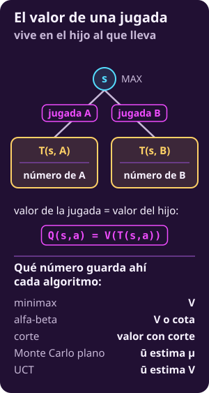
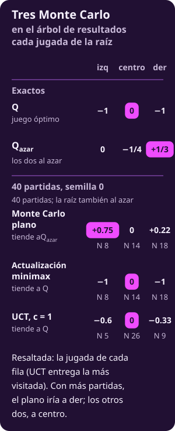
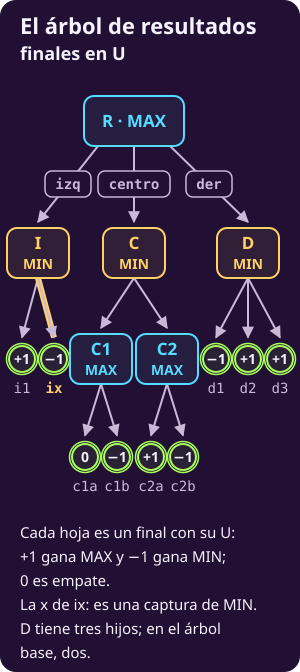
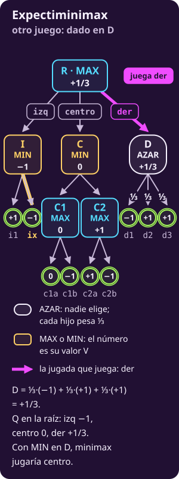
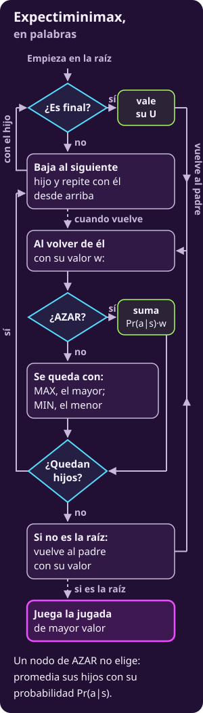
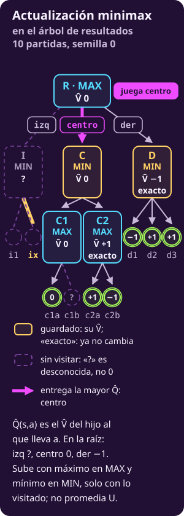

# Radiografía: un árbol, todos los algoritmos

**Siete algoritmos, el mismo mapa:** valor, exploración, elección, propiedades y casos borde. Los recorridos completos están en las páginas a detalle.

**Al final del día, se busca $V(s)$:** el pago para MAX cuando ambos juegan lo mejor. Para elegir, se comparan los $Q(s_{\text{raíz}},a)$ de las jugadas:

- **Minimax** calcula cada $Q$ exacto.
- **Alfa-beta** obtiene el mismo resultado con igual o menos trabajo; puede devolver cotas de las jugadas descartadas.
- **Expectiminimax** calcula el $V$ exacto de otro juego: en D decide un dado.
- **El corte** estima $M\cdot V$ con EVAL donde se detiene.
- **Monte Carlo plano** estima $Q_{\text{azar}}$, el pago esperado si ambos juegan al azar.
- **Monte Carlo con actualización minimax** simula al azar y sube máximos y mínimos; converge a $V$ bajo su contrato.
- **UCT** promedia y mejora su selección. En un árbol finito, con $c>0$ fija y vueltas sin límite, sus $\widehat Q(s,a)$ tienden a $Q(s,a)$ y el valor de la raíz a $V$.

> [!TIP]
> **Míralo correr**
>
> - **▶ [El mismo árbol, todos los algoritmos](../_assets/un_arbol_todos.html)**: elige un algoritmo y mira qué nodos genera, qué jugada entrega y con qué valor.
> - **Las figuras de minimax, alfa-beta, el corte, la quietud y la profundización iterativa se animan:** un halo recorre los nodos en el orden en que el algoritmo los genera y termina en la jugada que juega.

---

## La notación de esta página

**La notación se retoma de la unidad** y de [[notacion-juegos|la hoja de notación]].

**El juego**

::: table {#jue-c3-rx-tab-notacion-juego title="Notación: el juego"}
| Símbolo | Qué es |
|---|---|
| $S$, $s$ | Los estados del juego; cada uno incluye el turno |
| $s_0$ | El estado inicial del juego |
| $s_{\text{raíz}}$ | Donde MAX decide: la **raíz** de la búsqueda |
| $\mathrm{Pl}(s)$ | Quién mueve en $s$: MAX, MIN o AZAR |
| $A(s)$ | Las jugadas permitidas en un estado no final |
| $T(s,a)$ | Adonde lleva la jugada $a$: un **hijo** $s'$ |
| $U(s)$ | Pago de un final, desde MAX. Solo en finales |
| $V(s)$ | Pago para MAX si los dos juegan lo mejor desde $s$ |
| $Q(s,a)$ | Lo mismo, si en $s$ se juega $a$ |
| $\Pr(a\mid s)$ | Probabilidad de cada resultado de un nodo AZAR |
| $b$ | El máximo de jugadas permitidas en un estado |
| $m$ | El largo máximo de una partida, en jugadas |
:::

**Cada juego define su pago terminal desde MAX.** Aquí $U=+1$ si gana MAX, $-1$ si gana MIN y $0$ si empatan; en finales, $V(s)=U(s)$.

**La búsqueda con corte y poda**

::: table {#jue-c3-rx-tab-notacion-busqueda title="Notación: corte y poda"}
| Símbolo | Qué es |
|---|---|
| $\mathrm{EVAL}(s)$ | Estimación de $M\cdot V(s)$ que mira solo $s$ |
| $M$ | Escala de los finales; aquí $M=100$ y $\lvert\mathrm{EVAL}\rvert<M$ |
| $d$ | Las decisiones que quedan, de los dos jugadores |
| $V_d(s)$ | El valor con corte de $s$ cuando quedan $d$ |
| $(\alpha,\beta)$ | Ventana de alternativas del camino, no cotas del nodo |
:::

**La simulación**

::: table {#jue-c3-rx-tab-notacion-simulacion title="Notación: simulación"}
| Símbolo | Qué es |
|---|---|
| $N(s)$ | Cuántas simulaciones o vueltas pasaron por $s$ |
| $N(s,a)$ | Cuántas tomaron la jugada $a$ en $s$ |
| $\widehat Q(s,a)$ | Estimación por jugada; su objetivo depende del algoritmo |
| $\widehat V(s)$ | Estimación por estado; su objetivo depende del algoritmo |
| $Q_{\text{azar}}$ | Pago esperado si **los dos** juegan al azar; en general no es $Q$ |
| $k$ | Simulaciones por jugada de la raíz, en Monte Carlo plano |
| $n$ | Simulaciones, iteraciones o vueltas **en total** |
| $c>0$ | El peso de explorar en el puntaje de UCT |
| $h$ | La profundidad que alcanzó el árbol de UCT; a lo más $m$ |
:::

**El gorro marca una estimación hecha con partidas simuladas.** Monte Carlo plano estima $Q_{\text{azar}}$; la actualización minimax y UCT, $Q$. Sin gorro, $V$, $Q$ y $Q_{\text{azar}}$ son valores exactos.

---

## Valor de un estado y valor de una jugada

**Los valores siempre se miden desde MAX**, como en [[diagnosticar-el-juego|Diagnosticar el juego]] y [[minimax|Minimax]]:

- **El estado vale $V(s)$:** el pago para MAX si ambos juegan lo mejor desde $s$.
- **La jugada vale $Q(s,a)$:** ese pago si primero se elige $a$ en $s$.

**Sin azar, una jugada vale lo que el hijo al que lleva:**

$$
\mathbf{Q(s,a)=V(T(s,a))}
$$

- **El estado vale lo que su mejor jugada para quien mueve.** MAX elige el mayor $Q$ y MIN el menor: $\mathbf{V(s)=\max_{a\in A(s)}Q(s,a)}$ si $\mathrm{Pl}(s)=$ MAX, y el mínimo si es MIN.
- **Si decide el azar, el estado promedia.** Con $\mathrm{Pl}(s)=$ AZAR, $V(s)=\sum_a \Pr(a\mid s)\,Q(s,a)$; dibujado el azar como un nodo hijo, $Q(s,a)=V(T(s,a))$ sigue valiendo.
- **Dos jugadas que llevan al mismo estado valen lo mismo.** Pero sus visitas son de aristas distintas; por eso las estadísticas de simulación se guardan por jugada.

**En UCT, $N(s,a)$ y $\widehat Q(s,a)$ son de la arista; $N(s)$ y $\widehat V(s)$, del estado.** Aquí cada hijo tiene un solo padre, así que $\widehat Q(s,a)=\widehat V(T(s,a))$: las figuras dibujan junto al hijo su $N$ y su $\widehat V$.

::: figure {#jue-c3-rx-fig-estado-y-jugada title="El valor de una jugada vive en el hijo al que lleva"}

:::

::: table {#jue-c3-rx-tab-que-guarda title="Qué guarda cada algoritmo, dónde y cómo sube"}
| Algoritmo | Guarda | Dónde | Sube |
|---|---|---|---|
| Minimax | $V$ | Nodo | Máx. o mín. |
| Alfa-beta | $V$ o cota | Nodo | Máx. o mín.; poda |
| Expectiminimax | $V$ con dado | Nodo | Máx., mín. o suma |
| Corte | $V_d$ o cota | Nodo | Máx. o mín.; EVAL |
| MC plano | $N$ y suma | Raíz | No sube |
| Act. minimax | $\widehat V(s)$, $\widehat Q(s,a)$ | Lo descubierto | Máx. o mín. |
| UCT | $N$, $\widehat Q(s,a)$; $N$, $\widehat V(s)$ | Arista; estado | Promedio |
:::

- **Los cuatro primeros calculan desde los hijos.** Solo expectiminimax promedia, en AZAR.
- **La actualización minimax guarda $\widehat V$ por estado descubierto** y copia ese valor en la $\widehat Q$ de la jugada entrante.
- **UCT también guarda $N(s)$**, que usa para calcular el bono.

**Converge a lo que simulas.** Los tres Monte Carlo usan partidas hasta un final, pero llegan a números distintos:

::: table {#jue-rx-tab-converge title="Los tres Monte Carlo: a qué converge cada uno"}
| Algoritmo | Sube | Converge a |
|---|---|---|
| MC plano | No sube | $Q_{\text{azar}}$ |
| Act. minimax | Máx. o mín. | $Q$ y $V$ |
| UCT | Promedio | $Q$ y $V$ |
:::

- **Monte Carlo plano converge a $Q_{\text{azar}}$**, con muestras independientes y una regla al azar fija.
- **La actualización minimax converge a $V$ porque sube máximos y mínimos**, bajo su contrato.
- **UCT converge porque mejora su selección, no porque promedie un máximo.** En un árbol finito, con $c>0$ fija y vueltas sin límite, la fracción de visitas a jugadas inferiores tiende a cero.
- **Con presupuesto fijo, ninguno garantiza $V$.**

::: figure {#jue-rx-fig-tres-mc title="Los tres Monte Carlo en el árbol de resultados"}

:::

**La figura usa una variante:** Monte Carlo plano reparte 40 partidas eligiendo también al azar en la raíz. Sus $N$ son 8, 14 y 18; la ficha usa $k=5$ por jugada.

---

## El problema: un juego, dos dibujos

**Dado:** el estado $s_{\text{raíz}}$ de MAX, las reglas y un presupuesto. **Encontrar:** la mejor jugada posible de $A(s_{\text{raíz}})$. Seis algoritmos comparten juego; expectiminimax introduce un dado en D.

**El primer dibujo representa un juego cualquiera.** MAX y MIN alternan niveles; hay hasta $b$ jugadas por estado y $m$ por partida.

::: figure {#jue-c3-rx-arbol-abstracto title="Un juego cualquiera, en abstracto"}

:::

**El segundo dibujo es el árbol de resultados**, basado en [[minimax-como-algoritmo|Minimax como algoritmo]]. MAX mueve en R: izq, centro y der llevan a I, C y D, donde mueve MIN. Cambia en tres cosas:

- **Sus finales dicen quién gana.** Cada hoja vale $+1$, $-1$ o $0$, y hay un solo empate.
- **Tiene una captura.** La segunda respuesta de MIN en I, ix, captura una pieza; eso importa para la búsqueda de quietud.
- **D tiene tres hijos**, no dos. En total, el árbol tiene 15 nodos.

**Este dibujo no lleva EVAL.** De los siete, solo el corte la necesita, y sus valores van en las figuras de su ficha.

::: figure {#jue-c3-rx-arbol-tpm title="El árbol de resultados: jugadas y finales en U, sin EVAL"}

:::

---

## La EVAL

**El corte sustituye la continuación por EVAL**, que estima $M\cdot V$ mirando solo el estado. Aquí $M=100$.

- **Si un algoritmo usa EVAL, cuenta los finales como $\mathbf{M\cdot U}$:** una victoria vale $100$, más que cualquier EVAL, porque $|\mathrm{EVAL}|<M$.
- **Un final se reconoce antes de cortar.** Aunque ya no quede profundidad, vale su $M\cdot U$; nunca se estima.
- **Si un algoritmo no usa EVAL, trabaja directo con $U$**, entre $-1$ y $+1$.

---

## Explorar contra jugar

**Los siete trabajan en dos tiempos:**

1. **Exploran:** recorren o construyen parte del árbol para asignar números a las jugadas de la raíz.
2. **Juegan:** eligen una jugada; tras la respuesta rival, buscan desde el nuevo estado.

**Explorar no obliga a jugar:** se puede investigar una jugada y entregar otra. Las fichas separan «1 · Exploración» de «2 · Elección».

**El orden y los empates.** Los hijos se recorren en el orden del dibujo, de izquierda a derecha, salvo que la ficha diga otro. Un empate en la raíz lo gana la primera jugada en el orden que usó esa búsqueda.

**Se puede interrumpir (*anytime*)** un algoritmo que, si se le detiene, ya tiene una jugada que entregar. Tenerla no garantiza que sea buena.

---

## Lo que suponen: dos jugadores y suma cero

**Las fichas suponen dos jugadores, suma cero o constante, turnos y todo a la vista.** Esta nota reúne las alternativas:

::: remark {#jue-rx-nota-suma-cero title="Suma cero, suma no constante y más jugadores"}
**«MIN minimiza lo de MAX» solo vale con dos jugadores y suma cero o constante.** Entonces cada final tiene un solo número, y el $-1$ de MAX es el mejor final para MIN.

- **Dos jugadores, suma no constante:** usan $(U_1,U_2)$; maximizar $U_2$ no equivale necesariamente a minimizar $U_1$.
- **Más jugadores: max$^n$** (Luckhardt e Irani, 1986) usa $(U_1,\dots,U_n)$. Quien mueve maximiza su componente y copia el vector elegido.
- **Max$^n$ da un equilibrio** en árboles finitos, por turnos y con todo a la vista, con desempate fijo. No conserva la garantía escalar de minimax.
- **Alfa-beta ordinaria no se traslada:** la poda superficial requiere cotas individuales y sobre la suma (Korf, 1991). No ofrece el ahorro de alfa-beta.
- **El paranoico (*Paranoid*)** (Sturtevant y Korf, 2000) agrupa rivales en una coalición MIN: recupera alfa-beta para un juego más pesimista.
- **UCT con vectores** guarda promedios individuales; cada jugador selecciona por el suyo. Puede dar equilibrios mixtos bajo las condiciones de Sturtevant (2008).
:::

---

## Las siete fichas

### Minimax

**Minimax recorre todo el árbol hasta los finales y sube máximos y mínimos.** El recorrido está en [[minimax-como-algoritmo|Minimax como algoritmo]].

- **Qué valor rastrea:** calcula $V(s)$ y $Q(s,a)=V(T(s,a))$.
- **Dónde lo guarda:** cada llamada conserva el valor hasta entregarlo al padre.
- **Cómo sube:** toma el máximo en MAX y el mínimo en MIN.
- **A qué converge:** no requiere convergencia; termina con valores exactos.

**1 · Exploración: cómo obtiene su número**

**Recorre en profundidad** (*depth-first search*), en el orden del dibujo. Un final vale su pago; un nodo se cierra cuando conoce todos sus hijos.

| Nodo | Su valor |
|---|---|
| Final | $\mathbf{V(s)=U(s)}$ |
| $\mathrm{Pl}(s)=$ MAX | $\mathbf{V(s)=\max_{a\in A(s)} Q(s,a)}$ |
| $\mathrm{Pl}(s)=$ MIN | $\mathbf{V(s)=\min_{a\in A(s)} Q(s,a)}$ |

**Si MAX juega óptimamente, asegura $V$.** Obtiene ese pago contra MIN óptimo; ante errores de MIN, puede ganar más, nunca menos.

**Ejemplo en un nodo de MAX.** Tiene dos hijos de MIN, cada uno con dos finales debajo.

| Jugada de MAX | Finales debajo | $Q$ de la jugada |
|---|---|---|
| $a$ | $+1$ y $-1$ | $-1$ |
| $b$ | $0$ y $0$ | $0$ |

**MAX asegura el empate con $b$:** MIN evita la victoria bajo $a$. Ambos pares promedian $0$, pero valen distinto. **Decide lo que MAX puede asegurar, no el mejor final que hay debajo ni el promedio.**

**2 · Elección: qué jugada juega**

**Juega la de mayor $Q$ al cerrar la raíz**, con el desempate por orden. Explorar y elegir usan el mismo número.

**3 · Propiedades**

- **Número que da:** entrega el $Q$ exacto de cada jugada.
- **Usa EVAL:** no; trabaja con pagos terminales $U$.
- **Garantía:** entrega $V$ y una jugada óptima.
- **Se puede interrumpir:** esta versión entrega solo al cerrar la raíz.
- **Complejidad:** genera hasta $1+b+\dots+b^m$ nodos: tiempo $O(b^m)$. Guarda el camino y las jugadas pendientes: memoria $O(bm)$.
- **Frente a los demás:** sirve de referencia; su costo exponencial obliga a buscar alternativas.
- **Supuestos:** requiere un árbol finito, dos jugadores, turnos, todo a la vista, suma cero o constante y ausencia de azar. Con más jugadores, corresponde max$^n$ (@jue-rx-nota-suma-cero).

**4 · Casos borde**

- **Empate:** todas las jugadas empatadas son óptimas; juega la primera.
- **Una sola jugada:** queda forzada, y $V(s)=Q(s,a)$.
- **Final ya en el árbol:** vale su $U$ y no genera hijos. Si la raíz misma es final, no hay jugada que entregar.
- **Finales a distintas profundidades:** no prefiere ganar pronto ni perder tarde, salvo que $U$ lo codifique.

::: figure {#jue-c3-rx-fig-minimax title="Minimax en el árbol de resultados: genera los 15 nodos y juega centro"}

:::

::: figure {#jue-c3-rx-fig-flujo-minimax title="Minimax, en palabras"}

:::

---

### Alfa-beta

**Alfa-beta es minimax con poda (*pruning*):** omite ramas cuando basta lo revisado para decidir en la raíz. El recorrido está en [[alfa-beta-como-algoritmo|Alfa-beta como algoritmo]].

- **Qué valor rastrea:** calcula $V$ o cotas: «al menos» o «a lo más».
- **Dónde lo guarda:** cada llamada conserva el valor y su ventana $(\alpha,\beta)$.
- **Cómo sube:** toma máximos o mínimos y poda.
- **A qué converge:** no requiere convergencia; termina con el valor exacto de la jugada elegida.

**1 · Exploración: cómo obtiene su número**

**La ventana reúne alternativas del camino:** $\alpha$ para MAX y $\beta$ para MIN, medidas desde MAX. No acota por sí sola este nodo; la raíz empieza con $(-\infty,+\infty)$.

**La regla de poda en un nodo de MAX**, con $v$ el mayor número que le han devuelto sus hijos:

$$
\mathbf{v\ge\beta\;\Rightarrow\;\text{no genera sus hijos restantes}}
$$

- **Con $v\ge\beta$, MIN ya tiene una alternativa igual o mejor:** los hijos restantes solo podrían aumentar el máximo.
- **La igualdad también permite podar.**

| Mueve | Poda si | Nombre | Si no poda |
|---|---|---|---|
| MAX | $\mathbf{v\ge\beta}$ | Corte beta | $\alpha\leftarrow\max(\alpha,v)$ |
| MIN | $\mathbf{v\le\alpha}$ | Corte alfa | $\beta\leftarrow\min(\beta,v)$ |

**El retorno $w$ se interpreta contra la ventana de entrada**, con $\alpha_0<\beta_0$:

| Lo que devuelve | Qué asegura |
|---|---|
| $w\le\alpha_0$ | $V\le w$: «a lo más» |
| $\alpha_0<w<\beta_0$ | $V=w$: exacto |
| $w\ge\beta_0$ | $V\ge w$: «al menos» |

**No podar en un nodo no garantiza que su número sea exacto:** una poda en un descendiente pudo dejarle solo una cota.

**Ejemplo en un nodo de MAX, con pagos cualquiera** (un juego cuyo $U$ va de $0$ a $10$). Llega con $\beta=4$: más arriba, MIN ya tiene una jugada que le da $4$.

| Caso | 1.er hijo | ¿Poda? | Devuelve |
|---|---|---|---|
| $a$ | $6$ | Sí: $6\ge 4$ | $6$: «$\ge 6$» |
| $b$ | $4$ | Sí: $4\ge 4$ | $4$: «$\ge 4$» |
| $c$ | $3$ | No: $3<4$ | Sigue con el segundo |

**Decide la comparación con $\beta$.** En $a$, omite el segundo hijo y devuelve la cota inferior $6$; en $c$, debe seguir.

**2 · Elección: qué jugada juega**

**Juega la mejor jugada demostrada en la raíz.** Solo la cambia si $w>\alpha$; empatar con $\alpha$ podría indicar una cota superior.

| Decisión | Compara | Regla |
|---|---|---|
| Poda en un nodo de MAX | $v$ con $\beta$ | $\mathbf{v\ge\beta}$ |
| Elección en la raíz | $w$ con $\alpha$ | $\mathbf{w>\alpha}$ |

**3 · Propiedades**

- **Número que da:** entrega el $Q$ exacto de la elegida; las descartadas pueden tener solo cotas.
- **Usa EVAL:** no; trabaja con $U$.
- **Garantía:** obtiene el mismo $V$ y, con igual orden y desempate, la misma jugada que minimax.
- **Se puede interrumpir:** esta versión entrega solo al terminar el recorrido.
- **Complejidad:** en un árbol aproximadamente uniforme, cuesta $O(b^{m/2})$ con orden perfecto y $O(b^m)$ con el peor; usa memoria $O(bm)$. El orden perfecto prueba primero la mejor jugada para quien mueve.
- **Frente a los demás:** conserva la respuesta de minimax con igual o menos trabajo. Con corte y orden perfecto permite mirar cerca del doble de hondo.
- **Supuestos:** comparte los de minimax; con más jugadores requiere otras reglas de poda (@jue-rx-nota-suma-cero).

**4 · Casos borde**

- **Empate en la raíz:** $w>\alpha$ conserva la primera jugada empatada, como minimax.
- **Un final entre los primeros hijos** puede provocar la poda de inmediato, si su $U$ alcanza la ventana.
- **El orden:** con mal orden puede generar los mismos nodos que minimax. Cambiar el orden no cambia el valor óptimo, pero puede cambiar la jugada elegida entre empates.

::: figure {#jue-c3-rx-fig-alfa-beta title="Alfa-beta en el árbol de resultados: 12 de 15 nodos, la misma jugada"}

:::

::: figure {#jue-c3-rx-fig-flujo-alfa-beta title="Alfa-beta, en palabras"}

:::

---

### Expectiminimax: otro juego, con un dado en D

**Esta ficha resuelve otro juego, con un dado parejo de tres caras en D en vez de MIN.** Las otras seis no tienen azar; el recorrido está en [[cuando-decide-un-dado|Cuando decide un dado]].

- **Qué valor rastrea:** calcula $V$, el pago esperado para MAX bajo juego óptimo.
- **Dónde lo guarda:** cada llamada conserva el valor, como en minimax.
- **Cómo sube:** toma máximos en MAX, mínimos en MIN y esperanzas en AZAR.
- **A qué converge:** no requiere convergencia; calcula esperanzas exactas, sin muestrear.

**1 · Exploración: cómo obtiene su número**

**Recorre el árbol entero como minimax;** solo cambia la regla de los nodos AZAR, que necesitan **todos** sus hijos.

| Nodo | Su valor |
|---|---|
| Final | $\mathbf{V(s)=U(s)}$ |
| $\mathrm{Pl}(s)=$ MAX | $\mathbf{V(s)=\max_{a} Q(s,a)}$ |
| $\mathrm{Pl}(s)=$ MIN | $\mathbf{V(s)=\min_{a} Q(s,a)}$ |
| $\mathrm{Pl}(s)=$ AZAR | $\mathbf{V(s)=\sum_{a} \Pr(a\mid s)\,Q(s,a)}$ |

**$\Pr(a\mid s)$ la dan las reglas:** no son negativas y suman $1$. La suma es una esperanza, $E[\cdot]$.

**Ejemplo: el mismo par de finales, $+1$ y $-1$, debajo de dos nodos distintos.**

| Quién decide | Su valor |
|---|---|
| MIN | $-1$ |
| Un volado parejo | $(+1-1)/2=0$ |

**Donde decide un rival se toma el mínimo; donde decide el azar, el promedio.**

**2 · Elección: qué jugada juega**

**Juega la de mayor $Q$ del juego con dado**, con el desempate por orden.

**Con dado, D vale $(-1+1+1)/3=1/3$:** supera el $0$ de centro y el $-1$ de I. Juega der y genera los 15 nodos. **El valor es exacto para otro juego:** con MIN en D, der vale $-1$. Con dos hijos, el dado no cambiaba la jugada; por eso D tiene tres.

**3 · Propiedades**

- **Número que da:** entrega el $Q$ exacto de cada jugada en el juego con dado.
- **Usa EVAL:** no; trabaja con $U$. Solo las transformaciones afines positivas, como $2U+1$, preservan siempre la elección.
- **Garantía:** maximiza el pago esperado contra MIN óptimo y las $\Pr$ del juego, no el resultado de cada partida.
- **Se puede interrumpir:** esta versión entrega al cerrar la raíz.
- **Complejidad:** cuesta $O(b^m)$ y usa memoria $O(bm)$; $b$ incluye resultados del azar y $m$, decisiones y tiradas. La poda en AZAR requiere cotas conocidas de los pagos.
- **Frente a los demás:** con un solo resultado, de probabilidad $1$, el azar se vuelve determinista. Monte Carlo plano estima $Q_{\text{azar}}$: el expectiminimax que sustituye por azar todas las decisiones posteriores a la jugada evaluada.
- **Supuestos:** dos jugadores de suma cero o constante, más un azar con probabilidades conocidas (@jue-rx-nota-suma-cero).

**4 · Casos borde**

- **Un dado con una sola cara** es una jugada forzada: vale lo que su único hijo.
- **Un cambio de escala no afín** puede cambiar la jugada aunque conserve el orden de los finales. Aquí, con pagos $\pm1$ y $0$, elevar al cubo no cambia nada; en un juego con otros pagos, sí puede.
- **Empate y finales a distintas profundidades:** como en minimax.

::: figure {#jue-rx-fig-expectiminimax title="Expectiminimax en el árbol de resultados con un dado en D: juega der"}

:::

::: figure {#jue-rx-fig-flujo-expectiminimax title="Expectiminimax, en palabras"}

:::

---

### Minimax con corte: por nivel o por reloj

**El corte usa EVAL al agotar la profundidad.** Por nivel, fija cuánto mirar; por reloj, repite búsquedas más profundas. Los recorridos están en [[cortar-y-evaluar|Cortar y evaluar]] y [[jugar-contra-el-reloj|Hasta dónde mirar]].

- **Qué valor rastrea:** calcula $V_d$, el minimax del árbol cortado; la quietud lo modifica y la poda puede devolver cotas.
- **Dónde lo guarda:** cada llamada conserva el valor; la quietud puede explorar más allá del corte.
- **Cómo sube:** toma máximos o mínimos desde EVAL o pagos terminales.
- **A qué converge:** no promedia; obtiene $M\cdot V$ si alcanza los finales sin EVAL ni quietud.

**1 · Exploración: cómo obtiene su número**

**Los casos se revisan en este orden**, con $d$ las decisiones que quedan:

| Nodo | Valor con corte |
|---|---|
| Final | $\mathbf{V_d(s)=M\cdot U(s)}$ |
| No final, $d=0$ | $\mathbf{V_0(s)=\mathrm{EVAL}(s)}$ |
| MAX, $d\ge1$ | $\mathbf{V_d(s)=\max_{a}V_{d-1}(T(s,a))}$ |
| MIN, $d\ge1$ | $\mathbf{V_d(s)=\min_{a}V_{d-1}(T(s,a))}$ |

- **Primero comprueba el final (*terminal test*):** devuelve $M\cdot U$, incluso con $d=0$. Solo un estado no final con $d=0$ es un nodo de corte (*cutoff*).
- **Cada jugada consume un nivel**, sea de quien sea; MAX toma el mayor valor y MIN, el menor.

**Ejemplo en un nodo de MAX con $d=1$.**

| Hijo | Tipo | Valor |
|---|---|---|
| $a$ | No final | EVAL $40$ |
| $b$ | Final: gana MAX | $100$ |

**Elige $b$: el final se reconoce antes de evaluar.** Asignarle EVAL $30$ haría preferir $a$ y perder la victoria.

**Con poda es alfa-beta con corte:** las mismas cotas sobre el árbol cortado, el mismo valor en la raíz.

**Por reloj: profundización iterativa (*iterative deepening*).** Repite alfa-beta con corte con $d=1,2,3,\dots$:

- **Guarda como respaldo la primera jugada legal.**
- **Prueba primero la mejor jugada anterior**, para subir $\alpha$ y podar antes.
- **Revisa el reloj antes de cada búsqueda y tras cada hijo de la raíz.** No interrumpe a ese hijo; el plazo no es estricto.
- **Si un hijo devuelve $+M$ y aún queda tiempo, entrega esa jugada de inmediato:** ninguna EVAL alcanza $M$, así que demuestra una victoria.

**Horizonte y quietud.**

- **El efecto horizonte (*horizon effect*) oculta una consecuencia decisiva detrás del corte.** Aumentar $d$ lo desplaza, sin eliminarlo.
- **La búsqueda de quietud (*quiescence search*) sigue capturas desde el corte**, hasta estados quietos o finales. Quien mueve compara cada captura con su EVAL actual.
- **Quedarse con EVAL (*stand pat*) es una aproximación, no una jugada legal.** Puede suponer una jugada tranquila inexistente cuando todas las jugadas sin captura pierden.

**2 · Elección: qué jugada juega**

| Versión | Jugada disponible | Cuándo |
|---|---|---|
| Por nivel | Mayor valor con corte | Al terminar |
| Por reloj | Última búsqueda completa | Al vencer el plazo |
| Por reloj, con $+M$ | Esa jugada | Al encontrarla |

**Por reloj, la búsqueda que el plazo interrumpe se descarta;** si no terminó ninguna, entrega el respaldo. Ante empate conserva la primera jugada en el orden de esa búsqueda.

**3 · Propiedades**

- **Número que da:** calcula valores exactos del árbol cortado, como estimaciones de $M\cdot V$. Con poda, solo garantiza exactitud para la elegida.
- **Usa EVAL:** sí; reserva $M\cdot U$ para finales.
- **Garantía:** obtiene $M\cdot V$ y una jugada óptima si alcanza los finales sin aplicar EVAL ni activar quietud.
- **Se puede interrumpir:** por nivel, no; por reloj, sí, con respaldo legal.
- **Complejidad:** cuesta $O(b^d)$ sin poda y entre $O(b^{d/2})$ y $O(b^d)$ con alfa-beta; usa memoria $O(bd)$. Si cada profundidad cuesta $B>1$ veces la anterior, repetir cuesta cerca de $B/(B-1)$ veces la última: con $B=10$, un 11 % más. Si no crece parejo puede costar más: en el árbol de resultados, las búsquedas con $d=1$ y $d=2$ suman 13 nodos y la última, 12.
- **Frente a los demás:** permite decidir sin alcanzar finales, pero depende de EVAL. La quietud puede costar $O(b^m)$ y usar memoria $O(bm)$.
- **Supuestos:** comparte los de minimax; más jugadores requieren pagos y EVAL vectoriales (@jue-rx-nota-suma-cero).

**4 · Casos borde**

- **Un final con $d=0$:** vale $M\cdot U$, no su EVAL.
- **Finales a distintas profundidades:** el que cae antes del corte vale $M\cdot U$; el que queda detrás no se ve.
- **El reloj vence antes de terminar $d=1$:** entrega el respaldo.
- **Captura obligada:** si quien mueve está obligado a capturar, quedarse puede ocultar su única jugada legal.

**En las figuras de esta ficha, el árbol de resultados lleva una EVAL inventada:** I $60$, C $20$ y D $10$; con $d=2$, también C1 $10$ y C2 $50$. La de I es mala a propósito: no ve que la captura ix pierde.

::: figure {#jue-c3-rx-fig-corte title="Corte a d = 1 en el árbol de resultados: 4 nodos, juega izq"}

:::

::: figure {#jue-c3-rx-fig-quietud title="Búsqueda de quietud a d = 1 en el árbol de resultados: juega centro"}

:::

::: figure {#jue-c3-rx-fig-iterativa title="Profundización iterativa en el árbol de resultados: d = 1, 2, 3"}

:::

::: figure {#jue-c3-rx-fig-flujo-corte title="El corte, en palabras"}

:::

---

### Monte Carlo plano

**Monte Carlo plano (*flat Monte Carlo*) estima cada jugada promediando pagos de partidas al azar.** No construye un árbol; el recorrido está en [[simular-en-vez-de-evaluar|Simular partidas]].

- **Qué valor rastrea:** estima $Q_{\text{azar}}$, no $Q$.
- **Dónde lo guarda:** conserva $N(s_{\text{raíz}},a)$ y una suma por jugada de la raíz.
- **Cómo sube:** envía cada $U$ directamente a esa suma.
- **A qué converge:** con muestras independientes, regla al azar fija y presupuesto ilimitado, $\widehat Q$ converge casi seguramente a $Q_{\text{azar}}$.

**1 · Exploración: cómo obtiene su número**

**Simula $k$ partidas por jugada $a$**, desde $s'=T(s_{\text{raíz}},a)$ hasta un final (*rollout*). Ambos jugadores eligen al azar y parejo; acumula $U$, sin EVAL ni caminos guardados. El total es $n=|A(s_{\text{raíz}})|\,k\le b\,k$.

$$
\mathbf{\widehat Q(s_{\text{raíz}},a)=\frac{1}{N(s_{\text{raíz}},a)}\sum U}
$$

- **Lo que estima, $Q_{\text{azar}}$, es el pago esperado si después los dos eligen al azar.** Cada camino pesa el producto de $1/|A(s)|$ en cada estado que cruza, así que no es el promedio simple de las hojas.
- **Cuánto confiar en el promedio:** con simulaciones independientes y pagos en $[-1,1]$, el margen alrededor de $Q_{\text{azar}}$ se encoge como $1/\sqrt{N}$. La cota de Hoeffding está en [[de-donde-sale-el-bono|De dónde sale el bono]].

**Ejemplo: dos jugadas de MAX.** Después de cada una, una respuesta de MIN termina la partida.

| Jugada | Pagos finales | $Q_{\text{azar}}$ | $Q$ |
|---|---|---|---|
| $a$ | $+1,\ +1,\ -1$ | $1/3$ | $-1$ |
| $b$ | $0,\ 0$ | $0$ | $0$ |

**Monte Carlo plano acaba prefiriendo $a$:** al azar, MAX gana dos de tres continuaciones. MIN puede elegir la derrota; $b$ asegura el empate. **Más simulaciones no lo corrigen:** el promedio de $a$ converge a $1/3$, no a $-1$.

**2 · Elección: qué jugada juega**

**Juega la de mayor $\widehat Q$**, con el desempate por orden; el reparto de muestras no depende de los resultados. Si se interrumpe, compara promedios aunque haya cantidades distintas por jugada.

**3 · Propiedades**

- **Número que da:** entrega $\widehat Q$ por jugada, como estimación de $Q_{\text{azar}}$.
- **Usa EVAL:** no; necesita reglas, detección de finales y pagos.
- **Garantía:** ninguna sobre $V$; incluso su límite puede favorecer una jugada equivocada.
- **Se puede interrumpir:** entrega desde la primera muestra; comparar todas las jugadas requiere una por cada una.
- **Complejidad:** cuesta $O(m)$ por simulación y $O(nm)$ en total. Guarda contador y suma por jugada: memoria $O(b)$.
- **Frente a los demás:** usa pagos terminales como minimax, pero ahorra trabajo suponiendo juego al azar.
- **Supuestos:** admite pagos vectoriales; estima continuaciones al azar, no max$^n$ (@jue-rx-nota-suma-cero).

**4 · Casos borde**

- **Una jugada que lleva directo a un final:** cada simulación da el mismo $U$, así que su $\widehat Q$ es exacta desde la primera.
- **Finales a distintas profundidades:** el mismo número de simulaciones no cuesta lo mismo en todas las jugadas.
- **Una respuesta certera descubierta tarde:** en el promedio pesa solo $1/N$, y no cambia hacia dónde converge.
- **Jugada no visitada:** sin promedio; no vale $0$.

::: figure {#jue-c3-rx-fig-mc-plano title="Monte Carlo plano en el árbol de resultados: 5 simulaciones por jugada, juega der"}

:::

::: figure {#jue-c3-rx-fig-flujo-mc-plano title="Monte Carlo plano, en palabras"}

:::

---

### Monte Carlo con actualización minimax

**Simula al azar, conserva lo descubierto y sube máximos y mínimos.** Kocsis y Szepesvári (2006), *Bandit based Monte-Carlo Planning*, llaman a este método *Monte-Carlo planning with minimax value update* (MMMC). El recorrido está en [[simular-en-vez-de-evaluar|Simular partidas]].

- **Qué valor rastrea:** estima el minimax de lo descubierto con $\widehat V(s)$ y $\widehat Q(s,a)=\widehat V(T(s,a))$.
- **Dónde lo guarda:** conserva el árbol descubierto.
- **Cómo sube:** toma máximos en MAX y mínimos en MIN, sobre jugadas visitadas.
- **A qué converge:** converge casi seguramente a $V$, bajo su contrato.

**1 · Exploración: cómo obtiene su número**

**Cada iteración juega una partida al azar y parejo hasta un final real**, agrega los estados nuevos y sube por el camino:

| Estado | Su estimación |
|---|---|
| Final descubierto | $\mathbf{\widehat V(z)=U(z)}$ |
| $\mathrm{Pl}(s)=$ MAX | $\mathbf{\widehat V(s)=\max_{a\text{ visitada}}\widehat Q(s,a)}$ |
| $\mathrm{Pl}(s)=$ MIN | $\mathbf{\widehat V(s)=\min_{a\text{ visitada}}\widehat Q(s,a)}$ |

- **Una jugada no visitada es desconocida, nunca cero.** El máximo o el mínimo sobre las visitadas es **provisional**.
- **Un final vuelve exacta la $\widehat Q$ de la jugada que lleva a él.** Un nodo de MIN queda resuelto en cuanto tiene un hijo con valor **exacto** $-1$, el peor pago posible para MAX.
- **No se promedia el $U$ crudo por jugada:** promediar y después tomar el máximo seguiría estimando $Q_{\text{azar}}$.

**Ejemplo: las mismas dos jugadas de Monte Carlo plano.** Supón que $b$, que da $0$, ya fue visitada, y que la respuesta $-1$ bajo $a$ aparece hasta la tercera visita:

| Lo visto bajo $a$ | Promedio de $U$ | Actualización minimax |
|---|---|---|
| $+1$, $+1$ | $1$ | $1$, provisional |
| $+1$, $+1$, $-1$ | $1/3$ | $-1$, exacto |

**Al descubrir $-1$, la actualización minimax cambia a $b$;** el promedio sigue prefiriendo $a$.

**La secuencia impuesta de [[simular-en-vez-de-evaluar|Simular partidas]] muestra lo mismo:** después de 29 pagos $+10$ por A y uno de $-30$, su promedio queda en $8.67$. Sigue superando a B, de $-10$; la actualización minimax salta a $-30$ y cambia a B.

**2 · Elección: qué jugada juega**

**Juega la de mayor $\widehat Q$ disponible**, con el desempate por orden; sin muestras, entrega la primera legal. Una jugada no visitada es desconocida, nunca cero.

**3 · Propiedades**

- **Número que da:** entrega una $\widehat Q$ provisional por jugada visitada; es exacta cuando el subárbol queda resuelto.
- **Usa EVAL:** no; una frontera permanente de EVAL cambia el objetivo al minimax del árbol cortado.
- **Garantía:** converge casi seguramente a $V$ en un árbol finito, determinista y de ramificación finita, conservando lo descubierto. En cada estado enumera todas las jugadas; las partidas independientes muestrean uniformemente hasta finales reales con pagos exactos.
- **Se puede interrumpir:** entrega desde la primera partida.
- **Complejidad:** cada iteración simula $O(m)$ jugadas y revisa hasta $b$ hijos por nivel: cuesta $O(bm)$. Añade hasta $m+1$ estados; la memoria es $O(nm)$, limitada por el árbol completo.
- **Frente a los demás:** cambia el operador de Monte Carlo plano y puede jugar peor con poco presupuesto. Muestrea uniforme y sube máximos o mínimos; UCT mejora la selección y promedia.
- **Supuestos:** comparte los de minimax; con más jugadores, la extensión natural usa max$^n$ (@jue-rx-nota-suma-cero). Los ciclos requieren una regla que vuelva finito el árbol.

**Con presupuesto fijo no garantiza $V$.** En el peor caso necesita descubrir todo el árbol.

**4 · Casos borde**

- **Final directo:** la $\widehat Q$ de esa jugada es su $U$, exacta desde que se descubre.
- **Jugada no visitada:** desconocida, no cero. Tomarla como cero haría que un máximo provisional pudiera preferirla sin haberla visto.
- **Empates:** la jugada entregada puede cambiar entre óptimas mientras se descubre el árbol; una vez descubierto, se estabiliza.
- **Una sola jugada:** su valor sube sin que el máximo o el mínimo decidan nada.

**Con 10 partidas y semilla 0, juega centro.** D queda resuelto en $-1$ desde la cuarta, al aparecer d1; C sigue provisional en $0$ e izq, sin visitar.

::: figure {#jue-rx-fig-mmmc title="Actualización minimax en el árbol de resultados: 10 partidas, juega centro"}

:::

::: figure {#jue-rx-fig-flujo-mmmc title="Actualización minimax, en palabras"}

:::

---

### UCT

**UCT (*Upper Confidence bounds applied to Trees*) selecciona con UCB.** Pertenece a MCTS, la búsqueda en árbol de Monte Carlo (*Monte Carlo Tree Search*). Simula desde su frontera y juega por visitas; el recorrido está en [[monte-carlo-en-un-arbol-grande|MCTS con UCT]].

- **Qué valor rastrea:** estima $Q(s,a)$ promediando los pagos de las vueltas que tomaron esa jugada, desde MAX.
- **Dónde lo guarda:** conserva $N(s,a)$ y $\widehat Q(s,a)$ por arista, y $N(s)$ y $\widehat V(s)$ por estado.
- **Cómo sube:** promedia el mismo $U$ en todo el camino.
- **A qué converge:** en un árbol finito, con $c>0$ fija y vueltas sin límite, sus $\widehat Q(s,a)$ tienden a $Q(s,a)$ y el valor de la raíz a $V$.

**1 · Exploración: cómo obtiene su número**

**Construye su propio árbol, que empieza con solo la raíz.** Cada **vuelta** tiene cuatro fases:

1. **Selección (*selection*).** Baja con UCT hasta una jugada sin agregar o un final.
2. **Expansión (*expansion*).** Agrega el primer hijo pendiente; un final pasa directo a retropropagación.
3. **Simulación.** Desde el hijo nuevo juega al azar hasta un final, sin agregar esos estados ni usar EVAL.
4. **Retropropagación (*backpropagation*).** Cada estado suma una visita a $N(s)$ y mete $U$ en su $\widehat V(s)$; cada arista incrementa $N(s,a)$ e incorpora el mismo $U$ en $\widehat Q(s,a)$.

**El puntaje de la selección**, con $\text{bono}=c\sqrt{\ln N(s)/N(s,a)}$:

| Quién mueve | Elige | Puntaje |
|---|---|---|
| MAX | El mayor | $\mathbf{\widehat Q(s,a)+\text{bono}}$ |
| MIN | El menor | $\mathbf{\widehat Q(s,a)-\text{bono}}$ |

- **MIN minimiza $\widehat Q-\text{bono}$**, equivalente a maximizar $-\widehat Q+\text{bono}$; $c$ mantiene su signo.
- **El promedio aprovecha (*exploitation*) y el bono explora (*exploration*).** Si el padre recibe visitas, crece el bono de la jugada olvidada; la expansión atiende antes las jugadas con $N(s,a)=0$.
- **El puntaje guía la búsqueda, pero no estima un pago.** Su explicación está en [[de-donde-sale-el-bono|De dónde sale el bono]].

**Ejemplo en un nodo de MAX.**

| Jugada | Promedio | Bono | Puntaje |
|---|---|---|---|
| $a$ | $0.5$ | $0.1$ | $0.6$ |
| $b$ | $0.2$ | $0.3$ | $0.5$ |

**Decide la suma:** elige $a$, aunque $b$ tenga más bono. Con bono $0.6$, $b$ sumaría $0.8$ y sería elegida.

**El promedio se acerca al mínimo porque MIN concentra visitas en sus mejores respuestas.** El $\widehat V(s)$ que dibujan las figuras promedia las vueltas que pasaron por $s$; no toma máximos ni mínimos de sus $\widehat Q$.

**2 · Elección: qué jugada juega**

**Juega la de más visitas $N(s_{\text{raíz}},a)$**, el hijo más visitado (*robust child*). El curso usa esta regla; el artículo original elige el mayor promedio.

| Decisión | Qué compara | Usa bono |
|---|---|---|
| Selección: dónde gastar otra vuelta | Puntajes UCT | Sí |
| Elección: qué jugar | Visitas $N(s_{\text{raíz}},a)$ | No |

**Seleccionar no es entregar.** La jugada más visitada es la que recibió más presupuesto, no necesariamente la de mayor $\widehat Q$. Este curso la entrega sin bono; con presupuesto finito todavía puede fallar.

**3 · Propiedades**

- **Número que da:** entrega visitas y promedios $\widehat Q$, como estimaciones de minimax.
- **Usa EVAL:** no; necesita reglas, detección de finales y pagos.
- **Garantía:** con presupuesto fijo, ninguna; la convergencia, en un árbol finito con $c>0$ fija y vueltas sin límite, puede tardar mucho.
- **Se puede interrumpir:** recomienda desde la primera vuelta.
- **Complejidad:** cuesta $O(bh+m)$ por vuelta y $O(n(bh+m))$ en total. Guarda hasta $n+1$ nodos: memoria $O(n)$.
- **Frente a los demás:** usa azar solo debajo de su frontera; Monte Carlo plano lo usa en toda la continuación. La actualización minimax muestrea uniforme y sube máximos o mínimos; UCT mejora la selección y promedia.
- **Supuestos:** requiere dos jugadores y suma cero o constante; la variante vectorial se describe en @jue-rx-nota-suma-cero.

**4 · Casos borde**

- **Final ya en su árbol:** no se expande ni se simula; se retropropaga su $U$ exacto.
- **Respuesta certera descubierta tarde:** entra como una observación más y mueve el promedio en proporción a $1/N$; la corrección es gradual.
- **Óptimos empatados:** las respuestas óptimas acumulan, juntas, casi todas las visitas, y la más visitada puede alternar entre ellas.
- **Una sola jugada:** queda forzada; sigue acumulando evidencia en su subárbol.
- **Jugada no visitada:** desconocida, no cero; se expande antes de usar el bono.

**En la figura de 12 vueltas, d1 ya dio $-1$ cuatro veces.** Aun así, $\widehat Q(s_{\text{raíz}},\text{der})=-1/7$ y der es la más visitada: el $-1$ certero de MIN pesa como un pago más.

::: figure {#jue-c3-rx-fig-uct-12 title="UCT en el árbol de resultados tras 12 vueltas: todavía juega der"}

:::

::: figure {#jue-c3-rx-fig-uct-40 title="UCT en el árbol de resultados tras 40 vueltas: ya juega centro"}

:::

::: figure {#jue-c3-rx-fig-flujo-uct title="UCT, en palabras"}

:::

---

## Comparación

**Las tablas comparan las siete fichas.** «Corte» incluye nivel y reloj; expectiminimax lleva la marca de otro juego, con dado en D.

### Lo que entrega cada uno en el árbol de resultados

::: table {#jue-c3-cmp-resultados title="Todos los algoritmos en el árbol de resultados"}
| Algoritmo | Jugada, valor | Nodos |
|---|---|---:|
| Minimax | centro, 0 | 15 |
| Alfa-beta, orden dado | centro, 0 | 12 |
| Alfa-beta, al revés | centro, 0 | 14 |
| Expecti­minimax, dado en D | der, 1/3 | 15 |
| Corte, d=1 | izq, 60 | 4 |
| Corte, d=2 | centro, 10 | 11 |
| Corte, d=3 | centro, 0 | 15 |
| Quietud, d=1 | centro, 20 | 5 |
| Iterativa, d=1, 2, 3 | centro, 0 | 25 |
| Monte Carlo plano | der, 3/5 | 15 |
| Actualización minimax | centro, 0 | 11 |
| UCT | centro, 0 | 15 |
:::

- **Valor:** usa la escala de cada método: $M\cdot U$ en el corte y $U$ en los demás.
- **Nodos:** cuenta los generados, incluida R; la iterativa suma sus búsquedas. En Monte Carlo plano cuenta estados distintos visitados; en actualización minimax y UCT, estados guardados.
- **Corridas:** todas usan semilla 0. Monte Carlo plano hace 15 simulaciones, 5 por jugada; actualización minimax, 10 partidas; UCT, 40 vueltas con $c=1$.

**Tres filas no dicen centro:** el dado cambia el juego; el corte a $d=1$ omite la captura; Monte Carlo plano supone azar. Las otras nueve coinciden en jugada, pero sus números significan cosas distintas.

### Qué hace cada uno

::: table {#jue-c3-rx-tab-numero title="Qué número da cada uno y si usa EVAL"}
| Algoritmo | EVAL | Número que da |
|---|---|---|
| Minimax | No | $Q$ de cada jugada |
| Alfa-beta | No | $Q$ de la elegida; cotas |
| Expectiminimax | No | $Q$ del juego con dado |
| Corte | Sí | $V_d$ |
| MC plano | No | $\widehat Q$ de $Q_{\text{azar}}$ |
| Act. minimax | No | $\widehat Q$ por máx. o mín. |
| UCT | No | $N$ y $\widehat Q$ |
:::

::: table {#jue-c3-rx-tab-juega title="Qué jugada juega cada uno y si garantiza V"}
| Algoritmo | Juega | Garantiza $V$ |
|---|---|---|
| Minimax | Mayor $Q$ | Sí |
| Alfa-beta | La de minimax | Sí, en la raíz |
| Expectiminimax | Mayor $Q$ | Sí, el $V$ del juego con dado |
| Corte | Mayor valor con corte | Con finales: $M\cdot V$ |
| MC plano | Mayor $\widehat Q$ | No |
| Act. minimax | Mayor $\widehat Q$ | No; converge |
| UCT | Más visitada | No; converge |
:::

- **En el corte, «con finales» excluye EVAL y quietud:** obtiene $M\cdot V$ y una jugada óptima.
- **Por reloj, entrega la última búsqueda completa.**
- **«Converge» lleva condiciones:** con presupuesto finito, ninguno de los dos garantiza $V$. La actualización minimax converge bajo el contrato de su ficha; UCT, en un árbol finito con $c>0$ fija y vueltas sin límite.

### Cuánto cuesta y cuándo conviene

**El costo cuenta nodos generados o jugadas simuladas**, con recorrido en profundidad y sin tabla de transposición.

::: table {#jue-c3-rx-tab-costo title="Cuánto cuesta cada uno"}
| Algoritmo | Tiempo | Memoria |
|---|---|---|
| Minimax | $O(b^m)$ | $O(bm)$ |
| Alfa-beta | $O(b^{m/2})$ a $O(b^m)$ | $O(bm)$ |
| Expectiminimax | $O(b^m)$ | $O(bm)$ |
| Corte | $O(b^d)$ sin poda | $O(bd)$ |
| MC plano | $O(nm)$ | $O(b)$ |
| Act. minimax | $O(nbm)$ | $O(nm)$ |
| UCT | $O(n(bh+m))$ | $O(n)$ |
:::

::: table {#jue-c3-rx-tab-cuando title="Cuándo se puede interrumpir y cuándo conviene"}
| Algoritmo | Interrumpir | Conviene si |
|---|---|---|
| Minimax | No | Cabe todo el árbol |
| Alfa-beta | No | Cabe todo, con poda |
| Expectiminimax | No | Hay dados y cabe |
| Corte | Por reloj, sí | Hay buena EVAL |
| MC plano | Desde la 1.ª muestra | Sin EVAL, como base |
| Act. minimax | Desde la 1.ª partida | Sin EVAL; cabe en memoria |
| UCT | Desde la 1.ª vuelta | Sin EVAL, árbol enorme |
:::

- **Alfa-beta cuesta $O(b^{m/2})$ con orden perfecto y $O(b^m)$ con el peor.** Con corte y orden perfecto cuesta $O(b^{d/2})$.
- **Expectiminimax incluye resultados del dado en $b$;** Monte Carlo plano usa $n=|A(s_{\text{raíz}})|\,k\le b\,k$.
- **El costo del corte excluye quietud.** Con ella puede llegar a tiempo $O(b^m)$ y memoria $O(bm)$.
- **Poder interrumpir no garantiza una buena jugada.**

### Qué garantiza y qué supone cada número

**Acertar la jugada no equivale a garantizar $V$.** La tabla distingue las garantías de cada método:

::: table {#jue-c3-cmp-garantiza title="Qué algoritmo garantiza V"}
| Algoritmo | ¿Garantiza $V$? |
|---|---|
| Minimax | Sí |
| Alfa-beta | Sí, en la raíz |
| Expecti­minimax | Sí, el $V$ del juego con dado |
| Corte | No; con finales, $M\cdot V$ |
| Quietud | No; con finales antes de activarla, $M\cdot V$ |
| Iterativa | No; con finales, $M\cdot V$ |
| Monte Carlo plano | No |
| Actualización minimax | No; converge a él en su contrato |
| UCT | No; en un árbol finito, con $c>0$ fija y vueltas sin límite, converge a $V$ |
:::

**Cuatro métodos sin garantía general coinciden aquí en el $0$.** Corte a $d=3$ e iterativa alcanzan finales: devuelven $0=M\cdot V$ y juegan óptimamente. La actualización minimax mantiene C provisional; el $0$ de UCT es un promedio que coincide por casualidad.

::: table {#jue-c3-cmp-num-supone title="Qué supone cada número"}
| Número | Supone que |
|---|---|
| $V$ | Todos eligen lo mejor |
| Valor con corte | La EVAL acierta en el corte |
| $\widehat Q$ de MC plano | Se juega al azar |
| $\widehat Q$ de act. minimax | Se elige lo mejor; se muestrea |
| $\widehat Q$ de UCT | Azar solo debajo de su árbol |
:::

- **En expectiminimax, $V$ incorpora el promedio del dado.**
- **Garantizar $V$ exige modelar juego óptimo y alcanzar finales**, o demostrar que lo omitido no cambia el resultado.
- **El corte sustituye continuaciones por EVAL;** promediar partidas al azar estima $Q_{\text{azar}}$. La actualización minimax y UCT convergen a $V$ mediante máximos y mínimos o selección mejorada.

**La EVAL no es lo que decide entre alfa-beta y MCTS:** se pueden combinar. Un MCTS puede valorar el hijo nuevo con una estimación en lugar de simular, o junto con la simulación, como hacía AlphaGo.

**Cinco de los siete buscan calcular, aproximar o converger al $V$ del juego original. Expectiminimax calcula el $V$ de otro juego, con dado y raíz $1/3$, y Monte Carlo plano estima $Q_{\text{azar}}$.**

Continúa con [[elegir-el-algoritmo|Elegir el algoritmo]].
