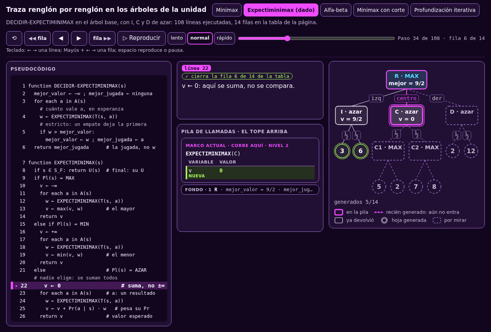

# Las animaciones de la unidad, en una página

Cada algoritmo de las clases 2 y 3 tiene una **animación que lo corre línea
por línea** en el árbol de su página. En la misma pantalla ves tres cosas a
la vez:

- **El pseudocódigo**, con la línea que corre resaltada.
- **La pila de llamadas**: un marco por cada nodo que espera, con sus
  variables. Lo que acaba de cambiar va marcado con «cambió».
- **El árbol**, con los nodos de la pila en magenta y lo que todavía no se
  genera en línea punteada.

Las tablas de traza de las páginas dan una fila por nodo. La animación da
**cada línea que corre** entre una fila y la siguiente. Si una fila de la
tabla no te queda clara, ábrela ahí.

**Cómo se maneja:**

- **▶ y ◀**, o las flechas → y ←, avanzan o retroceden una línea.
- **▶▶ fila y ◀◀ fila**, o Mayús + → y Mayús + ←, saltan a la siguiente fila
  de la tabla de la página.
- **Reproducir**, o la barra espaciadora, la corre sola. Puedes elegir
  lento, normal o rápido.
- **Los botones de arriba** cambian de algoritmo y de árbol, o de $d$ en el
  corte.

Pulsa cualquier imagen de esta página para abrir la animación en ese mismo
paso.

## Minimax

::: figure {#jue-b-anim-minimax title="Minimax en el árbol base, fila 12"}

:::

- **Qué mirar:** la pila crece al bajar y se encoge al volver. En la fila 12
  hay tres marcos, R›C›C2, y es todo lo que hay en memoria.
- **Dónde se usa:** [[minimax-como-algoritmo|Minimax como algoritmo]].
- **▶ [Ábrela desde el principio](_assets/traza_arbol_t.html#minimax)**

## Expectiminimax

::: figure {#jue-b-anim-azar title="Expectiminimax en el árbol base con I, C y D de azar, fila 6"}

:::

- **Qué mirar:** en un nodo de azar, $v$ empieza en 0 y no en $\pm\infty$,
  porque se suma, no se compara. Cada hijo entra pesado por su probabilidad.
- **Dónde se usa:** [[cuando-decide-un-dado|Cuando decide un dado]].
- **▶ [Ábrela desde el principio](_assets/traza_arbol_t.html#azar)**

## Alfa-beta

::: figure {#jue-b-anim-alfa-beta title="Alfa-beta en el árbol base, fila 12: el corte beta de C2"}

:::

- **Qué mirar:** cada marco lleva su ventana $(\alpha, \beta)$, y los
  marcos de abajo pueden tener otra. El corte llega cuando $v$ alcanza el
  umbral del rival: $v \ge \beta$ en un nodo de MAX, $v \le \alpha$ en
  uno de MIN.
- **Dónde se usa:** [[alfa-beta|Alfa-beta a mano]], con el árbol reducido
  y el base, y [[alfa-beta-como-algoritmo|Alfa-beta como algoritmo]].
- **▶ [Ábrela desde el principio](_assets/traza_arbol_t.html#alfa-beta)** ·
  [con el árbol reducido](_assets/traza_arbol_t.html#alfa-beta-t1)

## Minimax con corte

::: figure {#jue-b-anim-corte title="Minimax con corte en el árbol de resultados, d = 2, fila 8"}

:::

- **Qué mirar:** al llegar a la línea de corte, el nodo no baja más: se
  estima con EVAL. Cambia $d$ entre 1, 2 y 3 con los botones de arriba y
  mira cuándo cambia la jugada.
- **Dónde se usa:** [[cortar-y-evaluar|Cortar y evaluar]].
- **▶ [Ábrela desde el principio](_assets/traza_arbol_t.html#corte)**

## Profundización iterativa

::: figure {#jue-b-anim-iterativa title="Profundización iterativa en el árbol de resultados, búsqueda con d = 2"}

:::

- **Qué mirar:** corre las búsquedas con $d = 1$, 2 y 3 seguidas. Cada una
  empieza por la jugada que dejó la anterior, y el contador de abajo suma
  los nodos de todas.
- **Dónde se usa:** [[jugar-contra-el-reloj|Hasta dónde mirar]].
- **▶ [Ábrela desde el principio](_assets/traza_arbol_t.html#iterativa)**

## Los otros interactivos

No corren línea por línea, pero también se mueven:

- **▶ [Hoeffding en vivo](_assets/hoeffding_en_vivo.html):** miles de
  promedios a la vez. Mueve la esperanza, las simulaciones y el margen. Se
  usa en [[de-donde-sale-el-bono|De dónde sale el bono]].
- **▶ [Bandido en vivo](_assets/bandido_en_vivo.html):** tres jugadas con su
  esperanza oculta. Mueve $c$ y mira cuántas vueltas van a la mejor. Se usa
  en la misma página.
- **▶ [El mismo árbol, todos los algoritmos](_assets/un_arbol_todos.html):**
  cada algoritmo de la unidad sobre el árbol de resultados, con qué nodos
  genera y qué jugada entrega. Se usa en [[monte-carlo-en-un-arbol-grande|MCTS con UCT]] y en [[un-arbol-todos-los-algoritmos|la radiografía]].
