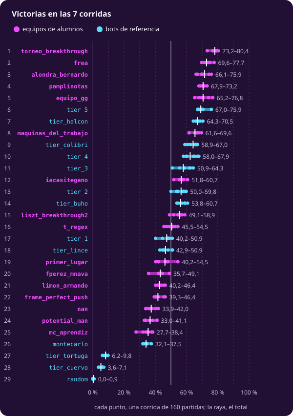

# Resultados del torneo

**Anexo** · la tabla final de la liga

La liga del [[proyecto-torneo-adversarial|proyecto de la unidad]] se jugó
completa del 17 al 18 de noviembre de 2026, en una sola máquina y con los
límites oficiales: cada bot corrió aislado en Docker con 1 núcleo y 1 GB, y
con 30 s de reloj por partida (escala oficial 1.1).

Jugaron **29 bots**: 16 equipos de alumnos y 13 bots de referencia
(`random`, `montecarlo` y los `tier_*`). Fue todos contra todos, con **40
partidas por pareja**: 20 juegos de dados, cada uno con blancas y con negras.
La tabla junta 7 corridas completas con semillas distintas, así que cada bot
jugó **1 120 partidas** y la liga entera **16 240**. Ninguna partida se perdió
por reloj y ninguna pareja quedó fuera por fallas.

**Cómo se lee.** En este juego no hay empates: los puntos son las partidas
ganadas. Si dos bots empatan en puntos, decide primero el resultado entre
ellos, luego el **SB** (la suma de los puntos de los rivales a los que
venciste) y al final los peones anotados (columna «Peones»). «%» es el
porcentaje de victorias. Los equipos de alumnos van en
negritas; los demás son los bots de referencia.

| Lugar | Equipo | Ganadas | % | SB | Peones |
| ---: | --- | ---: | ---: | ---: | ---: |
| 1 | **`torneo_breakthrough`** | 875 | 78,1 % | 453 939 | 2 917 |
| 2 | **`frea`** | 815 | 72,8 % | 409 034 | 2 897 |
| 3 | **`alondra_bernardo`** | 802 | 71,6 % | 410 603 | 2 808 |
| 4 | **`pamplinotas`** | 791 | 70,6 % | 401 092 | 2 803 |
| 5 | **`equipo_gg`** | 791 | 70,6 % | 395 380 | 2 841 |
| 6 | `tier_5` | 774 | 69,1 % | 385 163 | 2 734 |
| 7 | `tier_halcon` | 752 | 67,1 % | 371 892 | 2 686 |
| 8 | **`maquinas_del_trabajo`** | 733 | 65,4 % | 361 972 | 2 752 |
| 9 | `tier_colibri` | 719 | 64,2 % | 356 234 | 2 613 |
| 10 | `tier_4` | 698 | 62,3 % | 340 035 | 2 644 |
| 11 | `tier_3` | 649 | 57,9 % | 310 203 | 2 472 |
| 12 | **`iacasitegano`** | 634 | 56,6 % | 299 081 | 2 571 |
| 13 | `tier_2` | 633 | 56,5 % | 296 975 | 2 644 |
| 14 | `tier_buho` | 629 | 56,2 % | 293 116 | 2 631 |
| 15 | **`liszt_breakthrough2`** | 619 | 55,3 % | 297 587 | 2 534 |
| 16 | **`t_regex`** | 566 | 50,5 % | 261 120 | 2 479 |
| 17 | `tier_1` | 530 | 47,3 % | 238 599 | 1 961 |
| 18 | `tier_lince` | 521 | 46,5 % | 234 848 | 1 941 |
| 19 | **`primer_lugar`** | 518 | 46,2 % | 231 939 | 2 119 |
| 20 | **`fperez_mnava`** | 484 | 43,2 % | 212 852 | 2 311 |
| 21 | **`limon_armando`** | 479 | 42,8 % | 212 303 | 2 042 |
| 22 | **`frame_perfect_push`** | 467 | 41,7 % | 204 331 | 2 021 |
| 23 | **`nan`** | 419 | 37,4 % | 179 134 | 1 733 |
| 24 | **`potential_man`** | 411 | 36,7 % | 176 317 | 1 910 |
| 25 | **`mc_aprendiz`** | 396 | 35,4 % | 164 093 | 2 039 |
| 26 | `montecarlo` | 382 | 34,1 % | 156 320 | 1 736 |
| 27 | `tier_tortuga` | 92 | 8,2 % | 8 999 | 588 |
| 28 | `tier_cuervo` | 58 | 5,2 % | 9 684 | 542 |
| 29 | `random` | 3 | 0,3 % | 991 | 90 |

## Tres cosas que dice la tabla

- **Los cinco primeros equipos de alumnos quedaron por encima de `tier_5`**,
  el más fuerte de los tiers numerados, y `torneo_breakthrough` ganó la liga
  con 78,1 % de victorias.
- **Los tiers 1 a 5 quedaron en orden**: `tier_5` 6.º, `tier_4` 10.º,
  `tier_3` 11.º, `tier_2` 13.º y `tier_1` 17.º. Con 1 120 partidas por bot,
  la escala de fuerza se notó tal como estaba pensada.
- **`pamplinotas` y `equipo_gg` empataron con 791 puntos** y los separó el
  SB: 401 092 contra 395 380. Ganarle a rivales fuertes pesa más que ganarle
  a los débiles.

Y una más: los 16 equipos de alumnos quedaron por encima de `montecarlo`.

## Las gráficas

::: figure {#jue-torneo-fig-victorias title="El porcentaje de victorias de cada bot, con su intervalo de confianza al 95 %"}

:::

Cada intervalo mide hasta ±3 puntos. Los del 2.º al 6.º lugar se enciman:
con 1 120 partidas por bot, las diferencias entre ellos caben en el ruido de
los dados. La del 1.º no: el intervalo de `torneo_breakthrough` no toca el de
nadie más.

::: figure {#jue-torneo-fig-cara-a-cara title="Cara a cara: cuántas de las 40 partidas ganó la fila contra la columna"}

:::

Se lee por filas: la fila de un equipo es su temporada, rival por rival.
Cada celda y su simétrica suman 40, así que el mapa es verde arriba a la
derecha y magenta abajo a la izquierda. Las celdas de color contrario a su
zona son las sorpresas: un equipo que le ganó la serie a otro que quedó más
arriba.

::: figure {#jue-torneo-fig-corridas title="El porcentaje de victorias en cada una de las 7 corridas"}

:::

Una sola corrida son 160 partidas por bot, y en ella el orden baila: la
franja de `torneo_breakthrough` va de 73,2 % a 80,4 %, y la de `equipo_gg` de
65,2 % a 76,8 %. Por eso la tabla junta siete corridas y no una.

## Datos curiosos

- **`torneo_breakthrough` ganó su serie contra los 28 rivales**: más de 20
  de las 40 partidas contra cada uno. La más pareja fue contra
  `maquinas_del_trabajo`, 23 a 17.
- **Blancas ganan exactamente el 50,0 %** de las 16 240 partidas: mover
  primero no da ventaja. Una partida dura en promedio 82 jugadas, y solo 8
  terminaron porque un bando se quedó sin jugadas; las otras 16 232, por
  peones anotados.
- **La suerte con los dados casi no pesa.** Si se suma, en cada ataque, si
  el dado lo dio por bueno menos la probabilidad de que lo diera, el
  promedio por partida queda entre −0,05 y +0,07 para todos los bots. El
  campeón tuvo de las peores, −0,04 por partida, y aun así ganó.
- **`pamplinotas` y `equipo_gg` quedaron 20 a 20 entre ellos**: el resultado
  directo no los separó y decidió el SB.

Las reglas y el motor siguen en el
[repositorio del torneo](https://github.com/raya-lucaria/ia_o26_torneo_adversarial).

Regresa a [[proyecto-torneo-adversarial|el proyecto]] o a [[juegos|la unidad]].
