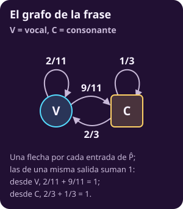
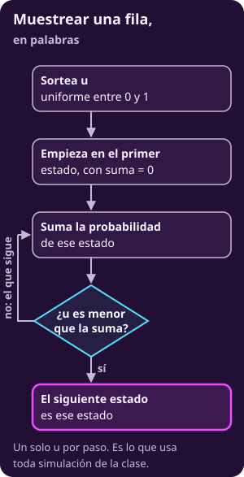
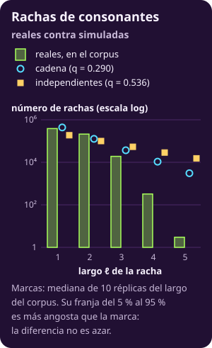

# El problema de Markov

**Página en construcción.**

::: figure {#mkv-c1-grafo-vc title="El grafo de la frase"}

:::

::: figure {#mkv-c1-flujo-muestrear title="Muestrear una fila, en palabras"}

:::

::: figure {#mkv-c1-rachas title="Rachas de consonantes"}

:::
