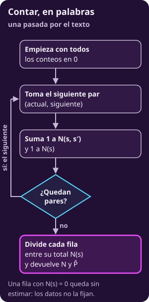
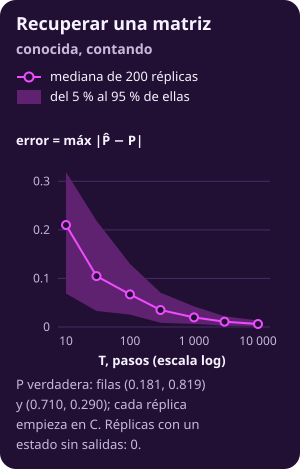
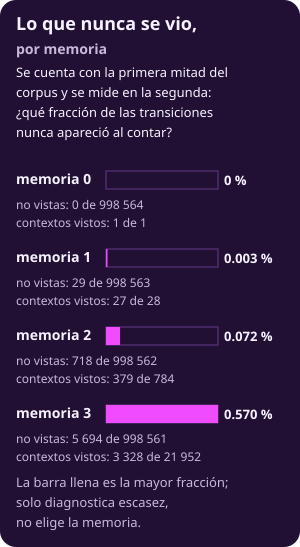

# Ajustar contando

**Página en construcción.**

::: figure {#mkv-c1-flujo-contar title="Contar, en palabras"}

:::

::: figure {#mkv-c1-recuperar-p title="Recuperar una matriz conocida"}

:::

::: figure {#mkv-c1-ceros title="Lo que nunca se vio, por memoria"}

:::
