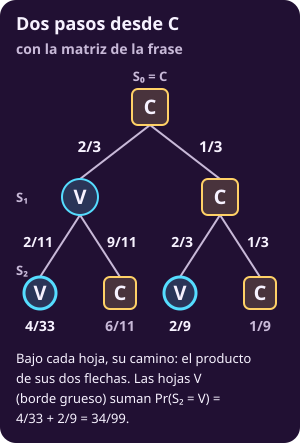
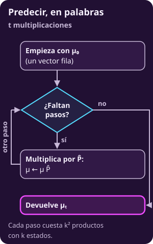
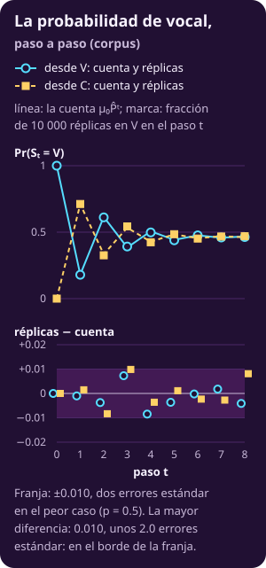

# Predecir

**Página en construcción.**

::: figure {#mkv-c1-arbol-2-pasos title="Dos pasos desde C"}

:::

::: figure {#mkv-c1-flujo-predecir title="Predecir, en palabras"}

:::

::: figure {#mkv-c1-mu-t title="La probabilidad de vocal, paso a paso"}

:::
