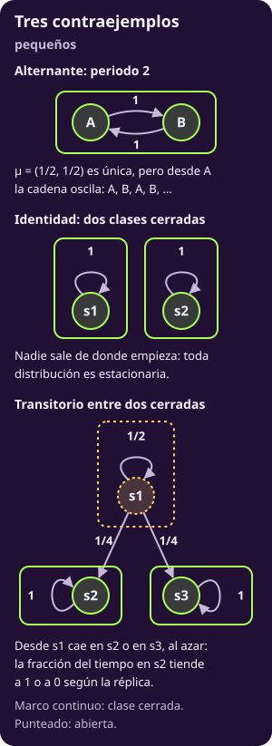

# Resumen de la clase 2: el formulario

**Todo lo de la clase, en una página.** Aquí no hay nada nuevo. Cada renglón resume algo que ya está demostrado o calculado en su página; si un renglón no te queda claro, vuelve a ella.

## 1 · La idea y las tres preguntas

- **Estacionaria:** una fila $\mu$ con $\mu P=\mu$, entradas $\ge0$ y suma 1. Si la cadena arranca en ella, sigue en ella. No es un estado donde la cadena se queda: es una **distribución** que no cambia.
- **En el paso $t$:** $\mu_t=\mu_0P^t$. Promedia sobre muchas réplicas, en un mismo paso.
- **En el límite:** $\lim_{t\to\infty}\mu_t$, si existe.
- **Fracción del tiempo:** $N_T(s)/T$. Sigue **una sola** trayectoria a lo largo del tiempo.
- **Cómo se calcula $\mu$:** con el sistema $\mu P=\mu$, cambiando una ecuación por $\sum_s\mu(s)=1$; iterando $\mu\leftarrow\mu P$ hasta la tolerancia; o simulando y contando la fracción del tiempo.

---

## 2 · Las definiciones

::: table {#mkv-c2-rs-tabla-definiciones title="Las definiciones de la clase"}
| Término | Qué es | Cómo se reconoce |
|---|---|---|
| $s\to s'$, alcanzar | Hay camino de flechas positivas, de cualquier largo (también 0) | $(P^t)_{ss'}>0$ para algún $t\ge0$ |
| $s\leftrightarrow s'$, comunicar | Hay camino de ida y de vuelta | $s\to s'$ y $s'\to s$ |
| Clase | Los estados que se comunican entre sí | Grupos del grafo con ida y vuelta |
| Clase cerrada | No sale ninguna flecha | Las filas de la clase suman 1 dentro de ella |
| Absorbente | Un estado que nunca sale | $P_{ss}=1$ |
| Recurrente | Empezando en $s$, regresa seguro ($f_s=1$) | En cadenas finitas: está en una clase cerrada |
| Transitorio | Puede no regresar ($f_s<1$) | En cadenas finitas: está en una clase abierta |
| Periodo $d(s)$ | El mcd de los pasos en que se puede regresar | Un lazo da $d=1$; toda la clase comparte $d$ |
:::

::: figure {#mkv-c2-rs-fig-clasificar title="Una cadena con las tres clases posibles"}

:::

- **Cómo leer la figura:** $\{s_1\}$ es abierta, así que $s_1$ es transitorio. $\{s_2,s_3\}$ es cerrada con periodo 2. $\{s_4,s_5\}$ es cerrada y aperiódica, por el lazo en $s_4$.

---

## 3 · Los cuatro teoremas, en cadenas finitas

::: table {#mkv-c2-rs-tabla-teoremas title="Los cuatro teoremas y su intuición"}
| Teorema | Condición | Intuición |
|---|---|---|
| Existe una estacionaria | Cadena finita (basta) | Con pocos estados, la probabilidad no tiene a dónde escaparse |
| Es única | Una sola clase cerrada (si y solo si) | Cada clase cerrada tiene su propia estacionaria; con dos, cualquier mezcla sirve |
| $\mu_t$ llega a la misma $\mu$ desde todo inicio | Una sola clase cerrada y aperiódica (si y solo si) | Sin periodo, la probabilidad deja de saltar de un lado a otro y se asienta |
| $N_T(s)/T\to\mu(s)$ con probabilidad 1, desde todo inicio | Una sola clase cerrada; el periodo no importa (si y solo si) | Toda trayectoria acaba en esa clase y la recorre en la proporción $\mu$ |
:::

- **Fuera de las clases cerradas:** toda estacionaria vale 0. Los transitorios se visitan un número finito de veces.
- **El último teorema es el ergódico:** la versión de Markov de la ley de los grandes números. Las visitas de una cadena no son independientes, así que Hoeffding no aplica tal cual.

---

## 4 · Un ejemplo y un contraejemplo de cada teorema

«Olvida su inicio» quiere decir: $\mu_t$ llega a la misma $\mu$ desde cualquier inicio.

::: table {#mkv-c2-rs-tabla-ejemplos title="Qué cumple cada cadena de la clase"}
| Cadena | ¿Única? | ¿Olvida el inicio? | ¿Fracción → μ? |
|---|---|---|---|
| Frase V/C | Sí | Sí | Sí |
| Alternante | Sí | No: alterna | Sí |
| Identidad | No | No: se queda | No |
| Transitorio entre dos cerradas | No | No: el límite depende del inicio | No: 1 o 0 |
| La misma, con $s_2$ y $s_3$ unidos con lazos | Sí | Sí | Sí |
| $i\to i+1$, infinita | No existe | — | — |
:::

::: figure {#mkv-c2-rs-fig-contraejemplos title="Los tres contraejemplos pequeños"}

:::

- **Los valores:** la frase da $\mu=(22/49,27/49)$ y su distancia a $\mu$ se multiplica por $-16/33$ en cada paso. La alternante da $(1/2,1/2)$; desde A alterna 1, 0, 1, … El transitorio entre dos cerradas tiene una estacionaria $(0,p,1-p)$ para cada $p$; $\mu_t$ sí converge, pero a un límite distinto según el inicio. Unidos con lazos, queda $(0,1/2,1/2)$.
- **Qué rompe cada una:** la alternante rompe la convergencia (por el periodo); la identidad, la unicidad (dos clases cerradas); el transitorio entre dos cerradas, la unicidad y el ergódico.

---

## 5 · Los dos usos

- **Tiempo medio de llegada a un conjunto $A$:** $m=\mathbf 1+P_{\mathcal T}m$, con $m=0$ en $A$. Sale de condicionar en el primer paso.
- **Su condición:** desde todo estado fuera de $A$, la cadena llega a $A$ con probabilidad 1. Si una clase cerrada queda fuera de $A$, el tiempo es infinito.
- **En serpientes y escaleras:** el tablero chico da $m=(3,3,1)$ desde las casillas 0, 1 y 4. El de 100 casillas da $m(0)\approx55.668$ turnos.
- **PageRank:** la importancia de una página es la fracción del tiempo que un navegante al azar pasa en ella.
- **Sus dos arreglos:** $\overline P$ sustituye cada página sin salidas por el salto $v$; el salto con probabilidad $1-\alpha$ conecta todo con todo. Así $G=\alpha\overline P+(1-\alpha)\mathbf 1v$ tiene una sola clase cerrada aperiódica: estacionaria única y convergencia.
- **Cómo se calcula:** se itera $\mu\leftarrow\alpha\mu\overline P+(1-\alpha)v$ sin armar $G$. Con $\alpha=0.85$, la web de juguete da $(1429,1140,2109,1429)/6107$.

---

## 6 · Lo que más se confunde

> [!WARNING]
> - **Estacionaria no es un estado:** es una distribución. La cadena sigue brincando.
> - **Converger no es ser única:** en el transitorio entre dos cerradas, $\mu_t$ converge, pero a un límite distinto según el inicio.
> - **Ser única no es converger:** la alternante tiene una sola $\mu$, y desde A nunca llega a ella.
> - **Promediar réplicas no es seguir una trayectoria:** en el transitorio entre dos cerradas, las réplicas dan 1/2 en $s_2$ y cada trayectoria, 1 o 0.
> - **Oscilar no es no tener límite:** la frase oscila alrededor de $\mu$ y converge. Lo que no tiene límite es alternar entre dos valores distintos.
> - **Alcanzar no es comunicar:** comunicar pide camino de vuelta.
> - **Cerrada no prohíbe entrar:** solo prohíbe salir.
> - **Transitorio no es «nunca regresa»:** puede regresar, solo que no seguro.
> - **$d(s)=2$ no garantiza regresar en 2 pasos:** solo prohíbe regresar en pasos impares.
> - **«No paró» no es «no converge»:** solo dice que el tope llegó antes que la tolerancia.

Vuelve al [[markov-a-la-larga|índice de la clase 2]].
