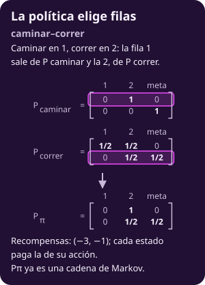

# El proceso de decisión de Markov

**¿Qué hay que escribir para que una computadora pueda decidir cuando el resultado de cada acción es azar?**

Al terminar tendrás:

- **Un modelo con nombre:** el MDP, con estados, acciones, una matriz por acción y recompensas.
- **Una política:** una acción por estado, y cuántas hay.
- **Una cadena por política:** la política elige filas y deja una cadena de Markov como las de la clase 2.
- **El retorno y el valor:** lo que suma una trayectoria y su promedio desde cada estado.
- **Una condición:** terminar con probabilidad 1, revisada en el grafo.

## Lo que traes

- **La escalera.** En [[mkv-la-escalera|De contar a decidir: la escalera]] la pasada hacia atrás calculó $\operatorname{costo}(s)$, lo que falta pagar desde el escalón $s$ (@mkv-c3-teo-hacia-atras): $\operatorname{costo}_{0..5}=(4,4,2,1,1,0)$.
- **El ciclo.** En la misma página, un brinco que falla y te deja en tu escalón hace que $\operatorname{costo}(s)$ dependa de sí mismo.
- **Llegar a un conjunto.** En [[mkv-absorcion|Cuánto falta para terminar]] viste $\tau_A$, el primer paso en que la cadena entra en $A$ (@mkv-c2-ab-def-llegada), y la condición de @mkv-c2-teo-absorcion: desde cada estado fuera de $A$ hay un camino hacia $A$.
- **Esperanza.** $E_s[X]$ y $\Pr_s$, empezando en $s$ (@mkv-c2-def-esperanza), y condicionar en el primer paso (@mkv-c2-teo-primer-paso).
- **El MDP de agentes.** En [[de-consecuencias-a-refuerzo|De consecuencias a refuerzo]] apareció la tupla de un proceso de decisión de Markov, la política y el retorno; aquí se definen con números.

> [!NOTE]
> **Por qué estudiamos esto.** En la clase 2 la matriz $P$ estaba dada: la cadena se movía sola. Ahora el agente elige, en cada estado, qué matriz usar. Antes de preguntar cuál conviene, hay que escribir con precisión qué se elige, qué cuesta y qué se promedia.

---

## 1 · Releer la escalera con una fila por brinco

**Piensa: ¿y si un brinco puede fallar y dejarte donde estabas?**

Entonces ya no basta una flecha por brinco: hace falta una **fila de probabilidades** que diga a dónde llegas. La escalera ya cabe en ese molde, con filas de ceros y un solo 1.

- **Estados:** los escalones $0,\dots,5$. El 5 es la meta: ahí no se decide nada.
- **Acciones:** desde el escalón $s$, el brinco $a\in\{1,2\}$ sin pasarte; desde el 4 solo cabe $a=1$.
- **Fila del brinco:** llegas a $s+a$ con probabilidad 1, y a cualquier otro escalón con 0.
- **Recompensa:** lo que pagas, con signo menos. Pisar el escalón 2 cuesta 2, así que brincar 2 desde el 0 da recompensa $-2$.

La recompensa es un **costo con signo negativo**: maximizar la suma de recompensas es minimizar lo que pagas. Así se escribe en la unidad de agentes y en los libros.

**En el juguete.** Con un brinco que falla, la fila cambia y nada más. Si brincar 1 desde el escalón 3 sale con probabilidad 1/2 y con 1/2 te deja en el 3, su fila pone 1/2 en el 4 y 1/2 en el 3. Ese 1/2 en la diagonal es el ciclo que rompió la pasada hacia atrás.

Una escalera es poco azar. ¿Cómo se ve un problema donde el azar está en todos lados?

---

## 2 · Dibujar el pasillo mojado

**Piensa: ¿cuándo conviene correr en un piso mojado?**

Cuando resbalar es barato. El segundo juguete de la clase, **el robot en el pasillo mojado**, tiene ese dilema en dos casillas.

::: figure {#mkv-c3-fig-pasillo title="El robot en el pasillo mojado"}

:::

- **Caminar:** avanza una casilla, seguro, y tarda 3: recompensa $-3$.
- **Correr:** tarda 1, recompensa $-1$. Con 1/2 avanza; con 1/2 resbala de lado y **se queda en su casilla**.
- **El hueco:** en la casilla 1 no hay barandal. Al resbalar ahí cae al hueco, lo levantan y cuesta 10 más.
- **El barandal:** en la casilla 2, resbalar solo cuesta el tiempo perdido.

**En el juguete.** Correr en la casilla 1 recibe $-1$ si avanza y $-11$ si resbala, cada uno con 1/2. En promedio:

$$
\tfrac12(-1)+\tfrac12(-11)=-6.
$$

Correr en la casilla 2 recibe $-1$ siempre. Caminar recibe $-3$ en las dos.

El robot elige en cada casilla, y el resultado de su elección es azar. ¿Qué objeto reúne todo eso?

---

## 3 · Definir el MDP

**Piensa: ¿qué necesitas saber del pasillo para predecir el siguiente paso?**

La casilla, la acción, a dónde lleva cada acción y cuánto paga. Eso, y nada más, es un proceso de decisión de Markov (*Markov decision process*, MDP).

::: definition {#mkv-c3-def-mdp title="Proceso de decisión de Markov (MDP)"}
$$
\langle\mathcal S,\ \mathcal A,\ P,\ r\rangle
$$

- **Qué es:** un conjunto finito de estados $\mathcal S$ con terminales $\mathcal F\subseteq\mathcal S$ no vacío y no terminales $\mathcal T=\mathcal S\setminus\mathcal F$. En cada $s\in\mathcal T$ hay un conjunto finito y no vacío de acciones $\mathcal A(s)$. Cada par $(s,a)$ trae una fila $P(\cdot\mid s,a)$ y una recompensa esperada $r(s,a)$.
- **Cómo se calcula:** una matriz por acción, $P_a$, de tamaño $\lvert\mathcal S\rvert\times\lvert\mathcal S\rvert$, fila desde y columna hacia, con entradas $P(s'\mid s,a)\ge0$ y cada fila sumando 1. La recompensa es el promedio de lo recibido:

$$
r(s,a)=E[r_{t+1}\mid S_t=s,\ a].
$$

- **Qué significa:** el siguiente estado y la recompensa dependen solo del estado actual y de la acción, no de la historia. Es la propiedad de Markov con una acción enmedio. Un terminal no decide nada: se queda en sí mismo con recompensa 0.
- **Qué no es:** una cadena de Markov. Una cadena tiene **una** matriz; un MDP tiene una por acción, y alguien tiene que elegir cuál usar.
:::

- **Aviso de letras.** La $\mathcal A$ es caligráfica porque $A$ ya es el conjunto de llegada de 8.2.5; en juegos se escribió $A(s)$ para las jugadas.
- **Aviso de la tupla.** Agentes la escribió $\langle S,A,P,R,\gamma\rangle$. Aquí no lleva $\gamma$: todo lo que estudiamos termina, y se suman las recompensas tal cual.
- **Recompensa recibida y esperada.** $r_{t+1}$ es lo que llega en un paso concreto, como en agentes; $r(s,a)$ es su promedio. Aquí todas son $\le0$.

**En el juguete.** Estados $\mathcal S=\{1,2,\text{meta}\}$, $\mathcal F=\{\text{meta}\}$, $\mathcal T=\{1,2\}$, acciones $\mathcal A(1)=\mathcal A(2)=\{\text{caminar},\text{correr}\}$. Las filas y columnas van en el orden 1, 2, meta:

$$
\begin{aligned}
P_{\text{caminar}}&=\begin{pmatrix}0&1&0\\0&0&1\\0&0&1\end{pmatrix},\\
P_{\text{correr}}&=\begin{pmatrix}1/2&1/2&0\\0&1/2&1/2\\0&0&1\end{pmatrix}.
\end{aligned}
$$

- **Recompensas:** $r(1,\text{caminar})=r(2,\text{caminar})=-3$, $r(1,\text{correr})=-6$ y $r(2,\text{correr})=-1$.
- **La fila de la meta:** es $(0,0,1)$ en las dos matrices. Es el terminal que se queda, como la meta de 8.2.5.

::: figure {#mkv-c3-fig-pasillo-mdp title="El pasillo como MDP: un nodo por acción"}

:::

> [!TIP]
> **Ejemplo y contraejemplo.**
>
> - **Lo cumple:** $P_{\text{caminar}}$ y $P_{\text{correr}}$ de arriba. Cada fila es una distribución: la fila 1 de correr pone 1/2 en quedarse y 1/2 en avanzar, y suma 1.
> - **No lo cumple:** una «correr» cuya fila de 1 es $(1/2,\ 1,\ 0)$: se queda con 1/2 y avanza con 1, como si resbalar y avanzar no se excluyeran. Esa fila suma 3/2 y no es una distribución. El hueco tampoco es un destino aparte: ocurre **junto con** resbalar, y su costo va en $r(1,\text{correr})$, no en $P$.

::: figure {#mkv-c3-fig-ej-mdp title="Ejemplo y contraejemplo: un MDP"}

:::

> [!WARNING]
> **Error típico:** poner el castigo como un estado más. **Un costo que acompaña a un resultado va en la recompensa, no en la matriz:** el robot que cae al hueco sigue en la casilla 1.

::: exercise {#mkv-c3-md-ej-castigo title="Cambia el castigo"}
Si caer al hueco costara 4 en lugar de 10, ¿qué cambia en $P_{\text{correr}}$? ¿Cuánto vale $r(1,\text{correr})$?
:::

::: hint {#mkv-c3-md-pista-castigo of="mkv-c3-md-ej-castigo" title="¿El castigo mueve al robot?"}
¿A qué casilla llega el robot que cae al hueco? Promedia lo recibido al avanzar y al resbalar.
:::

::: answer {#mkv-c3-md-resp-castigo of="mkv-c3-md-ej-castigo"}
$P_{\text{correr}}$ no cambia: el robot sigue en la casilla 1. Solo cambia la recompensa:

$$
r(1,\text{correr})=\tfrac12(-1)+\tfrac12(-5)=-3.
$$

Correr en 1 empata con caminar en el costo de un paso, pero no avanza siempre.
:::

El MDP dice qué puede pasar. Falta decir qué hace el robot en cada casilla.

---

## 4 · Elegir una acción por estado

**Piensa: ¿qué tiene que decidir el robot antes de salir?**

Una acción para cada casilla. A esa regla se le llama política.

::: definition {#mkv-c3-def-politica title="Política determinista y estacionaria"}
$$
\pi(s)\in\mathcal A(s)\quad\text{para cada }s\in\mathcal T.
$$

- **Qué es:** una regla que asigna **una** acción a cada estado no terminal.
- **Cómo se calcula:** se elige una acción por estado. El número de políticas es el producto de las opciones:

$$
\prod_{s\in\mathcal T}\lvert\mathcal A(s)\rvert.
$$

- **Qué significa:** cada vez que el robot está en $s$ hace $\pi(s)$, sin importar el paso ni cómo llegó. Eso es **estacionaria**; **determinista** es que elige una acción, no un sorteo.
- **Qué no es:** una ruta. Una ruta es una sucesión de casillas; la política dice qué hacer también en las casillas a las que el azar te lleve.
:::

- **Aviso de letras.** Agentes escribió $\pi(a\mid s)$, una probabilidad por acción. Aquí $\pi(s)$ es una sola acción, y $\pi^*$ será la mejor.
- **Nombres con palabras.** «Caminar–correr» es caminar en la casilla 1 y correr en la 2. Se escribe con palabras porque una C sola ya es consonante en esta unidad.

**En el juguete.** Dos casillas con dos acciones: $2\times2=4$ políticas. Son caminar–caminar, caminar–correr, correr–caminar y correr–correr.

**En la escalera.** Los escalones 0 a 3 tienen dos brincos y el 4 uno: $2^4\cdot1=16$ políticas. Hay más políticas que rutas, 16 contra 8, porque la política también decide en escalones que su ruta no pisa. La ruta óptima 0→2→4→5 sale de brincar 2 en el 0, 2 en el 2 y 1 en el 4.

::: exercise {#mkv-c3-md-ej-contar title="Cuenta las políticas con una acción más"}
Agrega al pasillo una tercera acción, esperar, que deja al robot en su casilla. ¿Cuántas políticas hay?
:::

::: hint {#mkv-c3-md-pista-contar of="mkv-c3-md-ej-contar" title="¿Cuántas opciones hay por casilla?"}
¿Cuántas acciones tiene cada estado de $\mathcal T$ ahora? Multiplica.
:::

::: answer {#mkv-c3-md-resp-contar of="mkv-c3-md-ej-contar"}
$\lvert\mathcal A(1)\rvert=\lvert\mathcal A(2)\rvert=3$, así que hay $3\times3=9$ políticas.
:::

Fijar la política fija una fila en cada estado. ¿Qué queda al juntarlas?

---

## 5 · Armar la cadena de la política

**Piensa: si el robot ya decidió, ¿hay algo que elegir todavía?**

No. Fija la política y la elección desaparece: lo que queda es una cadena de Markov, como las de la clase 2.

::: definition {#mkv-c3-def-cadena-politica title="La cadena de una política"}
Para una política $\pi$:

$$
\begin{aligned}
P_\pi(s'\mid s)&=P(s'\mid s,\pi(s)),\\
r_\pi(s)&=r(s,\pi(s)),\qquad s\in\mathcal T.
\end{aligned}
$$

- **Qué es:** la matriz $P_\pi$ cuya fila $s$ es la fila $s$ de $P_{\pi(s)}$, con las filas de los terminales sin cambio, y el vector $r_\pi$ de recompensas esperadas.
- **Cómo se calcula:** **la política elige filas.** Para cada estado, copia la fila de la matriz de la acción elegida. $P_{\pi,\mathcal T}$ es $P_\pi$ restringida a las filas y columnas de $\mathcal T$, como $P_{\mathcal T}$ en 8.2.5.
- **Qué significa:** bajo $\pi$, los estados $S_0,S_1,\dots$ forman una cadena de Markov con matriz $P_\pi$. Todo lo de la clase 2 se le aplica.
- **Qué no es:** una mezcla de matrices. $P_\pi$ no es un promedio de $P_{\text{caminar}}$ y $P_{\text{correr}}$: cada fila viene entera de una sola.
:::

**En el juguete.** Caminar–correr toma la fila 1 de $P_{\text{caminar}}$ y la fila 2 de $P_{\text{correr}}$:

$$
\begin{aligned}
P_\pi&=\begin{pmatrix}0&1&0\\0&1/2&1/2\\0&0&1\end{pmatrix},\qquad
r_\pi=\begin{pmatrix}-3\\-1\end{pmatrix},\\
P_{\pi,\mathcal T}&=\begin{pmatrix}0&1\\0&1/2\end{pmatrix}.
\end{aligned}
$$

::: figure {#mkv-c3-fig-politica-elige-filas title="La política elige filas"}

:::

Las cuatro políticas dan cuatro cadenas. Este programa las arma y comprueba que cada fila suma 1:

```python
from fractions import Fraction as F
from itertools import product

h = F(1, 2)
T = [1, 2]                           # (1) los que no terminan
P = {(1, "caminar"): {2: F(1)},      # (2) una fila por (s, a)
     (2, "caminar"): {"meta": F(1)},
     (1, "correr"): {1: h, 2: h},
     (2, "correr"): {2: h, "meta": h}}
r = {(1, "caminar"): -3, (2, "caminar"): -3,
     (1, "correr"): -6, (2, "correr"): -1}

for s, a in P:                       # (3) cada fila suma 1
    assert sum(P[(s, a)].values()) == 1

def fila(d):
    return ", ".join(f"{k}:{v}" for k, v in d.items())

for a1, a2 in product(["caminar", "correr"], repeat=2):
    pi = {1: a1, 2: a2}         # (4) una acción por estado
    print(f"{a1}–{a2}")
    for s in T:                 # (5) la política elige filas
        print(f"  {s} -> {fila(P[(s, pi[s])])}"
              f" | r = {r[(s, pi[s])]}")
```

```text
caminar–caminar
  1 -> 2:1 | r = -3
  2 -> meta:1 | r = -3
caminar–correr
  1 -> 2:1 | r = -3
  2 -> 2:1/2, meta:1/2 | r = -1
correr–caminar
  1 -> 1:1/2, 2:1/2 | r = -6
  2 -> meta:1 | r = -3
correr–correr
  1 -> 1:1/2, 2:1/2 | r = -6
  2 -> 2:1/2, meta:1/2 | r = -1
```

- **Línea (5):** `P[(s, pi[s])]` es la definición entera: la fila de $s$ en la matriz de la acción que eligió $\pi$.

::: figure {#mkv-c3-fig-cuatro-cadenas title="Las cuatro cadenas del pasillo, una por política"}

:::

::: exercise {#mkv-c3-md-ej-filas title="Arma la cadena de correr–caminar"}
Escribe $P_\pi$, $r_\pi$ y $P_{\pi,\mathcal T}$ para correr–caminar.
:::

::: hint {#mkv-c3-md-pista-filas of="mkv-c3-md-ej-filas" title="¿De qué matriz sale cada fila?"}
La fila 1 sale de $P_{\text{correr}}$ y la fila 2 de $P_{\text{caminar}}$. Para $P_{\pi,\mathcal T}$, quita la fila y la columna de la meta.
:::

::: answer {#mkv-c3-md-resp-filas of="mkv-c3-md-ej-filas"}
$$
\begin{aligned}
P_\pi&=\begin{pmatrix}1/2&1/2&0\\0&0&1\\0&0&1\end{pmatrix},\qquad
r_\pi=\begin{pmatrix}-6\\-3\end{pmatrix},\\
P_{\pi,\mathcal T}&=\begin{pmatrix}1/2&1/2\\0&0\end{pmatrix}.
\end{aligned}
$$
:::

Cada política da una cadena con recompensas. ¿Cómo se comparan dos cadenas así?

---

## 6 · Sumar lo recibido: retorno y valor

**Piensa: ¿qué número dice qué tan buena fue una caminata del robot?**

La suma de todo lo que recibió hasta llegar a la meta. Esa suma es aleatoria; su promedio, empezando en cada estado, es el valor.

::: definition {#mkv-c3-def-valor title="Retorno y valor de una política"}
Con $\tau_{\mathcal F}$ el primer paso en que la cadena está en $\mathcal F$, como $\tau_A$ en @mkv-c2-ab-def-llegada:

$$
\begin{aligned}
G_t&=r_{t+1}+r_{t+2}+\dots+r_{\tau_{\mathcal F}},\\
V_\pi(s)&=E^\pi_s[G_0],\qquad s\in\mathcal T.
\end{aligned}
$$

- **Qué es:** $G_t$ es el **retorno**, la suma de las recompensas recibidas desde el paso $t$ hasta terminar. $V_\pi(s)$ es el **valor**: el promedio de $G_0$ cuando la cadena de $\pi$ empieza en $s$. En $\mathcal F$ el valor es 0.
- **Cómo se calcula:** sin azar, sumando la única trayectoria. Con azar, es un promedio sobre todas las trayectorias. En ese promedio se puede usar $r_\pi(S_t)$ en lugar de lo recibido: el promedio no cambia.
- **Qué significa:** cuánto recibe en promedio, de aquí al final, quien empieza en $s$ y sigue $\pi$. Con recompensas negativas, $-V_\pi(s)$ es el costo esperado.
- **Qué no es:** el retorno de **una** trayectoria, ni $r_\pi(s)$, que es solo el primer paso.
:::

- **Aviso de letras.** $G$ con subíndice es el retorno; la $G$ sola sigue siendo la matriz de Google. El estado va entre paréntesis: $V_\pi(1)$, $V(2)$, nunca con subíndice.
- **Si no termina.** La suma no tiene último término; con recompensas negativas puede valer $-\infty$.

**En la escalera.** No hay azar: cada política da una sola trayectoria. La óptima, 0→2→4→5, recibe $-2-1-1=-4$, así que su valor en el 0 es $-4=-\operatorname{costo}(0)$. En general, $V=-\operatorname{costo}$ para la política de la pasada hacia atrás.

**En el juguete.** Caminar–caminar tampoco tiene azar. Desde 1, el robot recibe $-3$ y $-3$:

$$
V_\pi(1)=-6,\qquad V_\pi(2)=-3.
$$

Correr–correr sí tiene azar. Desde 2, el robot corre hasta avanzar; si avanza en el intento $j$, recibe $-1$ en cada intento:

::: table {#mkv-c3-md-tabla-retorno title="Retorno desde la casilla 2 con correr–correr"}
| Avanza en el intento | Trayectoria | $G_0$ | Probabilidad |
|---:|---|---:|---:|
| 1 | 2, meta | $-1$ | 1/2 |
| 2 | 2, 2, meta | $-2$ | 1/4 |
| 3 | 2, 2, 2, meta | $-3$ | 1/8 |
| $j$ | $j$ veces 2, meta | $-j$ | $(1/2)^j$ |
:::

- **Lectura:** $G_0$ toma infinitos valores, cada vez menos probables. $V_\pi(2)$ es su promedio, y una suma infinita no es la forma cómoda de sacarlo.

::: exercise {#mkv-c3-md-ej-retorno title="Suma una trayectoria"}
Con correr–correr, el robot sale de 1, resbala dos veces, avanza, y en la casilla 2 avanza al primer intento. ¿Cuánto vale $G_0$?
:::

::: hint {#mkv-c3-md-pista-retorno of="mkv-c3-md-ej-retorno" title="¿Qué recibe en cada resbalón?"}
Usa lo recibido, no $r(1,\text{correr})$: en la casilla 1, resbalar incluye caer al hueco.
:::

::: answer {#mkv-c3-md-resp-retorno of="mkv-c3-md-ej-retorno"}
Cuatro pasos: dos resbalones en 1, un avance en 1 y un avance en 2.

$$
G_0=-11-11-1-1=-24.
$$
:::

El valor es un promedio sobre trayectorias que terminan. ¿Y si alguna no termina?

---

## 7 · Terminar con probabilidad 1

**Piensa: ¿qué pasa con el retorno si el robot nunca llega a la meta?**

La suma nunca cierra, y el valor deja de medir cuánto cuesta llegar. Por eso se pide que la política termine.

::: definition {#mkv-c3-def-termina title="Una política termina con probabilidad 1"}
$$
\Pr^\pi_s(\tau_{\mathcal F}<\infty)=1\quad\text{para todo }s\in\mathcal T.
$$

- **Qué es:** desde **cada** estado no terminal, la cadena de $\pi$ llega a $\mathcal F$ con probabilidad 1.
- **Cómo se calcula:** en el grafo de $P_\pi$, desde cada $s\in\mathcal T$ hay un camino de flechas positivas a $\mathcal F$. Es la condición de @mkv-c2-teo-absorcion con $A=\mathcal F$.
- **Qué significa:** $G_0$ es, con probabilidad 1, una suma finita.
- **Qué no es:** terminar en un número acotado de pasos, ni terminar solo desde el inicio.
:::

**En el juguete.** Las cuatro políticas del pasillo terminan. Con correr–correr, en cada casilla avanza con probabilidad 1/2 en cada intento. Desde 2, no terminar en $t$ pasos tiene probabilidad $(1/2)^t$, que tiende a 0.

> [!TIP]
> **Ejemplo y contraejemplo.**
>
> - **Lo cumple:** caminar–correr. $P_\pi$ tiene filas $(0,1,0)$, $(0,\tfrac12,\tfrac12)$ y $(0,0,1)$: de 1 se va a 2, y de 2 hay una flecha a la meta. Llega con probabilidad 1 desde las dos casillas.
> - **No lo cumple:** con la acción esperar, que deja al robot en su casilla, la política esperar siempre. $P_{\pi,\mathcal T}$ es la identidad: ninguna flecha sale hacia la meta. Nunca llega, y su retorno es una suma sin último término.

::: figure {#mkv-c3-fig-ej-termina title="Ejemplo y contraejemplo: terminar con probabilidad 1"}

:::

> [!WARNING]
> **Error típico:** «termina con probabilidad 1, así que termina en a lo más tantos pasos». **Con correr–correr no hay tope:** desde 2, tardar más de 10 pasos tiene probabilidad $(1/2)^{10}=1/1024$, positiva. Lo que vale 1 es la probabilidad de llegar alguna vez.

::: exercise {#mkv-c3-md-ej-termina title="Cuáles terminan con esperar"}
Con esperar como tercera acción hay 9 políticas. ¿Cuántas terminan? ¿Termina caminar en 1 y esperar en 2?
:::

::: hint {#mkv-c3-md-pista-termina of="mkv-c3-md-ej-termina" title="¿Desde qué casilla hay que llegar?"}
La definición pide llegar desde **cada** estado de $\mathcal T$. ¿Qué pasa en una casilla donde la política espera?
:::

::: answer {#mkv-c3-md-resp-termina of="mkv-c3-md-ej-termina"}
Terminan 4: las que no esperan en ninguna casilla. Si la política espera en $s$, desde $s$ no hay flecha que salga, y no termina desde $s$.

Caminar en 1 y esperar en 2 no termina: desde 1 llega a 2 y se queda ahí para siempre.
:::

---

## Ejercicios

::: exercise {#mkv-c3-md-ej-tres-casillas title="Un pasillo de tres casillas"}
**Intenta formular tu propuesta sin abrir las pistas ni la respuesta y sin pedir ayuda a ChatGPT.**

**Cambia una idea:** el pasillo tiene tres casillas, 1, 2 y 3, antes de la meta. El hueco sin barandal está en la casilla 2; la 1 y la 3 tienen barandal. Caminar y correr funcionan igual que en el pasillo de dos casillas, con el mismo castigo de 10.

1. **Modela:** escribe $\mathcal T$, $\mathcal F$, $P_{\text{caminar}}$, $P_{\text{correr}}$ y las seis recompensas $r(s,a)$.
2. **Cuenta:** ¿cuántas políticas hay?
3. **Elige filas:** para correr junto al barandal y caminar junto al hueco, escribe $P_\pi$ y $r_\pi$.
4. **Revisa y suma:** ¿cuáles políticas terminan con probabilidad 1? Da $V_\pi(1)$, $V_\pi(2)$ y $V_\pi(3)$ para caminar siempre.
:::

::: hint {#mkv-c3-md-pista-tres-casillas-1 of="mkv-c3-md-ej-tres-casillas" title="Pista 1 · ¿Qué cambia en la casilla del hueco?"}
¿Qué filas de $P_{\text{correr}}$ tienen 1/2 en la diagonal? ¿En cuál casilla correr recibe $-11$ al resbalar?
:::

::: hint {#mkv-c3-md-pista-tres-casillas-2 of="mkv-c3-md-ej-tres-casillas" title="Pista 2 · ¿Suman 1 tus filas y llega cada casilla?"}
¿Cada fila de tus matrices suma 1, incluida la de la meta? Para el entregable 4, ¿hay una flecha que avance desde cada casilla, con cualquier acción?
:::

::: answer {#mkv-c3-md-resp-tres-casillas of="mkv-c3-md-ej-tres-casillas" title="Respuesta · Tres filas por acción y ocho políticas"}
**1. Modela.** $\mathcal T=\{1,2,3\}$, $\mathcal F=\{\text{meta}\}$. En el orden 1, 2, 3, meta:

$$
\begin{aligned}
P_{\text{caminar}}&=\begin{pmatrix}0&1&0&0\\0&0&1&0\\0&0&0&1\\0&0&0&1\end{pmatrix},\\
P_{\text{correr}}&=\begin{pmatrix}1/2&1/2&0&0\\0&1/2&1/2&0\\0&0&1/2&1/2\\0&0&0&1\end{pmatrix}.
\end{aligned}
$$

Caminar recibe $-3$ en las tres casillas. Correr recibe $-1$ en 1 y en 3, y en 2 recibe $\tfrac12(-1)+\tfrac12(-11)=-6$.

**2. Cuenta.** $2\times2\times2=8$ políticas.

**3. Elige filas.** Correr en 1 y en 3, caminar en 2:

$$
P_\pi=\begin{pmatrix}1/2&1/2&0&0\\0&0&1&0\\0&0&1/2&1/2\\0&0&0&1\end{pmatrix},\qquad
r_\pi=\begin{pmatrix}-1\\-3\\-1\end{pmatrix}.
$$

**4. Revisa y suma.** Las 8 terminan: con cualquier acción, cada casilla tiene una flecha positiva hacia la siguiente, y la 3 hacia la meta. Caminar siempre no tiene azar: $V_\pi(1)=-9$, $V_\pi(2)=-6$, $V_\pi(3)=-3$.
:::

**Punto de control:** deberías poder escribir un problema de decisión como MDP, con una matriz por acción cuyas filas suman 1. También, contar sus políticas, armar $P_\pi$ y $r_\pi$ eligiendo filas, y revisar en el grafo si una política termina con probabilidad 1.

---

## Lo que hay que llevarse

- **MDP:** $\langle\mathcal S,\mathcal A,P,r\rangle$, una matriz $P_a$ por acción, filas que suman 1, y $r(s,a)$, la recompensa esperada (@mkv-c3-def-mdp).
- **El pasillo:** caminar cuesta 3 y avanza seguro; correr cuesta 1, avanza con 1/2, y en la casilla 1 su recompensa esperada es $-6$.
- **Política:** una acción por estado, $\pi(s)\in\mathcal A(s)$; el pasillo tiene $2\times2=4$ y la escalera 16 (@mkv-c3-def-politica).
- **La política elige filas:** $P_\pi$ toma la fila $s$ de $P_{\pi(s)}$ y es una cadena de Markov; caminar–correr da $P_{\pi,\mathcal T}$ con filas $(0,1)$ y $(0,\tfrac12)$ (@mkv-c3-def-cadena-politica).
- **Valor:** $V_\pi(s)=E^\pi_s[G_0]$, el promedio del retorno. Caminar–caminar vale $(-6,-3)$; en la escalera, $V=-\operatorname{costo}$ (@mkv-c3-def-valor).
- **Terminar:** desde cada estado no terminal se llega a $\mathcal F$ con probabilidad 1; se revisa en el grafo de $P_\pi$. Las cuatro del pasillo terminan; esperar siempre no (@mkv-c3-def-termina).

Si fijamos la política, ¿cuánto vale?

Continúa con [[mkv-evaluar-politica|Evaluar una política]]
