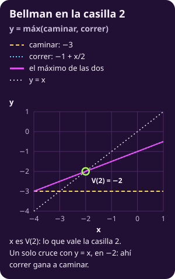

# La ecuación de Bellman

**Si en cada estado puedes elegir la acción, ¿qué ecuación cumple lo mejor que se puede lograr, y cuándo basta con resolverla?**

Al terminar tendrás:

- **El valor de una acción:** $Q_\pi(s,a)$, hacer $a$ una vez y seguir $\pi$ después.
- **El óptimo:** $V^*$ y $Q^*$; en el pasillo, $V^*=(-5,-2)$.
- **La ecuación de Bellman con su condición exacta:** cuándo $V^*$ es su única solución.
- **La codiciosa del óptimo:** mirar un paso adelante con $V^*$ da una política óptima; con otra estimación, no.
- **Dos contraejemplos:** esperar gratis rompe la ecuación; esperar con costo 1 la repara.

## Lo que traes

De [[mkv-max-y-punto-fijo|Lo que necesitas: el máximo y el punto fijo]]:

- **Argmax:** el conjunto de argumentos que alcanzan el máximo; con empates tiene varios (@mkv-c3-def-argmax).
- **Punto fijo:** un $x$ con $x=f(x)$; puede haber uno, ninguno o infinitos (@mkv-c3-def-punto-fijo).

De [[mkv-el-mdp|El proceso de decisión de Markov]]:

- **MDP:** $\langle\mathcal S,\mathcal A,P,r\rangle$, una matriz $P_a$ por acción y recompensas $r(s,a)\le0$ (@mkv-c3-def-mdp).
- **Política:** $\pi(s)\in\mathcal A(s)$, una acción por estado (@mkv-c3-def-politica); la política elige filas y arma $P_\pi$, $P_{\pi,\mathcal T}$ y $r_\pi$ (@mkv-c3-def-cadena-politica).
- **Valor:** $V_\pi(s)=E^\pi_s[G_0]$, que puede ser $-\infty$ si no termina (@mkv-c3-def-valor), y terminar con probabilidad 1 (@mkv-c3-def-termina).
- **El pasillo:** casillas 1 y 2, meta; caminar cuesta 3 y avanza; correr cuesta 1, avanza con $1/2$ y si no se queda; en la casilla 1 el hueco suma 10 con probabilidad $1/2$, así que $r(1,\text{correr})=-6$.

De [[mkv-evaluar-politica|Evaluar una política]]:

- **Evaluar:** si $\pi$ termina con probabilidad 1 desde todo estado, $V_\pi=r_\pi+P_{\pi,\mathcal T}V_\pi$ tiene solución única (@mkv-c3-teo-evaluar).
- **Las cuatro políticas del pasillo:** caminar–caminar $(-6,-3)$, caminar–correr $(-5,-2)$, correr–caminar $(-15,-3)$, correr–correr $(-14,-2)$.

De [[cuando-decide-un-dado|Cuando decide un dado]], en juegos: expectiminimax toma el máximo en los nodos de MAX y el promedio en los de azar (@jue-c2-valor-esperado). De la clase 2: condicionar en el primer paso (@mkv-c2-teo-primer-paso).

> [!NOTE]
> **Por qué estudiamos esto.** Evaluar las políticas una por una funciona con 4. Con 200 casillas son $2^{200}$. La ecuación de Bellman describe el óptimo **sin** enumerar políticas, y de ella salen los algoritmos que lo calculan. Pero tiene una condición, y sin ella la ecuación puede mentir.

---

## 1 · Valorar una acción

**Piensa: si sigues caminar–caminar, ¿conviene correr una sola vez en la casilla 2?**

Sí. Corres una vez y, si caes en la 2 otra vez, vuelves a caminar: el costo esperado es $5/2$, menos que 3. Para decirlo en general hace falta el valor de una acción.

::: definition {#mkv-c3-def-q title="Valor de una acción"}
Para un MDP y una política $\pi$ que termina con probabilidad 1 desde todo estado de $\mathcal T$:

$$
\begin{aligned}
Q_\pi(s,a)&=r(s,a)+\sum_{s'\in\mathcal T}P(s'\mid s,a)\,V_\pi(s'),\\
&\qquad s\in\mathcal T,\ a\in\mathcal A(s).
\end{aligned}
$$

- **Qué es:** el valor esperado de hacer $a$ en $s$ **una vez** y seguir $\pi$ después.
- **Cómo se calcula:** con $V_\pi$ de @mkv-c3-teo-evaluar, una suma por acción. Los estados de $\mathcal F$ no aparecen: ahí el valor es 0.
- **Qué significa:** $Q_\pi(s,\pi(s))=V_\pi(s)$. Si $Q_\pi(s,a)>V_\pi(s)$, desviarse una vez en $s$ conviene.
- **Qué no es:** el valor de usar $a$ siempre en $s$. Después del primer paso manda $\pi$.
:::

La fórmula es condicionar en el primer paso (@mkv-c2-teo-primer-paso): primero $a$, luego $\pi$ desde donde caigas.

En juegos ya usaste la letra: $Q(s,a)=V(T(s,a))$, con una sola jugada siguiente y sin pago intermedio. Aquí el siguiente estado es azar y se suma $r(s,a)$.

**En el juguete.** Con $\pi$ = caminar–caminar, $V_\pi=(-6,-3)$:

$$
\begin{aligned}
Q_\pi(2,\text{correr})&=-1+\tfrac12(-3)+\tfrac12\cdot0=-\tfrac52,\\
Q_\pi(1,\text{correr})&=-6+\tfrac12(-6)+\tfrac12(-3)=-\tfrac{21}2.
\end{aligned}
$$

- **En la casilla 2:** $-5/2>-3=V_\pi(2)$. Desviarse conviene.
- **En la casilla 1:** $-21/2<-6=V_\pi(1)$. Correr junto al hueco no conviene.

Si desviarse una vez mejora, ¿qué es lo mejor que se puede lograr?

---

## 2 · Definir el óptimo

**Piensa: ¿puede una política ser la mejor en la casilla 1 y otra en la casilla 2?**

En principio sí: el máximo se toma estado por estado. Que una sola política gane en todos a la vez es un teorema, en la sección 4.

::: definition {#mkv-c3-def-optimo title="Valor óptimo y valor de acción óptimo"}
Con el máximo sobre las $\prod_{s\in\mathcal T}\lvert\mathcal A(s)\rvert$ políticas:

$$
\begin{aligned}
V^*(s)&=\max_{\pi}V_\pi(s),\qquad s\in\mathcal T,\\
Q^*(s,a)&=r(s,a)+\sum_{s'\in\mathcal T}P(s'\mid s,a)\,V^*(s').
\end{aligned}
$$

Una política $\pi^*$ es **óptima** si $V_{\pi^*}(s)=V^*(s)$ en todo $s\in\mathcal T$.

- **Qué es:** lo mejor que se puede lograr desde $s$, y lo mejor después de empezar con $a$.
- **Cómo se calcula:** en principio, evaluando todas las políticas. En el pasillo son 4; con 200 casillas, $2^{200}$.
- **Qué significa:** $V^*$ es una cota que ninguna política supera en ningún estado.
- **Qué no es:** el máximo sobre reglas que recuerdan la historia o sortean la acción. Bajo la condición de la sección 3 no ganan nada; lo citamos sin probarlo.
:::

**En el juguete.** La tabla de [[mkv-evaluar-politica|Evaluar una política]], con el máximo de cada columna:

| Política | $V(1)$ | $V(2)$ |
|---|---:|---:|
| caminar–caminar | $-6$ | $-3$ |
| caminar–correr | $\mathbf{-5}$ | $\mathbf{-2}$ |
| correr–caminar | $-15$ | $-3$ |
| correr–correr | $-14$ | $\mathbf{-2}$ |

$V^*=(-5,-2)$, y caminar–correr lo alcanza en las dos casillas: es $\pi^*$. Con $V^*$:

$$
\begin{aligned}
Q^*(1,\text{caminar})&=-3+(-2)=-5,\\
Q^*(1,\text{correr})&=-6+\tfrac12(-5)+\tfrac12(-2)=-\tfrac{19}2,\\
Q^*(2,\text{caminar})&=-3,\\
Q^*(2,\text{correr})&=-1+\tfrac12(-2)=-2.
\end{aligned}
$$

En cada casilla, $V^*(s)$ es el mayor de sus dos $Q^*$. ¿Pasa siempre?

::: exercise {#mkv-c3-be-ej-desviar title="Desvíate una vez desde correr–correr"}
Con $\pi$ = correr–correr, $V_\pi=(-14,-2)$. Calcula $Q_\pi(1,\text{caminar})$. ¿Conviene desviarse una vez en la casilla 1?
:::

::: hint {#mkv-c3-be-pista-desviar of="mkv-c3-be-ej-desviar" title="¿A dónde te lleva caminar?"}
Caminar desde 1 llega seguro a la casilla 2. ¿Cuánto vale seguir $\pi$ desde ahí?
:::

::: answer {#mkv-c3-be-resp-desviar of="mkv-c3-be-ej-desviar"}
$Q_\pi(1,\text{caminar})=-3+V_\pi(2)=-3-2=-5>-14$. Conviene mucho: caminar junto al hueco ahorra 9 en promedio.
:::

---

## 3 · Escribir la ecuación de Bellman

**Piensa: desde $s$, si haces $a$ y después juegas lo mejor posible, ¿cuánto vale? ¿Y si eliges el mejor $a$?**

Vale $Q^*(s,a)$, y el mejor $a$ da $V^*(s)$. Escrito como ecuación, el valor óptimo aparece en los dos lados.

::: theorem {#mkv-c3-teo-bellman title="Ecuación de Bellman"}
**Condición.**

1. $\mathcal S$ y cada $\mathcal A(s)$ son finitos.
2. Los estados de $\mathcal F$ terminan con recompensa 0: $V=0$ ahí.
3. Existe al menos una política que termina con probabilidad 1 desde todo $s\in\mathcal T$.
4. Toda política estacionaria que **no** termina desde algún estado vale $-\infty$ en algún estado.

Entonces $V^*$ es finito y es la **única** solución $V:\mathcal T\to\mathbb R$ de

$$
\begin{aligned}
V(s)&=\max_{a\in\mathcal A(s)}\Bigl[r(s,a)\\
&\qquad+\sum_{s'\in\mathcal T}P(s'\mid s,a)\,V(s')\Bigr],
\quad s\in\mathcal T.
\end{aligned}
$$

En términos de $Q^*$: $V^*(s)=\max_{a}Q^*(s,a)$.

**Lectura.** Lo mejor desde $s$ es la mejor acción seguida de lo mejor desde donde caigas.

**Casos nulos.** Si cada $\mathcal A(s)$ tiene una sola acción, no hay máximo y queda @mkv-c3-teo-evaluar.
:::

**De dónde sale.** No la demostramos completa.

- **Que $V^*$ la cumple:** es condicionar en el primer paso, con el máximo por fuera. Ninguna política hace mejor que la mejor primera acción seguida de lo mejor.
- **Que es la única:** es la parte difícil, y la que usa la condición 4. La prueba es de Bertsekas y Tsitsiklis (1991), para el camino más corto con azar: basta una política que llegue a la meta y que toda política que no llegue cueste infinito.
- **El nombre:** Richard Bellman publicó *Dynamic Programming* en 1957. Según su autobiografía, eligió «programación dinámica» en RAND para ocultar que hacía matemáticas.

**En el juguete.** Las cuatro condiciones se cumplen: el pasillo es finito, la meta vale 0 y las cuatro políticas terminan. Comprueba $V^*=(-5,-2)$:

$$
\begin{aligned}
V(2)&=\max\bigl(-3,\ -1+\tfrac12(-2)\bigr)=-2,\\
V(1)&=\max\bigl(-3+(-2),\ -\tfrac{19}2\bigr)=-5.
\end{aligned}
$$

> [!TIP]
> **Ejemplo y contraejemplo.**
>
> - **Lo cumple:** el pasillo, mirando solo la casilla 2, que no depende de la 1. La ecuación es $V(2)=\max\bigl(-3,\,-1+V(2)/2\bigr)$. La curva $y=\max(-3,-1+x/2)$ cruza la diagonal $y=x$ una sola vez, en $x=-2$.
> - **No lo cumple:** el pasillo con una acción más, **esperar**, que cuesta 0 y se queda en su casilla. La ecuación es $V(2)=\max\bigl(-3,\,-1+V(2)/2,\,V(2)\bigr)$. La curva $y=\max(-3,-1+x/2,x)$ se pega a la diagonal para todo $x\ge-2$: infinitas soluciones.

::: figure {#mkv-c3-fig-ej-bellman title="Ejemplo y contraejemplo: la ecuación de Bellman"}

:::

> [!WARNING]
> **Error típico:** «si un vector cumple la ecuación de Bellman, es $V^*$». **Solo con la condición.** Con esperar gratis, $(-5,-2)$ cumple la ecuación y no es el óptimo (sección 6).

::: exercise {#mkv-c3-be-ej-revisar title="Revisa un vector con la ecuación"}
Correr–caminar vale $(-15,-3)$. Calcula el lado derecho de la ecuación de Bellman en ese vector. ¿Lo cumple? ¿En qué casillas falla, y qué acción gana ahí?
:::

::: hint {#mkv-c3-be-pista-revisar of="mkv-c3-be-ej-revisar" title="Dos acciones por casilla"}
En cada casilla, suma la recompensa de la acción y el promedio de $V$ donde caes. ¿Cuál de las dos da más?
:::

::: answer {#mkv-c3-be-resp-revisar of="mkv-c3-be-ej-revisar"}
Casilla 2: $\max\bigl(-3,\ -1+\tfrac12(-3)\bigr)=-\tfrac52$, gana correr. Casilla 1: $\max\bigl(-3+(-3),\ -6+\tfrac12(-15)+\tfrac12(-3)\bigr)=\max(-6,-15)=-6$, gana caminar. Da $(-6,-\tfrac52)\ne(-15,-3)$: falla en las dos casillas, y correr–caminar no es óptima.
:::

Ya sabemos qué cumple $V^*$. ¿Y la política que lo alcanza?

---

## 4 · Elegir con la codiciosa

**Piensa: si alguien te da $V^*$, ¿cómo decides en cada casilla?**

Miras un paso adelante: en cada $s$ eliges la acción con mayor $Q^*(s,a)$. Esa es la política codiciosa de $V^*$.

::: theorem {#mkv-c3-teo-codiciosa title="La codiciosa del óptimo es óptima"}
**Condición.** Las de @mkv-c3-teo-bellman. Para una estimación $U$ cualquiera del valor, la codiciosa es

$$
\begin{aligned}
\pi_U(s)&\in\arg\max_{a\in\mathcal A(s)}\Bigl[r(s,a)\\
&\qquad+\sum_{s'\in\mathcal T}P(s'\mid s,a)\,U(s')\Bigr].
\end{aligned}
$$

Una política $\pi$ es óptima **si y solo si** $\pi(s)\in\arg\max_aQ^*(s,a)$ para todo $s\in\mathcal T$. En particular, $\pi_{V^*}$ es óptima: siempre hay una política que gana en todos los estados a la vez.

**Lectura.** Con $V^*$ en la mano, decidir es mirar un paso adelante.

**Casos nulos.** Si el argmax tiene empates, cualquier elección es óptima y hay varias $\pi^*$.
:::

::: proof {#mkv-c3-be-dem-codiciosa of="mkv-c3-teo-codiciosa"}
La damos con $r\le0$, como en el pasillo: así las sumas parciales solo bajan. Que una política que no termina valga $-\infty$ lo pone la condición 4, no el signo: esperar gratis no termina y vale 0.

Si todas las políticas terminan (lo verás en los volados del ejercicio final), el primer paso de abajo sobra y el resto vale con recompensas de cualquier signo. Los vectores son columnas sobre $\mathcal T$.

**Si.** Sea $\pi$ con $\pi(s)$ en el argmax. Por @mkv-c3-teo-bellman, $V^*=r_\pi+P_{\pi,\mathcal T}V^*$. Sustituyendo $n$ veces:

$$
\begin{aligned}
V^*&=\sum_{k=0}^{n-1}P_{\pi,\mathcal T}^{\,k}\,r_\pi\\
&\quad+P_{\pi,\mathcal T}^{\,n}\,V^*.
\end{aligned}
$$

- **$\pi$ termina.** Si no, la condición 4 da un $s_0$ con $V_\pi(s_0)=-\infty$. La suma en $s_0$ baja a $-\infty$, y el último término queda acotado por $\max_s\lvert V^*(s)\rvert$. Contradice que $V^*(s_0)$ es finito.
- **Vale $V^*$.** Como $\pi$ termina, $P_{\pi,\mathcal T}^{\,n}\to0$ y la suma tiende a $V_\pi$. Queda $V_\pi=V^*$.

**Solo si.** Si $V_\pi=V^*$, es finito, así que $\pi$ termina (condición 4). Por @mkv-c3-teo-evaluar, $V^*=r_\pi+P_{\pi,\mathcal T}V^*$: en cada $s$, $V^*(s)=Q^*(s,\pi(s))$. Como $V^*(s)=\max_aQ^*(s,a)$, $\pi(s)$ está en el argmax.
:::

**En el juguete.** Con los $Q^*$ de la sección 2: en la casilla 1, caminar ($-5$ contra $-19/2$); en la 2, correr ($-2$ contra $-3$). La codiciosa de $V^*$ es caminar–correr, $\pi^*$.

> [!TIP]
> **Ejemplo y contraejemplo.**
>
> - **Lo cumple:** la codiciosa de $V^*=(-5,-2)$. En 1, caminar ($-5$) contra correr ($-19/2$); en 2, correr ($-2$) contra caminar ($-3$). Da caminar–correr, que vale $(-5,-2)$: óptima.
> - **No lo cumple:** la codiciosa de $U=(-8,-8)$, una estimación equivocada. En 1, caminar ($-3-8=-11$) contra correr ($-6-4-4=-14$); en 2, caminar ($-3$) contra correr ($-1-4=-5$). Da caminar–caminar, que vale $(-6,-3)$: no es óptima.

::: figure {#mkv-c3-fig-ej-codiciosa title="Ejemplo y contraejemplo: la codiciosa"}

:::

- **Por qué falla:** $U(2)=-8$ es demasiado pesimista. Hace que resbalar y quedarse en la 2 parezca carísimo, y correr pierde.
- **Lo que pide el teorema:** la codiciosa es óptima si mira con $V^*$, no con cualquier $U$.

**La política óptima depende de los números.** Cambia el costo de caminar y el castigo del hueco (en el pasillo, 3 y 10). Correr cuesta 1 por intento y avanza con $1/2$: en promedio son dos intentos.

- **En la casilla 2:** correr cuesta 2 en promedio. Conviene si caminar cuesta más de 2.
- **En la casilla 1:** cada intento cuesta además medio castigo; en promedio, $2+\text{castigo}$. Conviene si el castigo es menor que el costo de caminar menos 2.
- **Con costo de caminar 3:** correr junto al hueco convendría solo con castigo menor que 1. En las igualdades, empatan.

::: figure {#mkv-c3-fig-fronteras title="Qué política es óptima según el costo de caminar y el castigo"}

:::

::: exercise {#mkv-c3-be-ej-codiciosa-cero title="La codiciosa de cero"}
Calcula la codiciosa de $U=(0,0)$ en el pasillo. ¿Es óptima? ¿Prueba eso que $(0,0)$ es una buena estimación?
:::

::: hint {#mkv-c3-be-pista-codiciosa-cero of="mkv-c3-be-ej-codiciosa-cero" title="¿Qué pide el teorema de U?"}
Compara las dos acciones en cada casilla con $U=0$. Luego, ¿cumple $(0,0)$ la ecuación de Bellman?
:::

::: answer {#mkv-c3-be-resp-codiciosa-cero of="mkv-c3-be-ej-codiciosa-cero"}
En 1, caminar ($-3$) contra correr ($-6$); en 2, caminar ($-3$) contra correr ($-1$). Da caminar–correr: es óptima. Pero $(0,0)$ no cumple Bellman: el lado derecho da $(-3,-1)$. La codiciosa acertó por suerte; @mkv-c3-teo-codiciosa solo garantiza la de $V^*$. Es la codiciosa de la escalera: con $U=0$ solo cuenta el costo inmediato.
:::

---

## 5 · Ver el punto fijo

**Piensa: ¿en qué se parece la ecuación de Bellman a expectiminimax?**

Es expectiminimax sin rival: máximo en los nodos de decisión y promedio en los de azar (@jue-c2-valor-esperado). La diferencia es el ciclo.

- **En un árbol:** las hojas tienen valor y se sube una vez, de abajo hacia arriba.
- **En el pasillo:** correr desde 2 puede regresar a 2. $V(2)$ aparece en los dos lados de su propia ecuación, y no hay hoja desde donde empezar.
- **Desenrollado:** el árbol del pasillo es infinito; cada resbalón abre otra copia de la casilla 2.

Por eso $V^*$ no se calcula de abajo hacia arriba: es un **punto fijo** (@mkv-c3-def-punto-fijo). Tomas un vector $U$, calculas el lado derecho de la ecuación y obtienes otro vector. $V^*$ es el que no cambia.

**En el juguete.** La casilla 2 no depende de la 1, así que su ecuación es de una variable: $x=\max(-3,-1+x/2)$. La curva es horizontal en $-3$ hasta $x=-4$ y después sube con pendiente $1/2$. Cruza la diagonal una sola vez, en $x=-2$.

::: figure {#mkv-c3-fig-bellman-1d title="La ecuación de Bellman de la casilla 2 como punto fijo"}

:::

- **La casilla 1, después:** con $V(2)=-2$, queda $x=\max(-5,\,-7+x/2)$. La recta $-7+x/2$ cruza la diagonal en $-14$, y ahí $-5$ es mayor; el único punto fijo es $x=-5$.

La condición de @mkv-c3-teo-bellman dice cuándo hay un solo cruce. ¿Qué pasa cuando falla?

---

## 6 · Romper la condición: esperar

**Piensa: si esperar no cuesta nada, ¿cuál es la mejor política?**

Esperar para siempre: nunca llega, pero tampoco paga. Como toda recompensa es $\le0$, nada supera 0.

Agrega al pasillo la acción **esperar**: se queda en su casilla, $P(s\mid s,\text{esperar})=1$.

**Esperar gratis**, con $r(s,\text{esperar})=0$:

- **El óptimo:** esperar siempre vale 0 en las dos casillas, así que $V^*=(0,0)$.
- **Evaluarla:** $P_{\pi,\mathcal T}=I$ y $I-P_{\pi,\mathcal T}=0$ es singular. @mkv-c3-teo-evaluar no aplica: esa política no termina.
- **La condición que falla:** la 4. Esperar siempre no termina y vale 0, no $-\infty$.

La ecuación de Bellman gana un término en cada casilla:

$$
\begin{aligned}
V(2)&=\max\bigl(-3,\ -1+\tfrac12V(2),\ V(2)\bigr),\\
V(1)&=\max\bigl(V(2)-3,\ -6+\tfrac12V(1)+\tfrac12V(2),\ V(1)\bigr).
\end{aligned}
$$

- **Por qué hay infinitas:** el término $V(s)$ hace que el máximo valga $V(s)$ en cuanto los otros dos no lo superan.
- **La región de soluciones:** todas las $(V(1),V(2))$ con $V(2)\ge-2$ y $V(1)\ge V(2)-3$. La desigualdad con $-6$ ya va implícita.
- **Tres de ellas:** $(0,0)$, que es $V^*$; $(-5,-2)$, que no lo es; y $(-1,-1)$, que no es el valor de ninguna política.

**Esperar con costo 1**, con $r(s,\text{esperar})=-1$:

- **La condición vuelve:** esperar siempre paga 1 en cada paso para siempre, así que vale $-\infty$. Lo mismo cualquier política que espere en alguna casilla.
- **La ecuación vuelve a tener una solución:** el término nuevo es $-1+V(s)$, que nunca alcanza a $V(s)$. Queda $(-5,-2)$, y nadie elige esperar.

El código comprueba los tres puntos en las tres versiones del pasillo: sin esperar, esperar gratis y esperar con costo 1.

```python
from fractions import Fraction as F

def lado_derecho(V, esperar=None):
    v1, v2 = V                    # V(1), V(2)
    m = F(1, 2)
    en1 = [-3 + v2, -6 + m * v1 + m * v2]
    en2 = [F(-3), -1 + m * v2]
    if esperar is not None:       # costo de esperar
        en1.append(-esperar + v1)
        en2.append(-esperar + v2)
    return (max(en1), max(en2))

for V in [(0, 0), (-5, -2), (-1, -1)]:
    V = (F(V[0]), F(V[1]))
    print(V == lado_derecho(V),
          V == lado_derecho(V, 0),
          V == lado_derecho(V, 1))
```

```text
False True False
True True True
False True False
```

- **Lectura:** solo $(-5,-2)$ es punto fijo sin esperar y con esperar caro. Con esperar gratis, los tres lo son.
- **Qué se rompe:** con esperar gratis, $(-5,-2)$ cumple la ecuación y no es $V^*$. Una solución de Bellman no es el óptimo si la condición falla.

> [!NOTE]
> **Recuadro · Si el futuro pesa menos.** En [[de-consecuencias-a-refuerzo|De consecuencias a refuerzo]] el retorno multiplicaba por $\gamma^t$ la recompensa de $t$ pasos adelante, con $0\le\gamma<1$ (descuento). Bellman queda
>
> $$\begin{aligned}V(s)=\max_a\Bigl[&r(s,a)\\&+\gamma\sum_{s'}P(s'\mid s,a)V(s')\Bigr],\end{aligned}$$
>
> y tiene una sola solución sin pedir que nada termine. Con esperar gratis, esa solución es $(0,0)=V^*$. El descuento arregla la ecuación, no el modelo: esperar sigue siendo lo mejor. Aquí usamos $\gamma=1$ y pagamos con la condición de @mkv-c3-teo-bellman.

::: exercise {#mkv-c3-be-ej-costo-uno title="Revisa que esperar caro ya no estorba"}
Con esperar gratis, $(-2,-1)$ resuelve la ecuación: está en la región. Ahora cobra 1 por esperar y evalúa el lado derecho en $(-2,-1)$. ¿Sigue siendo punto fijo?
:::

::: hint {#mkv-c3-be-pista-costo-uno of="mkv-c3-be-ej-costo-uno" title="¿Cuánto da esperar desde V(s)?"}
El término de esperar es $-1+V(s)$. ¿Puede ser el máximo y valer $V(s)$ a la vez?
:::

::: answer {#mkv-c3-be-resp-costo-uno of="mkv-c3-be-ej-costo-uno"}
Casilla 2: $\max(-3,\,-1-\tfrac12,\,-1-1)=-\tfrac32$. Casilla 1: $\max(-1-3,\,-6-1-\tfrac12,\,-1-2)=-3$. Da $(-3,-\tfrac32)\ne(-2,-1)$: ya no es punto fijo. Con esperar gratis, el término $V(s)$ ganaba; ahora $-1+V(s)<V(s)$ siempre, y solo queda la solución de la ecuación sin esperar.
:::

---

## Ejercicios

::: exercise {#mkv-c3-be-ej-volados title="Apostar fuerte o apostar poco"}
**Intenta formular tu propuesta sin abrir las pistas ni la respuesta y sin pedir ayuda a ChatGPT.**

Un jugador tiene 1, 2 o 3 pesos y quiere llegar a 4. En cada volado apuesta un número entero de pesos, al menos 1: gana la apuesta con probabilidad $p$ y la pierde con $1-p$. Nunca apuesta más de lo que tiene ni más de lo que le falta. Con 0 pesos quiebra; con 4 se retira. Solo con 2 pesos decide: apostar 1 (tímida) o apostar 2 (audaz).

**Cambia una idea:** en el pasillo había una meta y costos. Aquí hay dos terminales, 0 y 4, y la recompensa es 1 al llegar a 4: el valor es la probabilidad de llegar.

1. **Plantea el MDP:** $\mathcal T$, $\mathcal F$, cada $\mathcal A(s)$ y cada $r(s,a)$. ¿Se cumple la condición de @mkv-c3-teo-bellman?
2. **Evalúa** las dos políticas con $p=1/3$.
3. **Revisa Bellman** en el capital 2 con cada vector. ¿Cuál es óptima?
4. **Cambia la moneda:** repite con $p=2/3$ y con $p=1/2$. ¿Qué regla sale?
:::

::: hint {#mkv-c3-be-pista-volados-1 of="mkv-c3-be-ej-volados" title="Pista 1 · ¿Qué recompensa da cada volado?"}
¿En qué volados puedes recibir el 1, y con qué probabilidad? ¿Desde qué capitales y con qué apuestas se puede llegar de un golpe? Para la audaz, empieza por el capital 2: ¿cuántos volados decide? Para la tímida, escribe las tres ecuaciones de @mkv-c3-teo-evaluar.
:::

::: hint {#mkv-c3-be-pista-volados-2 of="mkv-c3-be-ej-volados" title="Pista 2 · ¿Tienen sentido tus valores?"}
¿Están entre 0 y 1, y crecen con el capital? Con una moneda justa, ¿te parecen razonables para un juego justo? En el capital 2, ¿comparaste $p\,V(3)+(1-p)\,V(1)$ contra lo que da apostar 2?
:::

::: answer {#mkv-c3-be-resp-volados of="mkv-c3-be-ej-volados" title="Respuesta · Contra la casa, apuesta fuerte"}
**1. El MDP.** $\mathcal T=\{1,2,3\}$, $\mathcal F=\{0,4\}$. $\mathcal A(1)=\mathcal A(3)=\{\text{apostar }1\}$ y $\mathcal A(2)=\{\text{apostar }1,\text{apostar }2\}$. Solo se llega a 4 de un golpe desde 3 apostando 1 o desde 2 apostando 2: $r(3,\text{apostar }1)=r(2,\text{apostar }2)=p$, y las demás valen 0. Desde cualquier capital, tres volados ganados seguidos llegan a 4, con probabilidad al menos $p^3>0$: las dos políticas terminan con probabilidad 1 y la condición se cumple.

**2. Evalúa, con $p=1/3$.** Audaz: desde 2 decide un volado, $V(2)=1/3$; luego $V(1)=\tfrac13V(2)=1/9$ y $V(3)=\tfrac13+\tfrac23V(2)=5/9$. Tímida:

$$
\begin{aligned}
V(1)&=\tfrac13V(2),\\
V(2)&=\tfrac13V(3)+\tfrac23V(1),\\
V(3)&=\tfrac13+\tfrac23V(2),
\end{aligned}
$$

con solución $(1/15,\ 1/5,\ 7/15)$. La audaz gana en los tres capitales.

**3. Revisa Bellman.** Con el vector de la audaz, en el capital 2: apostar 1 da $\tfrac13\cdot\tfrac59+\tfrac23\cdot\tfrac19=\tfrac7{27}$; apostar 2 da $\tfrac13=\tfrac9{27}$. El máximo es $1/3=V(2)$. En 1 y 3 hay una sola acción y la ecuación es la de evaluar. El vector cumple Bellman: es $V^*$, y la audaz es su codiciosa, óptima por @mkv-c3-teo-codiciosa. Con el vector de la tímida, apostar 2 da $1/3>1/5$: no cumple.

**4. Cambia la moneda.** Con $p=2/3$, audaz $(4/9,\ 2/3,\ 8/9)$ y tímida $(8/15,\ 4/5,\ 14/15)$. En el capital 2, con la tímida, apostar 1 da $\tfrac23\cdot\tfrac{14}{15}+\tfrac13\cdot\tfrac8{15}=\tfrac45$, contra $\tfrac23$ de apostar 2: la tímida es óptima. Con $p=1/2$ las dos valen $s/4$ y empatan en el capital 2: el argmax tiene dos acciones y las dos son óptimas.

**La regla:** si el volado está en tu contra, apuesta fuerte y juega pocos volados; si está a tu favor, apuesta poco y deja que se acumule la ventaja.
:::

**Punto de control:** deberías poder calcular $Q_\pi$ y $Q^*$ con una suma por acción, escribir la ecuación de Bellman de un MDP pequeño, revisar sus cuatro condiciones y sacar la política óptima con la codiciosa de $V^*$. Antes de confiar en una solución de la ecuación, pregunta: ¿hay alguna política que no termine y no cueste?

---

## Lo que hay que llevarse

- **Valor de una acción:** $Q_\pi(s,a)=r(s,a)+\sum_{s'}P(s'\mid s,a)V_\pi(s')$; una vez $a$, después $\pi$ (@mkv-c3-def-q).
- **Óptimo:** $V^*(s)=\max_\pi V_\pi(s)$; en el pasillo, $V^*=(-5,-2)$, $Q^*(1,\cdot)=(-5,\,-19/2)$ y $Q^*(2,\cdot)=(-3,\,-2)$ (@mkv-c3-def-optimo).
- **Bellman:** $V^*(s)=\max_aQ^*(s,a)$, y es la única solución si el MDP es finito, $\mathcal F$ vale 0, alguna política termina y toda política que no termina vale $-\infty$ en algún estado (@mkv-c3-teo-bellman).
- **Codiciosa:** $\pi$ es óptima si y solo si elige en el argmax de $Q^*$; la codiciosa de $V^*$ es caminar–correr, y la de $U=(-8,-8)$ es caminar–caminar, $(-6,-3)$ (@mkv-c3-teo-codiciosa).
- **Punto fijo:** es expectiminimax con ciclos; en la casilla 2, $x=\max(-3,-1+x/2)$ cruza la diagonal solo en $-2$.
- **Esperar gratis:** $V^*=(0,0)$, la condición 4 falla y la ecuación tiene infinitas soluciones, $V(2)\ge-2$ y $V(1)\ge V(2)-3$; $(-5,-2)$ es una de ellas.
- **Esperar con costo 1:** esperar siempre vale $-\infty$, la condición vuelve y la única solución es $(-5,-2)$.
- **Volados a 4:** con $p=1/3$ gana la audaz, $(1/9,1/3,5/9)$; con $p=2/3$, la tímida, $(8/15,4/5,14/15)$.

Continúa con [[mkv-iterar-valores|Iteración de valores]]: ¿cómo se resuelve una ecuación con un máximo y un ciclo?
