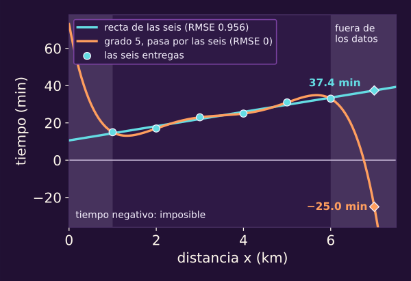
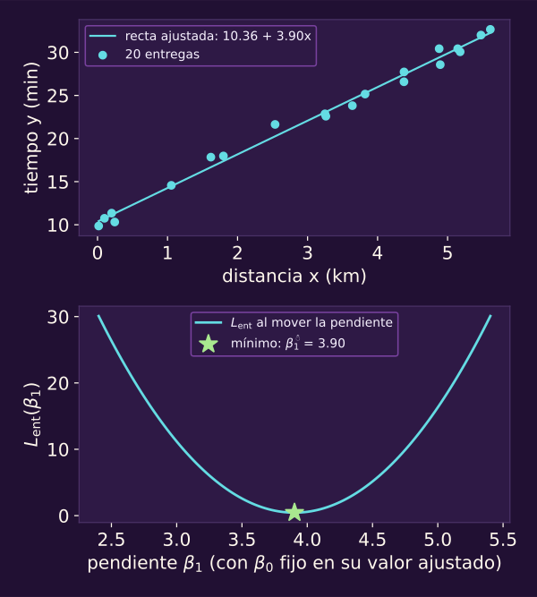

# ¿Qué es f? El proceso, el piso y la representación

**¿Qué parte del próximo tiempo de entrega podemos aprender con lo que medimos, y qué parte no aprenderá ningún modelo?**

~30 min de lectura y ~25 con el notebook.

Al terminar tendrás:

- **El proceso:** $y=f(x)+\varepsilon$, con cada pieza explicada.
- **Dos errores distintos:** $L_{\text{ent}}$ frente a $R$.
- **Un piso calculado:** el de un proceso sencillo y qué lo baja.
- **Un diagnóstico:** la fuente de un error y su remedio.
- **Un criterio de linealidad:** decidir si un modelo es lineal en $\beta$ y escribir su $\Phi$.

> [!TIP]
> **Míralo correr: ¿qué es f?**
>
> Recorre los cinco bloques de `01_que_es_f.ipynb` junto con la lectura.
>
> 

> **Lo que traes**
>
> Las seis entregas y el polinomio de grado 5 de [[opt-objetivo-regresion-practica|Regresión, en la unidad 6]].
>
> Qué es aprender, supervisado y quién elige lo que el modelo ve (@ml-c0-quien-elige-phi), en [[ml-repaso-que-es-aprender|la clase 0]].
>
> El gorro de lo estimado, como $\widehat P$ en [[mkv-el-problema-de-markov|Markov]].

## 1 · Volver al ajuste que ganó

::: figure {#ml-c1-ganador-imposible title="El ajuste que ganó predice un tiempo imposible"}

:::

El grado 5 pasa por las seis entregas; la recta deja pequeñas diferencias.
Las franjas sombreadas quedan fuera del rango observado, de 1 a 6 km.
Ahí los ajustes se separan: a 7 km predicen −25 y 37.4 minutos, respectivamente.

**Piensa: ¿falló el optimizador, o cumplió exactamente una instrucción equivocada?**

Cumplió: debía minimizar el error en esas seis entregas.
La tabla de la unidad 6 daba RMSE de 0.956 para la recta y 0.000 para el grado 5.
Con ese criterio, el polinomio ganó. El objetivo no penalizaba un tiempo negativo fuera de los datos.

En la clase 0 (@ml-c0-memorizar-contra-ajustar) memorizar llegó a cero en lo visto y falló en lo nuevo; aquí el que llega a cero es un polinomio.

La recta de las seis es $10.6+(134/35)x$. El polinomio de grado 5 es

$$
73-\tfrac{1876}{15}x+\tfrac{280}{3}x^2-\tfrac{92}{3}x^3+\tfrac{14}{3}x^4-\tfrac{4}{15}x^5 .
$$

Dentro y fuera del rango observado no se comportan igual: la página 2 retoma la extrapolación, predecir fuera del rango observado.

Queríamos acertar la siguiente entrega. Para explicar qué podemos aprender de ella, necesitamos separar la regla que genera tiempos de sus variaciones.

::: exercise {#ml-c1-ej-ganador title="Calcula entre los datos"}
Con los dos ajustes de la figura:

(a) ¿Qué tiempo predicen para 3.5 km?

(b) ¿Y para 0 km?
:::

::: hint {#ml-c1-pista-ganador-1 of="ml-c1-ej-ganador" title="Pista 1 · Ubica la distancia"}
¿Qué valor de $x$ pondrías en cada fórmula, y queda dentro o fuera del rango 1–6 km?
:::

::: answer {#ml-c1-resp-ganador of="ml-c1-ej-ganador" title="Respuesta · La coincidencia no se prolonga"}
(a) A 3.5 km, la recta y el polinomio predicen 24.0 minutos.

(b) A 0 km, predicen 10.6 y 73.0 minutos, respectivamente: en $x=0$ cada fórmula vale su término constante.
Dentro coinciden en el punto consultado; fuera, no. Acertar entre los datos no fija la continuación de la curva.
:::

## 2 · Separar la regla del azar

::: figure {#ml-c1-mismo-mundo title="Un proceso, tres muestras, tres ajustes"}

:::

Tres muestras de 20 entregas producen tres rectas distintas; al fondo hay observaciones nuevas.
El ajuste cambia con la muestra; por eso lleva gorro.

**Piensa: si repites las mismas distancias, ¿saldrán los mismos tiempos?**

No necesariamente: observas realizaciones de un proceso, no el proceso mismo.
Aquí la regla es $f(x)=10+4x_1$, con $x_1$ como distancia.

$x_i$, con la letra $i$, es la observación $i$; $x_1, x_2, \dots$, con número, son **variables** (columnas); $x_{ij}$ es la variable $j$ de la observación $i$.

$E[\,\cdot\mid x]$ promedia las observaciones con esa misma $x$: es la media condicional.
$\operatorname{Var}(\cdot\mid x)$, «varianza», promedia el cuadrado de la distancia a ese promedio: mide la dispersión de tiempos a igual distancia.

Esta $\varepsilon$ no es la cadena vacía de computabilidad ni la cantidad positiva de Markov: aquí es el ruido.
Si su media condicional no fuera cero y solo quisiéramos predecir, podríamos absorberla en la parte sistemática.
Si $f$ es la regla de interés (estructural) y no solo la mejor predicción, no siempre podemos absorberla: eso es la endogeneidad.

::: definition {#ml-c1-def-proceso-generador title="Proceso generador"}
Cada observación $(x,y)$ sale del mismo proceso:

$$
\begin{aligned}
y&=f(x)+\varepsilon,\\
E[\varepsilon\mid x]&=0,\qquad \operatorname{Var}(\varepsilon\mid x)=\sigma_\varepsilon^2(x).
\end{aligned}
$$

$f$ es la parte sistemática (la función verdadera, sobre todas las
variables) y $\varepsilon$ el ruido. Como $E[\varepsilon\mid x]=0$,
$f(x)=E[y\mid x]$. Por omisión, $\sigma_\varepsilon^2(x)=\sigma_\varepsilon^2$
es constante. Más adelante, la unidad rompe a propósito cada supuesto:
con ruido de Cauchy, $\varepsilon$ no tiene media y su segundo momento es
infinito; con endogeneidad, $E[\varepsilon\mid x]\ne0$, y entonces $f\ne
E[y\mid x]$; con heterocedasticidad, $\sigma_\varepsilon^2(x)$ no es
constante.
:::

$\sigma_\varepsilon^2$ es la varianza del ruido; lleva subíndice porque $\sigma$ sola es la sigmoide.
La varianza del estimador, sobre cambios entre muestras, es otra cosa; la clase 2 descompone el error en promedio.

::: figure {#ml-c1-reducible title="El residual se parte en dos"}

:::

El residual mezcla desacierto y azar.

::: remark {#ml-c1-obs-residual-no-es-ruido title="El residual no es el ruido"}
En una observación,

$$
y-\widehat f(x)=\bigl(f(x)-\widehat f(x)\bigr)+\varepsilon .
$$

El primer término depende de qué tan bien estimamos $f$ (reducible); el
segundo, de nada que el ajuste pueda tocar con las variables que mide.
:::

> [!TIP]
> **Míralo correr: bloque 1 · El proceso que no vemos**
>
> Cambia la muestra y compara las rectas.
>
> 

::: exercise {#ml-c1-ej-residual title="Separa el residual"}
En una entrega de 3 km, $f(3)=22$, observaste $y=25$ y tu ajuste dice $\widehat f(3)=23.5$.

(a) ¿Cuánto vale $\varepsilon$?

(b) ¿Cuánto $f-\widehat f$?

(c) ¿Cuál puedes conocer con datos reales?
:::

::: hint {#ml-c1-pista-residual-1 of="ml-c1-ej-residual" title="Pista 1 · Distingue lo visible"}
¿Qué parte de la identidad usa $f$, que nunca ves?
:::

::: answer {#ml-c1-resp-residual of="ml-c1-ej-residual" title="Respuesta · Solo observas la suma"}
(a) El ruido es $\varepsilon=25-22=3$.

(b) La diferencia reducible es $f-\widehat f=22-23.5=-1.5$.

(c) Con datos reales solo ves el residual: $25-23.5=1.5$.
Las otras dos cuentas requieren conocer $f$, disponible aquí porque especificamos el proceso.
:::

## 3 · Medir el error que importa

::: figure {#ml-c1-aprender-es-minimizar title="Aprender es minimizar"}

:::

Abajo, la pérdida mínima en entrenamiento vale 0.45.

**Piensa: si el optimizador encontró el mínimo exacto, ¿encontró el mejor modelo?**

Encontró el mejor para esos datos: aprender aquí es optimizar.
Esta $L$ es la pérdida promedio de la unidad 6; no un lenguaje, espacio logarítmico ni longitud de racha.

::: definition {#ml-c1-def-perdida-en-conjunto title="Pérdida promedio en un conjunto"}
Para un conjunto de datos $\mathcal D$ con $n_{\mathcal D}$ observaciones,

$$
L_{\mathcal D}(\beta)=\frac1{n_{\mathcal D}}\sum_{i\in\mathcal D}\ell_i(\beta),
$$

la misma $L$ de la unidad 6 con $\ell_i(\beta)=\ell\bigl(y_i,f_\beta(x_i)\bigr)$.
En el conjunto de entrenamiento $\mathcal D_{\text{ent}}$ se escribe
$L_{\text{ent}}=L_{\mathcal D_{\text{ent}}}$. En la clase 2 aparecen otros
conjuntos con la misma fórmula: validación y prueba.
:::

::: definition {#ml-c1-def-estimacion title="Lo estimado lleva gorro"}
Con un conjunto de entrenamiento, el ajuste elige

$$
\widehat\beta\in\operatorname*{arg\,min}_\beta L_{\text{ent}}(\beta),\qquad \widehat f=f_{\widehat\beta}.
$$

Lleva gorro porque cambia con la muestra.
El $\beta^\star=(11,\ 3.6)$ de la clase 0 y el $\beta^\star$ de la unidad 6
son, en esta notación, $\widehat\beta$: dependen de la muestra.
:::

Desde aquí, todo ajuste a una muestra lleva gorro; la estrella queda para el óptimo de un problema sobre la población, que no depende de ninguna muestra.

La clase 0 midió el error en dos entregas que el programa no usó y le prometió un nombre. Ese nombre es el riesgo: el mismo error, promediado sobre todos los casos en que se usará el modelo.

::: definition {#ml-c1-def-riesgo title="Riesgo y error de generalización"}
Sea $\ell$ una pérdida por observación. El riesgo de $\beta$ es la pérdida
esperada en una observación nueva $(x,y)$ del proceso en el que se usará el
modelo (el despliegue):

$$
R(\beta)=E\bigl[\ell\bigl(y,f_\beta(x)\bigr)\bigr].
$$

Menor es mejor. El error de generalización de lo ajustado es
$R(\widehat\beta)$: con $\widehat\beta$ ya fijo, la esperanza corre sobre la
observación nueva.
:::

El error que la clase 0 midió en las dos entregas nuevas (el MAE) es un promedio de la pérdida absoluta $\lvert y-\widehat y\rvert$ en dos casos; $R$ es su versión esperada sobre todo el despliegue. En esta clase usamos la pérdida cuadrática, la misma con que se ajusta; por qué se puede reportar con otra lo explica la clase 4.

Aquí $\ell(y,\widehat y)=(y-\widehat y)^2$ y $L$ es el MSE.
Por omisión, entrenamiento y despliegue comparten proceso; otra muestra da otro $\widehat\beta$ y otro $R(\widehat\beta)$.

El notebook aproxima esa esperanza con 100 000 observaciones nuevas, disponibles solo aquí.
El error estándar del oráculo con $\sigma_\varepsilon=1$ es 0.0045.

Con $\beta$ fijado antes de ver los datos, $L_{\text{ent}}$ promedia honestamente $R(\beta)$; con $\widehat\beta$, no.

> [!WARNING]
> Lectura equivocada: «El error es 0.96 minutos».
>
> Lectura correcta: **Un error sin conjunto no dice nada: el de entrenamiento lo eligió el optimizador; el que importa es $R$.**

::: exercise {#ml-c1-ej-beta-fijo title="Compara con β fijo"}
La recta $10+4x_1$ se eligió antes de ver las seis entregas; en ellas su MSE es 1.
El proceso es $f=10+4x_1$, con $\sigma_\varepsilon^2=1$.

(a) ¿Cuánto vale $R(\beta)$?

(b) ¿Qué cambiaría si la recta se hubiera ajustado a esas seis?
:::

::: hint {#ml-c1-pista-beta-fijo-1 of="ml-c1-ej-beta-fijo" title="Pista 1 · Sustituye el predictor"}
¿Qué vale $(y-f(x))^2$ en promedio si $f_\beta=f$?
:::

::: answer {#ml-c1-resp-beta-fijo of="ml-c1-ej-beta-fijo" title="Respuesta · Elegir con los datos cambia la comparación"}
(a) $R(\beta)=\sigma_\varepsilon^2=1$.
Con $\beta$ fijado antes de observar los datos, $L_{\text{ent}}$ es un promedio honesto de $R(\beta)$.

(b) La recta ajustada logra MSE de 0.914 < 1 en esas seis entregas.
Su RMSE es $0.956=\sqrt{0.914}$, con redondeo; el grado 5 llega a cero.
Elegir el ajuste con esos datos vuelve optimista la comparación en promedio, no necesariamente en cada muestra.
La página 2 lo demuestra.
:::

## 4 · Encontrar el piso

::: figure {#ml-c1-piso title="El piso que nadie baja"}

:::

El oráculo usa $f$ exacta y su error sigue siendo positivo; la recta queda cerca.
La barra de la media de entrenamiento $\bar y$ está recortada: es el punto de comparación (*benchmark*) que define la clase 3.

**Piensa: si conocieras $f$ exacta, ¿tu error sería cero?**

No: todavía queda el ruido. Con $\sigma_\varepsilon=1$, el piso es 1; con $\sigma_\varepsilon=2$, es 4.
Duplicar $\sigma_\varepsilon$ cuadruplica el piso cuadrático.
Las barras aproximan riesgos: 0.99 y 3.97 no contradicen los pisos exactos.

Con pérdida cuadrática, ninguna regla mejora el promedio de tiempos posibles con la información disponible.
Esto vale incluso fuera de nuestra familia.

::: definition {#ml-c1-def-error-bayes title="El piso: error de Bayes"}
Para una pérdida dada, el error de Bayes $R_{\text{Bayes}}$ es el ínfimo del
riesgo sobre **todos los predictores que usan solo las variables que el
modelo ve**; puede valer $+\infty$. Con pérdida cuadrática y segundo momento
finito, el ínfimo se alcanza en $E[y\mid x_{\text{visibles}}]$ y

$$
R_{\text{Bayes}}=E\bigl[\operatorname{Var}(y\mid x_{\text{visibles}})\bigr].
$$

Si no se omite ninguna variable y $E[\varepsilon\mid x]=0$, ese predictor es
$f$ misma y $R_{\text{Bayes}}=E[\sigma_\varepsilon^2(x)]$, que vale
$\sigma_\varepsilon^2$ en el caso constante. Dejar de ver una variable no
disminuye el piso (puede dejarlo igual); medir una más no lo aumenta (puede
bajarlo).

Con ruido de segundo momento infinito (Cauchy) e independiente de las variables, todo predictor tiene riesgo cuadrático infinito: el piso cuadrático es $+\infty$.
:::

La cuenta separa dispersión inevitable y distancia al promedio condicional.

::: theorem {#ml-c1-teo-mejor-predictor title="El mejor predictor cuadrático es la media condicional"}
Sea $x$ el vector de variables visibles y $h$ cualquier predictor con
$E[(y-h(x))^2]<\infty$. Entonces

$$
\begin{aligned}
E\bigl[(y-h(x))^2\bigr]&=E\bigl[\operatorname{Var}(y\mid x)\bigr]\\
&\quad+E\Bigl[\bigl(E[y\mid x]-h(x)\bigr)^2\Bigr].
\end{aligned}
$$

El primer término no depende de $h$: ningún predictor baja de él, y
$h(x)=E[y\mid x]$ lo alcanza.
:::

::: proof {#ml-c1-dem-mejor-predictor of="ml-c1-teo-mejor-predictor"}
1. Suma y resta $E[y\mid x]$ dentro del cuadrado: $y-h=(y-E[y\mid x])+(E[y\mid x]-h)$.
2. Desarrolla el cuadrado.
3. El término cruzado se anula: condicionado a $x$, $E[y\mid x]-h(x)$ es constante y $E\bigl[y-E[y\mid x]\mid x\bigr]=0$; toma la esperanza de la esperanza condicional.
4. El primer cuadrado da $E[\operatorname{Var}(y\mid x)]$.
:::

> [!TIP]
> **Míralo correr: bloque 2 · El piso que nadie baja**
>
> Cambia el ruido y compara el oráculo con los ajustes.
>
> 

::: exercise {#ml-c1-ej-piso title="Calcula el piso"}
Tienes $y=2x+\varepsilon$, con $\sigma_\varepsilon^2=4$.

(a) ¿Qué MSE logra en promedio el predictor $2x$?

(b) ¿Y en una muestra de 10?
:::

::: hint {#ml-c1-pista-piso-1 of="ml-c1-ej-piso" title="Pista 1 · Reconoce lo que queda"}
¿Qué queda dentro del cuadrado si sustituyes el predictor?
:::

::: answer {#ml-c1-resp-piso of="ml-c1-ej-piso" title="Respuesta · La esperanza no es cada muestra"}
(a) Queda $\varepsilon^2$; su promedio poblacional es 4.

(b) En 10 observaciones no tiene por qué dar 4.
La muestra puede contener ruidos más pequeños o más grandes de lo habitual.
:::

## 5 · Distinguir el ruido de lo que no mides

::: figure {#ml-c1-dos-franjas title="Ruido que no es ruido: la lluvia"}

:::

La nube superior parece dispersa alrededor de una recta.
Abajo son los mismos tiempos: distinguir la lluvia revela dos franjas.
La separación tenía una explicación que la distancia sola ocultaba.

**Piensa: si dos entregas de la misma distancia tardan distinto, ¿es azar o es algo que no anotaste?**

Pueden ser ambas cosas. Parte de lo que parecía ruido depende de otra variable.
Aquí llover agrega 6 minutos; si no sabes si llueve, debes promediar ambas posibilidades.

::: example {#ml-c1-ejm-lluvia title="La lluvia: ruido que no es ruido"}
Entregas con $x_1$ = distancia (km) y $x_2=1$ si llueve, $0$ si no, con
$\Pr(x_2=1)=\tfrac12$ e independiente de $x_1$:

$$
y=10+4x_1+6x_2+\varepsilon,\qquad \sigma_\varepsilon^2=1.
$$

Si el modelo solo ve $x_1$, $E[y\mid x_1]=13+4x_1$ y
$R_{\text{Bayes}}=1+6^2\cdot\tfrac14=10$. Si mide $x_2$, $R_{\text{Bayes}}=1$.
:::

La mejor recta sin lluvia, $13+4x_1$, ya cabe en la familia.
Falta información sobre la siguiente entrega, no flexibilidad.
El azar permanece; medir la lluvia elimina la incertidumbre que esa variable aportaba.

> [!WARNING]
> Lectura equivocada: «Irreducible significa para siempre».
>
> Lectura correcta: **El azar no baja con nada, pero lo que no mides sí: medir la lluvia baja el piso de 10 a 1. El piso es relativo a lo que mides y a la pérdida.**

También puedes perder información al representar: redondear la distancia borra diferencias que habías medido.
La sección 7 mostrará qué conserva y qué descarta una transformación.

> [!TIP]
> **Míralo correr: bloque 3 · La lluvia**
>
> Oculta la lluvia y luego permite que el modelo la vea.
>
> 

::: exercise {#ml-c1-ej-intervencion title="Elige el remedio"}
En el ejemplo de la lluvia, ¿qué intervención puede bajar el piso de $R$?

(a) Duplicar $n$.

(b) Subir a grado 5.

(c) Medir $x_2$.
:::

::: hint {#ml-c1-pista-intervencion-1 of="ml-c1-ej-intervencion" title="Pista 1 · Mira la siguiente entrega"}
¿Cuál de las tres cambia lo que sabes de la **siguiente** entrega?
:::

::: answer {#ml-c1-resp-intervencion of="ml-c1-ej-intervencion" title="Respuesta · Medir lo que faltaba"}
(c) Medir $x_2$ baja el piso de 10 a 1.
Más datos pueden mejorar la estimación, pero no revelan si llueve en la siguiente entrega.
Un grado mayor tampoco lo revela: la mejor función con solo distancia ya era una recta.
:::

## 6 · Nombrar las fuentes del error

::: figure {#ml-c1-cuatro-fuentes title="Las cuatro fuentes del error"}
![Diagrama de las cuatro fuentes del error. Al centro, lo mejor que se puede predecir con lo que mides, rodeado de dos halos: 1, el azar, y 2, lo que no mides, que puede encogerse al medir otra variable; las dos fijan el piso. A la derecha, el óvalo de la familia: la mejor de la familia, en su borde, está a una distancia de aproximación (3) del centro, y f gorro con n datos está a una distancia de estimación (4) de la mejor de la familia. Junto a f gorro, un punto hueco: lo que devuelve el optimizador; la distancia entre los dos es el error de optimización, aparte, punteado y fuera de las cuatro.](../_assets/ml-c1-cuatro-fuentes.svg)
:::

Los halos muestran el piso; el óvalo, la familia permitida.
El ajuste depende además de los datos.

**Piensa: si tu error es grande, ¿siempre se arregla con un modelo más flexible?**

No: mayor flexibilidad no revela la lluvia omitida ni elimina el azar.

::: remark {#ml-c1-obs-cuatro-fuentes title="Las cuatro fuentes del error"}
1. **Azar:** aun con todo medido, $y$ varía alrededor de $f(x)$. No baja con
   nada.
2. **Variables que no medimos:** lo que sí determina $y$ y el modelo no ve.
   Puede bajar al medirlas. Las fuentes 1 y 2 juntas fijan el piso
   $R_{\text{Bayes}}$, relativo a lo que mides.
3. **Una familia equivocada (aproximación):** ni la mejor función de la
   familia alcanza el mejor predictor con lo que mides,
   $E[y\mid x_{\text{visibles}}]$.
4. **Pocos datos (estimación):** con $n$ datos finitos, $\widehat f$ puede diferir de la mejor función de la familia.

Y además: el algoritmo puede no encontrar el mínimo de $L_{\text{ent}}$ (optimización), fuera de las cuatro; la página 2 vuelve sobre esto.
:::

Cambia representación o familia para corregir aproximación; reúne más datos para mejorar estimación.

::: exercise {#ml-c1-ej-cuatro-fuentes title="Nombra la fuente"}
Nombra cada causa y su remedio.

(a) Una recta para 10 000 datos de una curva, sin variables omitidas.

(b) Todas las variables medidas; aun así, dos entregas idénticas tardan distinto.

(c) La nube se parte en dos franjas según algo que no anotaste.

(d) Un polinomio de grado 3 con 8 datos ruidosos de un proceso que sí es cúbico.

(e) Descenso de gradiente detenido a las 5 iteraciones, antes del mínimo.
:::

::: hint {#ml-c1-pista-cuatro-fuentes-1 of="ml-c1-ej-cuatro-fuentes" title="Pista 1 · Prueba una intervención"}
¿Cambiaría el error con infinitos datos? ¿Y si midieras otra variable? ¿Y con una familia más rica?
:::

::: answer {#ml-c1-resp-cuatro-fuentes of="ml-c1-ej-cuatro-fuentes" title="Respuesta · Una intervención para cada causa"}
(a) Familia equivocada: cambia la representación o permite curvas.

(b) Azar: con todo medido, esa variación permanece.

(c) Variable no medida: anótala también para predecir la siguiente entrega.

(d) Pocos datos: la familia contiene el proceso, pero necesitas más observaciones para estimarlo mejor.

(e) Además, optimización: continúa o corrige el procedimiento hasta acercarte al mínimo.
Esta causa queda aparte del recuento de cuatro.
:::

## 7 · Cambiar la representación

::: figure {#ml-c1-anillos-polares title="Los anillos en dos representaciones"}

:::

Arriba, una recta no separa el anillo interior del exterior.
Abajo, las mismas observaciones se ordenan por radio y ángulo.
Las entregas no muestran esta frontera circular; los anillos permiten aislar el efecto de cambiar coordenadas.

**Piensa: si la regresión logística no separa los anillos, ¿el problema es la logística?**

La representación la limita. Conservamos la logística, cuyo puntaje es lineal en $\beta$, y cambiamos lo que recibe.
En cartesianas hay 48 % de aciertos en el despliegue, cerca del 50 % de la moda; en polares, 75 %.

Usamos $\phi(x)=(1,r,\theta)$: $r=\sqrt{x_1^2+x_2^2}$ es el radio y $\theta$ el ángulo.
Esta $r$ no es la recompensa de Markov; $r$ y $\theta$ se usan aquí solo para los anillos.
El 1 aporta el intercepto, como en $\phi(3)=(1,3,9)$.

Una frontera $\beta_0+\beta_1r=0$ fija un radio: es un círculo en cartesianas.
En la figura, $\theta$ va horizontal y $r$ vertical; por eso la ideal $r=1.31$ es horizontal.
La ajustada usa también $\theta$, con coeficiente −0.07: se inclina ligeramente.
Otras rectas polares pueden producir espirales, y el ángulo salta en $\pm\pi$.

> [!WARNING]
> Lectura equivocada: «Cambiar coordenadas agrega información».
>
> Lectura correcta: **Cambiar de coordenadas no agrega información: cambia qué fronteras puede dibujar una recta.**
> Si conservas solo $r$ y la etiqueta depende de $\theta$, pierdes información: los aciertos del mejor clasificador posible pueden bajar.

Algo semejante ocurre al dar a la logística un reporte médico o los píxeles de una resonancia: cambia la información representada.
Tú eliges $\phi$, como en @ml-c0-quien-elige-phi; el aprendizaje de representaciones la aprende (@ml-c0-jerarquia).
Los anillos se traslapan: hasta el clasificador de Bayes alcanza solo 76 % de aciertos en el despliegue.

> [!TIP]
> **Míralo correr: bloque 4 · Laboratorio polar**
>
> Compara cartesianas, polares y solo radio.
>
> 

::: exercise {#ml-c1-ej-representacion title="Encuentra lo que se pierde"}
Cambia la etiqueta: clase 1 si el punto está en la mitad de arriba ($x_2>0$).

(a) ¿Sirve $\phi=(1,r)$?

(b) ¿Qué $\phi$ propones?
:::

::: hint {#ml-c1-pista-representacion-1 of="ml-c1-ej-representacion" title="Pista 1 · Localiza la información"}
¿Qué coordenada guarda «arriba o abajo»?
:::

::: answer {#ml-c1-resp-representacion of="ml-c1-ej-representacion" title="Respuesta · El radio descarta el lado"}
(a) No: el mismo radio aparece arriba y abajo; los aciertos quedan cerca de 50 %.
Una frontera de radio fijo es un círculo y no separa esas mitades.

(b) Sirve $\phi=(1,x_2)$, con frontera $x_2=0$.
También $\phi=(1,\theta)$, con frontera $\theta=0$ y $\theta\in(-\pi,\pi]$.
Ambas conservan la información que exige la nueva etiqueta.
:::

## 8 · Reconocer un modelo lineal

::: figure {#ml-c1-matriz-phi title="Tres Φ para las mismas seis entregas"}
![Las seis entregas, con x de 1 a 6, escritas con tres matrices de diseño lado a lado: phi de x igual a (1, x), con 2 columnas; (1, x, x al cuadrado), con 3 columnas y valores 1, 4, 9, 16, 25 y 36; y (1, 1 entre x), con 2 columnas y valores 1, 1/2, 1/3, 1/4, 1/5 y 1/6. La primera columna de cada una es la de unos. Debajo de cada matriz, la misma multiplicación Φ por beta gorro igual a y gorro: Φ tiene 6 filas y tantas columnas como entradas tiene beta gorro, y y gorro trae 6 predicciones, una por entrega.](../_assets/ml-c1-matriz-phi.svg)
:::

Las seis entregas vuelven transformadas en columnas.
Las tres matrices describen modelos lineales en $\beta$, con curvas distintas.

**Piensa: si la curva ajustada se dobla, ¿el modelo dejó de ser lineal en sus parámetros?**

No: calculas cuadrados o recíprocos antes de conocer los coeficientes.
Formalizamos la elección de $\phi$ de @ml-c0-quien-elige-phi.

$X$ es la matriz de datos $n\times J$: $J$ cuenta variables.
$x_i$, con la letra $i$, es la observación $i$ (una fila de $X$); $x_1, x_2, \dots$, con número, son variables (columnas); $x_{ij}$ es la variable $j$ de la observación $i$.

$\Phi$ reúne las entradas transformadas.
$q$ cuenta columnas; no es la probabilidad de seguir en consonante de Markov.

::: definition {#ml-c1-def-modelo-lineal title="Modelo lineal: lineal en sus parámetros"}
Sea $x\in\mathbb R^J$ y $\phi:\mathbb R^J\to\mathbb R^q$ una transformación
fija (no se ajusta junto con $\beta$). El modelo

$$
f_\beta(x)=\beta^{\mathsf T}\phi(x),\qquad \beta\in\mathbb R^q,
$$

es lineal en $\beta$. La primera coordenada de $\phi(x)$ es la constante 1,
así que $\beta_0$ es el intercepto y $q$ cuenta esa columna. La matriz de
diseño $\Phi$ es $n\times q$ y su fila $i$
es $\phi(x_i)^{\mathsf T}$; las predicciones son $\Phi\widehat\beta$. Elegir
$\phi$ es **ingeniería de variables**. Ejemplos: $\phi(x)=(1,x,\dots,x^N)$
($q=N+1$), $(1,1/x)$ con $x\ne0$, $(1,\ln x)$ con $x>0$, dummies de una
categoría, $(1,x_1,x_2,x_1x_2)$.
:::

La primera columna de $\Phi$ es la de unos; con el cuadrado hay 3 columnas, con el recíproco, 2.
Para cualquier $\phi$ fija se resuelve el mismo problema de mínimos cuadrados.
Las dummies indican pertenencia a categorías; $x_1x_2$ combina variables.
Elegir columnas traduce tu conocimiento a matemáticas.

> [!WARNING]
> Lectura equivocada: «Si la curva se dobla, el modelo es no lineal».
>
> Lectura correcta: **Lo que decide es si $\beta$ entra multiplicando columnas que calculas sin conocer $\beta$.**

En $\beta_1e^{\beta_2x}$ necesitas $\beta_2$ para calcular la exponencial.
La logística es lineal generalizada: transforma el puntaje con la sigmoide; la clase 4 lo desarrolla.
La linealidad es en $\phi(x)$, no necesariamente en las entradas originales.

> [!TIP]
> **Míralo correr: bloque 5 · Lineal en sus parámetros**
>
> Cambia las columnas y conserva el ajuste por mínimos cuadrados.
>
> 

::: exercise {#ml-c1-ej-lineal title="Clasifica"}
Clasifica cada modelo: lineal en $\beta$, lineal generalizado o no lineal en sus parámetros.

(a) $\beta_0+\beta_1x^7$.

(b) $\beta_0+\beta_1\ln x$.

(c) $\beta_0+\beta_1x_1x_2$.

(d) $\beta_1e^{\beta_2x}$.

(e) $\sigma(\beta^{\mathsf T}\phi(x))$, con la $\phi$ de la definición.
:::

::: hint {#ml-c1-pista-lineal-1 of="ml-c1-ej-lineal" title="Pista 1 · Calcula antes de ajustar"}
¿Puedes escribir cada columna de $\Phi$ antes de conocer $\beta$?
:::

::: answer {#ml-c1-resp-lineal of="ml-c1-ej-lineal" title="Respuesta · Mira dónde están los parámetros"}
(a), (b) y (c) son lineales en $\beta$: potencia, logaritmo e interacción se calculan sin los coeficientes.
En (b) necesitas $x>0$.

(d) No es lineal en sus parámetros: $\beta_2$ aparece dentro de la exponencial.

(e) Es lineal generalizado: el puntaje $\beta^{\mathsf T}\phi(x)$ es lineal en $\beta$, pero la sigmoide transforma la salida.
:::

## Ejercicio final

**Intenta formular tu propuesta sin abrir las pistas ni la respuesta y sin
pedir ayuda a ChatGPT.**

::: exercise {#ml-c1-ej-final-que-es-f title="Propón la representación de una frontera nueva"}
Tienes cuatro clientes con $(x_1,x_2)\in\{(1,1),(-1,-1),(1,-1),(-1,1)\}$.
La clase es 1 si las coordenadas tienen el mismo signo; en otro caso, es 0.
Solo consideramos esos cuatro puntos, sin ruido. La idea nueva: la frontera ya no es un círculo.

1. Dibuja los cuatro puntos con su clase.
2. Muestra que ninguna recta $\beta_0+\beta_1x_1+\beta_2x_2=0$ los separa.
3. Propón una $\phi$ y escribe un puntaje lineal en $\beta$ que sí los separe.
4. Di si cambiaste el modelo o la representación.
:::

::: hint {#ml-c1-pista-final-que-es-f-1 of="ml-c1-ej-final-que-es-f" title="Pista 1 · Compara las parejas"}
¿Qué tienen en común las dos parejas con la misma etiqueta, como número?
:::

::: hint {#ml-c1-pista-final-que-es-f-2 of="ml-c1-ej-final-que-es-f" title="Pista 2 · Revisa la separación"}
Suma por separado las dos desigualdades de cada clase: ¿qué exige cada suma sobre $\beta_0$?
¿Tu $\phi$ da valores de signo distinto a cada clase?
:::

::: answer {#ml-c1-resp-final-que-es-f of="ml-c1-ej-final-que-es-f" title="Respuesta · Una columna con el producto"}
**1. Los puntos.** En este esquema, las columnas son $x_1$ y las filas son $x_2$; cada entrada es la clase.

| | $x_1=-1$ | $x_1=1$ |
|---|---:|---:|
| $x_2=1$ | 0 | 1 |
| $x_2=-1$ | 1 | 0 |

**2. La imposibilidad.** Llama $z=\beta_0+\beta_1x_1+\beta_2x_2$ al puntaje.
Sumar $z>0$ en $(1,1),(-1,-1)$ exige $2\beta_0>0$.
Sumar $z<0$ en $(1,-1),(-1,1)$ exige $2\beta_0<0$.
No puedes satisfacer ambas condiciones.
Con la orientación contraria (clase 1 en $z<0$) cambian los signos y llegas a la misma contradicción.

**3. La representación.** Elige $\phi=(1,x_1x_2)$ y $\beta_0=0$.
Entonces $z=\beta_1x_1x_2$, con $\beta_1>0$, separa las clases al cortar en cero.
El producto es positivo exactamente cuando los signos coinciden.

**4. Lo que cambió.** Cambiaste la representación; el puntaje sigue siendo lineal en $\beta$.
La página 2 usa estos cuatro puntos para introducir la dimensión VC.
:::

**Punto de control:** ¿por qué el polinomio de grado 5 de la unidad 6 ganaba y aun así predice −25 min a 7 km?
Minimizó $L_{\text{ent}}$, no $R$: las seis entregas no penalizaban esa predicción.

## Para profundizar

$R$ pondera por dónde caen las entradas del uso real.
Acercarte a $f$ donde casi nunca habrá entregas pesa menos que hacerlo donde se concentran.
Por eso necesitas especificar el proceso de despliegue, además de la pérdida.

- James, Witten, Hastie y Tibshirani, [*An Introduction to Statistical Learning*](https://www.statlearning.com/), §2.1: error reducible e irreducible.
- Goodfellow, Bengio y Courville, [*Deep Learning*](https://www.deeplearningbook.org/), §1, pp. 3–4: representación; §5.2, p. 114: error de Bayes.

## Lo que hay que llevarse

- **Ganar en las seis no basta:** a 7 km, el grado 5 predice −25 minutos y la recta 37.4.
- **El riesgo mira el despliegue:** $L_{\text{ent}}$ usa lo observado; $R(\widehat\beta)$ promedia sobre la siguiente observación del proceso.
- **El piso depende de lo visible:** medir la lluvia lo baja de 10 a 1.
  Cuando el piso es solo $\sigma_\varepsilon^2$, duplicar la desviación estándar lo cuadruplica.
- **El remedio depende de la fuente:** azar, variables no medidas, familia equivocada o pocos datos. La optimización se revisa aparte.
- **Representar cambia lo que puedes ajustar:** los anillos pasan de cerca de 50 % a 75 % de aciertos en el despliegue con la misma logística.
- **Lineal significa lineal en $\beta$:** una curva puede doblarse y seguir siendo una suma de columnas calculadas de antemano.

Continúa con [[ml-clase-1-el-problema|Clase 1 · El problema]].
