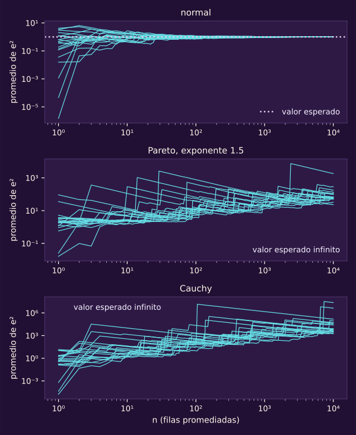
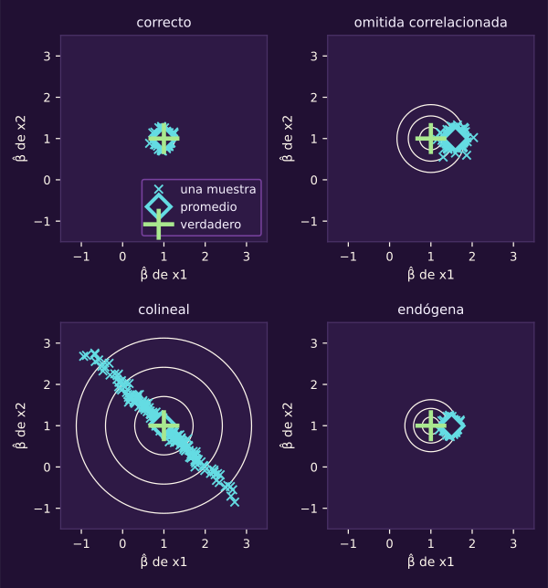
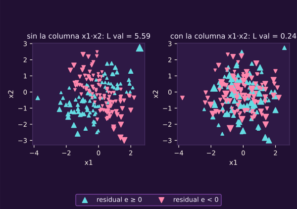
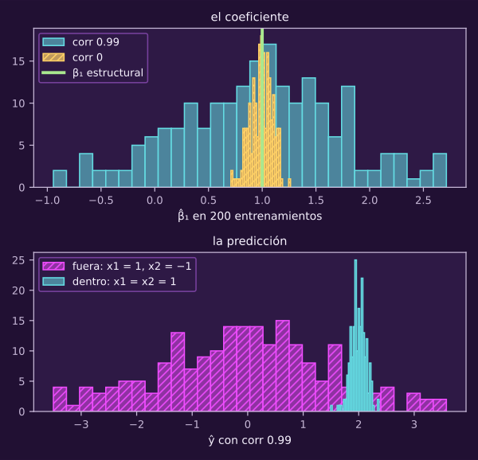

> [!WARNING]
> **▶▶ ABRE EL NOTEBOOK EN COLAB ◀◀**
>
> **Notebook 06 · Leer el error.** Corre en tu navegador, sin instalar nada.
>
> 
>
> **[👉 Abrir `06_leer_el_error.ipynb` en Colab](https://colab.research.google.com/github/raya-lucaria/ia_o26/blob/main/course/9_aprendizaje_maquina/_assets/06_leer_el_error.ipynb)**

# Leer el error

**Tu modelo tiene un error de validación. ¿Es bueno o malo, y qué te dice sobre lo que hay que cambiar?**

~30 min de lectura, ~10 de cuentas a mano y ~25 con el notebook.

Al terminar tendrás:

- **Tres vistas:** leer centro, ancho y forma de los residuales.
- **Una comparación:** medir el error contra la media, la mediana y el piso.
- **Una cola reconocible:** explicar por qué el MSE sufre con valores extremos.
- **Cuatro diagnósticos:** distinguir variable omitida, interacción omitida, endogeneidad y colinealidad por sus efectos sobre $\widehat\beta$.
- **Una decisión:** decir qué arregla regularizar y qué no.

> [!TIP]
> **Míralo correr: el notebook 6**
>
> 

> **Lo que traes:** residuales $e_i=y_i-\widehat y_i$, MAE, MSE y RMSE de [[opt-objetivo-regresion-practica|la regresión de la unidad 6]].
> El proceso y las cuatro fuentes: @ml-c1-def-proceso-generador y @ml-c1-obs-cuatro-fuentes.
> El piso: @ml-c1-def-error-bayes; el modelo lineal en parámetros: @ml-c1-def-modelo-lineal.
> Sesgo y varianza de una predicción en un punto: @ml-c2-teo-sesgo-varianza y su diana, @ml-c2-diana.

## 1 · Leer el error en tres vistas

::: figure {#ml-c3-mismo-rmse title="Dos modelos, el mismo RMSE"}

:::

Cada columna muestra un modelo; cada punto corresponde a una observación de validación. En A, la recta correcta deja ruido grande: $\sigma_\varepsilon=1.33$. En B, una recta intenta seguir una curva con ruido chico: $\sigma_\varepsilon=0.5$. Ambas tienen RMSE de validación 1.34, pero solo B deja una U en los residuales contra $x$.

**Piensa: ¿dos modelos con el mismo RMSE de validación se equivocan de la misma manera?**

El promedio esconde cómo falla cada modelo: ensanchar la familia puede corregir la curva de B, pero no elimina el ruido de A.

> [!TIP]
> **Míralo correr: bloque 1 · Las tres vistas**
>
> 
>
> Mueve el ruido y la semilla; sigue los cambios en los tres paneles.

::: definition {#ml-c3-def-tres-vistas title="Las tres vistas del error"}
Con $\widehat f$ ajustado en $\mathcal D_{\text{ent}}$ y los residuales
$e_i=y_i-\widehat y_i$ de $i\in\mathcal D_{\text{val}}$:
1. $\widehat y_i$ contra $y_i$, con la diagonal $\widehat y=y$ y los mismos
   límites en los dos ejes;
2. el histograma de los $e_i$, con su **centro**
   $\bar e_{\text{val}}=\frac1{n_{\text{val}}}\sum_{i\in\mathcal D_{\text{val}}}e_i$
   y su **ancho**;
3. $e_i$ contra cada variable $x_{ij}$ (o contra $\widehat y_i$): la **forma**.

Se leen en validación. En entrenamiento, supón que $\widehat\beta$ minimiza la pérdida cuadrática con $\beta_0$ libre y sin penalizar. Las demás componentes pueden llevar $\mu$ o no. Entonces $\bar e_{\text{ent}}=0$ siempre: la derivada respecto a $\beta_0$ es $-\frac2{n_{\text{ent}}}\sum_i e_i=0$.
:::

La simulación confirma $\bar e_{\text{ent}}=0$ a 10 decimales. Para separar centro y ancho, resta a cada residual su promedio.

::: theorem {#ml-c3-teo-centro-y-ancho title="El error cuadrático es centro más ancho"}
Para cualquier conjunto $\mathcal D$ y cualquier $\widehat f$, con pérdida
cuadrática,

$$
L_{\mathcal D}=\frac1{n_{\mathcal D}}\sum_{i\in\mathcal D}e_i^2=\bar e_{\mathcal D}^{\,2}+\frac1{n_{\mathcal D}}\sum_{i\in\mathcal D}\bigl(e_i-\bar e_{\mathcal D}\bigr)^2 .
$$

:::
::: proof {#ml-c3-dem-centro-y-ancho of="ml-c3-teo-centro-y-ancho"}
1) Escribe $e_i=\bar e_{\mathcal D}+(e_i-\bar e_{\mathcal D})$ y eleva al cuadrado.
2) El término cruzado es $2\bar e_{\mathcal D}\sum_i(e_i-\bar e_{\mathcal D})=0$.
3) Promedia.
:::

Esta identidad es exacta en cada muestra. La siguiente promedia sobre entrenamientos: $\operatorname{Var}_x$ mide cuánto cambia una cantidad al cambiar $x$.

::: remark {#ml-c3-obs-centro-no-es-sesgo title="El centro es menos el sesgo promedio; lo demás va al ancho"}
El histograma junta residuales de muchos $x$. Repite el entrenamiento y saca un $x$ nuevo, independiente de él. Con pérdida cuadrática, $E[\varepsilon\mid x]=0$ y $\text{sesgo}(x)=E_{\mathcal D}[\widehat f(x)]-f(x)$, como en @ml-c2-teo-sesgo-varianza, en promedio sobre entrenamientos:

$$
E[e]=-E_x\bigl[\text{sesgo}(x)\bigr]
$$

y, para el ancho,

$$
\operatorname{Var}(e)=E_x\bigl[\sigma_\varepsilon^2(x)\bigr]+E_x\bigl[\text{varianza}(x)\bigr]+\operatorname{Var}_x\bigl(\text{sesgo}(x)\bigr).
$$

Un sesgo de promedio cero sobre $x$ puede ensanchar el histograma sin desplazarlo. Por ejemplo, una curva faltante compensada por el intercepto: aparece como forma en $e$ contra $x$.

La identidad vale en promedio, no en cada histograma. Su centro se mueve por dos razones. Con el ajuste fijo, validación es una muestra: $\bar e$ cae cerca de $E[e\mid\widehat f]$, pero no encima. Entre entrenamientos cambia $\widehat f$ y, con él, ese centro.

Ambos movimientos ocurren aun con $\sigma_\varepsilon=0$: dependen también de qué $x$ cayeron en cada conjunto y de cómo los usó el ajuste.
:::

> [!WARNING]
> Lectura equivocada: «El histograma está centrado en cero, así que el modelo está bien».
>
> Lectura correcta: **Un centro cerca de cero es compatible con sesgos de predicción que se compensan sobre $x$.** La curva que falta aparece en el ancho y la forma.

::: exercise {#ml-c3-ej-cancelan title="Calcula el centro de unos residuales que se cancelan"}
En validación, $x=(-2,-1,0,1,2)$ y $e=(2,-1,-2,-1,2)$.

(a) Calcula $\bar e$ y $L_{\text{val}}$ con pérdida cuadrática.

(b) ¿Qué vista delata el problema y qué columna le falta a $\Phi$?
:::
::: hint {#ml-c3-pista-cancelan-1 of="ml-c3-ej-cancelan" title="Pista 1 · Busca una forma"}
¿Los cinco residuales se parecen a alguna función sencilla de $x$?
:::
::: answer {#ml-c3-resp-cancelan of="ml-c3-ej-cancelan" title="Respuesta · La forma que el centro esconde"}
**(a)** $\bar e=0$ y $L_{\text{val}}=14/5=2.8$: todo está en el ancho.

**(b)** $e_i=x_i^2-2$ exactamente. La vista 3 muestra una U; falta la columna $x^2$. Agregarla conserva un modelo lineal en $\beta$.
:::

Ya puedes leer cómo falla. Falta decidir cuánto importa ese error.

## 2 · Comparar el error contra un benchmark

::: figure {#ml-c3-benchmarks title="Contra qué se mide un error"}

:::

Las barras muestran RMSE de validación y la raíz del piso cuadrático, en las mismas unidades. Abajo, una señal débil deja poco margen sobre el piso.

**Piensa: un RMSE de 1.05 cuando la respuesta ronda 1000, ¿es bueno?**

Dividirlo entre el nivel da 0.1 %, pero eso engaña. En el caso 11, la media logra RMSE 1.10 y la mediana 1.09. La desviación de $y$ en entrenamiento es 1.06; RMSE/desviación vale 0.99. La mejora cuadrática sobre la media es 7.7 %, calculada con las cifras sin redondear: importa la dispersión, no el nivel.

Retomamos la media de entrenamiento como punto de comparación de la clase 2: ¿el modelo le gana de verdad o por azar?

> [!TIP]
> **Míralo correr: bloque 2 · ¿Bueno o malo?**
>
> 
>
> Mueve el nivel y la señal. Compara qué cambia al dividir por el nivel o por la dispersión.

La regla constante tiene capacidad cero: solo ajusta $\beta_0$. Entre su pérdida y el piso de @ml-c1-def-error-bayes está el margen disponible.

::: definition {#ml-c3-def-benchmark title="Benchmark y error relativo"}
Un **punto de comparación (*benchmark*)** es una regla tonta ajustada con $\mathcal D_{\text{ent}}$. Se evalúa en el mismo conjunto y con la misma pérdida que el modelo. En regresión predice siempre $\bar y_{\text{ent}}$ con pérdida cuadrática, o la mediana de $y$ de entrenamiento con pérdida absoluta. Todo error se reporta:
1. junto al del benchmark, y como **mejora sobre el benchmark**

   $$
   1-\frac{L_{\text{val}}(\widehat\beta)}{L_{\text{val}}(\bar y_{\text{ent}})};
   $$

2. frente a la **escala** de $y$: el $\mathrm{RMSE}$ al lado de la
   desviación estándar de $y$ en entrenamiento, no al lado de su nivel.

**Cuándo le gana**, en dos casos distintos:

(a) **Reserva independiente, modelos fijados.** Fija modelo y benchmark antes de mirar $\mathcal D$: la prueba, o una validación que no eligió nada. Esa reserva no intervino en el ajuste, los hiperparámetros ni el preprocesamiento de ninguno. Las observaciones deben ser independientes y cumplir $E[\ell^2]<\infty$, como en @ml-c2-teo-prueba-insesgada.

Calcula las diferencias pareadas $d_i=\ell_i^{\text{modelo}}-\ell_i^{\text{benchmark}}$, $i\in\mathcal D$. El modelo le gana si su media queda por debajo de 0 a más de dos errores estándar. Aquí $\mathrm{EE}=s_d/\sqrt{n_{\mathcal D}}$, con $s_d$ la desviación de las $d_i$. La inferencia es aproximada, requiere $n_{\mathcal D}$ grande y solo vale para esos dos modelos.

(b) **Validación cruzada (*cross-validation*).** Las pérdidas fuera de pliegue dependen entre sí; emparejarlas no lo arregla (@ml-c3-obs-cv-no-es-reserva). La comparación en CV es descriptiva. Usa la diferencia de las medias de $\mathrm{CV}_k$ y las $k$ diferencias por pliegue, con la misma partición.

Si la diferencia media no sale de la dispersión de las diferencias por pliegue, no hay señal. Si sale, hay una señal que requiere confirmación con (a) en una reserva. Elegir el modelo con esa misma CV vuelve optimista la señal (@ml-c2-obs-optimismo-seleccion).
:::

En ambos paneles, la validación es una reserva: no eligió nada; los modelos quedaron fijados con entrenamiento. Caso 11: diferencia pareada modelo − media de -0.093 (EE 0.041), en 200 filas. Le gana por más de 2 EE, aunque la mejora sea chica.

Con señal débil, $f=0.75x$, el RMSE del modelo es 1.05; el de la media, 1.15; la raíz del piso, 1.00. La mejora es 15.7 %, calculada con las cifras sin redondear; la diferencia pareada, -0.205 (EE 0.064), también pasa de 2 EE. El modelo casi alcanza el piso: cambiar la familia ofrece poco margen.

::: remark {#ml-c3-obs-cv-no-es-reserva title="Por qué la validación cruzada no da ese error estándar"}
En validación cruzada los ajustes comparten casi todo su entrenamiento: las pérdidas fuera de pliegue dependen entre sí. No hay un estimador insesgado universal de la varianza de $\mathrm{CV}_k$, es decir, válido sin hipótesis adicionales para todas las distribuciones (Bengio y Grandvalet, 2004).

Considera dos respuestas independientes, cada una $+1$ o $-1$ con probabilidad $1/2$. La validación cruzada deja una fuera. El modelo predice 0; el benchmark, la media de entrenamiento: la otra respuesta.

Si las respuestas son iguales, ambas diferencias valen $1-0=1$; si son distintas, $1-4=-3$. Las diferencias son siempre iguales: $s_d/\sqrt2=0$ en toda muestra. Su media vale $1$ o $-3$ con probabilidad $1/2$: su desviación real es 2.
:::

La media es −1 en promedio sobre muestras. El cero del supuesto EE no indica certeza.

::: theorem {#ml-c3-teo-constante-optima title="La mejor constante es la media o la mediana"}
Para $y_1,\dots,y_n$,
$\frac1n\sum_{i=1}^n(y_i-\beta_0)^2$ tiene un **único** minimizador,
$\beta_0=\bar y$, y

$$
\operatorname*{arg\,min}_{\beta_0}\ \frac1n\sum_{i=1}^n\lvert y_i-\beta_0\rvert
$$

es el conjunto de las medianas de los $y_i$. Si $n$ es par, incluye todo el intervalo entre las dos centrales. El benchmark toma su punto medio, la regla de selección de `benchmarks`.
:::
::: proof {#ml-c3-dem-constante-optima of="ml-c3-teo-constante-optima"}
1) Cuadrática: la derivada es $\frac2n\sum_i(\beta_0-y_i)=2(\beta_0-\bar y)$,
cero solo en $\bar y$; la función es convexa.
2) Absoluta: fuera de los $y_i$, la pendiente es (cuántos $y_i$ quedan abajo − cuántos arriba)$/n$. Es negativa mientras haya más arriba y positiva cuando hay más abajo. El mínimo está donde cambia de signo: la mediana.
:::

::: remark {#ml-c3-obs-r2 title="Lo que muchos llaman R²"}
Muchos libros llaman $R^2$ a esta mejora, pero usan la media del conjunto evaluado, desconocida de antemano para el modelo. Aquí usamos $\bar y_{\text{ent}}$ y decimos «mejora sobre el benchmark». **La $R$ de $R^2$ no es el riesgo $R$: es otra letra con el mismo nombre.**
:::

::: exercise {#ml-c3-ej-constante title="Compara dos constantes con dos pérdidas"}
Con $y=(0,0,0,0,10)$, compara predecir siempre 2 (la media) y siempre 0 (la mediana).

(a) Calcula el MSE de ambas reglas.

(b) Calcula el MAE. ¿Cambia cuál prefieres?
:::
::: hint {#ml-c3-pista-constante-1 of="ml-c3-ej-constante" title="Pista 1 · Separa la fila grande"}
¿Cuánto aporta la observación de 10 a cada promedio, por separado?
:::
::: answer {#ml-c3-resp-constante of="ml-c3-ej-constante" title="Respuesta · La pérdida decide"}
**(a)** MSE 16 con la media contra 20 con la mediana. Elevar al cuadrado hace costoso alejarse de la observación de 10.

**(b)** MAE 3.2 con la media contra 2 con la mediana. «Mejor» depende de la pérdida, como dice @ml-c3-teo-constante-optima.
:::

La moda aparecerá en la clase 4. Aquí queda otra pregunta: ¿qué pasa si las filas enormes son parte habitual del proceso?

## 3 · Reconocer una cola larga

::: figure {#ml-c3-media-acumulada title="El MSE sin segundo momento"}

:::

Cada línea sigue el MSE del modelo correcto en los primeros $n$ casos de validación, con una semilla distinta. Con ruido normal convergen; con Pareto y Cauchy saltan. A $n=10^4$, el cociente máximo/mínimo entre 20 semillas es 1.04, 79 y 13 196, respectivamente.

**Piensa: si una sola entrega de cada mil tarda diez veces más, ¿la quitas de los datos?**

Una cola larga produce valores enormes, raros pero no despreciables. Primero averigua si la entrega fue real o hubo un error de captura.

> [!TIP]
> **Míralo correr: bloque 3 · Colas largas**
>
> 
>
> Cambia el ruido de cola y la semilla. Mira cuánto tarda en saltar el promedio.

::: remark {#ml-c3-obs-colas-largas title="Una cola larga no es un outlier"}
Con ruido de Pareto de exponente 1.5 la media existe y la varianza es infinita. Lo mismo ocurre con una distribución de Student de 2 grados de libertad. Con exponente 1 o menos, Pareto tampoco tiene media.

Con Cauchy no existe la media y el segundo momento es infinito. El supuesto $E[\varepsilon\mid x]=0$ de @ml-c1-def-proceso-generador deja de tener sentido (caso 6 de la galería, con `ruido=ml.cauchy()`). Si el ruido es independiente de las entradas, en los tres casos todo predictor tiene riesgo cuadrático infinito. El piso cuadrático también es infinito: es el ínfimo del riesgo (@ml-c1-def-error-bayes). Con Cauchy también lo es el absoluto.

Sin varianza, $L_{\text{val}}$ cuadrático no se estabiliza al crecer $n_{\text{val}}$: lo dominan pocas filas. El MAE se estabiliza si la media existe; con Cauchy, tampoco. Cada una de esas filas **no es un outlier: es el fenómeno**. Quitarlas cambia el problema que se resuelve.
:::

::: remark {#ml-c3-obs-mse-verosimilitud title="La pérdida cuadrática y la verosimilitud normal"}
Con ruido normal de varianza fija, minimizar la pérdida cuadrática da el $\widehat\beta$ que hace más probable la muestra (máxima verosimilitud). Con ruido de Laplace, lo da minimizar la absoluta.

La implicación va en ese sentido: minimizar el MSE apunta a la media condicional con cualquier ruido de varianza finita. Las colas largas cambian cuánto pesan pocas filas y si existe la varianza (@ml-c3-obs-colas-largas).
:::

> [!WARNING]
> Lectura equivocada: «Ese dato es demasiado grande, lo quito».
>
> Lectura correcta: **Si el proceso produce esos valores, quitarlos es responder otra pregunta.** Primero revisa la captura; después, la pérdida que corresponde a tu pregunta.

::: exercise {#ml-c3-ej-cola title="Calcula cuánto pesa una sola fila"}
Tienes 100 residuales de validación: 99 valen $\pm1$ y uno vale 50.

(a) ¿Qué fracción del MSE aporta esa fila?

(b) ¿Qué fracción del MAE aporta?
:::
::: hint {#ml-c3-pista-cola-1 of="ml-c3-ej-cola" title="Pista 1 · Suma por separado"}
¿Cuánto suman los 99 cuadrados y cuánto el de la fila grande?
:::
::: answer {#ml-c3-resp-cola of="ml-c3-ej-cola" title="Respuesta · Una fila domina"}
**(a)** MSE $=(99+2500)/100=25.99$. La fila aporta $2500/2599\approx96\%$ del total.

**(b)** MAE $=(99+50)/100=1.49$. Aporta $50/149\approx34\%$. El cuadrado aumenta mucho su peso relativo.
:::

El tamaño de los errores puede venir del ruido; su patrón puede señalar algo que el modelo no ve.

## 4 · Rastrear lo que el modelo no ve

::: figure {#ml-c3-fuentes-patologias title="Cuatro fuentes y sus patologías"}

:::

El mapa retoma @ml-c1-obs-cuatro-fuentes: azar, variables que no medimos, familia equivocada y pocos datos. La optimización va aparte. Observaremos cómo cambia $\widehat\beta$ entre entrenamientos.

**Piensa: si quitas una variable que sí importa, ¿siempre se equivoca la pendiente de las demás?**

La omitida puede subir el piso sin correr la pendiente; si está correlacionada con las visibles, puede hacer ambas cosas. Una interacción ausente deja error de aproximación. La colinealidad deja pocos datos para separar columnas casi iguales; la endogeneidad compromete la interpretación estructural.

> [!TIP]
> **Míralo correr: bloque 4 · Lo que el modelo no ve**
>
> 
>
> Cambia qué ve el modelo. Usa `imprimir_Phi` para comprobar qué columnas recibe.

La diana de @ml-c2-diana mostraba predicciones en un punto fijo; ahora muestra parejas de coeficientes.

::: figure {#ml-c3-diana-beta title="La diana de los coeficientes"}

:::

Cada punto es $(\widehat\beta_1,\widehat\beta_2)$ de un entrenamiento; hay 200 por panel. La cruz verde marca el coeficiente estructural $(1,1)$; el rombo cian, el promedio. La nube correcta está centrada; la colineal se alarga. La omitida centra $\widehat\beta_1$ en 1.59; la endógena, en 1.50.

Todas las $x$ son normales estándar y $\sigma_\varepsilon=1$: en la omitida, $f=1+x_1+x_2+x_3$, con $x_3$ omitida y $\operatorname{corr}(x_1,x_3)=0.6$; en la endógena, $f=1+x_1+x_2$, con $\operatorname{corr}(x_1,\varepsilon)=0.5$. La cuenta de @ml-c3-teo-variable-omitida da $1+0.6=1.6$ y $1+0.5=1.5$; la simulación da 1.59 y 1.50.

El sesgo del estimador, $E_{\mathcal D}[\widehat\beta_j]-\beta_j$, usa el $\beta_j$ estructural. Difiere del sesgo de predicción $\text{sesgo}(x)=E_{\mathcal D}[\widehat f(x)]-f(x)$ de @ml-c2-teo-sesgo-varianza. Veremos que una pendiente sesgada puede predecir bien la media condicional visible.

La covarianza, $\operatorname{cov}$, mide cómo varían juntas dos cantidades; la correlación, $\operatorname{corr}$, expresa esa relación sin unidades.

::: theorem {#ml-c3-teo-variable-omitida title="Lo que absorbe una pendiente cuando falta una variable"}
Supón $y=\beta_0+\beta_1x_1+\beta_2x_2+\varepsilon$ con
$E[\varepsilon\mid x_1,x_2]=0$, varianzas finitas y
$\operatorname{Var}(x_1)>0$. Si el modelo solo ve $x_1$, al crecer
$n_{\text{ent}}$ la pendiente de mínimos cuadrados $\widehat\beta_1$ se
concentra en

$$
\beta_1+\beta_2\,\frac{\operatorname{cov}(x_1,x_2)}{\operatorname{Var}(x_1)}.
$$

Si $\operatorname{cov}(x_1,x_2)=0$, se concentra en $\beta_1$. Esto habla solo de la pendiente. Que lo omitido «solo suba el piso» pide más: por ejemplo, que $x_2$ sea independiente de $x_1$. Entonces el piso sube en $\beta_2^2\operatorname{Var}(x_2)$.
:::
::: proof {#ml-c3-dem-variable-omitida of="ml-c3-teo-variable-omitida"}
1) Con un regresor, la pendiente de mínimos cuadrados divide la covarianza muestral de $x_1$ con $y$ entre la varianza muestral de $x_1$. Con $n$ grande se acerca a $\operatorname{cov}(x_1,y)/\operatorname{Var}(x_1)$.
2) Sustituye $y$: $\operatorname{cov}(x_1,y)=\beta_1\operatorname{Var}(x_1)+\beta_2\operatorname{cov}(x_1,x_2)+\operatorname{cov}(x_1,\varepsilon)$.
3) $E[\varepsilon\mid x_1,x_2]=0$ da $\operatorname{cov}(x_1,\varepsilon)=0$. Divide.
:::

::: example {#ml-c3-ejm-omitida title="Tres láminas con un solo proceso"}
En el caso 1 de la galería de la clase 1, $y=x_1+x_2x_3+\varepsilon$. Las variables $x_1$ y $x_3$ son normales estándar con $\operatorname{corr}(x_1,x_3)=0.8$. La variable $x_2$ es normal, independiente de ambas, con media 1 y desviación 0.5; $\sigma_\varepsilon=0.5$.

El modelo solo ve $x_1$. Distingue tres objetos:
- el **coeficiente estructural** de $x_1$ en $f$: vale 1;
- el **predictor de Bayes con lo visible**, $E[y\mid x_1]$: como $x_2$ es
  independiente y $x_3$ es normal con $x_1$,
  $E[y\mid x_1]=x_1+E[x_2]\,E[x_3\mid x_1]=x_1+0.8\,x_1=1.8\,x_1$;
- el **mejor predictor lineal con lo visible**: aquí es el mismo,
  $1.8\,x_1$, **porque** $E[y\mid x_1]$ resulta lineal en este proceso.

(a) Falta $x_2x_3$, con coeficiente 1. Por independencia de $x_2$, $\operatorname{cov}(x_1,x_2x_3)=E[x_2]\operatorname{cov}(x_1,x_3)=0.8$. Así, @ml-c3-teo-variable-omitida da $\widehat\beta_1\to1+0.8=1.8$; la simulación da $1.79$.

(b) Con $x_1,x_2,x_3$ en $\Phi$, sin el producto, $\widehat\beta_1\approx1.00$. La cuenta da 1: $x_2x_3=x_3+(x_2-1)x_3$ y la segunda parte no se correlaciona con ninguna columna. La interacción deja forma en los residuales.

(c) Con la columna $x_2x_3$, $\widehat\beta_1\approx1.01$ y el coeficiente de $x_2x_3\approx1.00$. El error $L_{\text{val}}=0.24$ llega al piso con todo visible, $\sigma_\varepsilon^2=0.25$.

La pendiente de (a) está sesgada como coeficiente estructural (1.8 contra 1), pero es la mejor para predecir con lo visible. Aquí el mejor predictor lineal coincide con el de Bayes. Si $E[y\mid x_1]$ fuera curva, mínimos cuadrados daría el mejor ajuste lineal; Bayes sería otro y los tres objetos serían distintos.
:::

Las tres láminas usan los mismos datos. En (a), el piso con lo visible es 0.86: bajarlo requiere recuperar información. En (b), ya está medida; falta la columna del producto.

::: figure {#ml-c3-interaccion-plano title="Una interacción es una columna más"}

:::

Este otro proceso, $f=x_1+x_2+2x_1x_2$, muestra la interacción en un plano. Los triángulos señalan residuales positivos hacia arriba y negativos hacia abajo. Agregar $x_1x_2$ elimina la silla y baja $L_{\text{val}}$ de 5.59 a 0.24.

> [!WARNING]
> Lectura equivocada: «Agregar una interacción cambia la linealidad en los parámetros».
>
> Lectura correcta: **El producto es una columna más de $\Phi$; el modelo sigue siendo lineal en $\beta$**, como en @ml-c1-def-modelo-lineal.

Una pendiente también puede incorporar ruido predecible desde la entrada.

::: remark {#ml-c3-obs-endogeneidad title="Endogeneidad: sesgo sin que falte nada visible"}
Si $x_1$ está correlacionada con el ruido, $E[\varepsilon\mid x]\neq0$ (caso 8). La misma cuenta concentra $\widehat\beta_1$ en $\beta_1+\operatorname{cov}(x_1,\varepsilon)/\operatorname{Var}(x_1)$. Los residuales de entrenamiento no lo delatan: las ecuaciones normales obligan $\sum_{i\in\mathcal D_{\text{ent}}}e_i\,x_{ij}=0$ para cada columna.

La función estructural $f$ ya no es $E[y\mid x]$. En el caso 8, $(x_1,\varepsilon)$ tiene distribución normal conjunta. Por eso $E[y\mid x_1]$ es lineal, con esa pendiente, y coincide con el mejor predictor lineal. Como en @ml-c3-ejm-omitida, hay sesgo del coeficiente estructural. Respecto de la media condicional visible $E[y\mid x_1]$, en este caso normal conjunto, la predicción no tiene sesgo; respecto de $f$, sí: el sesgo es $0.5x_1$.

Sin normalidad conjunta, mínimos cuadrados sigue dando el mejor predictor lineal con esa pendiente, pero la media condicional puede no ser lineal.

En el caso 8, donde $x_1$ es la única entrada y $(x_1,\varepsilon)$ tiene distribución normal conjunta, el piso visible es $\operatorname{Var}(\varepsilon)\,\bigl(1-\operatorname{corr}(x_1,\varepsilon)^2\bigr)$. Aquí $\operatorname{Var}(\varepsilon)$ es la varianza marginal del ruido. Con más entradas visibles, o si falta una variable, esa fórmula no vale: el piso es $E[\operatorname{Var}(y\mid x_{\text{visibles}})]$.

Ni más datos ni regularizar permiten identificar el coeficiente estructural sin información adicional. Hace falta otra información, fuera de este curso.
:::

En el caso 8, $f=1+2x_1$, $\operatorname{Var}(x_1)=1$ y $\operatorname{corr}(x_1,\varepsilon)=0.5$. La cuenta da 2.5; el promedio de 200 estimaciones, 2.50. La correlación de $e$ con $x_1$ en entrenamiento es 0 a 10 decimales. En validación, $L_{\text{val}}=0.78$ casi toca el piso 0.75: predice bien, pero no recupera el efecto estructural.

Aquí la varianza marginal del ruido es $\operatorname{Var}(\varepsilon)=1$; el piso usa la variación que queda después de observar $x_1$.

Con omitidas o endogeneidad, aplica la descomposición predictiva usando $E[y\mid x_{\text{visibles}}]$ y $\operatorname{Var}(y\mid x_{\text{visibles}})$.

::: exercise {#ml-c3-ej-pendiente title="Predice una pendiente sospechosa"}
Tienes $y=2x_1+3x_2+\varepsilon$, $\operatorname{Var}(x_1)=1$, $\operatorname{cov}(x_1,x_2)=0.5$ y ruido exógeno. Ajustas solo con $x_1$.

(a) ¿En qué valor se concentra $\widehat\beta_1$?

(b) ¿Sirve para predecir? Distingue la predicción de la interpretación estructural.
:::
::: hint {#ml-c3-pista-pendiente-1 of="ml-c3-ej-pendiente" title="Pista 1 · Lo que anticipa la entrada"}
¿Qué parte de $x_2$ se puede anticipar con $x_1$?
:::
::: answer {#ml-c3-resp-pendiente of="ml-c3-ej-pendiente" title="Respuesta · La pendiente absorbe información"}
**(a)** $2+3\cdot0.5=3.5$.

**(b)** Es la pendiente del mejor predictor lineal con $x_1$ sola. Coincide con la del predictor de Bayes si $E[x_2\mid x_1]$ es lineal, como con normales. No es el 2 estructural.
:::

¿Y si la nube se alarga al volver a aprender?

## 5 · Ver lo que cambia al reaprender

::: figure {#ml-c3-colineal-prediccion title="Lo que cambia al reaprender"}

:::

La figura compara 200 entrenamientos. Arriba, la colinealidad ensancha el histograma de $\widehat\beta_1$. Abajo, separa predecir dentro de la nube y fuera de la diagonal donde viven los datos, $x_1\approx x_2$.

**Piensa: con dos variables casi idénticas, ¿qué es más estable entre entrenamientos: cada coeficiente o la predicción?**

La predicción dentro de la nube puede ser estable aunque los coeficientes cambien mucho. Si subes una pendiente y bajas la otra, sus aportes casi se compensan. Fuera de la diagonal ya no: estás extrapolando.

> [!TIP]
> **Míralo correr: bloque 5 · Reaprender**
>
> 
>
> Aumenta la correlación y compara coeficientes y predicciones al cambiar la semilla.

Las soluciones casi igual de buenas forman una elipse alargada. La fórmula mide esa apertura; su comprobación queda en «Para profundizar».

::: remark {#ml-c3-obs-colinealidad title="Cuánto crece la varianza con la colinealidad"}
Con dos variables, el modelo correcto y ruido de varianza constante
$\sigma_\varepsilon^2$,

$$
\operatorname{Var}(\widehat\beta_1\mid X)=\frac{\sigma_\varepsilon^2}{n_{\text{ent}}\,\widehat{\operatorname{Var}}(x_1)\,\bigl(1-\widehat{\operatorname{corr}}(x_1,x_2)^2\bigr)},
$$

con la varianza y la correlación muestrales de entrenamiento. Con
$\widehat{\operatorname{corr}}=0.99$, el factor $1/(1-0.99^2)\approx50$.
:::

La varianza muestral de esta fórmula divide entre $n_{\text{ent}}$. En la simulación, al pasar de correlación 0 a 0.99, la desviación de $\widehat\beta_1$ pasa de 0.10 a 0.75. La desviación de $\widehat y$ es 0.13 dentro, en $(1,1)$, y 1.50 fuera, en $(1,-1)$. Comprueba la estabilidad donde necesitas predecir.

::: exercise {#ml-c3-ej-colineal title="Calcula cuánto se abre la nube"}
Con $\sigma_\varepsilon^2=1$, $n_{\text{ent}}=100$ y $\widehat{\operatorname{Var}}(x_1)=1$:

(a) Calcula la desviación de $\widehat\beta_1$ con correlación 0.

(b) Calcula la desviación con correlación 0.9. ¿Cuántas veces se ensancha?
:::
::: hint {#ml-c3-pista-colineal-1 of="ml-c3-ej-colineal" title="Pista 1 · Localiza el factor"}
¿Qué factor de la fórmula de @ml-c3-obs-colinealidad cambia al pasar de 0 a 0.9, y cuánto vale en cada caso?
:::
::: answer {#ml-c3-resp-colineal of="ml-c3-ej-colineal" title="Respuesta · De varianza a desviación"}
**(a)** La desviación es $0.1$.

**(b)** Es $\sqrt{1/19}\approx0.229$, unas 2.3 veces mayor. Toma la raíz de la varianza para comparar el ancho de las nubes.
:::

Los datos permiten intercambiar coeficientes enormes sin cambiar casi el ajuste. ¿Podemos pedirle al optimizador que prefiera una solución menos extrema?

### Ejercicio final

**Intenta formular tu propuesta sin abrir las pistas ni la respuesta y sin pedir ayuda a ChatGPT.**

::: exercise {#ml-c3-ej-final-leer-el-error title="Distingue dos causas del mismo abanico"}
Un equipo predice minutos de entrega con distancia $x_1$ y tráfico $x_2$, centradas e independientes. Usa $\Phi=(1,x_1,x_2)$. En validación, el residual contra $x_1$ abre en abanico: chico cerca de $x_1=0$, grande en los extremos, sin curva.

La idea nueva es que el mismo dibujo puede tener dos causas. H1: $\varepsilon=\sigma_\varepsilon(x_1)\cdot Z$, con $\sigma_\varepsilon$ creciente en $\lvert x_1\rvert$ y $Z$ normal estándar independiente de $x_1$ y $x_2$. H2: falta el término $x_1x_2$. No hay otras variables y no puedes pedir más datos. Usa los conjuntos ya separados; la prueba sigue cerrada.

Entrega un diagnóstico: explica qué observarías bajo cada causa y cómo confirmarías una mejora.

1. Propón una vista o cuenta con los datos de validación que separe H1 de H2. Di qué conserva que el abanico no muestra.
2. Explica qué cambiarías en $\Phi$ bajo cada hipótesis. ¿El modelo sigue siendo lineal en $\beta$?
3. Indica qué número de validación revisarías para evaluar tu cambio y contra qué lo compararías. Aclara qué puedes afirmar si decides mirando ese conjunto.
4. Ubica cada hipótesis entre las cuatro fuentes: azar, variables que no medimos, familia equivocada y pocos datos. Justifica por qué eliges esa fuente.
5. ¿Regularizar arregla alguna de las dos? Distingue reducir inestabilidad, recuperar una columna ausente y quitar ruido.
:::
::: hint {#ml-c3-pista-final-leer-el-error-1 of="ml-c3-ej-final-leer-el-error" title="Pista 1 · Qué conserva cada vista"}
Si coloreas cada residual por el signo de $x_2$, ¿qué esperarías ver bajo cada hipótesis?
:::
::: hint {#ml-c3-pista-final-leer-el-error-2 of="ml-c3-ej-final-leer-el-error" title="Pista 2 · Revisa tu propuesta"}
Comprueba con dos preguntas: ¿tu cambio bajaría $L_{\text{val}}$ hasta cerca del piso bajo H1? ¿y bajo H2?
:::
::: answer {#ml-c3-resp-final-leer-el-error of="ml-c3-ej-final-leer-el-error" title="Respuesta · Separar ruido de forma"}
**1.** Bajo H2, el signo de $e$ tiende a seguir el de $x_1x_2$: aparece una silla en el plano, como en @ml-c3-interaccion-plano. Bajo H1, el error ideal es $y-E[y\mid x]=\sigma_\varepsilon(x_1)Z$: su signo es el de $Z$, independiente de $x_1$ y $x_2$.

El residual $e$ suma además el error del ajuste finito, que puede cambiar algún signo, pero sin un patrón sistemático con el signo de $x_1x_2$ bajo H1. El abanico solo mostraba tamaños; separar por signo conserva la dirección del error.

**2.** Bajo H2, agrega la columna $x_1x_2$ con `interacciones`; el modelo sigue siendo lineal en $\beta$. Bajo H1, la familia ya representa la media condicional: no agregas columnas por ese abanico.

**3.** Compara $L_{\text{val}}$ cuadrático con el del ajuste anterior, el benchmark y el piso. Bajo H2, debería caer cerca del piso; bajo H1, no esperas una reducción sistemática: ya estaba cerca.

Como decidiste mirando validación, esa caída solo es una señal. Fija el cambio antes de abrir la prueba una vez. Confirma la mejora sobre el benchmark con las diferencias pareadas y más de 2 EE, bajo las hipótesis del caso (a) de @ml-c3-def-benchmark.

**4.** Según @ml-c1-obs-cuatro-fuentes, H1 pertenece al azar: vive en el piso. H2 pertenece a una familia equivocada: es error de aproximación, pues las variables están medidas pero falta su combinación.

**5.** No. Ninguna $\mu$ crea una columna que no está ni quita ruido. Regularizar puede reducir la inestabilidad asociada a capacidad de sobra; ninguna de estas hipótesis identifica ese problema.
:::

**Punto de control:** Distingue ruido, forma, información faltante e inestabilidad en un diagnóstico de tres paneles. Un histograma ancho no basta: revisa también las entradas y los cambios al reaprender.

## Para profundizar

- Goodfellow et al. (2016), §5.4: sesgo y varianza de un estimador; §11.5: mira los peores errores, como hace `peores_errores`.
- Taleb, *Statistical Consequences of Fat Tails* (2020), capítulos 1–3: por qué una cola no es un outlier.
- Wooldridge, *Introductory Econometrics*, capítulo 3: variable omitida.

Para comprobar @ml-c3-obs-colinealidad, centra las dos columnas y elimina de la primera su proyección sobre la segunda. Su variación restante se reduce por el factor uno menos la correlación al cuadrado. La varianza de la pendiente divide por esa variación: de ahí el factor cercano a 50 con correlación 0.99.

Con una cola en $x$, los errores grandes pueden vivir donde las entradas son raras: es el problema de extrapolar. Compáralo con una cola en el ruido en «dónde vive la cola», bloque 3.

## Lo que hay que llevarse

- **Centro, ancho y forma:** $\bar e_{\text{ent}}=0$ con intercepto libre no garantiza un buen modelo; dos RMSE de 1.34 esconden errores distintos.
- **Benchmark y piso:** caso 11, RMSE 1.05 contra 1.10 y mejora 7.7 %. Señal débil: 1.05 contra 1.15, cerca de la raíz del piso 1.00.
- **Cola larga:** una sola fila aporta aproximadamente 96 % del MSE; borrarla cambia la pregunta si pertenece al proceso.
- **Lo que falta:** la pendiente puede ir a 3.5 en vez del 2 estructural y seguir siendo útil para predecir.
- **Reaprender:** correlación 0.99 multiplica la varianza por un factor cercano a 50; revisa dónde necesitas estabilidad.

Continúa con [[ml-lagrangeano-en-accion|El lagrangeano en acción]].
