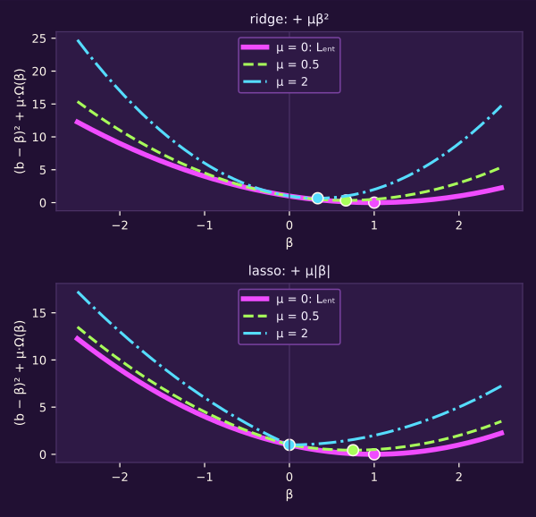
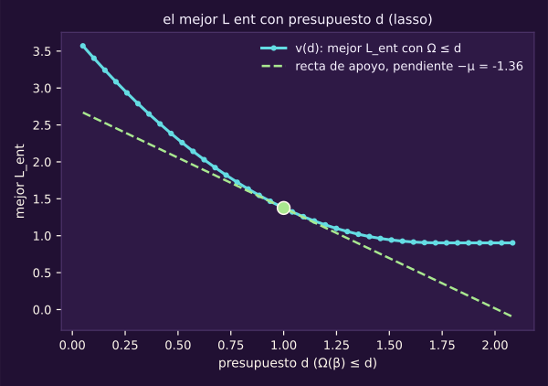
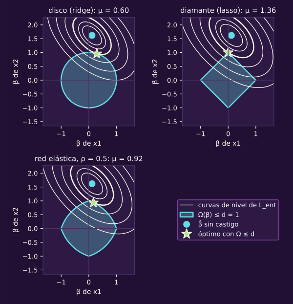
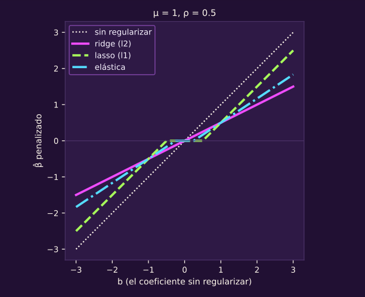
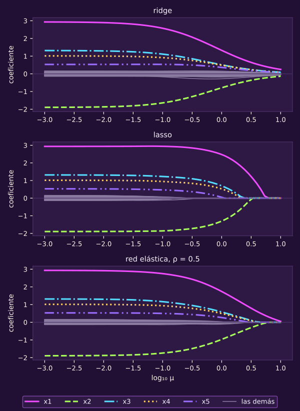
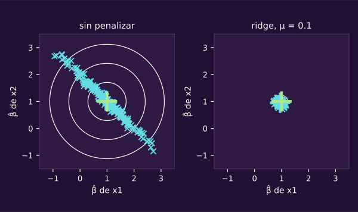
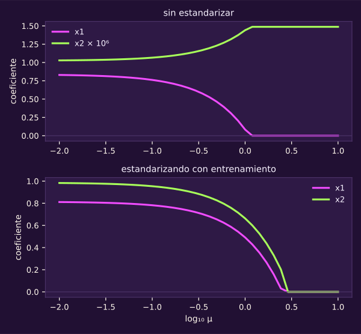
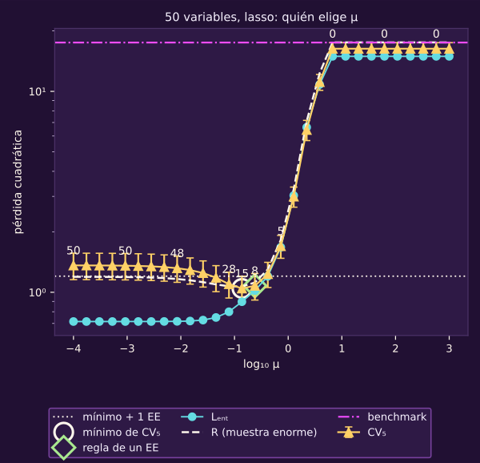

> [!WARNING]
> **▶▶ ABRE EL NOTEBOOK EN COLAB ◀◀**
>
> **Notebook 07 · El lagrangeano en acción.** Corre en tu navegador, sin instalar nada.
>
> 
>
> **[👉 Abrir `07_el_lagrangeano_en_accion.ipynb` en Colab](https://colab.research.google.com/github/raya-lucaria/ia_o26/blob/main/course/9_aprendizaje_maquina/_assets/07_el_lagrangeano_en_accion.ipynb)**

# El lagrangeano en acción: regularizar

**Si los datos admiten muchos ajustes casi igual de buenos, ¿cómo le pides al optimizador que prefiera uno más simple, y quién decide cuánto?**

En las entregas, perseguir cada punto puede salir caro fuera del entrenamiento.
Ahora pondrás un precio a los coeficientes grandes. Después elegirás ese precio
con datos que no participaron en el ajuste.

Al terminar tendrás:

- **Un lagrangeano:** escribirás ridge, lasso y red elástica con $\mu\ge0$.
- **Una explicación de los ceros:** conectarás la esquina del diamante con una cuenta de lasso.
- **Una trayectoria:** leerás qué coeficientes sobreviven cuando sube la penalización.
- **Una elección:** explicarás por qué $\mu$ es hiperparámetro y la elegirás con validación cruzada (*cross-validation*).
- **Una escala comparable:** estandarizarás con entrenamiento y explicarás qué cambia al cambiar unidades.

> [!TIP]
> **Míralo correr: el lagrangeano en acción**
> Abre `07_el_lagrangeano_en_accion.ipynb`. Cada bloque acompaña una parte de esta lectura.
>
> 

El recorrido toma ~35 min de lectura, ~12 de cuentas a mano y ~28 con el notebook.

> **Lo que traes:** capacidad como restricción (@ml-c1-def-capacidad-como-restriccion), que anunció este paso.
> La regla de signos y KKT (@opt-lagrangeano-general, @opt-kkt).
> Parámetro contra hiperparámetro (@ml-c1-def-param-hiper); $\mathrm{CV}_k$ y un EE (@ml-c2-def-validacion-cruzada, @ml-c2-def-regla-un-ee).
> La U contra el grado de las entregas (@ml-c2-cv-capacidad) y la nube alargada de la página anterior (@ml-c3-obs-colinealidad).

## 1 · Poner un presupuesto a los coeficientes

*~8 min de lectura.*

La curva gruesa es $L_{\text{ent}}$ como función de un solo coeficiente: la de $\mu=0$.
Los paneles suman $\mu\beta^2$ (arriba) o $\mu\lvert\beta\rvert$ (abajo)
para tres valores de $\mu$; el punto marca cada mínimo.

::: figure {#ml-c3-un-coeficiente title="Un coeficiente y su castigo"}

:::

Al subir $\mu$, el mínimo se acerca a cero. Con el valor absoluto, llega
a cero y se queda ahí. Este $\mu$ es el multiplicador de KKT de la unidad 6;
en Markov nombraba una distribución.

**Piensa: si $L_{\text{ent}}$ elige libremente, ¿qué gana el modelo con un coeficiente enorme, y qué pierde fuera del entrenamiento?**

Puede bajar el error observado siguiendo fluctuaciones de la muestra. Fuera de
ella, esas fluctuaciones pueden aumentar el error. En la clase 1 escribimos la
capacidad como restricción $\Omega(\beta)\le d$ y prometimos volverla lagrangeano
(@ml-c1-def-capacidad-como-restriccion). Aquí cumplimos esa promesa.

::: definition {#ml-c3-def-regularizacion title="Regularización"}
Regularizar es cualquier cambio al procedimiento de aprendizaje que busca
bajar el **error de generalización** $R(\widehat\beta)$, no el de
entrenamiento $L_{\text{ent}}(\widehat\beta)$ (Goodfellow et al., 2016,
§5.2.2). Casi siempre sube $L_{\text{ent}}$: lo que busca es cerrar la
brecha (@ml-c1-def-brecha) más de lo que sube $L_{\text{ent}}$.
:::

::: definition {#ml-c3-def-lagrangeano-capacidad title="El lagrangeano de la capacidad"}
La capacidad como restricción (@ml-c1-def-capacidad-como-restriccion) es

$$
\min_{\beta}\ L_{\text{ent}}(\beta)\quad\text{s.a.}\quad\Omega(\beta)\le d .
$$

Es un mínimo con una restricción $\Omega(\beta)-d\le0$; la regla de
@opt-lagrangeano-general pone $+\mu$:

$$
\mathcal L(\beta,\mu)=L_{\text{ent}}(\beta)+\mu\,\bigl(\Omega(\beta)-d\bigr),\qquad\mu\ge0 .
$$

Con $\mu$ fijo, $-\mu d$ no depende de $\beta$, y minimizar $\mathcal L$ en
$\beta$ es resolver la **forma penalizada**

$$
\widehat\beta(\mu)\in\operatorname*{arg\,min}_{\beta}\ L_{\text{ent}}(\beta)+\mu\,\Omega(\beta).
$$

Con ridge y $\mu>0$ el minimizador es único; con lasso puede haber
varios (columnas colineales), y entonces `ajustar` devuelve el que da su
algoritmo: hay otros con el mismo objetivo. $\mu$ grande ⇔ $d$ chico ⇔
poca capacidad. El intercepto $\beta_0$ nunca entra en $\Omega$: solo las
pendientes.
:::

En los libros verás $\lambda$ en lugar de $\mu$, y en sklearn, `alpha`, con otra escala. Aquí es $\mu$ porque viene de una desigualdad: en el curso, $\lambda$ es el multiplicador de una igualdad.

La elección del signo es la de [[los-signos-del-lagrangeano|los signos del lagrangeano]].
Falta justificar cuándo un precio reemplaza al presupuesto.

::: theorem {#ml-c3-teo-restringido-penalizado title="Restringir es penalizar"}
Supón $L_{\text{ent}}$ convexa (la pérdida cuadrática lo es), $\Omega$
una de las tres de @ml-c3-def-ridge-lasso-elastica y $d>0$. De esas
$\Omega$ se usan dos cosas: son convexas y valen 0 en un $\beta$ con solo
intercepto, así que, con $d>0$, hay un $\beta$ con $\Omega(\beta)<d$: un
punto con **holgura** (la condición de Slater).

1. Si $\widehat\beta$ resuelve el problema restringido, existe $\mu\ge0$
   tal que $\widehat\beta$ minimiza $L_{\text{ent}}+\mu\,\Omega$ y
   $\mu\,\bigl(\Omega(\widehat\beta)-d\bigr)=0$.
2. Al revés: si $\widehat\beta(\mu)$ minimiza $L_{\text{ent}}+\mu\,\Omega$
   con $\mu\ge0$, resuelve el problema restringido con
   $d=\Omega\bigl(\widehat\beta(\mu)\bigr)$.

Cuánto vale $\mu$ para un $d$ dado depende de los datos: no hay fórmula que
convierta una en otra sin resolver el problema (Goodfellow et al., 2016, §7.2).
Con otra $\Omega$ convexa, la parte 1 pide de forma explícita un $\beta$
con $\Omega(\beta)<d$; sin él puede no haber ningún $\mu$ finito.
:::

::: proof {#ml-c3-dem-restringido-penalizado of="ml-c3-teo-restringido-penalizado"}
Parte 2, completa: 1) para todo $\beta$,
$L_{\text{ent}}\bigl(\widehat\beta(\mu)\bigr)+\mu\Omega\bigl(\widehat\beta(\mu)\bigr)\le L_{\text{ent}}(\beta)+\mu\Omega(\beta)$;
2) si además $\Omega(\beta)\le\Omega\bigl(\widehat\beta(\mu)\bigr)$, como $\mu\ge0$,
$\mu\Omega(\beta)\le\mu\Omega\bigl(\widehat\beta(\mu)\bigr)$; 3) resta:
$L_{\text{ent}}\bigl(\widehat\beta(\mu)\bigr)\le L_{\text{ent}}(\beta)$.

Parte 1, en esquema: 4) @opt-teo-kkt supone funciones derivables y
restricciones afines; aquí la restricción es convexa, y con lasso y la red
elástica $\Omega$ ni siquiera es derivable en los ejes. Hace falta otro
resultado y la hipótesis de holgura del enunciado (Slater): un punto que
cumpla la restricción con holgura. Con las tres $\Omega$ y $d>0$ lo hay:
$\beta$ con solo intercepto tiene $\Omega=0<d$.

Por último, 5) con convexidad y Slater, el teorema de dualidad convexa
(fuera del curso; aquí solo se enuncia, Boyd y Vandenberghe, 2004) da un
$\mu\ge0$ con el que $\widehat\beta$ **minimiza**
$\mathcal L(\cdot,\mu)=L_{\text{ent}}+\mu(\Omega-d)$, es decir,
$L_{\text{ent}}+\mu\Omega$, y con $\mu(\Omega(\widehat\beta)-d)=0$.

Si $\Omega$ es derivable (ridge), «minimiza» es la estacionariedad
$\nabla\mathcal L=0$ de @opt-kkt; si no (lasso), es la condición de la
esquina que se deriva en la demostración de @ml-c3-teo-soft-thresholding.

Esto **extiende** @opt-teo-kkt; no es lo que la unidad 6 demostró. @ml-c3-recta-de-apoyo
lo muestra para $d>0$: $\mu$ es la pendiente (con
signo menos) de una recta que apoya a la curva del mejor $L_{\text{ent}}$
contra el presupuesto.
:::

Cada punto de la curva es el mejor $L_{\text{ent}}$ que se puede lograr con presupuesto $d$: la curva $v(d)$.
El plano tiene presupuesto $\Omega$ en horizontal y pérdida en vertical.
La recta toca la curva en el óptimo del presupuesto marcado.
La figura usa los datos de §2 (dos variables estandarizadas con correlación 0.5) y lasso.

::: figure {#ml-c3-recta-de-apoyo title="μ es la pendiente de apoyo"}

:::

La curva baja y es convexa. En $d=1$, la recta de pendiente $-1.36$ deja
toda la curva arriba: $\mu=1.36$. Para $d>0$, donde $v$ es derivable,
$\mu=-v'(d)$; donde no, sirve cualquier pendiente de apoyo con signo menos.
Con presupuesto de sobra, la curva es plana y $\mu=0$.

En $d=0$ el teorema no promete nada. Lasso puede anular todas las pendientes
con un precio finito; ridge, en el ejemplo inicial, solo cuando $\mu\to\infty$
(@ml-c3-obs-mu-infinito). Allí $L_{\text{ent}}(\beta)=(\beta-1)^2$ y $\Omega=\beta^2$:
para $0<d\le1$, $v(d)=(1-\sqrt d)^2$ y
$v'(d)=-(1-\sqrt d)/\sqrt d\to-\infty$ al acercarte a cero.

::: remark {#ml-c3-obs-mu-precio title="μ es el precio del presupuesto"}
Por @opt-mu-mejora, $\mu$ es cuánto baja el mejor $L_{\text{ent}}$ por cada
unidad más de presupuesto $d$. Si el presupuesto no aprieta
($\Omega(\widehat\beta)<d$), $\mu=0$. Leído en el lagrangeano: un
coeficiente grande paga $\mu$ por unidad de $\Omega$; solo vale la pena si
baja $L_{\text{ent}}$ al menos eso.
:::

Es una tasa marginal: si un coeficiente va a ser grande, mejor que aporte mucho.

::: exercise {#ml-c3-ej-holgura title="Decide si el presupuesto aprieta"}
Usas lasso restringido con $d=2$. El ajuste de mínimos cuadrados cumple
$\Omega_1(\widehat\beta_{\text{MC}})=1.5$.
(a) ¿Cuánto vale $\mu$? (b) ¿Cuál es $\widehat\beta$?
:::
::: hint {#ml-c3-pista-holgura-1 of="ml-c3-ej-holgura" title="Pista · Revisa el presupuesto"}
¿El ajuste sin penalizar cumple la restricción?
:::
::: answer {#ml-c3-resp-holgura of="ml-c3-ej-holgura" title="Respuesta · Sobra presupuesto"}
(a) $\mu=0$: el presupuesto no aprieta, $1.5<2$, y la holgura
complementaria (@opt-kkt) lo obliga. (b) $\widehat\beta=\widehat\beta_{\text{MC}}$:
el mínimo libre ya está permitido.
:::

> [!TIP]
> **Míralo correr: bloque 1 · Restringir es penalizar**
> Mueve el presupuesto y compara dónde queda el óptimo.
>
> 

## 2 · Ver dónde toca la elipse

*~4 min de lectura.*

El precio depende también de qué castigas. Las elipses son curvas de nivel de
$L_{\text{ent}}$ en $(\beta_1,\beta_2)$; su centro es el ajuste sin penalizar.
Las variables están estandarizadas y tienen correlación 0.5.
La zona sombreada es $\Omega(\beta)\le d$: disco, diamante y región de la
red elástica (*elastic net*), con el mismo $d=1$. El punto es el óptimo restringido.

::: figure {#ml-c3-elipse-region title="Dónde toca la elipse"}

:::

Haz crecer la elipse desde su centro hasta tocar la región.
En el diamante toca una esquina: $\widehat\beta_1=0$ exacto.
En el disco toca un punto liso: ambos coeficientes siguen vivos.

**Piensa: ¿por qué una región con esquinas produce coeficientes exactamente cero?**

Las esquinas del diamante están sobre los ejes. Un intervalo de orientaciones
de la elipse puede tocar la misma esquina: no necesita una tangencia de dirección única.
La elástica conserva esquinas, pero curva sus lados.

::: definition {#ml-c3-def-ridge-lasso-elastica title="Ridge, lasso y red elástica"}
Con $\beta_1,\dots$ los coeficientes de las columnas de $\Phi$ salvo el
intercepto (en esta unidad, $\lVert\beta\rVert$ no incluye $\beta_0$):

$$
\Omega_2(\beta)=\lVert\beta\rVert_2^2=\sum_{j\ge1}\beta_j^2\ \text{(ridge)},
$$

$$
\Omega_1(\beta)=\lVert\beta\rVert_1=\sum_{j\ge1}\lvert\beta_j\rvert\ \text{(lasso)},
$$

$$
\Omega_\rho(\beta)=\rho\,\lVert\beta\rVert_1+(1-\rho)\,\lVert\beta\rVert_2^2,\quad0\le\rho\le1\ \text{(red elástica)}.
$$

Las tres son el mismo lagrangeano con otra $\Omega$: $\rho=1$ es lasso y
$\rho=0$ es ridge.
:::

Con $d=1$, ridge llega a $(0.29,\ 0.96)$ con $\mu=0.60$;
lasso, a $(0,\ 1.00)$ con $\mu=1.36$.
La elástica con $\rho=0.5$ llega a $(0.17,\ 0.93)$ con $\mu=0.92$.
El mismo presupuesto numérico no exige el mismo precio: cambió la medida de capacidad.

::: exercise {#ml-c3-ej-esquina title="Encuentra dónde toca"}
Ahora las variables están estandarizadas con entrenamiento y no tienen correlación.
En las columnas sin la constante, $\frac1n\Phi^{\mathsf T}\Phi=I$;
las curvas de nivel son círculos. El intercepto no entra en $\Omega$.
Tienes $\widehat\beta_{\text{MC}}=(0.3,\ 2)$ y $d=1$.
(a) ¿Cuál es $\widehat\beta$ con lasso? (b) ¿Y con ridge, $\Omega_2\le1$?
:::
::: hint {#ml-c3-pista-esquina-1 of="ml-c3-ej-esquina" title="Pista · Busca el primer contacto"}
Con círculos, el óptimo restringido es el punto de la región más cercano a $(0.3,2)$:
¿qué lado del diamante queda enfrente?
:::
::: answer {#ml-c3-resp-esquina of="ml-c3-ej-esquina" title="Respuesta · La esquina y el arco"}
Con lasso, $(0,\ 1)$ y $\mu=2$: quitar $\mu/2$ a cada pendiente deja
la primera en cero. Con ridge, proyectas radialmente sobre el círculo:
$(0.148,\ 0.989)$, con $\mu\approx1.022$. Ninguna pendiente vale cero.
La cuenta de la sección siguiente permite comprobar ambos precios.
:::

## 3 · Derivar por qué lasso hace ceros

*~6 min de lectura.*

La esquina tiene una traducción algebraica. Eje horizontal: la pendiente sin
penalizar $b$; eje vertical: la que deja cada penalización con $\mu=1$.

::: figure {#ml-c3-encoger-1d title="Encoger o anular"}

:::

Ridge da una recta más tendida. Lasso tiene una zona plana:
si $b$ cae entre $-\mu/2$ y $\mu/2$, la pendiente penalizada vale cero.
Aquí $b$ nombra la pendiente sin penalizar.

**Piensa: ¿puede un castigo pequeño dejar un coeficiente exactamente en cero?**

Sí, si la pendiente sin penalizar también es pequeña. En lasso importa
comparar su magnitud con el umbral. El operador $\operatorname{sign}$ devuelve
el signo de $b$; el máximo de la fórmula impide cruzar cero al restar el castigo.

::: theorem {#ml-c3-teo-soft-thresholding title="Lasso hace ceros; ridge solo encoge"}
Una sola variable, con $x$ y $y$ centradas en entrenamiento (así
$\widehat\beta_0=\bar y_{\text{ent}}$, que no se penaliza ni se encoge),
$\frac1n\sum_i x_i^2=1$ y $b=\frac1n\sum_i x_iy_i$, la pendiente de
mínimos cuadrados. El objetivo
$\frac1n\sum_i(y_i-\beta x_i)^2+\mu\,\Omega(\beta)$ es estrictamente
convexo, así que su minimizador $\widehat\beta$ es único:

$$
\widehat\beta_{\text{lasso}}=\operatorname{sign}(b)\max\bigl(\lvert b\rvert-\mu/2,\ 0\bigr),
$$

$$
\widehat\beta_{\text{ridge}}=\frac{b}{1+\mu}.
$$

Lasso vale exactamente 0 si $\lvert b\rvert\le\mu/2$; ridge nunca, si
$b\ne0$. Lo mismo vale para **cada pendiente** cuando las columnas sin la
constante están centradas y cumplen $\frac1n\Phi^{\mathsf T}\Phi=I$; la
coordenada del intercepto nunca se encoge.
:::
::: proof {#ml-c3-dem-soft-thresholding of="ml-c3-teo-soft-thresholding"}
1) Expande: $\frac1n\sum_i(y_i-\beta x_i)^2=\frac1n\sum_iy_i^2-2b\beta+\beta^2$;
el primer término es una constante que no depende de $\beta$.
2) Ridge: $\beta^2-2b\beta+\mu\beta^2$ más esa constante; derivada
$2(1+\mu)\beta-2b=0$.
3) Lasso con $\beta>0$: derivada $2\beta-2b+\mu=0$, $\beta=b-\mu/2$, válido
si $b>\mu/2$. Con $\beta<0$: $\beta=b+\mu/2$, válido si $b<-\mu/2$.
4) En $\beta=0$, $\lvert\beta\rvert$ tiene una esquina: el objetivo, que
es convexo, sale de 0 hacia la derecha con pendiente $-2b+\mu$ y hacia la
izquierda con pendiente $-2b-\mu$. Cero es el mínimo si sube hacia los
dos lados: $-2b+\mu\ge0$ y $-2b-\mu\le0$, o sea si $\lvert b\rvert\le\mu/2$.
5) Con las columnas sin la constante centradas y
$\frac1n\Phi^{\mathsf T}\Phi=I$, el objetivo se separa en el intercepto
(que vale $\bar y_{\text{ent}}$ sin castigo) más una suma de problemas
como éste, uno por pendiente.
:::

La esquina admite un intervalo de pendientes que sostienen el mínimo en cero;
es el mismo efecto del diamante. Con variables correlacionadas, el objetivo
no se separa así.

Goodfellow escribe el umbral con otra escala; con nuestra convención
($\frac1n\sum$ y $\mu$ sin $\frac12$) es $\mu/2$.

::: exercise {#ml-c3-ej-cero-a-mano title="Encoge tres veces"}
Las columnas sin la constante están centradas y cumplen $\frac1n\Phi^{\mathsf T}\Phi=I$.
Las pendientes sin penalizar son $(3,\ 0.4)$ y $\mu=1$.
Calcula las pendientes con (a) ridge, (b) lasso y (c) red elástica con $\rho=0.5$.
:::
::: hint {#ml-c3-pista-cero-a-mano-1 of="ml-c3-ej-cero-a-mano" title="Pista · Combina los dos castigos"}
Para la elástica, repite la cuenta de la demostración con
$\mu(\rho\lvert\beta\rvert+(1-\rho)\beta^2)$:
¿qué cambia en el umbral y qué en el denominador?
:::
::: answer {#ml-c3-resp-cero-a-mano of="ml-c3-ej-cero-a-mano" title="Respuesta · Restar y dividir"}
Ridge divide entre $1+\mu$: $(1.5,\ 0.2)$.
Lasso resta el umbral sin cruzar cero: $(2.5,\ 0)$.
La elástica combina ambos pasos:

$$
\frac{\operatorname{sign}(b)\max(\lvert b\rvert-\mu\rho/2,0)}{1+\mu(1-\rho)}.
$$

Da $(1.833,\ 0.1)$: el umbral es la mitad del de lasso y después encoge más.
:::

> [!TIP]
> **Míralo correr: bloque 2 · Encoger o anular**
> Mueve la pendiente sin penalizar y el precio. Busca cuándo aparece el cero.
>
> 

## 4 · Seguir los coeficientes al mover la penalización

*~5 min de lectura.*

Volvamos a las mismas entregas de la clase 2: 36 de entrenamiento y el
polinomio de grado 12 que sobreajustaba. Ahora mantienes el grado y ajustas
con ridge. Los paneles comparan tres precios; el cuarto muestra los errores contra
$\mu$, de más capacidad a la izquierda a menos a la derecha.

::: figure {#ml-c3-grado-12-mu title="El grado 12 con tres μ"}

:::

En A, $\mu=100$ deja casi la media; en B, $\mu=0.0032$ se acerca a la forma de $f$.
En C, $\mu=10^{-6}$ persigue los puntos y oscila, sobre todo en los bordes.
No interpola las 36 entregas. Es la misma familia, con otra capacidad:
sigue siendo lineal en $\beta$.

La U que viste contra el grado (@ml-c2-cv-capacidad) reaparece aquí en $\mathrm{CV}_5$, con mínimo en B.
El $R$ de B, 29.3, supera al de las $\mu$ vecinas de la rejilla: B cae en el tope intermedio de $R$.
La CV con 36 entregas no ve ese tope: elegir con CV no garantiza el mínimo de $R$.

$L_{\text{ent}}$ sube con $\mu$; $R$ no dibuja una U limpia:
baja desde C, tiene un tope intermedio y vuelve a subir hacia A.
La U de §6 usará otras variables y lasso para elegir.

| Medida | A: $\mu=100$ | B: $\mu=0.0032$ | C: $\mu=10^{-6}$ |
|---|---:|---:|---:|
| $L_{\text{val}}$, en 12 filas | 56.4 | 13.8 | 7.6 |
| $R$, muestra enorme | 48.3 | 29.3 | 203.1 |
| Centro de residuales, muestra enorme | 0.8 | 0.7 | 2.5 |
| Ancho de residuales, muestra enorme | 6.9 | 5.4 | 14.0 |

El grado 12 sin penalizar tenía $R=1971$. Aquí $R$ castiga especialmente la
penalización pequeña, aunque esas 12 filas de validación prefieran C.
En la muestra enorme, el centro queda chico frente al ancho en este ejemplo.

El intercepto libre garantiza $\bar e_{\text{ent}}=0$ en entrenamiento (@ml-c3-def-tres-vistas).
En validación y en la muestra enorme no hay tal garantía;
no lo leas como sesgo de predicción (@ml-c3-obs-centro-no-es-sesgo).
Con poca penalización pesa la varianza; con mucha, queda forma en $e$ contra $x$ que el ajuste ya no sigue.

El punto de comparación (*benchmark*) de la media marca el extremo de este recorrido.

::: remark {#ml-c3-obs-mu-infinito title="Con μ enorme llegas al benchmark"}
Como $\beta_0$ no se penaliza, con $\mu\to\infty$ todos los demás
coeficientes van a 0 y $\widehat\beta_0\to\bar y_{\text{ent}}$: la forma
penalizada termina en el benchmark de la media (@ml-c3-def-benchmark), con
ridge, con lasso y con la elástica.
:::

Para ver qué desaparece antes, pasamos a 50 variables: 5 útiles en color y 45 espurias en gris.
Cada línea es un coeficiente contra $\mu$, que crece en escala logarítmica.

::: figure {#ml-c3-trayectorias title="Trayectorias de los coeficientes"}

:::

En estos datos ridge no apaga ninguna. Lasso apaga las útiles entre
$\mu=1.1$ y $\mu=6.3$; al caer la última, no queda ninguna espuria viva.
La elástica combina encogimiento y ceros.

**Piensa: al subir $\mu$, ¿las variables útiles son siempre las últimas en apagarse?**

No: depende de la muestra y de las otras variables.
La gemela espuria $x_6$ tiene correlación 0.95 con la útil $x_1$.
Con $\mu=0.3$, en 100 réplicas lasso conserva $x_1$ las 100 veces y $x_6$ solo 42.
La elástica conserva ambas las 100 veces, incluida la espuria. Aquí lasso
tiende a quedarse con una; no escoge al azar entre ellas.

::: remark {#ml-c3-obs-lasso-correlacionadas title="Hacer cero no es encontrar la variable verdadera"}
Con dos variables útiles casi iguales, lasso suele quedarse con una y
apagar la otra, y cuál depende de la muestra. La red elástica ($\rho<1$)
tiende a conservarlas juntas (Zou y Hastie, 2005).
:::

Ridge no tiene esa zona de anulación: con correlacionadas, una pendiente puede
cruzar cero por cancelación en un precio aislado. Mira ahora la nube de
$(\widehat\beta_1,\widehat\beta_2)$, con correlación 0.99, sin penalizar y con ridge.

::: figure {#ml-c3-ridge-colineal title="Ridge calma la colinealidad"}

:::

Con $\mu=0.1$, la desviación de $\widehat\beta_1$ baja de 0.75 a 0.09;
su media pasa de 0.96 a 0.94. La nube se acorta y se corre un poco:
menos varianza a cambio de sesgo del estimador de ese coeficiente (@ml-c2-teo-sesgo-varianza).
«Para profundizar» explica la dirección que encoge y el caso 23, con más parámetros que datos.

::: exercise {#ml-c3-ej-que-apaga title="Explica qué hace lasso con las variables que no funcionan"}
Las columnas sin la constante están centradas y cumplen $\frac1n\Phi^{\mathsf T}\Phi=I$.
(a) ¿Qué condición sobre la pendiente sin penalizar apaga una variable?
(b) ¿Por qué no vale tal cual con variables correlacionadas?
:::
::: hint {#ml-c3-pista-que-apaga-1 of="ml-c3-ej-que-apaga" title="Pista · Revisa la separación"}
¿Qué dice @ml-c3-teo-soft-thresholding cuando el problema se separa en un problema por coordenada?
¿Qué pasa con esa separación si las columnas se correlacionan?
:::
::: answer {#ml-c3-resp-que-apaga of="ml-c3-ej-que-apaga" title="Respuesta · El umbral necesita sus supuestos"}
La variable se apaga si $\lvert b_j\rvert\le\mu/2$, con $b_j$ su pendiente sin penalizar.
Con correlación el problema no se separa: cambiar una pendiente altera lo
que conviene hacer con las demás (@ml-c3-obs-lasso-correlacionadas).
:::

> [!TIP]
> **Míralo correr: bloque 3 · Grado 12 y la U contra μ**
> Mueve el precio y compara la curva ajustada, los residuales y los errores.
>
> 

> [!TIP]
> **Míralo correr: bloque 4 · Trayectorias**
> Cambia la penalización e introduce la gemela. Explica qué conserva cada ajuste.
>
> 

## 5 · Estandarizar antes de penalizar

*~3 min de lectura.*

Antes de comparar trayectorias, revisa sus unidades. Dos variables son igual
de útiles, pero $x_2$ se midió en unidades $\times10^6$.
La figura muestra trayectorias de lasso sin estandarizar y estandarizando con entrenamiento.

::: figure {#ml-c3-estandarizar title="Estandarizar antes de penalizar"}

:::

Sin estandarizar, $x_1$ se apaga en $\mu=1.1$;
$x_2$, hasta $\mu\approx2.8\times10^6$, fuera de la figura.
Estandarizando se apagan en 2.5 y 2.9, respectivamente.
En el panel sin estandarizar, la curva de $x_2$ muestra $10^6\cdot\widehat\beta_2$: solo se amplía su escala vertical para que se vea; su valor es un millón de veces menor.

**Piensa: si mides una distancia en metros en lugar de kilómetros, ¿debería cambiar lo que predice el modelo?**

La información es la misma. Pero penalizar coeficientes sin comparar sus
escalas favorece a quien necesita un coeficiente numéricamente pequeño.

::: remark {#ml-c3-obs-estandarizar title="Estandarizar con entrenamiento, antes de penalizar"}
Si una variable cambia de unidades, por ejemplo de kilómetros a metros
($x_j\to1000\,x_j$), el ajuste sin penalizar y con $\Phi$ de rango
completo de columnas no cambia sus predicciones: el coeficiente pasa a
$\beta_j/1000$. Con penalización sí cambian, porque
$\Omega$ castiga distinto a $\beta_j/1000$ que a $\beta_j$: la misma $\mu$
castiga distinto a cada variable. Por eso cada columna de $\Phi$, salvo el
intercepto, se estandariza antes de penalizar,

$$
\widetilde x_{ij}=\frac{x_{ij}-\bar x_j}{s_j},
$$

con la media $\bar x_j$ y la desviación $s_j$ **de entrenamiento** (de cada
pliegue, en validación cruzada), nunca de todos los datos. La clase 5
muestra por qué.
:::

Con rango deficiente, sin penalizar solo se garantiza la invariancia de las predicciones de entrenamiento.
Para potencias, lleva $x$ a un intervalo simétrico alrededor de cero antes de elevarla, como `polinomio(N, escalar=True)`.
Estandarizar después no deshace la correlación entre $x$ y $x^2$ cuando $x$ estaba lejos de cero.
Con distribución simétrica y momentos finitos, potencias pares e impares tienen correlación poblacional cero; centrar, por sí solo, no basta.

::: remark {#ml-c3-obs-escala-objetivo title="Si cambian las unidades de y"}
Si $y$ pasa de kilos a gramos ($y\to1000\,y$), $L_{\text{ent}}$ se
multiplica por $1000^2$. Con ridge, la misma $\mu$ da los coeficientes
multiplicados por 1000: nada cambia. Con lasso hace falta $1000\,\mu$ para
el mismo ajuste. Con la red elástica no basta cambiar $\mu$: cambia el
balance entre sus dos partes. (Caso 24.)
:::

En ese caso, lasso deja 5 coeficientes distintos de cero con $y$, frente a
10 con $1000y$ y la misma $\mu$.

::: exercise {#ml-c3-ej-unidades title="Predice qué variable se apaga primero"}
Usas lasso sin estandarizar, con la misma $\mu$. La distancia pasa de kilómetros a metros.
(a) ¿Se apaga antes o después? (b) ¿Por qué?
:::
::: hint {#ml-c3-pista-unidades-1 of="ml-c3-ej-unidades" title="Pista · Sigue el cambio de unidades"}
¿Qué le pasa a su coeficiente, y entonces a su castigo?
:::
::: answer {#ml-c3-resp-unidades of="ml-c3-ej-unidades" title="Respuesta · Las unidades eligieron una preferencia"}
Se apaga después. Para expresar el mismo efecto, el coeficiente se divide entre 1000 y su castigo también.
El modelo cambió por una preferencia que nadie eligió.
:::

> [!TIP]
> **Míralo correr: bloque 6 · Estandarizar**
> Cambia las unidades y compara las trayectorias antes y después de estandarizar.
> El bloque 5 acompaña a §6: puedes saltarlo y volver.
>
> 

## 6 · Elegir la penalización con validación cruzada

*~5 min de lectura.*

Con escalas comparables, falta elegir el precio. Son las 50 variables de §4,
con lasso y 30 valores de $\mu$ entre $10^{-4}$ y $10^3$.
El eje horizontal crece en escala logarítmica. Los círculos muestran $L_{\text{ent}}$;
los triángulos, $\mathrm{CV}_5\pm$ un EE. Arriba se cuentan las pendientes distintas de cero.

Los conteos y $R$ son del reajuste con entrenamiento ∪ validación (240 filas), el modelo que se entrega; $L_{\text{ent}}$ es del ajuste con entrenamiento.

La curva crema discontinua es $R$, calculada con la muestra enorme de la simulación;
la raya-punto magenta es el benchmark de la media.
La horizontal marca «mínimo + un EE». Cada punto evalúa el ajuste de ese precio, sin sumar $\mu\Omega$.

::: figure {#ml-c3-mu-cv title="Elegir μ con validación cruzada"}

:::

$L_{\text{ent}}$ sube; $\mathrm{CV}_5$ y $R$ dibujan una U en este ejemplo.
La regla de un EE recorre $\mu$ de mayor a menor:
elige el primer triángulo bajo el umbral, su media, no su barra.
El mínimo y la elección llevan marcas sobre sus puntos.

**Piensa: si dejas que $L_{\text{ent}}$ elija $\mu$, ¿cuál elige?**

Aquí, la más pequeña: $10^{-4}$ en esta rejilla. El ajuste libre puede imitar a
cualquier ajuste castigado, así que entrenamiento no tiene motivo para preferir más castigo.

::: theorem {#ml-c3-teo-monotonia-mu title="Entrenamiento nunca prefiere más μ"}
Si $0\le\mu<\mu'$ y $\widehat\beta(\mu)$, $\widehat\beta(\mu')$
minimizan $L_{\text{ent}}+\mu\,\Omega$ y $L_{\text{ent}}+\mu'\,\Omega$, entonces

$$
\Omega\bigl(\widehat\beta(\mu')\bigr)\le\Omega\bigl(\widehat\beta(\mu)\bigr)
$$

y

$$
L_{\text{ent}}\bigl(\widehat\beta(\mu)\bigr)\le L_{\text{ent}}\bigl(\widehat\beta(\mu')\bigr).
$$

Si $L_{\text{ent}}$ elige $\mu$, la menor $\mu$ es una minimizadora; puede haber empates.
:::
::: proof {#ml-c3-dem-monotonia-mu of="ml-c3-teo-monotonia-mu"}
Escribe $\widehat\beta=\widehat\beta(\mu)$ y $\widehat\beta'=\widehat\beta(\mu')$.
1) Optimalidad de cada uno contra el otro:
$L_{\text{ent}}(\widehat\beta)+\mu\,\Omega(\widehat\beta)\le L_{\text{ent}}(\widehat\beta')+\mu\,\Omega(\widehat\beta')$
y la misma con $\mu'$ y los papeles al revés.
2) Súmalas: $(\mu'-\mu)\,\Omega(\widehat\beta')\le(\mu'-\mu)\,\Omega(\widehat\beta)$; divide entre $\mu'-\mu>0$.
3) En la primera, $L_{\text{ent}}(\widehat\beta)\le L_{\text{ent}}(\widehat\beta')+\mu\bigl(\Omega(\widehat\beta')-\Omega(\widehat\beta)\bigr)\le L_{\text{ent}}(\widehat\beta')$.
:::

::: remark {#ml-c3-obs-mu-hiperparametro title="μ y ρ se eligen fuera del ajuste"}
$\mu$ y $\rho$ son hiperparámetros (@ml-c1-def-param-hiper): fijan el
problema que resuelve $\widehat\beta(\mu)$, y $L_{\text{ent}}$ nunca prefiere
una $\mu$ mayor: $\mu=0$ es una de sus minimizadoras. Se eligen con $\mathrm{CV}_k$ (@ml-c2-def-validacion-cruzada) en
una rejilla logarítmica, estandarizando dentro de cada pliegue. Con la
regla de un EE (@ml-c2-def-regla-un-ee) el orden de simple a complejo es
**$\mu$ decreciente**.

Las curvas de $L$ contra $\mu$ se dibujan **sin**
sumar $\mu\,\Omega$: la penalización solo es parte del objetivo de ajuste.
La prueba se abre una vez, al final (@ml-c2-teo-prueba-insesgada).
:::

Es la fila de $\mu$ y $\rho$ en @ml-c2-tab-param-hiper.
Declara el orden antes de medir: `orden_complejidad=sorted(candidatos, reverse=True)`.
El orden accidental del diccionario no decide qué significa «simple».

| Elección | $\mu$ | $\mathrm{CV}_5\pm\mathrm{EE}$ | Pendientes distintas de cero |
|---|---:|---:|---:|
| Mínimo | 0.14 | 1.05 ± 0.16 | 15 |
| Un EE | 0.24 | 1.08 ± 0.16 | 8 |

Sus riesgos son 1.07 y 1.12, respectivamente. Esas cifras de la simulación
no eligen el modelo. Tampoco confundas el mínimo de CV con una evaluación final:
ya participó en la selección (@ml-c2-obs-optimismo-seleccion).

El elegido se reajusta con entrenamiento ∪ validación: es `Seleccion.modelo_final`.
Con `con="cv"` es el mismo objeto que `modelo`.
Al abrir la prueba una vez, da $L_{\text{prueba}}=0.95\pm0.32$ (±2 EE).
La diferencia pareada modelo − media es $-18.4$, con EE 3.1:
le gana por más de 2 EE. Ambos modelos estaban fijados antes de abrir esa reserva (@ml-c3-def-benchmark).

> [!WARNING]
> Lectura equivocada: «Más regularización siempre generaliza mejor».
>
> Lectura correcta: **a la derecha de esta U, $\mathrm{CV}_5$ y $R$ suben juntos; con $\mu\to\infty$ llegas al benchmark.**

::: exercise {#ml-c3-ej-sube-mu title="Predice tres curvas"}
Usa la U de esta sección. Al subir un poco $\mu$, ¿qué pasa con $L_{\text{ent}}$,
$\mathrm{CV}_5$ y $R$ si partes de una penalización (a) muy chica,
(b) intermedia, en el fondo, o (c) muy grande?
:::
::: hint {#ml-c3-pista-sube-mu-1 of="ml-c3-ej-sube-mu" title="Pista · Separa el teorema del ejemplo"}
¿Qué dice el teorema de $L_{\text{ent}}$, y qué dice la U de la figura?
:::
::: answer {#ml-c3-resp-sube-mu of="ml-c3-ej-sube-mu" title="Respuesta · Una curva monótona y dos con fondo"}
$L_{\text{ent}}$ sube o se queda igual en los tres casos.
En esta figura, $\mathrm{CV}_5$ y $R$ bajan con $\mu$ chica, casi no cambian
en el fondo y suben con $\mu$ grande. La monotonía de entrenamiento es
un teorema; la U de los otros errores describe este ejemplo.
:::

> [!TIP]
> **Míralo correr: bloque 5 · Quién elige μ**
> Compara la menor pérdida de entrenamiento, el mínimo de CV y la regla de un EE.
>
> 

## Ejercicio final

**Intenta formular tu propuesta sin abrir las pistas ni la respuesta y sin pedir ayuda a ChatGPT.**

::: exercise {#ml-c3-ej-final-lagrangeano-en-accion title="Plantea el lagrangeano de una regularización nueva"}
El equipo de entregas tiene 12 variables: distancia $x_1$, en kilómetros,
y 11 de clima, $x_2,\dots,x_{12}$, ya estandarizadas.
Un estudio previo, con distancia en kilómetros, sitúa su coeficiente cerca
de 4 minutos por kilómetro. Ahora tienes dos restricciones y una no jala hacia cero.

Quieren que los coeficientes de clima sumen en valor absoluto a lo más $d_1$.
También piden $(\beta_1-4)^2\le d_2$, con $\beta_1$ en minutos por kilómetro.
Usa pérdida cuadrática e intercepto libre. No necesitas resolver el ajuste;
puedes proponer distintos órdenes de simplicidad si los declaras antes de medir.

1. Escribe el problema restringido completo: objetivo, variables y restricciones.
2. Escribe su lagrangeano, con un multiplicador por restricción. Justifica cada signo con @opt-lagrangeano-general.
3. Escribe la forma penalizada. Distingue parámetros e hiperparámetros.
4. Explica qué pasa con $\widehat\beta_1$ si el multiplicador de distancia crece sin límite. ¿Y con el clima si crece el suyo?
5. Explica cómo elegirías los hiperparámetros sin tocar la prueba y qué estandarizas con qué datos.
   ¿En qué número se convierte el 4 si también estandarizas la distancia con su desviación de entrenamiento $s_1$?
:::
::: hint {#ml-c3-pista-final-lagrangeano-en-accion-1 of="ml-c3-ej-final-lagrangeano-en-accion" title="Pista 1 · Contar las desigualdades"}
¿Cuántas restricciones hay, y cómo queda cada una contra cero?
:::
::: hint {#ml-c3-pista-final-lagrangeano-en-accion-2 of="ml-c3-ej-final-lagrangeano-en-accion" title="Pista 2 · Revisa tu propuesta"}
Comprueba con dos preguntas: si $d_1$ es enorme, ¿qué multiplicador debe valer cero?
¿Tu penalización de distancia jala a $\beta_1$ hacia 0 o hacia 4?
:::
::: answer {#ml-c3-resp-final-lagrangeano-en-accion of="ml-c3-ej-final-lagrangeano-en-accion" title="Respuesta · Dos presupuestos, dos precios"}
**1. Problema restringido.** Todas las componentes de $\beta$ son reales;
el intercepto $\beta_0$ queda libre:

$$
\min_\beta L_{\text{ent}}(\beta)\quad\text{s.a.}\quad
\sum_{j=2}^{12}\lvert\beta_j\rvert\le d_1,\qquad(\beta_1-4)^2\le d_2.
$$

**2. Lagrangeano.** Es un mínimo y ambas restricciones quedan $\le0$;
los términos se suman:

$$
\mathcal L=L_{\text{ent}}+\mu_1\bigl(\sum_{j=2}^{12}\lvert\beta_j\rvert-d_1\bigr)+\mu_2\bigl((\beta_1-4)^2-d_2\bigr),
$$

con $\mu_1,\mu_2\ge0$.

**3. Forma penalizada.** Quita las constantes respecto de $\beta$:

$$
L_{\text{ent}}+\mu_1\sum_{j=2}^{12}\lvert\beta_j\rvert+\mu_2(\beta_1-4)^2.
$$

Los parámetros son $\beta$; los hiperparámetros son $\mu_1,\mu_2$, o los presupuestos $d_1,d_2$.

**4. Límites.** Con $\mu_2\to\infty$, $\widehat\beta_1\to4$.
Con $\mu_1\to\infty$, los coeficientes de clima van a cero.
Si $d_1$ no aprieta, la holgura complementaria exige $\mu_1=0$.

**5. Elección y unidades.** Usa una rejilla logarítmica en dos dimensiones,
validación cruzada y un orden declarado para la regla de un EE. Abre la prueba una vez.
Cada pliegue obtiene las medias y desviaciones del clima únicamente con su entrenamiento.
Si la estandarización previa usó todos los datos, debes rehacerla dentro del pliegue.

Con $\widetilde x_{i1}=(x_{i1}-\bar x_1)/s_1$, el coeficiente estandarizado
es $\widetilde\beta_1=\beta_1s_1$, en minutos por desviación estándar.
El intercepto absorbe el centrado; el 4 pasa a $4s_1$ y la restricción queda

$$
(\widetilde\beta_1-4s_1)^2\le d_2s_1^2.
$$

Como $s_1$ sale de entrenamiento, cambia con cada pliegue.
:::

**Punto de control:** deberías poder escribir el lagrangeano de cualquier penalización convexa y decir qué hace su $\mu$.

## Para profundizar

*~4 min de lectura.*

### Por qué ridge calma la colinealidad

::: remark {#ml-c3-obs-ridge-colinealidad title="Ridge encoge sobre todo la dirección inestable"}
Con dos variables estandarizadas, ridge multiplica la parte de
$\widehat\beta_{\text{MC}}$ en la dirección $(1,1)$ por
$\frac{1+\operatorname{corr}(x_1,x_2)}{1+\operatorname{corr}(x_1,x_2)+\mu}$
y la de la dirección $(1,-1)$ por
$\frac{1-\operatorname{corr}(x_1,x_2)}{1-\operatorname{corr}(x_1,x_2)+\mu}$.
Con correlación cerca de 1, la segunda —la que la colinealidad vuelve
inestable— se encoge casi a cero.
:::

### Más parámetros que datos

::: remark {#ml-c3-obs-pseudoinversa title="Más parámetros que datos"}
Con más columnas que datos ($q>n_{\text{ent}}$) y $\mu=0$, el ajuste de
mínimos cuadrados no es único: hay infinitos $\widehat\beta$ con el mismo
$L_{\text{ent}}$ (el caso 23 de la clase 1). Que alguno **interpole**
(que $L_{\text{ent}}=0$ para cualquier $y$) pide además que las
$n_{\text{ent}}$ filas de $\Phi$ sean linealmente independientes.

Con el intercepto libre y sin penalizar, centra $y$ y cada columna con sus
medias de entrenamiento. Entonces ridge con $\mu\to0$ elige, entre las
pendientes que minimizan $L_{\text{ent}}$, la de **menor norma** (la
pseudoinversa de la matriz centrada, Goodfellow et al., 2016, §7.3). El
intercepto se recupera después como $\bar y_{\text{ent}}$ menos las medias
por las pendientes. Con $\mu>0$ la solución es única.
:::

Para seguir las conexiones y las fuentes:

- Ridge equivale a máximo a posteriori con una creencia previa gaussiana sobre las pendientes (Goodfellow et al., 2016, §5.6.1).
- Lasso corresponde a una creencia previa de Laplace (Goodfellow et al., 2016, §7.1.2).
- La parada temprana y el ruido en las entradas también regularizan (§7.5, §7.8): conecta con [[bajar-la-pendiente|bajar la pendiente]].
- Restringir y reproyectar es otra manera de imponer el presupuesto (Goodfellow et al., 2016, §7.2).
- Hastie, Tibshirani y Friedman, *The Elements of Statistical Learning*, 2.ª ed. (2009): §3.4, geometría del diamante; §7.10, regla de un EE.
- Tibshirani (1996), lasso; Zou y Hastie (2005), red elástica; Hoerl y Kennard (1970), ridge.
- Boyd y Vandenberghe, *Convex Optimization* (2004), cap. 5: dualidad, Slater y KKT convexo, usados en la demostración de @ml-c3-teo-restringido-penalizado.

## Lo que hay que llevarse

- El lagrangeano es $\mathcal L=L_{\text{ent}}+\mu(\Omega-d)$, con $\mu\ge0$ y el intercepto sin castigo.
- La esquina hace ceros: con umbral $\mu/2$, lasso lleva $(3,\ 0.4)$ a $(2.5,\ 0)$ cuando $\mu=1$.
- Entrenamiento nunca prefiere más $\mu$ (aquí elige $10^{-4}$); CV elige 0.14 por mínimo y 0.24 con un EE: 15 frente a 8 variables.
- Estandariza con entrenamiento, dentro de cada pliegue. Con $\mu\to\infty$, llegas a la media.

Continúa con la clase 4.
