> [!WARNING]
> **▶▶ ABRE EL NOTEBOOK EN COLAB ◀◀**
>
> **Notebook 08 · Pérdida, métrica y desbalanceo** Corre en tu navegador, sin instalar nada.
>
> 
>
> **[👉 Abrir `08_perdida_metrica_y_desbalanceo.ipynb` en Colab](https://colab.research.google.com/github/raya-lucaria/ia_o26/blob/main/course/9_aprendizaje_maquina/_assets/08_perdida_metrica_y_desbalanceo.ipynb)**

# Pérdida, métrica y desbalanceo

**Tu filtro de mensajes acierta 99 de cada 100. ¿Por qué todavía no sirve?**

~40 min de lectura y ~35 con el notebook.

Al terminar tendrás:

- **Un lagrangeano:** escribirás la logística regularizada y explicarás el caso separable sin penalización.
- **Tres decisiones:** distinguirás pérdida, umbral y métrica, con sus conjuntos de selección.
- **Un benchmark:** calcularás aciertos, aciertos balanceados y MCC de la moda con cualquier proporción.
- **Una pérdida ponderada:** escribirás $L^w_{\text{ent}}$ y explicarás qué cambia con $w_y$.
- **Una lectura multiclase:** compararás macro y ponderado.

> [!TIP]
> **Míralo correr:** el notebook *Pérdida, métrica y desbalanceo*.
>
> 

> **Lo que traes**
>
> La logística y su pérdida en [[opt-objetivo-clasificacion-practica|Clasificación, en la unidad 6]].
>
> El riesgo como pérdida esperada (@ml-c1-def-riesgo).
>
> Los tres conjuntos y la estratificación (@ml-c2-def-tres-conjuntos; @ml-c2-def-estratificada).
>
> El lagrangeano de capacidad (@ml-c3-def-lagrangeano-capacidad).
>
> El punto de comparación (*benchmark*; @ml-c3-def-benchmark).

Mira qué hizo la regla con el único fraude.

::: figure {#ml-c4-moda-99 title="Cien mensajes y una regla que nunca detecta nada"}
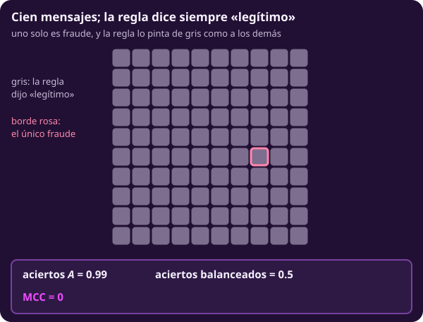
:::

Los aciertos premian un filtro inútil.
Separa cómo entrenas, decides y evalúas.

## 1 · Plantear la logística como lagrangeano

::: figure {#ml-c4-separable title="Sin penalización, los coeficientes no se detienen"}

:::

En el caso 17 separable, bajar la penalización acerca la curva a un escalón.
La norma crece despacio: unas 3.6 unidades por década; con ruido, se aplana.

**Piensa: ¿por qué no basta con ajustar una regresión lineal a $y\in\{0,1\}$ y pasarle la sigmoide al final?**

Quieres estimar $\Pr(y=1\mid x)$: debes ajustar la pérdida que evalúa esas probabilidades.
Cambia $\ell$, no la familia.
El intercepto de la unidad 6 ahora es $\beta_0$.
Aquí $\beta$ conserva el sentido de parámetros; $\mu$ es el multiplicador de optimización, no una distribución de Markov.

::: definition {#ml-c4-def-logistica-regularizada title="La logística regularizada, como lagrangeano"}
Etiquetas $y_i\in\{0,1\}$. Aquí $\phi$ no incluye la constante y $\beta$ son las
pendientes; el intercepto se escribe aparte, $\beta_0$. Puntaje y probabilidad:

$$
\begin{aligned}
z_i&=\beta_0+\beta^{\mathsf T}\phi(x_i),\\
p_i&=\sigma(z_i)=\frac{1}{1+e^{-z_i}}.
\end{aligned}
$$

Pérdida de una observación:

$$
\ell_i(\beta_0,\beta)=-y_i\ln p_i-(1-y_i)\ln(1-p_i).
$$

El problema con capacidad acotada y su lagrangeano son

$$
\begin{aligned}
&\min_{\beta_0,\beta}\ L_{\text{ent}}(\beta_0,\beta)\quad\text{s.a.}\quad \lVert\beta\rVert_2^2\le d,\\
&\mathcal L(\beta_0,\beta,\mu)=L_{\text{ent}}(\beta_0,\beta)+\mu\,\bigl(\lVert\beta\rVert_2^2-d\bigr),\quad \mu\ge0.
\end{aligned}
$$

Con $\mu$ fijo, el ajuste es

$$
(\widehat\beta_0,\widehat\beta)\in\operatorname*{arg\,min}_{\beta_0,\beta}\ L_{\text{ent}}(\beta_0,\beta)+\mu\lVert\beta\rVert_2^2 .
$$

El intercepto no se penaliza. Es el mismo lagrangeano de
@ml-c3-def-lagrangeano-capacidad con $\Omega=\Omega_2$; cambia $\ell$.
:::

Es lineal en el puntaje, no en la probabilidad: un modelo lineal generalizado (@ml-c1-def-modelo-lineal).
$\mu$ es un hiperparámetro (@ml-c1-def-param-hiper), elegido por validación cruzada (*cross-validation*; @ml-c2-def-validacion-cruzada).

Como en @ml-c3-obs-estandarizar, aprende media y desviación dentro de cada entrenamiento, también en cada pliegue.
La norma mide las pendientes estandarizadas, sin intercepto.
En sklearn, `C = 1/(2·μ·n)`.

::: remark {#ml-c4-obs-logloss-verosimilitud title="La pérdida logarítmica es verosimilitud"}
Si, dados los $x_i$, las etiquetas son independientes y cada una es Bernoulli
con probabilidad $p_i$, la probabilidad de observar justo esas etiquetas es

$$
\prod_{i\in\mathcal D_{\text{ent}}} p_i^{\,y_i}(1-p_i)^{1-y_i},
$$

y su logaritmo con signo menos es $n_{\text{ent}}\,L_{\text{ent}}(\beta_0,\beta)$.
Minimizar la pérdida logarítmica es maximizar la verosimilitud Bernoulli, como
minimizar el MSE era maximizar la verosimilitud gaussiana (@ml-c3-obs-mse-verosimilitud).
:::

::: remark {#ml-c4-obs-separable title="Datos separables: sin penalización no hay óptimo"}
Supón que algún $(\beta_0,\beta)$ da $z_i>0$ en todo caso con $y_i=1$ y $z_i<0$
en todo caso con $y_i=0$. Al multiplicar $(\beta_0,\beta)$ por un número cada vez
más grande, $L_{\text{ent}}$ baja hacia 0. Ningún par finito llega a ese ínfimo,
así que $\lVert\widehat\beta\rVert_2$ crece mientras el optimizador corra.

Con $\mu>0$ y las dos clases presentes en entrenamiento, el objetivo
$L_{\text{ent}}+\mu\lVert\beta\rVert_2^2$ crece sin tope lejos del origen y es
estrictamente convexo. Entonces el mínimo existe y es único. Con $\mu$ chico ese
mínimo existe, pero es grande: su norma crece como $\ln(1/\mu)$.
:::

Es el caso separable del §4 de [[opt-objetivo-clasificacion-practica|Clasificación, en la unidad 6]].

> [!WARNING]
> Lectura equivocada: «La sigmoide hace no lineal al modelo».
>
> Lectura correcta: **El puntaje es lineal en los parámetros; la sigmoide lo convierte en probabilidad.**

::: exercise {#ml-c4-ej-regresion-y-sigmoide title="Compara dos ajustes de la misma familia"}
Dos personas ajustan $p_i=\sigma(\beta_0+\beta^{\mathsf T}\phi(x_i))$ a los mismos datos.
Una minimiza la pérdida logarítmica; otra, el MSE entre $y_i$ y $z_i$, y luego aplica $\sigma$.

(a) ¿Obtienen el mismo $(\widehat\beta_0,\widehat\beta)$?

(b) ¿Qué cambió?
:::

::: hint {#ml-c4-pista-regresion-y-sigmoide-1 of="ml-c4-ej-regresion-y-sigmoide" title="Pista 1 · Mira el objetivo"}
¿Qué parte del lagrangeano es distinta entre las dos?
:::

::: answer {#ml-c4-resp-regresion-y-sigmoide of="ml-c4-ej-regresion-y-sigmoide" title="Respuesta · Cambió la pérdida"}
(a) No, en general.

(b) La familia es la misma; cambió $\ell$ dentro del lagrangeano, y con ella el argmin.
La segunda ni siquiera evalúa las probabilidades que anuncia: minimiza distancias a los puntajes.
:::

**Bloque 1 · La logística como lagrangeano.** 

## 2 · Separar la pérdida de la métrica

::: figure {#ml-c4-cadena-decision title="Del dato a la etiqueta: tres decisiones"}
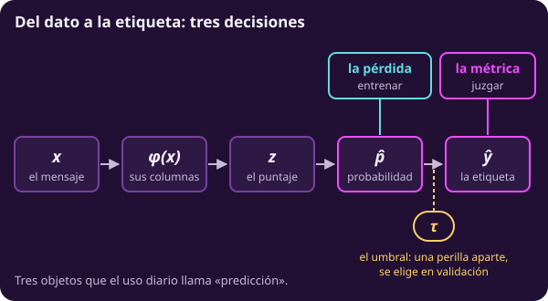
:::

El ajuste entrega probabilidades; tú eliges cómo convertirlas en etiquetas.
Con umbral 0.5, tanto 0.55 como 0.98 anuncian fraude: la etiqueta tira información.

**Piensa: si mueves el umbral sin volver a entrenar, ¿cambia la pérdida logarítmica?**

No: las probabilidades siguen iguales.
La pérdida sirve al optimizador; la métrica, al problema.

::: definition {#ml-c4-def-perdida-vs-metrica title="Pérdida, umbral y métrica son tres decisiones"}
La **pérdida** es lo que minimiza el ajuste: $L_{\text{ent}}$ (o $L^{w}_{\text{ent}}$,
más adelante). El **umbral** $\tau\in(0,1)$ convierte probabilidades en etiquetas,

$$
\widehat y_i=\mathbf 1\{\widehat p_i\ge\tau\};
$$

es un hiperparámetro y se elige en validación, nunca en prueba. La **métrica**
es la cifra con que se juzga el resultado (MCC, aciertos balanceados, un costo).

Cada cifra cumple uno de tres papeles: **objetivo** (la pérdida que minimiza el
ajuste), **criterio de selección** (lo que se compara en validación para elegir
$\mu$, $\tau$ o los pesos) y **evaluación** (lo que se reporta en prueba).

Regla de evaluación: toda cifra de validación, prueba, realidad o despliegue se
reporta con la métrica elegida o con la pérdida **sin ponderar**;
$L^{w}_{\text{ent}}$ es solo el objetivo de entrenamiento. $R$ sigue siendo la
pérdida esperada sin ponderar de @ml-c1-def-riesgo; una métrica en el despliegue
se nombra por su nombre («el MCC en el despliegue»), nunca $R$.
:::

Este $\tau$ es un umbral, no el tablero de juegos ni un tiempo de llegada de Markov.
MCC relaciona tus etiquetas con la verdad.

::: definition {#ml-c4-def-mcc title="MCC: la correlación entre lo que es y lo que dices"}
Binario: con las etiquetas codificadas 0/1,

$$
\mathrm{MCC}=\operatorname{corr}(y,\widehat y)=\frac{\operatorname{cov}(y,\widehat y)}{\sqrt{\operatorname{Var}(y)\,\operatorname{Var}(\widehat y)}},
$$

calculadas sobre los casos del conjunto evaluado. Multiclase (Gorodkin): con
$u_{iy}=\mathbf 1\{y_i=y\}$ y $\widehat u_{iy}=\mathbf 1\{\widehat y_i=y\}$,

$$
\mathrm{MCC}=\frac{\sum_{y}\operatorname{cov}(u_{\cdot y},\widehat u_{\cdot y})}{\sqrt{\sum_{y}\operatorname{Var}(u_{\cdot y})\,\sum_{y}\operatorname{Var}(\widehat u_{\cdot y})}},
$$

la misma correlación con las etiquetas en one-hot; con $K=2$ se reduce a la
binaria. Vale 1 si acierta todo, 0 si no se relaciona con la verdad y $-1$ si
la invierte (binario). Si un denominador es 0 (por ejemplo, una regla que
siempre dice lo mismo) se define como 0.

Sus dos compañeras: los **aciertos balanceados**, la proporción de aciertos
dentro de cada clase, promediada sobre las $K$ clases,

$$
A_{\text{bal}}=\frac1K\sum_{y=0}^{K-1}\frac{\#\{i:\ y_i=y,\ \widehat y_i=y\}}{\#\{i:\ y_i=y\}},
$$

y la **pérdida logarítmica sin pesos**, que mira las probabilidades y no las
etiquetas.
:::

La versión multiclase viene en §6; MCC no es una garantía universal.

::: figure {#ml-c4-perdida-vs-metrica title="La pérdida cambia suave; las métricas, a saltos"}
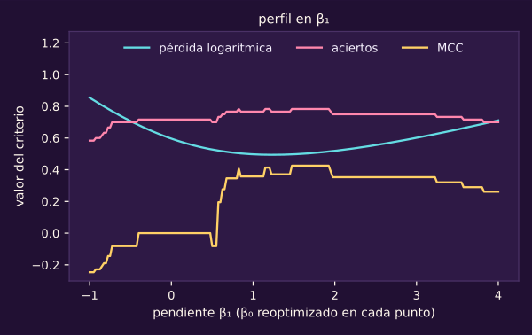
:::

Cada pendiente lleva su intercepto reoptimizado.
La pérdida tiene derivada; los escalones de las métricas no orientan al descenso entre saltos.

::: figure {#ml-c4-umbral title="Mover el umbral no toca la pérdida"}
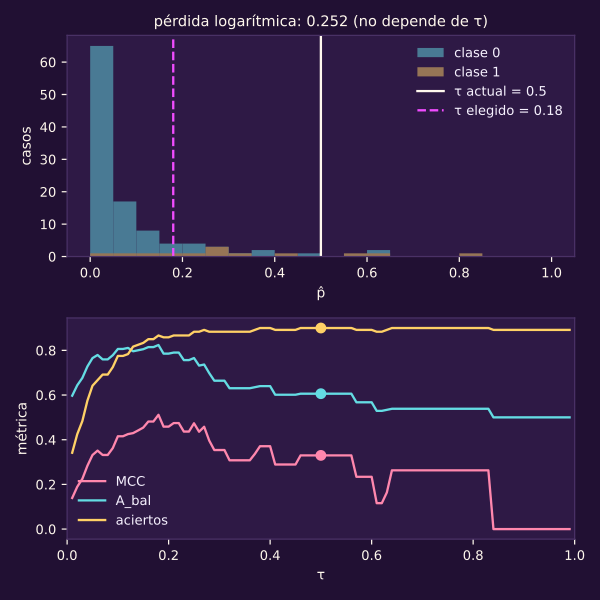
:::

La mejora al elegir $\tau$ no se repite íntegra en despliegue.

| Umbral | MCC en validación | MCC en despliegue |
|---|---|---|
| 0.5 | 0.33 | 0.38 |
| 0.18, elegido | 0.51 | 0.40 |

> [!WARNING]
> Lectura equivocada: «Elegí el umbral con prueba porque ahí veo el resultado real».
>
> Lectura correcta: **Elegir con prueba la vuelve parte del ajuste; la selección introduce optimismo** (@ml-c2-obs-optimismo-seleccion).

::: exercise {#ml-c4-ej-dos-reglas title="Elige quién gana en cada cifra"}
Cuatro mensajes tienen $y=(0,0,1,1)$.
La regla A anuncia $\widehat p=(0.01,\,0.01,\,0.49,\,0.99)$; la B, $(0.40,\,0.40,\,0.60,\,0.60)$.
Con $\tau=0.5$, ¿cuál gana (a) en pérdida logarítmica, (b) en aciertos y (c) en MCC?
:::

::: hint {#ml-c4-pista-dos-reglas-1 of="ml-c4-ej-dos-reglas" title="Pista 1 · Sigue la etiqueta correcta"}
¿Qué probabilidad recibe la etiqueta correcta en cada mensaje, y cuáles cruzan $\tau$?
:::

::: answer {#ml-c4-resp-dos-reglas of="ml-c4-ej-dos-reglas" title="Respuesta · Ganan reglas distintas"}
(a) A tiene menor pérdida: 0.186 contra 0.511.

(b) B acierta los cuatro: $A=1$, contra $A=0.75$ de A.

(c) B tiene $\mathrm{MCC}=1$, contra 0.577 de A.
La mejor pérdida no garantiza la mejor métrica: A pierde una etiqueta por quedar debajo del umbral.
:::

**Bloque 2 · La pérdida no es la métrica.** 

## 3 · Ver qué le hace el desbalanceo a la pérdida y a las métricas

::: figure {#ml-c4-contribucion-clases title="Cuántos votos tiene cada clase en el ajuste"}
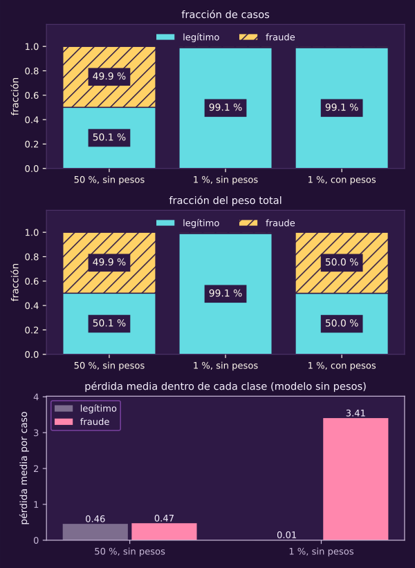
:::

La contribución de una clase es su fracción de casos multiplicada por su pérdida media.

| En entrenamiento con 1 % poblacional | Fraude | Legítimo |
|---|---|---|
| Pérdida media sin pesos | 3.41 | 0.009 |
| Fracción del peso balanceado | $1/2$ | $1/2$ |

**Piensa: si casi todos los mensajes son legítimos, ¿cuántos “votos” tienen los fraudes cuando el ajuste decide dónde poner la frontera?**

Cada caso cuenta igual; con clases encimadas, los pocos fraudes pierden influencia.
Si se separan bien, puedes detectarlos sin pesos.

Para etiquetas, compara con la moda (@ml-c3-def-benchmark): con 1 % de fraude obtiene $A=0.99$, $A_{\text{bal}}=0.5$, MCC $=0$ por convención.
MCC va de $-1$ a 1; una constante no aporta relación.

Para pérdida, el benchmark anuncia siempre $\bar y$ de entrenamiento y se evalúa en cada conjunto.
Su pérdida es la entropía $-\bar y\ln\bar y-(1-\bar y)\ln(1-\bar y)$ solo cuando las proporciones coinciden.
Con la proporción poblacional de 1 %, vale 0.056.

::: figure {#ml-c4-metricas-vs-proporcion title="Aciertos, aciertos balanceados y MCC contra la proporción de fraude"}
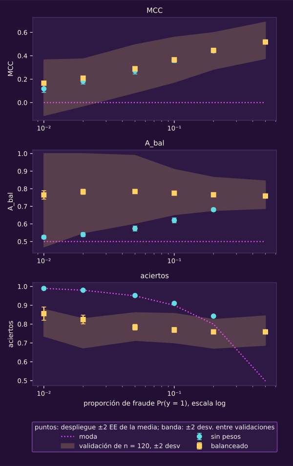
:::

Los tres primeros paneles promedian modelos reentrenados: las barras son $\pm2\,\mathrm{EE}$ de esa media, error Monte Carlo.
La tercera serie usa pesos en la pérdida; §4 explica qué hacen y qué cuestan.
En este proceso mejoran MCC y $A_{\text{bal}}$, sacrificando $A$.

El cuarto panel mantiene un modelo fijo y cambia la validación: su banda es $\pm2$ desviaciones entre evaluaciones.
Su ancho pasa de 0.16 con 50 % de fraude a 0.24 con 1 %.
El punto de despliegue usa una muestra enorme.

::: remark {#ml-c4-obs-intervalo-metrica title="Cuánto se mueve un MCC medido"}
@ml-c2-teo-prueba-insesgada da el error estándar de un promedio de pérdidas por
caso, como la pérdida logarítmica o $A$: esas cifras se reportan $\pm2\,\mathrm{EE}$.
MCC y $A_{\text{bal}}$ no son promedios por caso.

Con un solo conjunto, se
remuestrean sus filas con reemplazo, se recalcula la métrica en cada réplica y se
reporta el intervalo entre los percentiles 2.5 y 97.5 de las réplicas. Es un
**bootstrap por filas**: supone filas independientes y no fija cuántos casos de
cada clase salen en cada réplica. Junto a la cifra se dice siempre el esquema.
:::

Con $A$, ambos métodos dan resultados cercanos: $0.900\pm0.055$ frente al intervalo $[0.842,0.950]$.
Usa `ml.incertidumbre` con `estratificar=False`; la clase 5 cambia la unidad independiente a grupos completos mediante `grupo=`.

`estratificar=True` fija conteos: responde otra pregunta.
Con 90 negativos, 10 positivos y predicción constante negativa, su EE es 0; por filas es 0.030.

> [!WARNING]
> Lectura equivocada: «99 % de aciertos es excelente».
>
> Lectura correcta: **Con 1 % de fraudes, la moda alcanza 99 % sin detectar ninguno.**

::: exercise {#ml-c4-ej-moda title="Evalúa el filtro que nunca detecta"}
Con 2 % de fraudes:

(a) ¿Cuánto valen $A$, $A_{\text{bal}}$ y MCC de «siempre legítimo»?

(b) ¿Qué pérdida logarítmica tiene anunciar siempre $\widehat p=0.02$ con esa misma proporción?
:::

::: hint {#ml-c4-pista-moda-1 of="ml-c4-ej-moda" title="Pista 1 · Separa las clases"}
¿Qué fracción de cada clase acierta una regla que siempre dice lo mismo, y cuál es la varianza de $\widehat y$?
:::

::: answer {#ml-c4-resp-moda of="ml-c4-ej-moda" title="Respuesta · Muchos aciertos, ningún fraude"}
(a) $A=0.98$, $A_{\text{bal}}=(1+0)/2=0.5$ y MCC $=0$ por denominador nulo.

(b) $-0.02\ln0.02-0.98\ln0.98\approx0.098$.
Esta regla anuncia probabilidades; asignar probabilidad cero al fraude produciría pérdida infinita cuando aparezca uno.
:::

**Bloque 3 · El 99 % que no detecta nada.** 

## 4 · Corregir con pesos, no con datos inventados

::: figure {#ml-c4-pesos-umbral title="Pesar es mover el intercepto"}
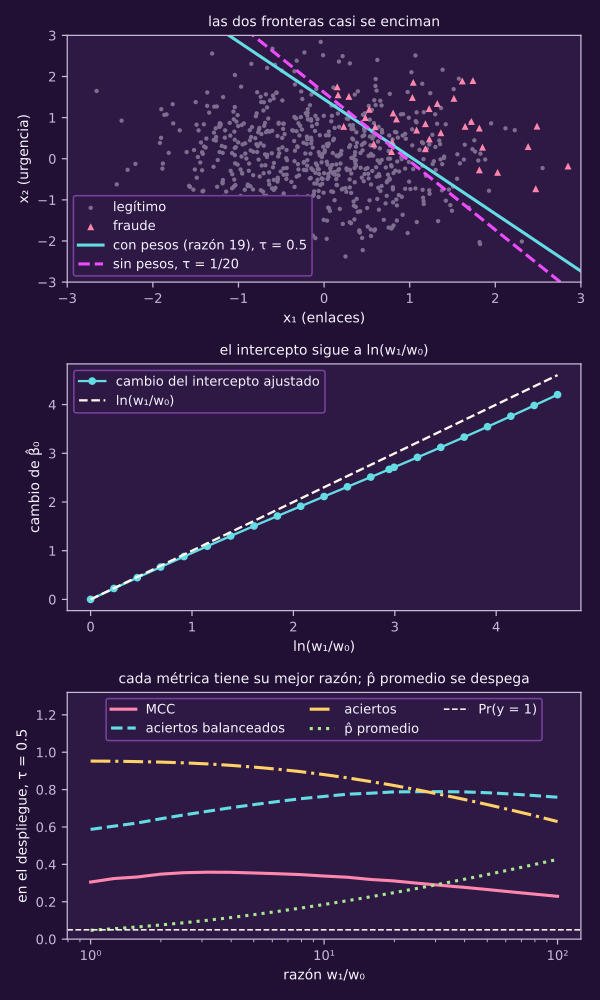
:::

Las fronteras casi coinciden; el teorema precisa cuándo coinciden.
Aquí ponderas observaciones: conservas los datos, cambias cuánto cuenta cada caso.

**Piensa: si el fraude pesa nueve veces más en la pérdida, ¿el modelo aprende algo nuevo sobre los fraudes?**

No recibe información nueva; cambia el objetivo que debe minimizar.
Este $w_y$ es peso de clase, no la cadena de computabilidad ni el valor de un hijo en juegos.

::: definition {#ml-c4-def-perdida-ponderada title="La pérdida ponderada y el lagrangeano ponderado"}
Con un peso $w_y>0$ por clase,

$$
L^{w}_{\text{ent}}=\frac1{n_{\text{ent}}}\sum_{i\in\mathcal D_{\text{ent}}} w_{y_i}\,\ell_i ,
$$

y el ajuste resuelve

$$
\min_{\beta_0,\beta}\ L^{w}_{\text{ent}}(\beta_0,\beta)\quad\text{s.a.}\quad\lVert\beta\rVert_2^2\le d
\quad\Rightarrow\quad
(\widehat\beta_0,\widehat\beta)\in\operatorname*{arg\,min}_{\beta_0,\beta}\ L^{w}_{\text{ent}}+\mu\lVert\beta\rVert_2^2 .
$$

El peso **balanceado** es $w_y=n_{\text{ent}}/(K\,n_y)$, con $n_y$ los casos de
clase $y$ en entrenamiento. Con él, $\sum_{i}w_{y_i}=n_{\text{ent}}$ y cada clase
suma lo mismo, $n_y w_y=n_{\text{ent}}/K$. Los pesos son hiperparámetros del
ajuste: no entran en ninguna cifra de evaluación (@ml-c4-def-perdida-vs-metrica).
:::

Igualas el peso total de las clases, no sus pérdidas; así se construyó la tercera serie de @ml-c4-metricas-vs-proporcion.

::: theorem {#ml-c4-teo-pesos-mueven-puntaje title="Los pesos mueven el puntaje en ln(w₁/w₀)"}
Supuestos: clasificación binaria; pesos $w_0,w_1>0$; en un $x$ fijo,
$\eta(x)=\Pr(y=1\mid x)\in(0,1)$. La probabilidad $p\in(0,1)$ que minimiza la
pérdida ponderada esperada en ese $x$,

$$
-w_1\,\eta(x)\ln p-w_0\,(1-\eta(x))\ln(1-p),
$$

es

$$
\begin{aligned}
p^{w}(x)&=\frac{w_1\,\eta(x)}{w_1\,\eta(x)+w_0\,(1-\eta(x))},\\
\ln\frac{p^{w}(x)}{1-p^{w}(x)}&=\ln\frac{\eta(x)}{1-\eta(x)}+\ln\frac{w_1}{w_0}.
\end{aligned}
$$

En consecuencia:

(a) Supón que $\ln\frac{\eta(x)}{1-\eta(x)}=\beta_0+\beta^{\mathsf T}\phi(x)$, es
decir, que la familia logística contiene la verdad. Entonces el mínimo ponderado
en la población con $\mu=0$ tiene la misma $\beta$ y el intercepto
$\beta_0+\ln(w_1/w_0)$.

(b) $p^{w}(x)\ge\tfrac12$ si y solo si $\eta(x)\ge\frac{w_0}{w_0+w_1}$. Con pesos
balanceados, $\frac{w_0}{w_0+w_1}=\frac{n_1}{n_{\text{ent}}}$, la proporción de
positivos en entrenamiento.
:::

::: proof {#ml-c4-dem-pesos-mueven-puntaje of="ml-c4-teo-pesos-mueven-puntaje"}
1) La función de $p$ es estrictamente convexa en $(0,1)$ (segunda derivada
$w_1\eta/p^2+w_0(1-\eta)/(1-p)^2>0$). 2) Su derivada es
$-w_1\eta/p+w_0(1-\eta)/(1-p)$; igualarla a cero da
$w_1\eta(1-p)=w_0(1-\eta)p$, de donde sale $p^{w}$. 3) Dividir $p^{w}$ entre
$1-p^{w}=w_0(1-\eta)/(\cdots)$ y tomar logaritmo da la segunda forma. 4) Para (a):
el riesgo ponderado es el promedio en $x$ de esa función, así que se minimiza
punto a punto.

Si $p^{w}$ está en la familia, es el mínimo dentro de ella, y su
puntaje es el verdadero más $\ln(w_1/w_0)$. 5) Para (b): $p^{w}\ge\frac12\iff
w_1\eta\ge w_0(1-\eta)$. Con $w_y=n_{\text{ent}}/(2n_y)$,
$\frac{w_0}{w_0+w_1}=\frac{1/n_0}{1/n_0+1/n_1}=\frac{n_1}{n_0+n_1}$.
:::

Con $\eta(x)=0.10$ y $w_1/w_0=9$, obtienes $p^w(x)=0.50$.
Con muestra finita, penalización o familia mal especificada, también pueden cambiar las pendientes.

**Más peso no es siempre mejor.** En población, con $\mu=0$ y modelo bien especificado, la razón equivale al corte $1/(1+w_1/w_0)$.
Cada métrica favorece un corte; pesar demasiado llena el filtro de falsas alarmas.

| Métrica | Mejor razón en el ejemplo | Qué pasa después |
|---|---|---|
| $A$ | 1: da 0.953 | Baja a 0.456 con razón 100 |
| $A_{\text{bal}}$ | 19, balanceada: da 0.793 | El corte en la proporción maximiza los aciertos medios por clase |
| MCC | Cerca de 4.4: da 0.362 | Baja a 0.297 con razón 19 y a 0.176 con 100 |

«Balanceado» favorece $A_{\text{bal}}$; elige la razón en validación con tu métrica.

**Piensa: si pesar equivale a mover $\tau$, ¿para qué pesar?**

En el caso ideal del teorema —población, $\mu=0$, familia bien especificada— mover $\tau$ es equivalente y más barato: no descalibra.
El argumento a favor de los pesos es contra remuestrear, no contra mover el umbral.

Los pesos y el umbral son dos decisiones distintas, y puedes usar las dos.
Lo que no se hace es aplicar dos correcciones de memoria: pesos balanceados y además
$\tau$ igual a la proporción de positivos. Si usas pesos y quieres otro
umbral, elígelo en validación con el modelo ya ponderado.

::: figure {#ml-c4-anillos-metricas title="Los pesos no cambian la forma de la frontera; la representación sí"}
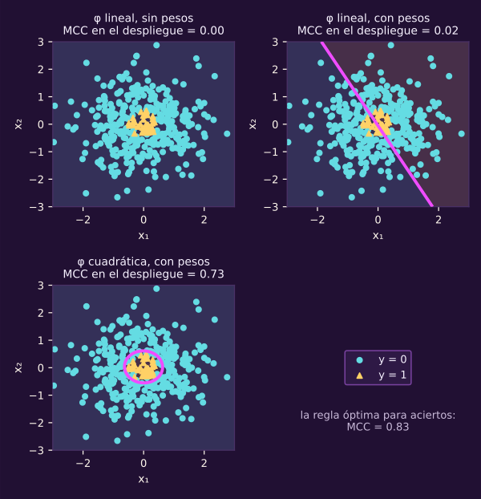
:::

::: remark {#ml-c4-obs-pesos-no-arreglan-phi title="Los pesos no arreglan una representación mala"}
Si la clase rara vive en el centro de una nube (caso 25), ninguna recta la
separa. Con $\phi(x)=(x_1,x_2)$, la nube es simétrica y el ajuste logístico no
encuentra ninguna pendiente útil: sin pesos dice siempre «la clase común».

Los
pesos solo corren el intercepto, y el MCC de ese ajuste sigue cerca de 0. Con
$\phi(x)=(x_1,x_2,x_1^2,x_2^2,x_1x_2)$ la frontera se curva y el modelo sigue
siendo lineal en $(\beta_0,\beta)$. Es la lección de @ml-c1-anillos-polares, ahora
con métricas.
:::

La cuadrática pierde MCC al ponderar; ni la mejor recta para MCC supera 0.22.

| Regla del caso 25 | MCC en despliegue o población indicada |
|---|---|
| Ajuste lineal / lineal con pesos | 0.00 / 0.02 en despliegue |
| Ajuste cuadrático / cuadrático con pesos | 0.82 / 0.73 en despliegue |
| Regla óptima para aciertos | 0.83 poblacional: no es un máximo calculado para MCC |

::: remark {#ml-c4-obs-por-que-no-remuestrear title="Submuestrear, sobremuestrear, SMOTE: existen, y por qué aquí no"}
Submuestrear tira casos de la clase común. Sobremuestrear repite casos raros, y
repetir un caso tres veces es lo mismo que darle peso 3 (cuidando la
normalización y $\mu$). SMOTE inventa casos nuevos interpolando entre vecinos de la
clase rara: supone que la clase rara llena los segmentos entre sus casos, y eso
puede ser falso.

Los pesos dan el efecto de repetir sin tirar datos ni inventar
puntos, y sin cambiar la población que la prueba tiene que imitar. Además,
sobremuestrear antes de separar pone copias del mismo caso en entrenamiento y en
prueba: es una fuga, y la clase 5 la estudia con ese nombre.
:::

> [!WARNING]
> Lectura equivocada: «Con pesos, las probabilidades quedan corregidas».
>
> Lectura correcta: **Los pesos cambian el objetivo; sus probabilidades ya no representan las frecuencias originales.** La página 2 retoma esto.

::: exercise {#ml-c4-ej-pesos-balanceados title="Reparte el peso entre dos clases"}
En entrenamiento hay 950 mensajes legítimos y 50 fraudes.

(a) Calcula $w_0$ y $w_1$ balanceados y comprueba que $\sum_i w_{y_i}=n_{\text{ent}}$.

(b) En población, con $\mu=0$ y familia bien especificada, ¿desde qué $\eta(x)$ anuncia fraude el modelo ponderado con $\tau=0.5$?
:::

::: hint {#ml-c4-pista-pesos-balanceados-1 of="ml-c4-ej-pesos-balanceados" title="Pista 1 · Suma por clase"}
¿Cuánto suma cada clase, $n_y w_y$?
:::

::: answer {#ml-c4-resp-pesos-balanceados of="ml-c4-ej-pesos-balanceados" title="Respuesta · Cada clase suma lo mismo"}
(a) $w_0=1000/(2\cdot950)\approx0.526$ y $w_1=1000/(2\cdot50)=10$.
Con los valores exactos, $950w_0+50w_1=500+500=1000$.

(b) El umbral equivalente es $w_0/(w_0+w_1)=50/1000=0.05$.
Es la equivalencia poblacional del teorema; no garantiza iguales ajustes con una muestra finita.
:::

**Bloque 4 · Pesos: cambiar el problema, no los datos.** 

## 5 · Estratificar cuando una clase es rara

Estratificar ya lo viste en la clase 2 (@ml-c2-def-estratificada; la figura @ml-c2-estratificada): reparte los casos raros entre los pliegues, pero no inventa los que faltan.

::: figure {#ml-c4-mcc-por-pliegue title="Una métrica por pliegue, con pocos fraudes"}
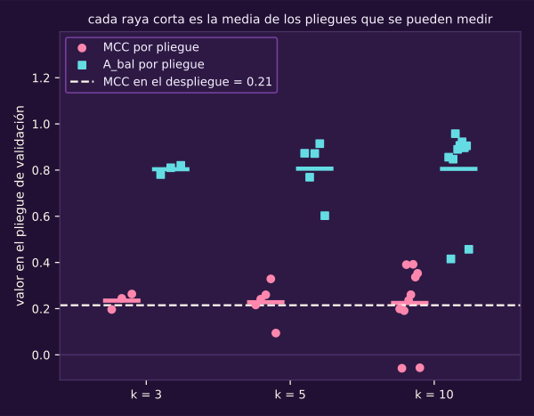
:::

Con diez pliegues, el MCC va de −0.06 a 0.39; la media solo describe.

**Piensa: si cada pliegue de validación tiene un solo fraude, ¿cuánto puede cambiar el MCC de un pliegue a otro por ese único caso?**

Puede saltar de 0 a más de 0.5: calcúlalo abajo.
Estratifica con casos independientes del mismo proceso; si el uso implica futuro o grupos nuevos, manda esa estructura.
Informa las clases del problema a `ml_lab`, mediante `ml.con_clases` en CV.

| Clase ausente | Consecuencia |
|---|---|
| En entrenamiento | El modelo no la aprende |
| En validación: $A_{\text{bal}}$ | «No estimable» (`nan`); no se promedian solo las clases presentes |
| En validación: MCC | 0 por convención; no aporta evidencia sobre esa clase |

Baja $k$, como máximo al conteo de la clase rara, buscando varios casos por pliegue; junta clases si tiene sentido.
O declara que no puedes estimar ese desempeño.
Repetir la CV no arregla la falta de casos.

::: exercise {#ml-c4-ej-mcc-un-fraude title="Mide el efecto de un solo fraude"}
En CV estratificada con $k=10$, cada pliegue tiene 100 mensajes y un fraude.
A detecta el fraude y da 2 falsas alarmas; B no lo detecta y no da ninguna alarma.

(a) Calcula MCC y $A_{\text{bal}}$ en ambos.

(b) ¿Qué te dice eso de la media de los diez?
:::

::: hint {#ml-c4-pista-mcc-un-fraude-1 of="ml-c4-ej-mcc-un-fraude" title="Pista 1 · Mira qué se anuncia"}
¿Cuántos aciertos y errores hay en cada clase? En B, ¿cuántos mensajes anuncia como fraude el modelo?
:::

::: answer {#ml-c4-resp-mcc-un-fraude of="ml-c4-ej-mcc-un-fraude" title="Respuesta · Un caso mueve mucho"}
(a) A tiene un fraude detectado, dos falsas alarmas y 97 legítimos bien clasificados.
Al calcular la correlación, MCC $=97/\sqrt{3\cdot1\cdot99\cdot97}\approx0.571$.
$A_{\text{bal}}=(1+97/99)/2\approx0.990$.

B anuncia siempre legítimo: su MCC es 0 por denominador nulo y $A_{\text{bal}}=(0+1)/2=0.5$.

(b) Un solo fraude mueve mucho la cifra; la media es ruidosa y descriptiva.
Con $k=5$ tendrías dos fraudes por pliegue.
:::

**Bloque 6 · Una métrica por pliegue.** 

## 6 · Pasar a más de dos clases

::: figure {#ml-c4-softmax title="Regresión softmax con tres clases"}
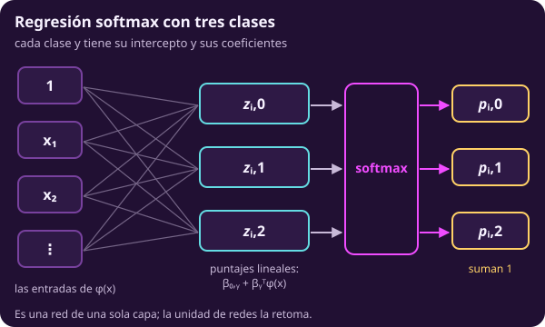

Es una red de una sola capa; la unidad de redes la retoma.
:::

Cada clase recibe un puntaje; softmax los convierte en probabilidades que suman 1 (@opt-clasificacion-ej-multiclase).

**Piensa: con 90 % de mensajes legítimos, 8 % de publicidad y 2 % de fraude, ¿qué promedio de “aciertos por clase” se parece a los aciertos totales?**

El que pesa cada cifra por la proporción de su clase: los muchos legítimos dominan el resultado.

::: definition {#ml-c4-def-softmax title="Softmax: la logística con K clases"}
Las etiquetas van de $0$ a $K-1$ (en binario, $\{0,1\}$). Cada clase $y$ tiene su
intercepto $\beta_{0,y}$ y sus coeficientes $\beta_y$:

$$
\begin{aligned}
z_{i,y}&=\beta_{0,y}+\beta_y^{\mathsf T}\phi(x_i),\\
p_{i,y}&=\frac{e^{z_{i,y}}}{\sum_{y'=0}^{K-1}e^{z_{i,y'}}},\\
\ell_i&=-\ln p_{i,y_i}.
\end{aligned}
$$

Se anuncia la clase de mayor $p_{i,y}$; si hay empate, la de menor índice. El
lagrangeano es el de @ml-c4-def-logistica-regularizada con
$\lVert\beta\rVert_2^2=\sum_{y}\lVert\beta_y\rVert_2^2$ (sin los interceptos).
Sumar la misma constante a todos los $\beta_{0,y}$ no cambia ninguna $p_{i,y}$.

Por eso los interceptos solo quedan fijos por una convención (sklearn los
devuelve centrados). Con $\mu>0$ y las $K$ clases presentes en entrenamiento, el
ajuste existe y sus probabilidades son únicas en todo $x$; con el desempate,
también la clase anunciada.

Con $\mu=0$ eso puede fallar: con datos separables no
hay ajuste finito, y si una clase falta, su intercepto baja sin tope. Es la regla multiclase de
[[opt-objetivo-clasificacion-practica|Clasificación, en la unidad 6]], con dos
cambios de notación.

El intercepto que allá era $\alpha_k$ aquí es $\beta_{0,y}$.
El índice de clase que allá era $k$, con clases de 1 a $K$ y la suma sobre $j$,
aquí es la propia $y$, con clases de $0$ a $K-1$ y la suma sobre $y'$. Aquí $k$
cuenta pliegues y $j$ variables.
:::

::: figure {#ml-c4-fronteras-tres-clases title="Tres clases, sin pesos y con pesos"}
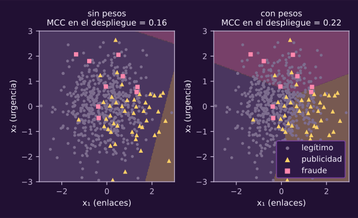
:::

El MCC de @ml-c4-def-mcc es global: no promedia MCC binarios.

| En despliegue | Sin pesos | Con pesos |
|---|---|---|
| Aciertos por clase | 1.00 / 0.05 / 0.02 | 0.56 / 0.65 / 0.73 |
| $A$ | 0.90 | 0.57 |
| $A_{\text{bal}}$ | 0.36 | 0.65 |
| MCC | 0.16 | 0.22 |

::: figure {#ml-c4-macro-ponderado title="Macro contra ponderado en el ejemplo de noticias"}
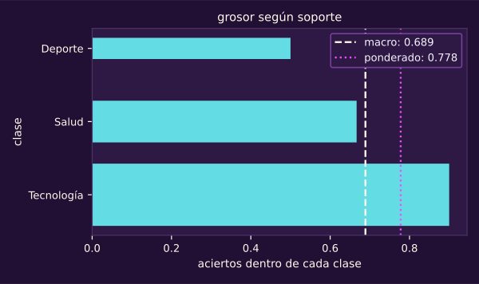
:::

Tecnología domina el promedio ponderado por su tamaño.

| Clase | Casos | Aciertos dentro de la clase |
|---|---|---|
| Tecnología | 100 | 0.900 |
| Salud | 60 | 0.667 |
| Deporte | 20 | 0.500 |

Macro da 0.689; ponderado, 0.778; MCC global, 0.611.

::: definition {#ml-c4-def-promedio-macro-ponderado title="Promediar una métrica por clase: macro o ponderado"}
Calcula una métrica dentro de cada clase $y$ de un conjunto $\mathcal D$, por
ejemplo los aciertos dentro de la clase $y$. El **promedio macro** es el promedio
simple de esas $K$ cifras.

El **promedio ponderado** pesa la cifra de cada clase
por su fracción de casos, $\#\{i\in\mathcal D:\ y_i=y\}/n_{\mathcal D}$.
El macro da el mismo peso a cada clase; el ponderado deja mandar a la clase
grande. Con los aciertos dentro de cada clase, el macro es $A_{\text{bal}}$ y el
ponderado es $A$.
:::

El promedio micro agrega decisiones de todas las clases; con una sola etiqueta por caso, coincide con $A$.
También existen uno contra el resto (OvR) y uno contra uno (OvO).

> [!WARNING]
> Lectura equivocada: «El promedio ponderado corrige el desbalanceo».
>
> Lectura correcta: **Lo reproduce: para aciertos por clase, el promedio ponderado es exactamente el total de aciertos.**

::: exercise {#ml-c4-ej-quien-manda title="Identifica quién manda en el promedio"}
Las proporciones son 0.98, 0.015 y 0.005; la regla anuncia siempre la clase 0.

(a) Calcula los aciertos dentro de cada clase.

(b) Calcula su macro, su ponderado y el MCC.
:::

::: hint {#ml-c4-pista-quien-manda-1 of="ml-c4-ej-quien-manda" title="Pista 1 · Revisa las clases olvidadas"}
¿Cuánto acierta en cada clase una regla que nunca anuncia las clases 1 y 2?
:::

::: answer {#ml-c4-resp-quien-manda of="ml-c4-ej-quien-manda" title="Respuesta · La clase grande oculta las otras"}
(a) Los aciertos por clase son $(1,0,0)$.

(b) Macro: $(1+0+0)/3=1/3$; ponderado: $0.98\cdot1+0.015\cdot0+0.005\cdot0=0.98$.
MCC vale 0 porque la predicción es constante.
:::

**Bloque 5 · Tres clases.** 

::: exercise {#ml-c4-ej-final-perdida-metrica-desbalanceo title="Diseña la evaluación de un triaje con una enfermedad rara"}
**Intenta formular tu propuesta sin abrir las pistas ni la respuesta y sin
pedir ayuda a ChatGPT.**

Una clínica clasifica consultas con dos mediciones: sin enfermedad (0), enfermedad común (1) y enfermedad rara (2).
La muestra de desarrollo tiene 900, 80 y 20 casos; la prueba ya se apartó estratificada.
La CV y los pesos se calculan sobre desarrollo.

El uso sigue el mismo proceso; salvo el punto 5, los errores cuestan igual.
No programes. La idea nueva es decidir qué conjunto elige cada perilla.
La respuesta desarrolla una opción.

1. Da el benchmark y sus valores de $A$, $A_{\text{bal}}$ y MCC con estas proporciones.
2. Justifica la métrica principal y sus compañeras. Distingue objetivo, criterio de selección y evaluación (@ml-c4-def-perdida-vs-metrica).
3. Escribe el lagrangeano ponderado con los pesos balanceados numéricos.
4. Indica dónde eliges $\mu$, los pesos o la opción «balanceado», y cómo separas los datos, incluyendo $k$.
5. Si fallar un caso raro cuesta 20 veces más que una falsa alarma, ¿cómo cambia la decisión? Nombra el desempate.
:::

::: hint {#ml-c4-pista-final-perdida-metrica-desbalanceo-1 of="ml-c4-ej-final-perdida-metrica-desbalanceo" title="Pista 1 · Empieza sin aprender"}
¿Qué regla no necesita aprender nada y qué valores saca en cada métrica?
:::

::: hint {#ml-c4-pista-final-perdida-metrica-desbalanceo-2 of="ml-c4-ej-final-perdida-metrica-desbalanceo" title="Pista 2 · Reserva el final"}
Para cada perilla, ¿qué conjunto la vería por primera vez si la eligieras ahí, y quedaría alguno intacto para el final?
:::

::: answer {#ml-c4-resp-final-perdida-metrica-desbalanceo of="ml-c4-ej-final-perdida-metrica-desbalanceo" title="Respuesta · Separa ajustar, elegir y evaluar"}
**1. Benchmark.** Anunciar siempre la clase 0 da $A=0.9$, $A_{\text{bal}}=1/3$ y MCC $=0$.
No detecta ninguna enfermedad, aunque acierta muchos casos.

**2. Métricas y papeles.** Usa MCC multiclase como principal; acompáñalo de $A_{\text{bal}}$ y pérdida logarítmica sin pesos.
El objetivo es $L^w_{\text{ent}}$ más la penalización.
El criterio de selección será MCC en CV; la evaluación reportará MCC y sus compañeras en prueba.
Otra opción válida selecciona con pérdida logarítmica sin pesos.

**3. Lagrangeano.** Sobre desarrollo completo, $w_0=1000/(3\cdot900)\approx0.370$, $w_1=1000/(3\cdot80)\approx4.17$ y $w_2=1000/(3\cdot20)\approx16.7$.

$$
\begin{aligned}
\mathcal L&=\frac1{n_{\text{ent}}}\sum_{i\in\mathcal D_{\text{ent}}}w_{y_i}(-\ln p_{i,y_i})
+\mu\left(\sum_{y=0}^{2}\lVert\beta_y\rVert_2^2-d\right),\quad\mu\ge0,\\
L^w_{\text{ent}}&=\frac1{n_{\text{ent}}}\sum_{i\in\mathcal D_{\text{ent}}}w_{y_i}(-\ln p_{i,y_i}).
\end{aligned}
$$

Con $\mu$ fijo minimizas $L^w_{\text{ent}}+\mu\sum_y\lVert\beta_y\rVert_2^2$, sin penalizar interceptos.
En cada pliegue recalculas los pesos usando solo su entrenamiento.

**4. Elecciones.** Usa CV estratificada en desarrollo para elegir $\mu$ y la opción de pesos.
$k=5$ deja 4 casos raros por pliegue de validación.
Reajusta en todo desarrollo con las decisiones elegidas; abre la prueba estratificada una vez.

Con pesos, anuncia la clase de mayor $\widehat p$, con empate hacia el menor índice.
No agregues otra corrección de memoria.
Si quieres cambiar la regla, elígela en validación con el modelo ya ponderado.

**5. Costos.** Anuncia la etiqueta de menor costo esperado; con empate, la de menor índice.
Necesitas probabilidades calibradas, que signifiquen frecuencias: es el problema de la página 2.
La razón de costos no convierte directamente las probabilidades ponderadas en frecuencias.
:::

**Punto de control:** deberías poder explicar por qué una regla con 99 % de aciertos puede tener MCC 0.
También, qué cambia —y qué no— al poner pesos.

## Para profundizar

### Los límites de las equivalencias

Con $K=2$, softmax penaliza ambas pendientes opuestas: su suma de cuadrados es la mitad del cuadrado de su diferencia.
Su $\mu$ equivale a $\mu/2$ en logística sobre esa diferencia.
Con $\mu=0$, pendientes indistinguibles en entrenamiento pueden anunciar clases distintas en un caso nuevo.
Una clase ausente puede perder todo su intercepto incluso con $\mu>0$.

En @ml-c4-pesos-umbral, la muestra finita deja diferencias frente al teorema poblacional:

| Comparación | Sin pesos | Con pesos |
|---|---|---|
| Norma de pendientes | 2.22 | 2.50 |
| Probabilidad anunciada promedio; proporción real 0.050 | 0.047 | 0.244 |
| Salto del intercepto frente al ideal | Ideal: 2.94 | Observado: 2.67 |
| Coincidencia de etiquetas con el umbral equivalente | 98.1 % | 98.1 % |

Con familia mal especificada, el ejemplo tampoco favorece ponderar:

| Procedimiento | MCC en despliegue |
|---|---|
| Sin pesos, umbral elegido en validación | 0.66 |
| Con pesos, umbral 0.5 | 0.41 |

### El vocabulario clásico, en un recuadro

::: remark {#ml-c4-obs-recuadro-confusion title="Matriz de confusión, precisión, recall, ROC y PR: solo vocabulario"}
En binario, la **matriz de confusión** cuenta los cuatro casos: verdaderos
positivos (VP), falsos positivos (FP), falsos negativos (FN) y verdaderos
negativos (VN); aquí la verdad va en los renglones, como en sklearn. La
**precisión** es $\frac{\mathrm{VP}}{\mathrm{VP}+\mathrm{FP}}$ (de lo que dices
positivo, cuánto lo es) y el **recall** o sensibilidad es
$\frac{\mathrm{VP}}{\mathrm{VP}+\mathrm{FN}}$ (de lo positivo, cuánto encuentras).

La curva **ROC** recorre todos los umbrales y dibuja la tasa de verdaderos
positivos contra la de falsos positivos; su área (AUC) es la probabilidad de
ordenar un positivo arriba de un negativo. La curva **PR** dibuja precisión
contra recall; con una clase rara informa más que la ROC. Nada de esta unidad
depende de este recuadro: MCC y $A_{\text{bal}}$ ya resumen la matriz.
:::

::: figure {#ml-c4-recuadro-confusion title="La matriz de confusión, la curva ROC y la curva PR"}
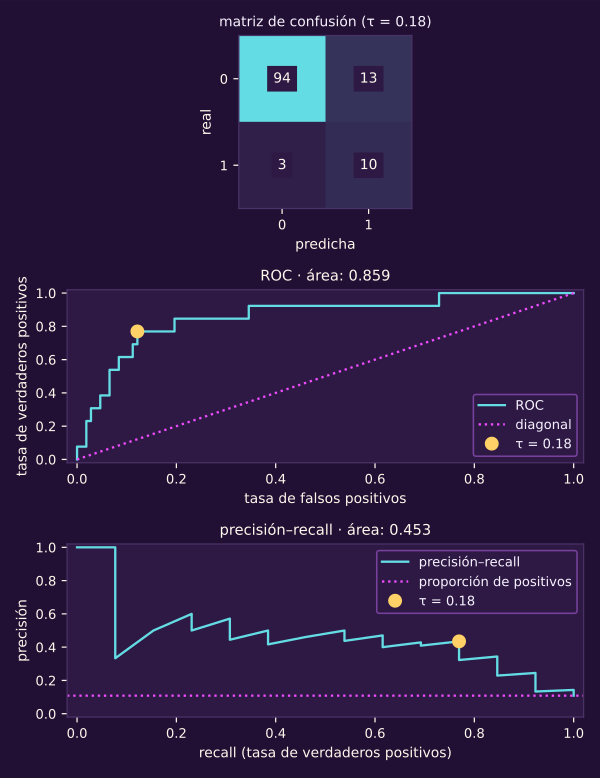
:::

### Lecturas

- Goodfellow, Bengio y Courville, *Deep Learning*: [§5.5](https://www.deeplearningbook.org/contents/ml.html) y [§8.1](https://www.deeplearningbook.org/contents/optimization.html), verosimilitud y pérdida sustituta. [§11.1](https://www.deeplearningbook.org/contents/guidelines.html): elegir métricas; la enfermedad de uno en un millón. «Cobertura» allí no significa cobertura conformal.
- Chicco y Jurman (2020), [MCC frente a F1 y aciertos](https://doi.org/10.1186/s12864-019-6413-7): comparación en clasificación binaria.

## Lo que hay que llevarse

La moda con 1 % de fraude da $A=0.99$, $A_{\text{bal}}=0.5$ y MCC $=0$; el benchmark probabilístico poblacional pierde 0.056.

Con 950/50, los pesos balanceados son 0.526 y 10.
En población, con $\mu=0$ y familia bien especificada, equivalen a cortar la probabilidad verdadera en 0.05.

En noticias, macro da 0.689 y ponderado, 0.778: el segundo deja mandar a la clase grande.

Continúa con [[ml-calibracion-y-conformal|Calibración y conformal]].
