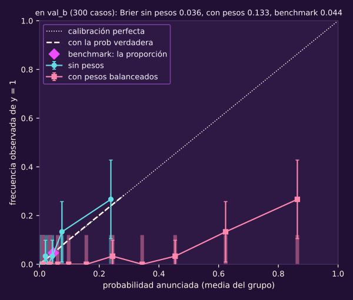
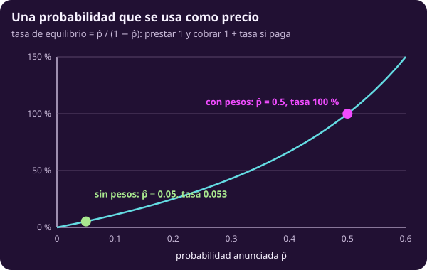
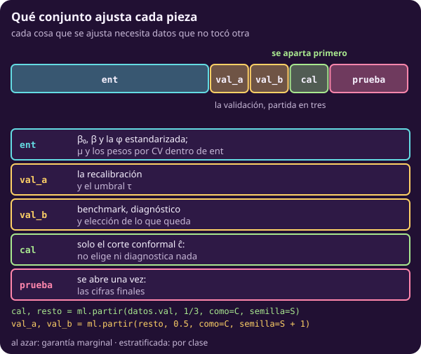
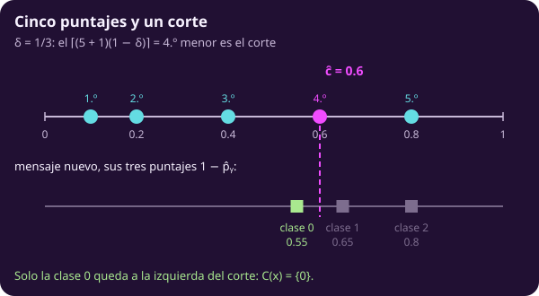
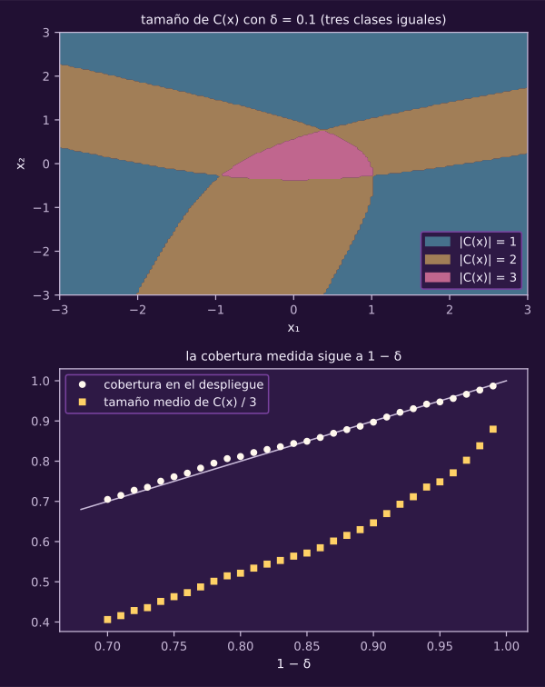
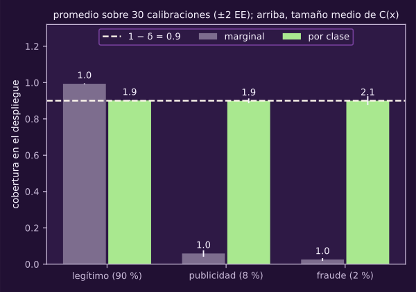

> [!WARNING]
> **▶▶ ABRE EL NOTEBOOK EN COLAB ◀◀**
>
> **Notebook 09 · Calibración y conformal** Corre en tu navegador, sin instalar nada.
>
> [](https://colab.research.google.com/github/raya-lucaria/ia_o26/blob/main/course/9_aprendizaje_maquina/_assets/09_calibracion_y_conformal.ipynb)
>
> **[👉 Abrir `09_calibracion_y_conformal.ipynb` en Colab](https://colab.research.google.com/github/raya-lucaria/ia_o26/blob/main/course/9_aprendizaje_maquina/_assets/09_calibracion_y_conformal.ipynb)**

# Calibración y predicción conformal

**El modelo le anuncia 0.8 a un mensaje. ¿De cada diez mensajes así, son fraude ocho?**

~30 min de lectura y ~25 con el notebook.

Al terminar tendrás:

- **Una lectura de probabilidades:** interpretarás la curva de confiabilidad y el Brier junto a su punto de comparación (*benchmark*).
- **Una cuenta de los pesos:** explicarás cuánto y por qué descalibran.
- **Una corrección separada:** recalibrarás y distinguirás parámetros de hiperparámetros.
- **Un conjunto conformal:** lo construirás a mano y enunciarás su garantía con sus supuestos.
- **Una revisión por clase:** explicarás qué deja fuera la garantía marginal.

> [!TIP]
> **Míralo correr: Calibración y conformal**
>
> Predice antes de mover cada control; después compara tu explicación con las curvas.
>
> [](https://colab.research.google.com/github/raya-lucaria/ia_o26/blob/main/course/9_aprendizaje_maquina/_assets/09_calibracion_y_conformal.ipynb)

> **Lo que traes**
>
> La pérdida ponderada (@ml-c4-def-perdida-ponderada) y el desplazamiento del puntaje (@ml-c4-teo-pesos-mueven-puntaje).
>
> La calibración por grupos de @opt-clasificacion-ej-calibracion: aquí le damos nombre y la medimos.
>
> Entrenamiento, validación y prueba (@ml-c2-def-tres-conjuntos).

## 1 · Comprobar si una probabilidad significa lo que dice

::: figure {#ml-c4-confiabilidad title="¿Ocurre lo que se anuncia?"}

:::

Cada punto reúne uno de diez grupos por cuantiles en `val_b`, la reserva de diagnóstico de §3.
Horizontal: probabilidad anunciada promedio; vertical: fracción observada de fraude.
Sin pesos, la curva sigue aproximadamente la diagonal; con pesos queda debajo: anuncia más fraude del que ocurre.
La curva oráculo usa `prob` de `realidad`; los histogramas muestran dónde se acumulan los anuncios.

**Piensa: una regla que anuncia siempre la proporción de fraudes, ¿está bien calibrada? ¿Sirve?**

Si anuncia la proporción verdadera, está calibrada, pero no distingue mensajes.
El punto del benchmark anuncia la proporción de entrenamiento; su altura es la fracción observada en `val_b`.
Ambas pueden diferir por variación de la muestra.

`predict_proba` no certifica frecuencias: $z$ es el puntaje y $\widehat p$ la probabilidad anunciada.
«Calibrada» es una propiedad que debes comprobar de $\widehat p$.
Una etiqueta borra la diferencia entre 0.55 y 0.98; aprovecharla exige que esos anuncios sean confiables.

::: definition {#ml-c4-def-calibracion title="Calibración, curva de confiabilidad y Brier"}
Una regla binaria que anuncia $\widehat p(x)$ está **calibrada** si, para cada
valor $p$ que anuncia,

$$
\Pr\bigl(y=1\mid \widehat p(x)=p\bigr)=p .
$$

En $K$ clases, la **calibración por clase** (uno contra el resto) pide lo mismo
para cada clase $y$ con $\widehat p_y(x)$; es más débil que calibrar el vector
completo, y es la que mide esta unidad.

La **curva de confiabilidad** agrupa los casos de un conjunto por su $\widehat p$
(grupos con el mismo número de casos), y dibuja, por grupo, el promedio de
$\widehat p$ contra la fracción de casos con $y=1$; calibrada es sobre la diagonal.
El **Brier** de un conjunto es

$$
\mathrm{Brier}=\frac1{n_{\mathcal D}}\sum_{i\in\mathcal D}\bigl(y_i-\widehat p_i\bigr)^2 .
$$

Mezcla calibración y capacidad de separar las clases. Se compara con el Brier de
la regla que anuncia siempre la proporción $\bar y$ de entrenamiento, evaluada en
el mismo conjunto. Cuando ese conjunto tiene la misma proporción, vale
$\bar y(1-\bar y)$.
:::

Usaremos Brier solo en binario. El constante anuncia $\bar y_{\text{ent}}$; su Brier se calcula con `benchmarks` en los mismos 300 mensajes de `val_b`.
Allí da 0.044, frente a 0.036 sin pesos y 0.133 con pesos.
La pérdida logarítmica da, respectivamente, 0.189, 0.127 y 0.416.

> [!WARNING]
> Lectura equivocada: «Si las probabilidades suman 1, están calibradas».
>
> Lectura correcta: **Sumar 1 es solo la forma; calibrar es que coincidan con frecuencias.**

::: exercise {#ml-c4-ej-misma-etiqueta title="Distingue dos anuncios con la misma etiqueta"}
Dos clientes reciben «impago» con $\widehat p=0.55$ y $\widehat p=0.98$.
(a) Da una decisión que los trate distinto.
(b) ¿Qué tendría que ser cierto del modelo para justificarla?
:::
::: hint {#ml-c4-pista-misma-etiqueta-1 of="ml-c4-ej-misma-etiqueta" title="Pista 1 · Interpreta el anuncio"}
¿Qué significaría el 0.55 si de cada cien clientes así fallaran treinta?
:::
::: answer {#ml-c4-resp-misma-etiqueta of="ml-c4-ej-misma-etiqueta" title="Respuesta · Justifica el trato distinto"}
(a) Puedes revisar a mano al de 0.55 y rechazar al de 0.98, o cobrarles distinto.
(b) Para justificar esa diferencia mediante las probabilidades anunciadas, estas deben estar calibradas.
La etiqueta sola no contiene esa información.
:::

**Bloque 1 · ¿Significa 0.8 lo que dice?** Compara curva, histograma y benchmark.
[](https://colab.research.google.com/github/raya-lucaria/ia_o26/blob/main/course/9_aprendizaje_maquina/_assets/09_calibracion_y_conformal.ipynb)

## 2 · Medir cuánto descalibran los pesos

::: figure {#ml-c4-tasa title="Una probabilidad que se cobra"}

:::

La curva traduce un anuncio en precio; las marcas comparan el mismo caso con y sin pesos.
Antes de pasar al crédito, seguimos con `fraude(proporcion=0.05)`, el proceso del notebook.
@ml-c4-pesos-umbral muestra de dónde sale el desplazamiento.

**Piensa: con proporción de fraude 0.05 y pesos balanceados, ¿qué anuncia el modelo cuando la probabilidad verdadera es 0.05?**

Anuncia 0.5 bajo las condiciones del teorema de los pesos.
Aquí $\eta(x)=\Pr(y=1\mid x)$ es la probabilidad verdadera.

::: remark {#ml-c4-obs-pesos-descalibran title="El costo de los pesos: las probabilidades dejan de ser frecuencias"}
Por @ml-c4-teo-pesos-mueven-puntaje, con pesos el modelo aprende $p^{w}(x)$,
no $\eta(x)$. En población, con $\mu=0$ y un modelo bien especificado, su puntaje
sube $\ln(w_1/w_0)$ en todas partes. Con pesos balanceados y $\Pr(y=1)=0.05$, un caso
con $\eta(x)=0.05$ queda anunciado en $0.5$.

El promedio de $\widehat p$ sube muy
por encima de la proporción real. Clasificar puede seguir bien, porque el orden
de los casos casi no cambia. Lo que se rompe es leer $\widehat p$ como frecuencia.
:::

En `realidad`, el anuncio promedio pasa de 0.051 sin pesos a 0.313 con pesos; la probabilidad real promedio es 0.050.

La misma cuenta aparece cuando $\widehat p$ se usa como precio. Pasemos un momento
de los mensajes a un crédito; la tarea lo hace completo.

::: example {#ml-c4-ejm-tasa title="Una probabilidad que se usa como precio"}
Un banco presta 1 y cobra la tasa que, en promedio, lo deja sin ganar ni
perder: si el cliente paga recibe $1+\text{tasa}$, si no, 0. La condición
$(1-\widehat p)(1+\text{tasa})=1$ da $\text{tasa}=\widehat p/(1-\widehat p)$. Si el
impago tuviera la misma proporción que el fraude, 0.05, el modelo sin pesos le
anunciaría al cliente típico $\widehat p=0.05$ y le cobraría 0.053. El modelo con
pesos balanceados le anunciaría 0.5 y le cobraría 1 (100 %).
:::

> [!WARNING]
> Lectura equivocada: «Con pesos, 0.5 significa una moneda al aire».
>
> Lectura correcta: **Significa que cruzó el umbral equivalente; no que la mitad de los casos así sean positivos.**

::: exercise {#ml-c4-ej-cliente-tipico title="Calcula el anuncio del caso típico"}
Con $\Pr(y=1)=0.05$ y pesos balanceados, calcula (a) $w_1/w_0$ y (b) $p^{w}$ para $\eta(x)=0.05$.
:::
::: hint {#ml-c4-pista-cliente-tipico-1 of="ml-c4-ej-cliente-tipico" title="Pista 1 · Recupera los pesos"}
¿Cuánto vale $w_1/w_0$ en términos de $n_0$ y $n_1$?
:::
::: answer {#ml-c4-resp-cliente-tipico of="ml-c4-ej-cliente-tipico" title="Respuesta · Sustituye la razón"}
(a) $w_1/w_0=n_0/n_1=0.95/0.05=19$.
(b) $p^{w}=19\cdot0.05/(19\cdot0.05+0.95)=0.5$.
La fórmula de @ml-c4-teo-pesos-mueven-puntaje transforma la frecuencia porque el ajuste valora distinto las clases.
:::

**Bloque 1 · Con pesos.** Activa esa opción y observa cuánto sube el anuncio.
[](https://colab.research.google.com/github/raya-lucaria/ia_o26/blob/main/course/9_aprendizaje_maquina/_assets/09_calibracion_y_conformal.ipynb)

## 3 · Recalibrar con datos que no tocó el ajuste

::: figure {#ml-c4-mapa-reservas title="Qué conjunto ajusta cada pieza"}

:::

Corregir los anuncios necesita etiquetas nuevas. El mapa evita que una corrección se evalúe con las mismas respuestas que la determinaron.

**Piensa: si ajustas la corrección y la compruebas con los mismos mensajes, ¿de qué te puedes estar engañando?**

Puedes confundir ajuste a esos mensajes con mejora fuera de ellos.
Cada reserva tiene un trabajo:

- `ent` ajusta $\beta_0,\beta$ y la $\phi$ estandarizada; la validación cruzada (*cross-validation*) estratificada interna elige $\mu$ y los pesos.
- `val_a` ajusta la recalibración y elige $\tau$.
- `val_b` compara benchmark, métricas por clase y confiabilidad antes/después; decide el método o si recalibrar.
- `cal` fija solo $\widehat c$ o $\widehat c_y$: no selecciona ni diagnostica nada.
- `prueba` se abre una vez para métricas, confiabilidad y cobertura finales.

Aparta las piezas al principio, con semilla propia, antes de elegir nada; `cal` se aparta primero:

```python
cal, resto = ml.partir(datos.val, 1/3, como=C, semilla=S)
val_a, val_b = ml.partir(resto, 0.5, como=C, semilla=S + 1)
```

`S` es la semilla; `C` conserva la forma de separación de la muestra.
Para la garantía marginal usa `"azar"` en ambas separaciones.
`"estratificado"` fija cuotas: `cal` y el caso nuevo pierden intercambiabilidad global; usa conformal por clase (§5).
Sin conformal, los bloques 1–2 no crean `cal`; los nombres conservan su papel.

Estas reglas suponen casos independientes del mismo proceso, independientes también del ajuste congelado (§4).
Compartir pacientes, grupos o momentos puede romperlo aunque no ajustes con `cal`.

::: definition {#ml-c4-def-recalibrar title="Recalibrar: un segundo ajuste, con su propio conjunto"}
Con $(\widehat\beta_0,\widehat\beta)$ fijos y el puntaje $\widehat z(x)$, la
**recalibración de Platt** anuncia

$$
\widehat p^{\,\text{cal}}(x)=\sigma\bigl(\widehat\beta^{\text{cal}}_0+\widehat\beta^{\text{cal}}_1\,\widehat z(x)\bigr),
$$

con $(\widehat\beta^{\text{cal}}_0,\widehat\beta^{\text{cal}}_1)$ los que minimizan la
pérdida logarítmica **sin pesos** en un conjunto de validación que el ajuste no
tocó. Son parámetros: los elige una optimización. Qué método usar (Platt o
grupos monótonos, *isotónica*) es un hiperparámetro.
:::

Es la distinción de @ml-c1-def-param-hiper.
Si los pesos solo desplazaran el intercepto, Platt lo desharía con pendiente cercana a 1 e intercepto cercano a $-\ln(w_1/w_0)$.
Aquí obtiene $\widehat\beta^{\text{cal}}_0=-3.08$ y $\widehat\beta^{\text{cal}}_1=0.78$; la referencia del intercepto es −3.03.
En multiclase necesitas desplazamientos por clase: una temperatura común no deshace pesos distintos.

En `val_b`, el Brier recalibrado es 0.037 contra 0.044 del constante; la pérdida logarítmica es 0.129 contra 0.189.

> [!WARNING]
> Lectura equivocada: «Rebalanceo también la prueba».
>
> Lectura correcta: **La prueba imita el uso real: no se pondera ni se remuestrea** (@ml-c2-def-simulacro).

::: exercise {#ml-c4-ej-reparar-protocolo title="Repara una evaluación optimista"}
Un compañero usa los mismos 300 mensajes para ajustar Platt, elegir $\tau$ y reportar confiabilidad.
(a) ¿Qué cifra sale optimista?
(b) Repara el protocolo.
:::
::: hint {#ml-c4-pista-reparar-protocolo-1 of="ml-c4-ej-reparar-protocolo" title="Pista 1 · Sigue las etiquetas"}
¿Qué etiquetas vio cada pieza antes de que la evaluaras?
:::
::: answer {#ml-c4-resp-reparar-protocolo of="ml-c4-ej-reparar-protocolo" title="Respuesta · Reserva el diagnóstico"}
(a) La curva de confiabilidad y el MCC con ese $\tau$ pueden resultar optimistas: sus etiquetas ayudaron a elegirlos.
(b) Aparta las reservas al principio: Platt y $\tau$ en `val_a`, diagnóstico en `val_b`, prueba al final.
Si usarás conformal, aparta primero `cal` y consérvalo sin mirar durante todas las elecciones.
:::

**Bloque 2 · Recalibrar.** Comprueba la corrección en `val_b`.
[](https://colab.research.google.com/github/raya-lucaria/ia_o26/blob/main/course/9_aprendizaje_maquina/_assets/09_calibracion_y_conformal.ipynb)

## 4 · Apartar datos para garantizar cobertura

::: figure {#ml-c4-conformal-rangos title="Cinco puntajes y un corte"}

:::

La figura ordena cuánto sorprenden las etiquetas conocidas para decidir qué etiquetas nuevas admitir.

**Piensa: ¿puedes prometer cobertura sin saber si el modelo es bueno?**

Sí, bajo el supuesto que sigue; puede requerir conjuntos grandes.
Aquí $\delta$ es la probabilidad de fallar, no la transición de computabilidad ni el error matricial de Markov.
$c$ es el puntaje conformal y $C$ el conjunto de predicción, no las casillas de juegos.

::: definition {#ml-c4-def-conformal title="Predicción conformal dividida"}
Con un modelo ya ajustado (sin usar estos datos), el **puntaje de no
conformidad** de una etiqueta $y$ en $x$ es $c(x,y)=1-\widehat p_y(x)$. En un
**conjunto de calibración** aparte, de $n_{\text{cal}}$ casos, se calculan
$c_i=c(x_i,y_i)$. Para $\delta\in(0,1)$, el cuantil corregido $\widehat c$ es el
$\lceil(n_{\text{cal}}+1)(1-\delta)\rceil$-ésimo menor de los $c_i$, y
$\widehat c=\infty$ si ese índice pasa de $n_{\text{cal}}$. El **conjunto de
predicción** de un caso nuevo es

$$
C(x)=\{\,y:\ c(x,y)\le\widehat c\,\}.
$$

:::

La calibración usa `cal`.
Con cinco puntajes y $\delta=1/3$, el índice es 4 y $\widehat c=0.6$.

::: theorem {#ml-c4-teo-cobertura-conformal title="Cobertura de conformal dividida"}
Sea $\mathcal D_{\text{ajuste}}$ todo lo que fijó el puntaje $c$: el entrenamiento
y las reservas que eligieron $\mu$, $\tau$ o la recalibración. Supuesto:
condicionado en $\mathcal D_{\text{ajuste}}$, los $n_{\text{cal}}+1$ casos (los de
calibración y el nuevo, $(x,y)$) son **intercambiables**: su distribución conjunta
no cambia si se permutan.

Basta con que esos $n_{\text{cal}}+1$ casos salgan
independientes del mismo proceso y sean independientes de $\mathcal D_{\text{ajuste}}$.
No basta con no usar la calibración para ajustar. Entonces

$$
\Pr\bigl(y\in C(x)\bigr)\ \ge\ 1-\delta ,
$$

donde la probabilidad es sobre el conjunto de calibración y el caso nuevo. La
garantía es **marginal**: no promete cobertura por clase ni por $x$.
:::

::: proof {#ml-c4-dem-cobertura-conformal of="ml-c4-teo-cobertura-conformal"}
1) Sea $c_{\text{nuevo}}=c(x,y)$ con la etiqueta verdadera; entonces
$y\in C(x)\iff c_{\text{nuevo}}\le\widehat c$. 2) Condicionado en
$\mathcal D_{\text{ajuste}}$, $c$ es una función fija. Una función fija aplicada
caso por caso a casos intercambiables da puntajes intercambiables.

Así que
$c_1,\dots,c_{n_{\text{cal}}},c_{\text{nuevo}}$ son intercambiables, y la posición
de $c_{\text{nuevo}}$ al ordenarlos es uniforme entre $1$ y $n_{\text{cal}}+1$
(los empates solo la favorecen). 3) Si el índice
$\lceil(n_{\text{cal}}+1)(1-\delta)\rceil$ no pasa de $n_{\text{cal}}$, entonces
$c_{\text{nuevo}}\le\widehat c$ siempre que $c_{\text{nuevo}}$ quede entre los
$\lceil(n_{\text{cal}}+1)(1-\delta)\rceil$ menores de los $n_{\text{cal}}+1$.

Eso
ocurre con probabilidad al menos
$\lceil(n_{\text{cal}}+1)(1-\delta)\rceil/(n_{\text{cal}}+1)\ge1-\delta$. Si el
índice pasa de $n_{\text{cal}}$, $\widehat c=\infty$ y la cobertura es 1. 4) La
cuenta vale para cada valor de $\mathcal D_{\text{ajuste}}$; promediar sobre él da
la garantía sin condicionar. No se usó nada de $x$ ni de la clase: por eso la
garantía es marginal.
:::

Se cumple por construcción: las piezas proceden de casos independientes del mismo proceso.
Con separación estratificada corresponde la versión por clase de §5.

::: figure {#ml-c4-conformal-conjuntos title="Conjuntos que crecen donde hay duda"}

:::

Compara cobertura en `despliegue` y meta $1-\delta$.
Con $\delta=0.1$, la cobertura es 0.90 y el tamaño medio 1.94.
Conformal no calibra probabilidades ni exige que lo estén: admite pesos; cambia el tamaño de los conjuntos.
Reusa las reservas de @ml-c2-def-tres-conjuntos; en regresión produce intervalos.

> [!WARNING]
> Lectura equivocada: «Cobertura alta significa buen modelo».
>
> Lectura correcta: **Anunciar todas las clases cubre siempre: mira también el tamaño del conjunto.**

::: exercise {#ml-c4-ej-cinco-puntajes title="Construye el conjunto de etiquetas"}
Los puntajes de calibración son 0.1, 0.2, 0.4, 0.6, 0.8.
Para un mensaje con $\widehat p=(0.45,0.35,0.20)$, construye $C(x)$ con (a) $\delta=1/3$ y (b) $\delta=1/6$.
:::
::: hint {#ml-c4-pista-cinco-puntajes-1 of="ml-c4-ej-cinco-puntajes" title="Pista 1 · Ubica el corte"}
¿Cuánto vale primero $\lceil(n_{\text{cal}}+1)(1-\delta)\rceil$ en cada caso?
:::
::: answer {#ml-c4-resp-cinco-puntajes of="ml-c4-ej-cinco-puntajes" title="Respuesta · Compara con el corte"}
Los puntajes nuevos son 0.55, 0.65 y 0.80.
(a) La posición 4 da $\widehat c=0.6$: solo entra la clase 0, $C=\{0\}$.
(b) La posición 5 da $\widehat c=0.8$: entran las tres, $C=\{0,1,2\}$.
La igualdad con el corte también admite una etiqueta.
:::

**Bloque 3 · Un conjunto en vez de una etiqueta.** Mueve $\delta$ y compara cobertura con tamaño.
[](https://colab.research.google.com/github/raya-lucaria/ia_o26/blob/main/course/9_aprendizaje_maquina/_assets/09_calibracion_y_conformal.ipynb)

## 5 · Revisar la garantía clase por clase

::: figure {#ml-c4-cobertura-por-clase title="La cobertura, clase por clase"}

:::

Las barras promedian 30 reservas para legítimo/publicidad/fraude (90/8/2 %).
El fraude pasa de cobertura 0.03 a 0.90 con la versión por clase.
Los tamaños muestran el costo de cubrirlo.

**Piensa: con 2 % de fraude y cobertura global 0.90, ¿qué tan mal puede ir entre los fraudes?**

Puede quedar fuera todo el fraude: las otras clases bastan para alcanzar la cobertura global.

::: remark {#ml-c4-obs-conformal-por-clase title="Con desbalanceo, la garantía marginal puede olvidar a la clase rara"}
Si la clase rara pesa 2 %, una cobertura de 0.90 sobre todos los casos admite que
entre los raros sea mucho menor. **Conformal por clase** calcula un $\widehat c_y$
con los casos de calibración de cada clase $y$ y usa
$C(x)=\{y: c(x,y)\le\widehat c_y\}$; así la cobertura dentro de cada clase es al
menos $1-\delta$.

Su supuesto es más débil: basta con que, con el modelo congelado
y dentro de cada clase, los casos de calibración y el nuevo sean intercambiables,
y una separación estratificada lo conserva. Cuesta datos: con $\delta=0.1$ hacen falta al menos 9
casos de esa clase en calibración, o $\widehat c_y=\infty$ y la clase entra siempre.
:::

También por clase, la garantía promedia sobre `cal` y el caso nuevo; no promete esa cobertura para cada reserva fija.

> [!WARNING]
> Lectura equivocada: «El teorema marginal garantiza 90 % para el fraude».
>
> Lectura correcta: **Promedia sobre todos los casos; para garantizarlo en fraude necesitas conformal por clase.**

La clase 5 da maneras de **buscar violaciones** de este supuesto (ninguna demuestra que se cumple).

::: exercise {#ml-c4-ej-noventa-global title="Recupera la cobertura del fraude"}
Legítimo 90 %, publicidad 8 %, fraude 2 %.
La cobertura global es 0.90; las primeras dos clases tienen cobertura 0.91 cada una.
(a) ¿Qué cobertura tiene el fraude?
(b) ¿Viola la garantía marginal?
:::
::: hint {#ml-c4-pista-noventa-global-1 of="ml-c4-ej-noventa-global" title="Pista 1 · Pesa las coberturas"}
¿Cómo escribes la cobertura global como promedio ponderado por la proporción de cada clase?
:::
::: answer {#ml-c4-resp-noventa-global of="ml-c4-ej-noventa-global" title="Respuesta · Completa el promedio"}
(a) $0.98\cdot0.91=0.8918$; falta $0.90-0.8918=0.0082$.
La cobertura del fraude es $0.0082/0.02=0.41$.
(b) No: se alcanza 0.90 global aunque aproximadamente seis de cada diez fraudes queden fuera de su conjunto.
:::

**Bloque 4 · La garantía es marginal.** Compara coberturas por clase y tamaños.
[](https://colab.research.google.com/github/raya-lucaria/ia_o26/blob/main/course/9_aprendizaje_maquina/_assets/09_calibracion_y_conformal.ipynb)

## Ejercicio final · Defiende —o desmiente— una garantía

**Intenta formular tu propuesta sin abrir las pistas ni la respuesta y sin pedir ayuda a ChatGPT.**

::: exercise {#ml-c4-ej-final-calibracion-y-conformal title="Defiende —o desmiente— una garantía"}
Un sistema distingue legítimo/publicidad/fraude (90/8/2 %).
Se entrenó con pesos balanceados y no se recalibró.
Anuncia «cobertura 0.90» con conformal marginal, $\delta=0.1$.
En `despliegue` obtiene cobertura global 0.91, fraude 0.91 y tamaño medio 2.00.

Supón que el despliegue sale del mismo proceso; quedan fuera los cambios de población.
La idea nueva es distinguir validez, utilidad y desempeño por clase.

1. ¿Qué afirmación es válida y bajo qué supuestos?
2. ¿Qué afirmación sobre el fraude no hace el teorema, aunque aquí salga bien?
3. ¿La falta de recalibración invalida la garantía? ¿Qué puede afectar?
4. ¿Qué cambiarías para garantizar cobertura en fraude y cuántos fraudes necesitas en `cal`?
5. ¿Qué reportarías junto a la cobertura?
:::
::: hint {#ml-c4-pista-final-calibracion-y-conformal-1 of="ml-c4-ej-final-calibracion-y-conformal" title="Pista 1 · Ubica los porcentajes"}
¿Sobre qué casos se calculó cada porcentaje?
:::
::: hint {#ml-c4-pista-final-calibracion-y-conformal-2 of="ml-c4-ej-final-calibracion-y-conformal" title="Pista 2 · Revisa el alcance"}
¿El enunciado del teorema menciona clases o tamaño del conjunto?
:::
::: answer {#ml-c4-resp-final-calibracion-y-conformal of="ml-c4-ej-final-calibracion-y-conformal" title="Respuesta · Separa las tres preguntas"}
**1. Validez.** Se garantiza cobertura marginal al menos 0.90 si, condicionado en $\mathcal D_{\text{ajuste}}$, `cal` y el caso nuevo son intercambiables.
Casos independientes del mismo proceso e independientes del ajuste congelado bastan.
Apartar primero `cal` y partir al azar preserva esa condición en este experimento.
La cifra observada 0.91 no demuestra los supuestos.

**2. Desempeño por clase.** El teorema marginal no promete 0.90 dentro de fraude.
Aquí el resultado es favorable; otra regla del mismo proceso obtiene 0.89 global y 0.01 en fraude.
Tampoco promete cobertura condicionada en cada entrada.

**3. Recalibración.** Su ausencia no invalida la garantía bajo esos supuestos.
Afecta la interpretación de $\widehat p$ como frecuencia y puede cambiar el tamaño de los conjuntos.
Aquí el tamaño medio 2.00 obliga a valorar cuánto ayuda el sistema a decidir.

**4. Cambio.** Usaría conformal por clase, bajo intercambiabilidad dentro de cada clase con el modelo congelado.
Con $\delta=0.1$, necesitas al menos 9 fraudes para un corte finito; menos obliga a incluir siempre fraude.
Ese mínimo permite calcular el corte, no asegura conjuntos pequeños.

**5. Informe.** Reportaría cobertura global y por clase, tamaños medios y frecuencia de conjuntos vacíos o completos.
Añadiría los casos disponibles por clase en `cal` y el protocolo de separación.
La prueba queda para el informe final, sin nuevas elecciones.
:::

**Punto de control:** deberías poder decir por qué un modelo con pesos puede clasificar bien y anunciar probabilidades malas.
También, qué promete —y qué no— un conjunto conformal.

## Para profundizar

Estas lecturas son de consulta.

- Platt (1999), *Probabilistic Outputs for Support Vector Machines and Comparisons to Regularized Likelihood Methods*: origen de la corrección sigmoide.
- [Niculescu-Mizil y Caruana (2005)](https://icml.cc/Conferences/2005/proceedings/papers/079_GoodProbabilities_NiculescuMizilCaruana.pdf): comparación de calibración entre modelos.
- [Elkan (2001)](https://ijcai.org/proceedings/2001/133) y [Saerens, Latinne y Decaestecker (2002)](https://dipot.ulb.ac.be/dspace/bitstream/2013/68391/1/Decaestecker_NeuralComp02.pdf): costos y correcciones por proporciones.
- [Angelopoulos y Bates, *A Gentle Introduction to Conformal Prediction*](https://arxiv.org/abs/2107.07511): construcción y ejemplos.
- [Angelopoulos, Barber y Bates, *Theoretical Foundations of Conformal Prediction*, §3.4.1](https://arxiv.org/html/2411.11824v1#S3.SS4.SSS1): por qué condicionar en el modelo congelado.
- [Vovk, Gammerman y Shafer (2005), *Algorithmic Learning in a Random World*](https://www.alrw.net/): fundamentos de la predicción conformal.

## Lo que hay que llevarse

- En `val_b`, Brier sin pesos 0.036, con pesos 0.133 y recalibrado 0.037; el constante da 0.044 en ese mismo conjunto.
- En `realidad`, el anuncio promedio sube de 0.051 a 0.313 con pesos; Platt en `val_a` lo regresa a 0.044.
- Un caso con probabilidad verdadera 0.05 queda anunciado en 0.5 bajo las condiciones del teorema de los pesos.
- Con $\delta=0.1$, una reserva da cobertura marginal global 0.89 y en fraude 0.01; no son garantías para esa reserva fija.
- Para cubrir cada clase necesitas su versión conformal; al menos 9 casos raros permiten un corte finito.

Continúa con [[ml-clase-5-supuestos-y-metodologia|La clase 5]].
