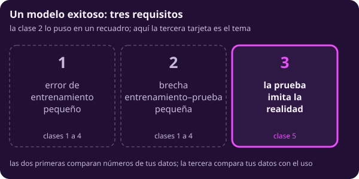
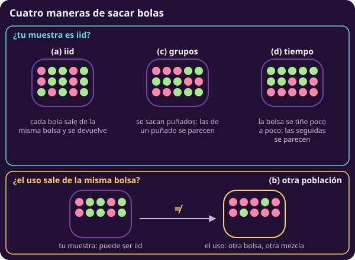
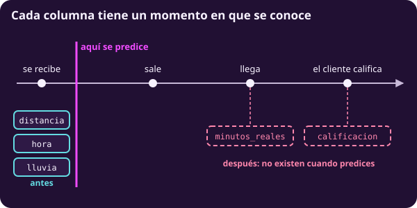
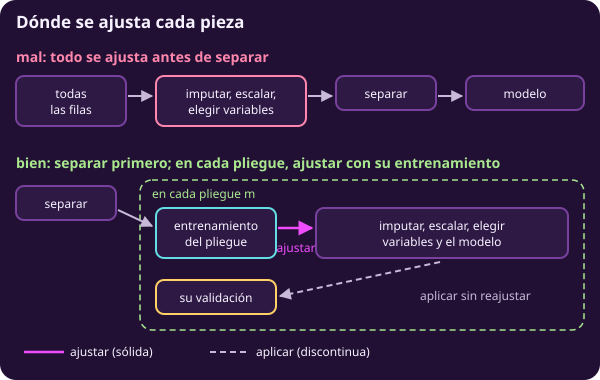
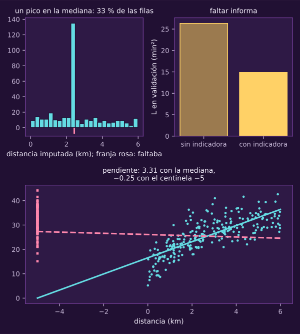

> [!WARNING]
> **▶▶ ABRE EL NOTEBOOK EN COLAB ◀◀**
>
> **Notebook 10 · ¿Son iid? Fugas** Corre en tu navegador, sin instalar nada.
>
> 
>
> **[👉 Abrir `10_son_iid_y_fugas.ipynb` en Colab](https://colab.research.google.com/github/raya-lucaria/ia_o26/blob/main/course/9_aprendizaje_maquina/_assets/10_son_iid_y_fugas.ipynb)**

# ¿Son iid? Fugas

**¿Cuándo el error que mides en prueba es el error que tendrás al usar el modelo?**

~45 min de lectura y ~45 con el notebook.

Al terminar tendrás:

- **Una definición de iid:** distinguirás tiempo, grupos y otra población.
- **Tres detectores:** sabrás qué buscan y qué no pueden ver.
- **Dos separaciones:** sabrás cuándo usar grupos o tiempo.
- **Cuatro fugas:** reconocerás sus rutas y efectos.
- **Una tubería:** ajustarás dentro del pliegue.

> [!TIP]
> **Míralo correr: el notebook 10**
>
> 

> **Lo que traes**
>
> $R$ se mide sobre el despliegue ([[ml-que-es-f|¿Qué es f?]], @ml-c1-def-riesgo).
>
> $L_{\text{prueba}}$ estima $R$ sin sesgo si la prueba no tocó decisiones **y** sale del mismo proceso que el despliegue, independiente de entrenamiento y validación; con filas dependientes, $s_\ell/\sqrt{n_{\text{prueba}}}$ **puede subestimar** el EE ([[ml-entrenamiento-y-prueba|Entrenamiento y prueba]], @ml-c2-teo-prueba-insesgada).
>
> El escalador se ajusta con entrenamiento ([[ml-lagrangeano-en-accion|El lagrangeano en acción]], @ml-c3-obs-estandarizar).

Revisaremos el supuesto pendiente: el uso debe parecerse a la muestra.

## 1 · Mirar el tercer requisito

::: figure {#ml-c5-modelo-exitoso title="Lo que hace exitoso a un modelo"}

:::

La tercera tarjeta retoma el recuadro de la clase 2.

**Piensa: si el error de entrenamiento es bajo y la prueba casi lo iguala, ¿ya puedes confiar en el número?**

No: falta revisar si imitan el uso.

@ml-c2-prueba-miente prometía lo mismo para usos distintos. ¿Cómo advertirlo?

Revisa supuestos e información usada.

> [!TIP]
> **Míralo correr: bloque 1 · Bolsas, puñados y una bolsa que cambia**
>
> 

::: exercise {#ml-c5-ej-tercer-requisito title="Señala qué tarjeta falla"}
Compara $L_{\text{ent}}$ y $L_{\text{prueba}}$ en estas situaciones:

(a) Entrenamiento bajo y prueba muy alta; prueba al azar.

(b) Los dos bajos y parecidos; prueba al azar; uso el año que viene.

(c) Los dos bajos y parecidos; prueba con los últimos dos meses; uso el mes que viene.
:::

::: hint {#ml-c5-pista-tercer-requisito-1 of="ml-c5-ej-tercer-requisito" title="Pista 1 · Mira qué se compara"}
¿Cuál de las tres tarjetas compara tus datos con el uso, y no tus datos entre sí?
:::

::: answer {#ml-c5-resp-tercer-requisito of="ml-c5-ej-tercer-requisito" title="Respuesta · Falta mirar fuera de la tabla"}
(a) Falla la segunda: la brecha es grande.

(b) Pasan las primeras dos; nada permite juzgar la tercera. El año siguiente puede traer otro proceso.

(c) La tercera es plausible: la prueba imita predecir el mes siguiente con información anterior. No garantiza que el proceso siga igual.
:::

## 2 · Definir iid con bolsas

::: figure {#ml-c5-bolsas title="Cuatro maneras de sacar bolas de una bolsa"}

:::

Los puñados vinculan filas; teñir la bolsa cambia su distribución.

**Piensa: si barajas las filas de tu tabla antes de separar, ¿las vuelves independientes?**

No: dos pedidos del mismo cliente siguen pareciéndose.

::: definition {#ml-c5-def-iid title="Observaciones iid"}
Las observaciones $(x_i,y_i)$, $i=1,\dots,n$, son **independientes e
idénticamente distribuidas (iid)** si cada una sale del mismo proceso que
$(x,y)$, una observación cualquiera. Ninguna depende de las otras: para
cualesquiera conjuntos $\mathcal S_i$, $i=1,\dots,n$,

$$\Pr\Bigl(\bigcap_{i=1}^{n}\bigl\{(x_i,y_i)\in\mathcal S_i\bigr\}\Bigr)=\prod_{i=1}^{n}\Pr\bigl((x,y)\in\mathcal S_i\bigr).$$

El producto dice «independientes»; que cada factor use la misma $(x,y)$ dice
«idénticamente distribuidas». Un **corte transversal** (*cross-section*) es
una tabla tomada en un mismo momento, sin orden en el tiempo. Es el caso en
que iid es más creíble, pero no está garantizado. Dos pedidos del mismo
cliente pueden estar en el mismo corte.

Dentro de la muestra se rompe por **grupos** (filas del mismo cliente o
paciente se parecen: falla la independencia) o por **tiempo** (filas
cercanas se parecen, y si el proceso se mueve, también falla la idéntica
distribución).

Es otra pregunta si el **uso** sale del mismo proceso que la
muestra. Una muestra iid de una ciudad no se vuelve dependiente porque el
modelo se use en otra. Lo que falla ahí es la correspondencia con el uso.

**Qué no es:** independencia entre las variables de una misma fila (en una
fila, la distancia y el tiempo pueden estar muy correlacionados), ni el
resultado de barajar.
:::

La validación cruzada (*cross-validation*, @ml-c2-def-validacion-cruzada) supone filas independientes. Sus estimaciones comparten datos de ajuste: el EE entre pliegues es aproximado.

::: remark {#ml-c5-obs-conformal-intercambiable title="Conformal también lo necesita"}
La garantía de @ml-c4-teo-cobertura-conformal pide que los casos de
calibración y el caso nuevo sean **intercambiables condicionados en el
predictor congelado**, en el sentido que fija ese teorema. Fijado todo lo
que ajustó el modelo, su distribución conjunta no cambia si se permutan.

Basta con que los datos de ajuste sean independientes de la calibración y
del caso nuevo, y que éstos sean iid entre sí. Si son iid, son
intercambiables (el producto de @ml-c5-def-iid no cambia al reordenar los
factores). Al revés no siempre.

No basta con no usar la calibración para
ajustar. Si el mismo cliente aparece en el ajuste y en la calibración, el
modelo ya lo conoce. Sus puntajes dejan de ser intercambiables con el de
un cliente nuevo.

Si el despliegue sale de otro proceso, el caso nuevo ya
no es intercambiable con los de calibración. La cobertura $1-\delta$ ya
no está garantizada. El mismo supuesto sostiene a la prueba, a la
validación cruzada y a conformal.

Los detectores de la sección siguiente
**buscan violaciones** de ese supuesto; ninguno demuestra que se cumple
(@ml-c5-obs-negativo-no-demuestra).
:::

Con grupos, apartar la calibración por grupos es necesario, pero no basta. Las filas de un mismo grupo dependen entre sí. Así que, contadas fila por fila, las de calibración y el caso nuevo de un grupo que no se vio dejan de ser intercambiables. El procedimiento por filas no tiene garantía. Si la clase mide una cobertura por grupos, es una comprobación experimental, no un teorema.

> [!TIP]
> **Míralo correr: bloque 1 · Bolsas, puñados y una bolsa que cambia**
>
> 

> [!WARNING]
> Lectura equivocada: «Si la tabla no tiene columna de fecha, los datos son iid».
>
> Lectura correcta: **revisa cómo se generaron las filas**.

::: exercise {#ml-c5-ej-bolsas title="Clasifica cuatro historias"}
¿Falla la muestra, alguna parte de iid, o la correspondencia con el uso?

(a) Encuestas a 2 000 hogares, 4 personas por hogar.

(b) Ventas diarias de 2019 a 2024.

(c) Radiografías: entrenamiento en un hospital y uso en otro.

(d) 500 pedidos sorteados de un mes, usados ese mismo mes.
:::

::: hint {#ml-c5-pista-bolsas-1 of="ml-c5-ej-bolsas" title="Pista 1 · Distingue las dos preguntas"}
¿Las filas se parecen entre sí más de lo que se parecen a una fila cualquiera, o el uso sale de otra bolsa?
:::

::: answer {#ml-c5-resp-bolsas of="ml-c5-ej-bolsas" title="Respuesta · Busca el mecanismo"}
(a) Falla la independencia: quienes comparten hogar comparten ingreso y costumbres.

(b) Si las ventas cercanas se parecen, falla la independencia. Con tendencia o temporada también falla la idéntica distribución. Las fechas solas no demuestran dependencia.

(c) La muestra puede ser iid dentro del primer hospital. Falla la correspondencia con el uso: cambian equipo o pacientes.

(d) Nada falla en principio. Aun así, habría que revisar si repiten clientes: sortear pedidos no borra esa relación.
:::

## 3 · Comprobar con tres detectores

::: figure {#ml-c5-detectores title="Tres detectores, con y sin deriva"}
Cada panel representa filas y su probabilidad de origen, valores de distancia y su distribución acumulada, o días y sus residuales.

:::

**Piensa: ¿cómo comprobarías que el mes que viene se parece a tus datos, si todavía no conoces sus $y$?**

Con sus $x$ y un punto de comparación (*benchmark*).

::: definition {#ml-c5-def-validacion-adversarial title="Validación adversarial"}
Se juntan las filas de entrenamiento y las del conjunto que quieres comparar
(la prueba, o las entradas del despliegue, que no necesitan $y$). Cada fila
recibe una etiqueta nueva, su **origen**: 1 si viene del segundo conjunto, 0 si
no.

Se entrena un clasificador que solo ve las columnas de $x$ (nunca $t$, el
cliente ni un identificador). Se mide con validación cruzada su pérdida
logarítmica y su $\mathrm{MCC}$ (@ml-c4-def-mcc).

Los pliegues de esa
validación cruzada respetan la misma estructura que los datos: estratificados
por origen (@ml-c2-def-estratificada) y, si hay grupos, **por grupos**. Si no,
el clasificador reconoce a un cliente que ya vio y «detecta» una diferencia
que no es de población.

Si los dos conjuntos salen del mismo proceso, el clasificador no puede hacer
más que el benchmark que solo conoce la proporción $\bar o$ de filas con
origen 1 (@ml-c3-def-benchmark): su pérdida logarítmica queda cerca de

$$-\bigl[\bar o\ln\bar o+(1-\bar o)\ln(1-\bar o)\bigr],$$

la misma pérdida logarítmica del benchmark de la proporción que en la
clase 4. Esa comparación es la **señal principal**: no depende de ningún
umbral.

El $\mathrm{MCC}$ es la señal de apoyo. Se calcula cortando la
probabilidad en $\tau=\bar o$, no en $0.5$. Con orígenes desbalanceados, un
corte en $0.5$ puede predecir siempre «origen 0» y dar $\mathrm{MCC}=0$
aunque los conjuntos difieran. Es el mismo efecto que corrigen los pesos
balanceados de @ml-c4-def-perdida-ponderada.

Este procedimiento usa una
sola corrección del desbalance de origen, el corte en $\bar o$. Así que el
clasificador se ajusta **sin pesos**. Con pesos y además el corte en
$\bar o$, su $\mathrm{MCC}$ dependería de cómo se combinan las dos.

Qué cuenta como diferencia es la regla de la unidad para ganarle a un
benchmark (@ml-c3-def-benchmark), con la pérdida logarítmica fuera de
pliegue de cada fila. En validación cruzada la comparación es descriptiva.
Se calculan, con la misma partición, las $k$ diferencias por pliegue entre
la pérdida del clasificador y la del benchmark.

Si su media queda por
debajo de 0 y fuera de la dispersión de esas $k$ diferencias, hay una
**señal** de que los conjuntos difieren. Si no, no hay señal.

Para
afirmarlo se confirma en una reserva que no tocó ninguna decisión, con la
diferencia pareada a más de dos EE. Con grupos, ese EE se calcula
remuestreando grupos completos. Con señal y el $\mathrm{MCC}$ por encima de
$0$, sus variables más importantes dicen en qué difieren.
:::

Con $\bar o=0.2$, compara el bosque poco profundo (página 2) contra la entropía 0.500:

| Escenario | Pérdida logarítmica | Resultado |
|---|---:|---|
| Sin deriva | 0.505 | Sin señal |
| Con deriva | 0.425 | Señal |

Fija el corte antes. Pesos y umbral son decisiones distintas (@ml-c4-def-perdida-vs-metrica).

Cortar en $\bar o$ no siempre da más MCC:

| Escenario | MCC con corte 0.5 | MCC con corte $\bar o$ |
|---|---:|---:|
| Mismas marginales | 0.00 | 0.22 |
| Deriva fuerte | 0.47 | 0.18 |

::: theorem {#ml-c5-teo-adversarial-azar title="Con el mismo proceso, el origen no se adivina"}
Si $x$ tiene la misma distribución en los dos conjuntos, entonces para toda
$x$, $\Pr(\text{origen}=1\mid x)=\Pr(\text{origen}=1)$. En consecuencia, el
mejor clasificador posible para la pérdida logarítmica predice la constante
$\Pr(\text{origen}=1)$. Una regla **fija** que solo mire $x$ (ajustada con
otras filas) tiene, en filas nuevas, correlación $0$ con el origen.
:::

Si esa regla da siempre la misma clase, la correlación no está definida y el MCC vale 0 por convención, como en la clase 4.

Demostración en «Para profundizar».

::: definition {#ml-c5-def-ks title="Distancia de Kolmogorov–Smirnov de una variable"}
Para la variable $j$ y un conjunto $\mathcal D$, la función de distribución
empírica es $\widehat F_{\mathcal D,j}(v)=\frac{1}{n_{\mathcal D}}\sum_{i\in\mathcal D}\mathbf 1\{x_{ij}\le v\}$,
la proporción de filas con $x_{ij}\le v$. La distancia KS entre entrenamiento
y el conjunto nuevo es la mayor separación vertical entre las dos escaleras:

$$\mathrm{KS}_j=\max_v\bigl\lvert\widehat F_{\text{ent},j}(v)-\widehat F_{\text{nuevo},j}(v)\bigr\rvert .$$

Vale entre 0 y 1.
:::

::: remark {#ml-c5-obs-negativo-no-demuestra title="Que no avisen no prueba iid"}
Los tres detectores pueden encontrar una diferencia; ninguno demuestra que no
la haya.
1. La validación adversarial y KS solo miran $x$. Si cambia la relación entre
   $x$ y $y$ (el tráfico de otra ciudad), no ven nada (caso
   28, `cambio_de_concepto`).
2. KS compara una variable a la vez: dos nubes con las mismas marginales y
   distinta relación entre variables le parecen iguales. La validación
   adversarial **puede** distinguirlas si su clasificador ve combinaciones de
   variables (un árbol o un bosque; una logística lineal en $x$, no) y hay
   datos suficientes.
3. Con $J$ variables y el umbral de 5 %, unas $0.05J$ salen «distintas» por
   azar aunque nada cambie. Por eso se mira primero la validación adversarial,
   que resume todas las variables en un solo número (no es un contraste con
   nivel garantizado), y el tamaño de $\mathrm{KS}_j$, no solo su valor p.
4. Ninguno mira el orden: para la dependencia en el tiempo está el tercer
   detector, los residuales contra $t$.
:::

Ordena residuales de validación (@ml-c3-def-tres-vistas) por tiempo $t$. Ondas o autocorrelaciones altas revelan estructura. El rezago 1 compara residuales consecutivos:

$$\sum_{t=1}^{n-1}(e_t-\bar e)(e_{t+1}-\bar e)\big/\sum_{t=1}^{n}(e_t-\bar e)^2.$$

El denominador es común. En $(1,-1,1,-1,1,-1)$ da $−5/6$, frente a $−1$ de Pearson.

> [!TIP]
> **Míralo correr: bloque 2 · Tres detectores**
>
> 

> [!WARNING]
> Lectura equivocada: «La validación adversarial dio $\mathrm{MCC}\approx0$: puedo separar al azar».
>
> Lectura correcta: **no demuestra independencia ni estabilidad de la respuesta**.

::: exercise {#ml-c5-ej-ks-a-mano title="Calcula una distancia KS"}
Compara entrenamiento $(0,1,2)$ y nuevo $(1,2,3)$. Dibuja las escaleras y calcula su mayor separación vertical.
:::

::: hint {#ml-c5-pista-ks-a-mano-1 of="ml-c5-ej-ks-a-mano" title="Pista 1 · Busca los saltos"}
¿En qué valores de $v$ puede cambiar cada escalera?
:::

::: answer {#ml-c5-resp-ks-a-mano of="ml-c5-ej-ks-a-mano" title="Respuesta · Compara las alturas"}
En $v=0,1,2,3$, las escaleras valen $(1/3,2/3,1,1)$ y $(0,1/3,2/3,1)$.
La mayor diferencia es $1/3$. Con tres datos por lado eso no prueba nada sobre el proceso.
:::

## 4 · Separar como se usará: grupos y tiempo

::: figure {#ml-c5-particiones title="Cinco pliegues, tres maneras"}

:::

Cada renglón es un simulacro (@ml-c2-def-simulacro); cada celda reúne filas.

**Piensa: si cada cliente tiene su retraso habitual y sus pedidos caen a ambos lados del corte, ¿la validación cruzada al azar promete más o menos error del que tendrás con clientes nuevos?**

Menos, si aprovecha esa coincidencia: ya conoció al cliente.

::: example {#ml-c5-ejm-pacientes title="Cinco muestras de un paciente, tres de otro"}
Goodfellow et al. (§8.1.3) describen una tabla médica donde las primeras
cinco filas son muestras de sangre del mismo paciente, tomadas en momentos
distintos. Las tres siguientes de otro. Si se separan las filas al azar, el
modelo ve en entrenamiento a casi todos los pacientes de la prueba. El grupo
no tiene que ser una persona: una tienda, un hospital o un día pueden serlo.
:::

::: definition {#ml-c5-def-cv-grupos title="Validación cruzada por grupos"}
Cuando varias filas comparten un grupo (un cliente, un paciente) y el modelo
se usará con **grupos nuevos**, cada pliegue $\mathcal D_m$ se arma con grupos
enteros. Ningún grupo tiene filas dentro y fuera de $\mathcal D_m$. Así
$\mathrm{CV}_k$ (@ml-c2-def-validacion-cruzada) estima el error en grupos que
el ajuste no vio. La prueba se aparta igual, por grupos.

Si el modelo se usará con los **mismos** grupos más adelante (pedidos
futuros de clientes que ya tienes), la pregunta es otra. Se separa por tiempo.
Qué separación usar lo dice el despliegue, no el formato de la tabla.
:::

::: definition {#ml-c5-def-cv-temporal title="Validación cruzada temporal"}
Con las filas ordenadas por $t$ y el modelo usado en el futuro, cada
iteración $m$ ajusta con las filas $\mathcal A_m$ anteriores a un corte. Valida con el bloque $\mathcal D_m$ que sigue:

$$\max\{t_i:\ i\in\mathcal A_m\}<\min\{t_i:\ i\in\mathcal D_m\}.$$

El entrenamiento crece de una iteración a la siguiente; la prueba es el último
tramo. Nunca se entrena con el futuro de lo que se valida.
:::

Cada barra muestra pérdida cuadrática: mediana de 20 semillas y rango intercuartil.

::: figure {#ml-c5-cv-miente title="Cuándo promete de más la validación al azar"}

:::

| Uso | Modelo | CV al azar | Despliegue |
|---|---|---:|---:|
| Clientes nuevos | Polinomio y dummies del cliente | 2.1 | 17.9 |
| Clientes nuevos | Lineal en $x$ | 23.5 | 23.4 |
| Días futuros | Vecinos sobre $(x,t)$ | 50 | 122 |
| Días futuros | Lineal en $x$ | 53 | 54 |

Es una versión con más días y algo menos de memoria que la de la clase 2.
$R$ mide el error a largo plazo con otra realización del ruido. Los primeros días pueden beneficiarse del ruido reciente.

::: remark {#ml-c5-obs-cuando-miente title="La validación al azar miente solo si alguien aprovecha la cercanía"}
Separar al azar datos con grupos o con tiempo no garantiza un número malo.
Miente cuando el modelo puede **usar** que una fila de validación tiene
vecinas casi iguales en entrenamiento (el mismo cliente, el día anterior) o
cuando el proceso se mueve con el tiempo.

Un modelo lineal en $x$ con ruido
con memoria no ve $t$ ni a las vecinas. Su predicción depende solo de $x$.
Con pocos parámetros y muchas filas, la CV al azar y la temporal estiman
casi la misma cosa, la varianza del ruido más el error de ajuste.

Un modelo
que sí ve la cercanía la aprovecha en la CV al azar y no en el uso. La
diferencia es grande. Igual se separa como se usará: el protocolo se
justifica por lo que sabrás al predecir, no por la cifra que resulte.
:::

El bootstrap por filas (@ml-c4-obs-intervalo-metrica) suponía filas independientes, sin fijar los conteos de clase. Aquí remuestreas grupos completos: cambia la unidad independiente.

Con rezagos o promedios móviles, deja un hueco entre entrenamiento y validación.

> [!TIP]
> **Míralo correr: bloque 3 · La validación cruzada que miente**
>
> 

> [!WARNING]
> Lectura equivocada: «Con grupos, siempre se separa por cliente».
>
> Lectura correcta: **depende de si los clientes serán nuevos o conocidos**.

::: exercise {#ml-c5-ej-tres-clientes title="Tres clientes, seis pedidos"}
A, B y C tienen dos pedidos cada uno. Uno de cada cliente va a entrenamiento y otro a validación.
El uso será con clientes nuevos. ¿Qué falla y cómo lo repararías?
:::

::: hint {#ml-c5-pista-tres-clientes-1 of="ml-c5-ej-tres-clientes" title="Pista 1 · Revisa quién ya apareció"}
¿Qué cliente de validación era desconocido para el ajuste?
:::

::: answer {#ml-c5-resp-tres-clientes of="ml-c5-ej-tres-clientes" title="Respuesta · Reserva clientes completos"}
Ninguno. Separaste pedidos, no clientes: el ajuste conoció a A, B y C.
Con validación cruzada por grupos, un pliegue contendría todos los pedidos de C; el ajuste usaría solo A y B.
:::

## 5 · Encontrar una fuga

::: figure {#ml-c5-momento-decision title="Qué se sabe cuando se predice"}
Cada columna tiene un momento en que se conoce.

:::

Las columnas posteriores no existen al predecir.

**Piensa: si nunca le diste $y$ al preprocesamiento, ¿puede haber una fuga?**

Sí: la mediana global contiene información de prueba.

::: definition {#ml-c5-def-fuga title="Fuga"}
Hay una **fuga** (*leakage*) cuando la estimación del error usa información
que el modelo no tendrá en el despliegue. Cuatro rutas:
1. **Del futuro:** una variable que se registra después del momento de
   predecir (la calificación del cliente). O una que fija la propia
   decisión que el modelo ayudará a tomar (el tiempo que se le promete al
   cliente, si se decide con la predicción).
2. **Por ajustar antes de separar:** algo que se aprende de los datos
   (escalar, imputar, codificar, **elegir variables**) se calcula con filas
   de validación o de prueba.
3. **Por duplicados:** la misma observación, o casi, aparece de los dos
   lados del corte.
4. **Por decidir mirando la prueba:** un umbral, una lista de columnas o un
   hiperparámetro se fijan viendo la prueba (@ml-c2-obs-optimismo-seleccion).
:::

::: remark {#ml-c5-obs-detectar-fuga title="Demasiado bueno para ser cierto"}
Una fuga se ve primero en el resultado: un error muy por debajo del benchmark
de un problema que sabes difícil. O muy cerca de cero cuando hay ruido que
nadie puede predecir (@ml-c1-def-error-bayes).

La segunda señal es la
importancia. Si al revolver una sola columna en validación el error sube
mucho más que con todas las demás juntas, pregunta cuándo se conoce esa
columna. Ninguna de las dos prueba que hay fuga; las dos dicen dónde buscar.
:::

Aquí $y$ es **llegó tarde**. Medimos MCC; la moda da 0.

Compara medianas de 5 semillas y rangos intercuartiles:

| Variantes | Modelo | Datos |
|---|---|---|
| Primeras cuatro | Vecinos | 600 pedidos; 30 % de distancias faltantes |
| Elegir variables antes | Logística | 100 pedidos; 500 columnas de ruido; $y$ no depende de nada |

::: figure {#ml-c5-fugas title="Cuánto infla cada fuga"}

:::

La calificación infla el MCC de la CV; desaparece al predecir.

El efecto del caso 20 es pequeño: mejora aparente en 1 de 20 semillas; diferencia mediana 0.000. El procedimiento sigue mal.

El profesor reconoció este error en sus notebooks anteriores: eligió variables por correlación con el objetivo usando todas las filas.

Repetir casos de la clase rara antes de separar pone copias del mismo caso en los dos lados: es la ruta 3 (@ml-c4-obs-por-que-no-remuestrear).

> [!TIP]
> **Míralo correr: bloque 4 · Fugas: el número demasiado bueno**
>
> 

> [!WARNING]
> Lectura equivocada: «Si no uso $y$ para preprocesar, no hay fuga».
>
> Lectura correcta: **ajustar con prueba también filtra información**.

::: exercise {#ml-c5-ej-mediana-global title="Ubica el ajuste indebido"}
Calculas la mediana de `distancia` con todas las filas y llenas los faltantes. Después corres la validación cruzada.
¿En qué paso entró información que debía quedar apartada?
:::

::: hint {#ml-c5-pista-mediana-global-1 of="ml-c5-ej-mediana-global" title="Pista 1 · Sigue el número"}
¿Qué filas aportaron al número con que llenaste los faltantes del primer pliegue?
:::

::: answer {#ml-c5-resp-mediana-global of="ml-c5-ej-mediana-global" title="Respuesta · La mediana ya vio la validación"}
También aportaron las filas que ese pliegue reservaría para validar. La fuga ocurrió al calcular la mediana global.
Repite ese cálculo dentro de cada entrenamiento y aplica su mediana a la validación, sin reajustarla.
:::

## 6 · Meter todo en la tubería

::: figure {#ml-c5-tuberia title="Ajustar antes de separar, o dentro del pliegue"}

:::

**Piensa: ¿qué es lo que se «aprende» al estandarizar una columna?**

Su media y su desviación: parámetros de $\phi$, estimados como $\widehat\beta$. El lagrangeano (@ml-c3-def-lagrangeano-capacidad) entra al pliegue.

::: definition {#ml-c5-def-tuberia title="Tubería"}
Una **tubería** (*pipeline*) junta en un solo procedimiento todo lo que se
ajusta a los datos (escalar, imputar, codificar, elegir variables) y el
modelo. Todo eso es parte de $\phi$, una $\phi$ que se estima. Cada partición
$m$ de la validación cruzada da dos conjuntos de filas: las de ajuste
$\mathcal A_m$, con $n_{\mathcal A_m}$ filas, y las de validación
$\mathcal D_m$. La tubería entera se ajusta solo con $\mathcal A_m$:

$$\widehat\phi^{(-m)}=\phi\ \text{ajustada con }\mathcal A_m,$$

Aquí $\widehat\phi^{(-m)}$ no incluye la constante y $\beta$ son las
pendientes; el intercepto $\beta_0$ se escribe aparte, como en
@ml-c4-def-logistica-regularizada:

$$
\begin{aligned}
(\widehat\beta_0^{(-m)},\widehat\beta^{(-m)})\in{}&\operatorname*{arg\,min}_{\beta_0,\beta}\ \frac{1}{n_{\mathcal A_m}}\sum_{i\in\mathcal A_m}w_{y_i}\,\ell_i\bigl(\beta_0,\beta;\ \widehat\phi^{(-m)}\bigr)\\
&+\mu\,\Omega(\beta),\qquad\mu\ge0,
\end{aligned}
$$

donde $\ell_i(\beta_0,\beta;\widehat\phi^{(-m)})$ es la pérdida de la fila
$i$ con la predicción hecha sobre $\widehat\phi^{(-m)}(x_i)$: en regresión,
la cuadrática con $\beta_0+\beta^{\mathsf T}\widehat\phi^{(-m)}(x_i)$; en
clasificación, la logarítmica con la probabilidad
$\sigma\bigl(\beta_0+\beta^{\mathsf T}\widehat\phi^{(-m)}(x_i)\bigr)$, nunca
con el puntaje solo.

En clasificación, con pesos por clase $w_y$ si el
modelo los usa (@ml-c4-def-perdida-ponderada), calculados con los conteos
de $\mathcal A_m$. El balanceado es $w_y=n_{\mathcal A_m}/(K\,n_y)$, con
$n_y$ los casos de clase $y$ en $\mathcal A_m$, y cambia de un pliegue a
otro. Sin pesos, $w_y=1$. Como $\beta$ son solo las pendientes,
$\Omega(\beta)$ no toca a $\beta_0$.

Si el mínimo no es único, se nombra la regla de
selección de la familia: la de norma mínima en mínimos cuadrados sin
penalizar. Con lasso, la que da su algoritmo.
$\mathcal D_m$ se transforma con $\widehat\phi^{(-m)}$ **sin reajustarla**.

En la validación cruzada de siempre, $\mathcal A_m$ son todos los datos de
desarrollo fuera de $\mathcal D_m$. Por grupos, los de otros grupos. En la
temporal, solo los anteriores al corte (@ml-c5-def-cv-temporal), nunca los
posteriores.

Al final, el modelo se reajusta con entrenamiento y
validación, **salvo las reservas de calibración** (@ml-c4-def-conformal,
@ml-c4-mapa-reservas). Si se reajusta, la recalibración
(@ml-c4-def-recalibrar) y el umbral se vuelven a ajustar en `val_a`. Y el
corte conformal en `cal`, que el modelo no tocó. La prueba se transforma
con la tubería final, sin reajustarla.
:::

El intercepto ahora va aparte (@ml-c1-def-modelo-lineal). Los pesos también se ajustan por pliegue.

::: definition {#ml-c5-def-imputacion-simple title="Imputación simple con indicador"}
Si a la variable numérica $x_j$ le faltan valores, la imputación simple la
cambia por dos columnas de $\phi$: $x_j$ con cada faltante reemplazado por
$\widehat{\operatorname{med}}_j$, la mediana de los valores **observados** de
$x_j$ en entrenamiento, y la indicadora $\mathbf 1\{x_{ij}\text{ falta}\}$.

Si
la variable es categórica, se usa la moda de entrenamiento o una categoría
«falta». Las dos cantidades se ajustan solo con entrenamiento, dentro de la
tubería. La indicadora deja que el modelo use que el dato faltaba, si eso
informa.
:::

Conserva las colas observadas (@ml-c3-obs-colas-largas). Cada punto es una entrega; la franja marca faltantes.

::: figure {#ml-c5-imputacion title="Llenar lo que falta sin inventar una distancia"}

:::

El centinela tuerce la pendiente.

::: remark {#ml-c5-obs-escalar-mco title="Escalar antes de separar: un error aunque la cifra no se mueva"}
En mínimos cuadrados **sin penalizar, con intercepto y con $\Phi$ de rango
completo de columnas**, estandarizar con todas las filas antes de separar
**no cambia las predicciones**. Estandarizar es una transformación afín de
cada columna, aplicada igual a entrenamiento y validación. Con intercepto
equivale a pasar de $\Phi$ a $\Phi\mathbf Q$ con $\mathbf Q$ invertible. El
espacio de columnas no cambia.

Las predicciones de entrenamiento no cambian
nunca. Las de validación y prueba, solo gracias al rango completo. Con
rango deficiente (la trampa de la dummy de la página 2, más columnas que
filas) la solución de norma mínima **sí** puede cambiar fuera de la
muestra. Si además se imputa, la invariancia sigue solo si la indicadora
está en $\Phi$ (cambiar el valor imputado suma un múltiplo de esa columna).

Con $\mu>0$ (@ml-c3-obs-estandarizar) o con vecinos sí cambia, aunque poco.
Ajustarlo dentro del pliegue es la regla porque la regla no depende de que
el error se note.
:::

| Ajuste | MCC de CV sin tubería | MCC de CV con tubería | MCC en el despliegue |
|---|---:|---:|---:|
| Seleccionar variables | 0.43 | -0.06 | 0.00 |
| Escalar e imputar | 0.21 | 0.21 | 0.29 |

La tubería no arregla dos rutas:

- Quita las columnas futuras antes de separar: son la ruta 1.
- Agrupa duplicados antes de separar y conserva cada grupo completo (@ml-c5-def-cv-grupos): son la ruta 3.

> [!TIP]
> **Míralo correr: bloque 5 · La tubería**
>
> 

> [!WARNING]
> Lectura equivocada: «Con una tubería ya no hay fugas».
>
> Lectura correcta: **aún debes revisar columnas y separación**.

::: exercise {#ml-c5-ej-que-arregla title="¿Cuáles arregla la tubería?"}
¿Cuáles de las cuatro fugas de @ml-c5-fugas arregla la tubería? Justifica qué información sigue entrando en las demás.
:::

::: hint {#ml-c5-pista-que-arregla-1 of="ml-c5-ej-que-arregla" title="Pista 1 · Localiza el aprendizaje"}
¿Cuáles nacen de algo que se ajusta, y cuáles de algo que está en la tabla antes de ajustar nada?
:::

::: answer {#ml-c5-resp-que-arregla of="ml-c5-ej-que-arregla" title="Respuesta · Dos ajustes y dos problemas de datos"}
Arregla escalar e imputar antes y elegir variables antes: ambas son de la ruta 2.
No arregla la calificación posterior, ruta 1, ni los pedidos duplicados, ruta 3.
Aunque el ajuste ocurra dentro del pliegue, esas columnas o filas todavía le dan información indebida.
:::

**Intenta formular tu propuesta sin abrir las pistas ni la respuesta y sin
pedir ayuda a ChatGPT.**

::: exercise {#ml-c5-ej-final-son-iid-y-fugas title="Diseña el simulacro"}
Una empresa de reparto tiene **ocho semanas** de pedidos: unas 3 000 filas y unos 400 clientes que repiten.
El tiempo real de cada entrega se conoce al llegar.
Columnas: `distancia`, `hora`, `lluvia`, `cliente`, `fecha`, `minutos_reales`, `calificacion` y `retraso_promedio_del_cliente`, calculado con toda la tabla.

El modelo predecirá el tiempo de pedidos de clientes nuevos en la semana nueve.
Cada semana llegan clientes que no habían pedido antes: unos 60 en la semana 8, con unos 450 pedidos de esa semana.
En cada semana de la 3 a la 7 llegan entre 40 y 60 clientes nuevos.

Simplifica suponiendo que el proceso no cambia de la semana 8 a la 9, salvo por los clientes.
La dificultad nueva es cumplir dos restricciones a la vez: tiempo y grupos. Una columna mezcla ambas.
La respuesta desarrolla una opción.

1. Decide qué columnas puedes usar al predecir y por qué. Distingue las del futuro de las calculadas con prueba.
2. Explica cómo apartas la prueba y qué filas excluyes del entrenamiento final.
3. Arma los pliegues de validación cruzada. Di qué filas pierde tu diseño.
4. Especifica qué va dentro de la tubería y con qué filas se ajusta.
5. Explica qué riesgo estima tu número final y qué no promete. Revisa qué harías si faltaran clientes nuevos.
:::

::: hint {#ml-c5-pista-final-son-iid-y-fugas-1 of="ml-c5-ej-final-son-iid-y-fugas" title="Pista 1 · Imita el pedido futuro"}
¿Qué dos condiciones tiene que cumplir una fila de prueba para parecerse a un pedido de la semana nueve?
:::

::: hint {#ml-c5-pista-final-son-iid-y-fugas-2 of="ml-c5-ej-final-son-iid-y-fugas" title="Pista 2 · Revisa lo que se cuela"}
En tu diseño, ¿hay alguna fila o columna que deje ver un cliente o un resultado que todavía no conocerías?
:::

::: answer {#ml-c5-resp-final-son-iid-y-fugas of="ml-c5-ej-final-son-iid-y-fugas" title="Respuesta · Respeta el tiempo y los clientes"}
**1 · Columnas.** Usa `distancia`, `hora` y `lluvia`, conocidas al recibir el pedido.
`minutos_reales` es $y$; `calificacion` viene del futuro.
`retraso_promedio_del_cliente` usa la prueba y no existe para clientes nuevos. Descártalo.
Conserva `cliente` y `fecha` para separar, sin entregarlos como entradas al modelo.

**2 · Prueba.** Reserva los pedidos de la semana 8 de clientes que aparecen por primera vez esa semana.
Cuenta los clientes antes de decidir: el escenario prevé unos 60. Reporta el conteo efectivo.
Los pedidos de clientes viejos de esa semana no entran a la prueba ni al entrenamiento final de esta evaluación.

**3 · Pliegues.** En cada corte, entrena con semanas anteriores y valida con clientes que aparecen por primera vez en la siguiente.
Usa las semanas 3 a 7 para esas validaciones. Pierdes sus pedidos de clientes ya conocidos como casos de validación.
No entrenes con semanas posteriores al corte; el modelo debe desconocer a todos los clientes que evalúas.

**4 · Tubería.** Ajusta imputación, escalamiento, codificación de `hora` y `lluvia`, y modelo solo con el entrenamiento del pliegue.
Aplica esas transformaciones sin reajustarlas. Con las decisiones congeladas, reajusta con las semanas 1–7 y evalúa una vez en la prueba.

**5 · Alcance.** La pérdida cuadrática promedio estima el riesgo por pedido de clientes nuevos de la semana siguiente, bajo la simplificación declarada.
No promete conservarlo si cambia el proceso. La validación adversarial entre semanas vigila cambios visibles en las entradas; no demuestra estabilidad.

Si en la semana 8 casi no llegan clientes nuevos, la prueba queda vacía o diminuta: dilo, sin presentar una estimación fiable.
Puedes sortear clientes completos antes de mirar resultados, reservar sus pedidos de la semana 8 y sacar sus historias de las semanas 1–7.

Pierdes datos de entrenamiento. Esa alternativa estima el error con clientes que el modelo no vio, en la semana siguiente, aunque sí hayan pedido antes.
Al informar incertidumbre, remuestrea clientes completos.
:::

**Punto de control:** justifica la separación y la tubería.

## Para profundizar

::: proof {#ml-c5-dem-adversarial-azar of="ml-c5-teo-adversarial-azar"}
1) Misma distribución quiere decir $\Pr(x\in\mathcal S\mid\text{origen}=1)=\Pr(x\in\mathcal S\mid\text{origen}=0)$ para todo conjunto $\mathcal S$.
2) Entonces $\Pr(x\in\mathcal S)$, que promedia esas dos con pesos $\Pr(\text{origen}=1)$ y $\Pr(\text{origen}=0)$, vale lo mismo, y $x$ y el origen son independientes.
3) Independencia da $\Pr(\text{origen}=1\mid x)=\Pr(\text{origen}=1)$.
4) La pérdida logarítmica esperada se minimiza anunciando la probabilidad verdadera (es la verosimilitud de la clase 4), que aquí no depende de $x$.
5) Una regla fija que solo mira $x$ es una función de $x$. Así que también es independiente del origen en una fila nueva. Dos variables independientes tienen covarianza $0$.
:::

Medir sobre el ajuste permite memorizar el origen.

::: remark {#ml-c5-obs-imputar-con-modelo title="Por qué no imputar con un modelo complejo"}
Predecir el faltante con otro modelo es otro problema de aprendizaje. Tiene
su propia pérdida, sus propios hiperparámetros y su propia separación. Se
ajusta también solo con entrenamiento y agrega varianza y nuevas rutas de
fuga. Puede convenir. El punto de partida de esta unidad es la mediana con
indicador. Lo demás se compara contra él en validación.
:::

- Goodfellow, Bengio y Courville, *Deep Learning*: [§5.2, supuestos iid](https://www.deeplearningbook.org/contents/ml.html); [§8.1.3, muestras del mismo paciente](https://www.deeplearningbook.org/contents/optimization.html).
- Hastie, Tibshirani y Friedman, [*The Elements of Statistical Learning*](https://web.iitd.ac.in/~sumeet/Hastie.pdf), segunda edición, §7.10.2: selección dentro del pliegue.
- Kaufman, Rosset, Perlich y Stitelman (2012), [«Leakage in data mining: formulation, detection, and avoidance»](https://cris.tau.ac.il/en/publications/leakage-in-data-mining-formulation-detection-and-avoidance/), *ACM TKDD* 6(4).
- Bergmeir, Hyndman y Koo (2018), [«A note on the validity of cross-validation for evaluating autoregressive time series prediction»](https://robjhyndman.com/papers/cv-wp.pdf).
  Requiere rezagos de $y$ y residuales sin correlación. No respalda nuestro lineal con memoria.
- Scikit-learn, [«Common pitfalls»](https://scikit-learn.org/stable/common_pitfalls.html): preprocesamiento y tuberías.
- La banda $\pm2/\sqrt n$ es aproximada, por rezago y bajo ruido blanco; véase [la documentación de ACF y Bartlett](https://www.statsmodels.org/stable/generated/statsmodels.tsa.stattools.acf.html).

## Lo que hay que llevarse

- La prueba debe imitar el uso: @ml-c2-prueba-miente dejó esa pregunta abierta.
- Los detectores buscan violaciones. La adversarial da pérdida 0.505 sin deriva y 0.425 con deriva, frente a 0.500; no demuestra iid.
- Separa como usarás: clientes que repiten dan 2.1 en CV al azar y 17.9 en clientes nuevos; el lineal, 23.5 y 23.4.
- Las fugas toman cuatro rutas. Calificación posterior: MCC 0.97 en CV y 0.00 en despliegue; duplicados: 0.45 y 0.27.
- Ajusta todo dentro del pliegue. La selección previa pasa de 0.43 a -0.06 en CV al repararla; escalar e imputar casi no cambia.

Continúa con [[ml-la-metodologia|La metodología]].
