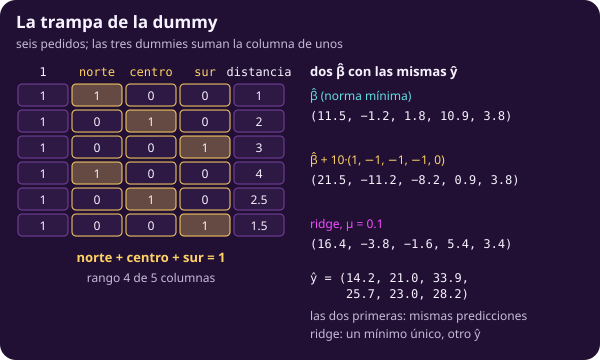
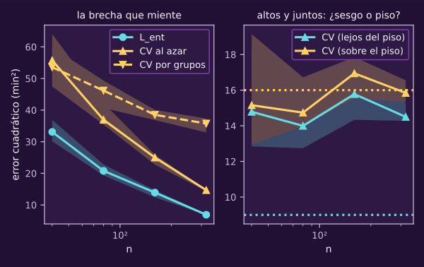
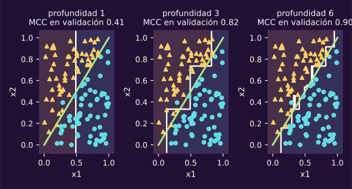
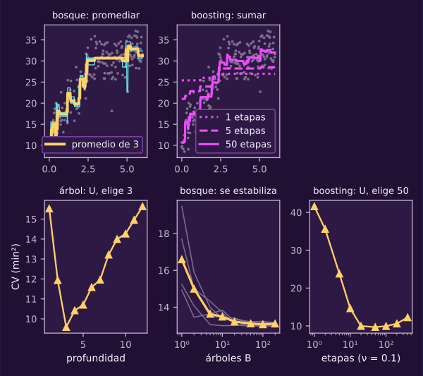
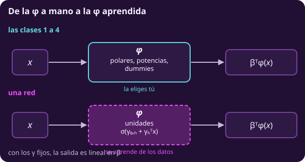
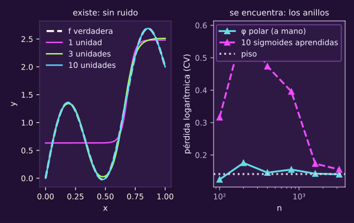

# La metodología

**¿En qué orden se trabaja para que el número final sea creíble?**

~50 min de lectura; esta página no tiene notebook: su práctica está en las tareas.

Al terminar tendrás:

- **Una receta:** ordenarás siete pasos y dirás con qué datos haces cada uno.
- **Columnas categóricas:** escribirás una categórica en $\Phi$ sin la trampa de la dummy.
- **Un siguiente experimento:** decidirás qué cambiar a partir del error.
- **Tres familias más:** compararás árbol, bosque y boosting con las mismas reglas.
- **Una representación aprendida:** distinguirás qué cambia cuando también se aprende $\phi$.

> **Lo que traes**
>
> El punto de comparación (*benchmark*), @ml-c3-def-benchmark.
>
> La curva de aprendizaje, @ml-c2-def-curva-aprendizaje.
>
> La pérdida no es la métrica, @ml-c4-def-perdida-vs-metrica.
>
> La tubería, @ml-c5-def-tuberia, en [[ml-son-iid-y-fugas|¿Son iid? Fugas]].

El equipo de entregas ya puede ajustar modelos y medir errores. Falta ordenar las decisiones: una cifra baja vale poco si la evaluación ayudó a conseguirla. Empezaremos por el uso previsto, construiremos una solución completa y decidiremos qué cambiar con evidencia. Cambiar de familia será una decisión más dentro de ese procedimiento.

## 1 · Seguir la receta

::: figure {#ml-c5-receta title="La receta, del uso a la prueba"}

:::

La flecha de regreso usa validación o validación cruzada (*cross-validation*, CV). La prueba espera al final. La tabla convierte esas flechas en una receta: primero describes el uso; después vienen los siete pasos.

**Piensa: si en el paso 6 mides cada cambio en la prueba, ¿qué le pasa al número que reportas al final?**

Sale optimista: la prueba ya decidió (@ml-c2-obs-optimismo-seleccion). Goodfellow llama prueba al conjunto de algunos pasos iterativos; aquí lo llamamos validación. El lazo siempre usa validación o CV.

El paso 1 fija el criterio de desempeño de Mitchell (@ml-c0-def-aprender). Una meta de pérdida solo es realista si no baja de su piso, $R_{\text{Bayes}}$ de esa pérdida (@ml-c1-def-error-bayes). En una métrica que se maximiza, como MCC o $A_{\text{bal}}$, mayor es mejor. No tiene $R_{\text{Bayes}}$: el piso de una pérdida no limita esa métrica.

Arma pronto una tubería de punta a punta con el modelo más simple que tenga sentido. Así podrás revisar tanto sus predicciones como su evaluación antes de añadir capacidad.

Las reservas siguen @ml-c4-mapa-reservas, de [[ml-calibracion-y-conformal|Calibración y predicción conformal]]. Si recalibras (@ml-c4-def-recalibrar), eliges $\tau$ o usas conformal (@ml-c4-def-conformal), las apartas en el paso 2. **`cal` se aparta primero y solo da el corte conformal**; del resto salen `val_a` y `val_b`.

La recalibración y $\tau$ se ajustan en `val_a`; el método de recalibración, el diagnóstico y el benchmark, en `val_b`. Ninguna cifra se reporta en `val_a`.

La razón: la recalibración de Platt es monótona, así que no cambia el orden de los puntajes, y elegir $\tau$ sobre la probabilidad recalibrada es elegir un corte del puntaje original; ajustar Platt ahí no agrega ninguna elección.

Lo que sí sale optimista es la cifra que se reporta en los mismos datos con que se ajustó y se eligió, y por eso las cifras salen de `val_b` y, al final, de la prueba.

Eso corrige el protocolo del micro sobre reportar en los mismos datos. En el lazo de validación, $\tau$ cambia en `val_a` y el método se compara en `val_b`. Con pesos en el ajuste, elegir además $\tau$ sigue siendo válido: son decisiones distintas (@ml-c4-def-perdida-vs-metrica).

`cal` no participa en ninguna elección. Solo se abre para calcular el corte, con todo lo demás fijo.

Con grupos, las reservas se apartan por grupos, y el entrenamiento no comparte grupos con `cal` ni con el caso nuevo. Aun así, el teorema de la clase 4 no se aplica tal cual, porque las filas de un mismo grupo no son intercambiables entre sí, y el corte cuenta filas.

Una versión que sí lo cumple usa un puntaje por grupo (por ejemplo, el de una fila elegida al azar de cada grupo). Supone grupos nuevos intercambiables con los de la reserva: la cobertura es entonces por grupo nuevo, no por fila.

Por eso, con grupos, el procedimiento por filas no tiene garantía: apartar la calibración por grupos es necesario, pero no basta. Si mides qué fracción de grupos nuevos queda cubierta, eso es una comprobación experimental: se reporta como una cifra medida, nunca con “$\ge 1-\delta$”.

Con tiempo, conformal no tiene garantía: la reserva se toma del tramo más reciente y la cobertura se vigila en el uso, que es una búsqueda de violaciones, no una garantía.

Al cerrar, si reajustas el modelo, dejas fuera las reservas. Vuelves a ajustar la recalibración y $\tau$ en `val_a` y el corte en `cal`. @ml-c4-teo-cobertura-conformal exige intercambiabilidad condicionada en el predictor congelado; haber usado `cal` para ajustar ese predictor rompe el argumento. Sin recalibración, umbral elegido ni conformal, no hay reservas: reajustas con todo el desarrollo.

::: table {#ml-c5-tab-metodologia title="La receta, paso a paso"}
| Paso | Qué haces | Con qué datos |
|---|---|---|
| 0 · Uso | Escribes dónde, cuándo y con qué información se usará el modelo | ninguno |
| 1 · Métrica y meta | Eliges la cifra que importa y su meta: una pérdida, que no puede bajar de su piso; o una métrica que se maximiza, sin piso | ninguno |
| 2 · Separar | Separas como se usará (al azar, por grupos o por tiempo) y apartas la prueba; si vas a recalibrar, elegir el umbral o usar conformal, apartas también sus reservas (mapa de reservas de la clase 4): `cal` primero y luego `val_a` y `val_b`, de la misma manera; con grupos o con tiempo, conformal pierde su garantía (ver arriba) | todos, una sola vez |
| 3 · Benchmark | Mides el modelo tonto: media, mediana, moda o proporción | entrenamiento; se mide en validación |
| 4 · Modelo simple | Armas la tubería completa con el modelo más simple que tenga sentido | entrenamiento; se mide en validación o CV |
| 5 · Analizar el error | Miras residuales, los peores errores y la curva de aprendizaje | validación o CV |
| 6 · Cambiar una cosa | Más datos, más capacidad, más regularización, otra $\phi$, otra familia, el umbral $\tau$ o el método de recalibración; vuelves al paso 5 | validación o CV; $\tau$ en `val_a`, el método en `val_b`; ninguna cifra se reporta en `val_a`; nunca la prueba ni `cal` |
| 7 · Cerrar | Fijas todo; reajustas el modelo con entrenamiento y validación, salvo las reservas; si reajustas, vuelves a ajustar la recalibración y $\tau$ en `val_a` y el corte en `cal`; abres la prueba una vez | entrenamiento y validación sin reservas; las reservas; prueba, una vez |
:::

> [!WARNING]
> Lectura equivocada: «Pruebo cada cambio en la prueba porque es el número que importa».
>
> Lectura correcta: **importa porque no se usa para decidir**.

::: exercise {#ml-c5-ej-ordena-receta title="Encuentra los dos pasos mal puestos"}
Un compañero usa conformal. Ya describió el uso y propone estos siete pasos:

1. Fijar métrica y meta.
2. Separar como se usará; apartar prueba y reservas, con `cal` primero.
3. Medir el benchmark en validación.
4. Armar y ajustar la tubería simple con entrenamiento.
5. Mirar errores en validación.
6. Comparar tres modelos con la prueba y elegir uno.
7. Reajustar con toda la validación, incluido `cal`, conservando el corte conformal anterior; reportar en prueba.

(a) Corrige los dos pasos mal puestos.

(b) Explica qué independencia pierde cada uno.
:::

::: hint {#ml-c5-pista-ordena-receta-1 of="ml-c5-ej-ordena-receta" title="Pista 1 · Sigue las reservas"}
¿Qué conjuntos quedan sin tocar para el final, y qué conjunto no debe haber visto el modelo cuando calculas el corte?
:::

::: answer {#ml-c5-resp-ordena-receta of="ml-c5-ej-ordena-receta" title="Respuesta · Repara los pasos 6 y 7"}
El orden correcto es @ml-c5-tab-metodologia. En el paso 6, compara con validación o CV: la prueba no debe decidir.

En el paso 7, deja fuera las reservas al reajustar. Calcula de nuevo el corte con el predictor final, usando `cal` intacto. Si consumes esa reserva, necesitas otra que el modelo final no haya visto. Con el corte viejo ya no vale @ml-c4-teo-cobertura-conformal.

Y si el compañero eligiera $\tau$, lo haría en `val_a`, tras recalibrar ahí. Reportaría su MCC en `val_b`, nunca en `val_a`.
:::

## 2 · Escribir las categóricas como columnas

::: figure {#ml-c5-trampa-dummy title="Tres zonas y un intercepto"}

:::

Ahora acerca el paso 4: además de distancia, conoces la zona de entrega. Una dummy vale 1 si el pedido pertenece a esa zona y 0 si no. Son columnas de $\Phi$; el modelo sigue siendo lineal en $\beta$ (@ml-c1-def-modelo-lineal).

**Piensa: si con intercepto y las tres zonas tus predicciones salen bien, ¿qué es lo que sale mal?**

Los coeficientes ya no son únicos. En la figura, el intercepto puede pasar de 11.5 a 21.5 sin cambiar las predicciones. Lo compensan las tres dummies. El primer pedido sigue teniendo una predicción de 14.2 minutos; las cifras mostradas están redondeadas.

::: remark {#ml-c5-obs-trampa-dummy title="La trampa de la dummy"}
Con intercepto y una dummy por cada zona, las columnas cumplen
$\mathbf 1\{\text{norte}\}+\mathbf 1\{\text{centro}\}+\mathbf 1\{\text{sur}\}=1$
en todas las filas: suman exactamente la columna del intercepto.

Entonces $\Phi$ no tiene rango completo, $\Phi^{\mathsf T}\Phi$ no se invierte y hay infinitos $\widehat\beta$ con las mismas $\widehat y$. Sumar una constante a $\beta_0$ y restarla a las tres dummies no cambia ninguna predicción.

Se arregla quitando una dummy (la zona que queda fuera es la referencia) o con la penalización de ridge. $\Omega(\beta)=\lVert\beta\rVert^2$ sin el intercepto y $\mu>0$ (@ml-c3-def-ridge-lasso-elastica): $\Omega$ es estrictamente convexa sobre esa recta de soluciones, así que elige un solo punto.

Con lasso puede no elegir uno: con un número par de zonas el mínimo sobre la recta es todo un intervalo. Lo que se rompe es la **lectura** de $\widehat\beta$, no la predicción.
:::

Ridge vuelve único el mínimo del lagrangeano, con $\mu>0$ y el intercepto sin penalizar. Pero la penalización no inventa información sobre zonas ausentes.

::: remark {#ml-c5-obs-categoria-nueva title="Una zona que no viste"}
Las dummies se ajustan con entrenamiento: la lista de zonas es la de entrenamiento. Si en la prueba aparece una zona nueva, no hay columna para ella.

Con una zona de referencia, tratarla en silencio como esa referencia sería inventar una respuesta. Así que el código se detiene con un error que nombra la zona (caso 27, `categoria_nueva`).

Hace falta decidir, antes de ver la prueba, qué se predice para una zona nueva: una categoría «otra», o el promedio de las zonas. Es lo que da la codificación por efectos con una fila de ceros y un aviso, como hace la clase 2 con un paciente nuevo.
:::

La codificación ordinal, como chico, mediano y grande escritos 1, 2 y 3, solo sirve si el orden es real y el efecto lo sigue. Para norte, centro y sur, usa dummies.

::: exercise {#ml-c5-ej-intercepto-y-zonas title="Encuentra la columna que sobra"}
Tienes intercepto, norte, centro, sur y distancia, como en la figura.

(a) Señala la dependencia entre columnas y el rango de $\Phi$.

(b) Propón dos maneras de obtener coeficientes únicos para estos datos.
:::

::: hint {#ml-c5-pista-intercepto-y-zonas-1 of="ml-c5-ej-intercepto-y-zonas" title="Pista 1 · Suma columnas"}
¿Qué suma vale 1 en todas las filas?
:::

::: answer {#ml-c5-resp-intercepto-y-zonas of="ml-c5-ej-intercepto-y-zonas" title="Respuesta · Una columna repite información"}
(a) Las tres dummies suman el intercepto. En estos datos, distancia añade una dirección independiente: el rango es 4 de 5 columnas.

(b) Quita una dummy y usa esa zona como referencia. También puedes mantenerlas y usar ridge con $\mu>0$, sin penalizar el intercepto. No confundas unicidad de coeficientes con mejor predicción fuera de muestra.
:::

## 3 · Decidir qué cambiar

Antes de interpretar errores, revisa si la evaluación imita el uso. El piso solo se ve en el simulador. En datos reales no lo conoces: **la meta del paso 1 no lo sustituye**. La meta dice cuánto error toleras; el piso dice cuánto es inevitable con lo visible.

::: figure {#ml-c5-diagnostico title="Una brecha que miente y un error que ya está en el piso"}
Cada punto resume diez muestras mediante la mediana; la banda es el rango intercuartil. El eje horizontal muestra el tamaño de entrenamiento en escala logarítmica; el vertical, error cuadrático medio en minutos cuadrados.

:::

La CV al azar da 14.7 minutos cuadrados; por grupos da 35.8, con el mismo modelo. Audita esa diferencia antes de pedir otra familia. A la derecha, una recta queda lejos del piso; otra ya ronda el suyo. Las causas son distintas: una curva faltante o ruido inevitable.

En la clase 2 (@ml-c2-diagnostico) leíste dos curvas; con @ml-c2-def-curva-aprendizaje decidías entre más capacidad y más datos.

**Piensa: si entrenamiento y validación son altos y casi iguales, ¿te sirven más datos?**

Con esas dos cifras no se sabe. Para pérdida cuadrática, @ml-c2-teo-sesgo-varianza separa tres términos:

$$E[(y-\widehat f(x))^2]=\sigma_\varepsilon^2+\text{sesgo}^2+\text{varianza}.$$

Una brecha chica sugiere poca varianza frente a sesgo y ruido. Pero la brecha no es el término de varianza ni demuestra que sea cero. Mira la curva de aprendizaje con ajustes repetidos: si $L_{\text{val}}$ todavía baja al crecer $n$, más datos ayudan.

Si la curva está plana, prueba más capacidad u otra $\phi$ como hipótesis de sesgo. Contrástala en validación. Si ya estás en el piso, nada lo baja con las mismas variables. Una meta de pérdida podría estar por debajo de ese piso; una métrica que se maximiza no se compara con $R_{\text{Bayes}}$.

Antes, comprueba que el ajuste funciona con un problema cuya respuesta conoces. Genera diez filas sin ruido con la misma $\phi$, capacidad suficiente y $\mu=0$, o una penalización compatible. La pérdida alcanzable es cero. No llegar es un indicio de error de código o preparación.

Con cualesquiera diez filas no basta. Una recta correcta sobre $x=0,\dots,9$, con $y=x^2$, no baja de 52.8 de error cuadrático medio. La representación cuadrática sí llega a cero con $\mu=0$.

Mira también los peores errores (@ml-c3-def-tres-vistas). En Street View, el recorte de las imágenes era demasiado estrecho. Corregirlo subió diez puntos porcentuales la cobertura de reconocimiento, según [Goodfellow et al., cap. 11](https://www.deeplearningbook.org/contents/guidelines.html). Aquí cobertura significa la fracción de direcciones que el sistema transcribe con la precisión exigida; no es cobertura conformal.

Cambia una cosa por vez y vuelve a medir en validación. Así sabrás qué intervención movió el error.

> [!WARNING]
> Lectura equivocada: «Si el modelo no mejora, hay que conseguir más datos».
>
> Lectura correcta: **la curva de aprendizaje orienta qué probar**. Una brecha chica no demuestra que más datos sean inútiles; ningún ajuste baja el piso.

::: exercise {#ml-c5-ej-siguiente-experimento title="Escoge el siguiente experimento"}
$L_{\text{ent}}$ y $L_{\text{val}}$ son altos y parecidos, lejos de la meta. La curva, con cinco ajustes por tamaño, ya está plana. La depuración llega a cero: diez filas, misma $\phi$, sin ruido y $\mu=0$. Los residuales de validación contra distancia hacen una curva clara.

(a) Elige un primer cambio y dónde medirlo.

(b) ¿Cambiaría tu hipótesis si los residuales fueran planos?
:::

::: hint {#ml-c5-pista-siguiente-experimento-1 of="ml-c5-ej-siguiente-experimento" title="Pista 1 · Lee los residuales"}
¿Qué patrón ves en los residuales que el modelo no tiene cómo representar?
:::

::: answer {#ml-c5-resp-siguiente-experimento of="ml-c5-ej-siguiente-experimento" title="Respuesta · Contrasta la hipótesis de sesgo"}
(a) Cambia $\phi$ para representar la curva y mide en validación. La depuración apoya que el ajuste funciona; la curva de aprendizaje plana hace que más datos no sea el primer experimento.

(b) Con residuales planos, considera la hipótesis de estar cerca del piso y revisa si la meta es alcanzable. Eso tampoco demuestra que hayas llegado al piso.
:::

## 4 · Probar otras familias

Cambiar la representación puede significar cambiar de familia. La diagonal permite verlo sin el ruido de las entregas: cada rectángulo es una hoja; su color indica la clase predicha.

::: figure {#ml-c5-arbol-escalones title="Una diagonal hecha de escalones"}

:::

El árbol sube y baja en escalones alrededor de una recta que la logística dibuja con un corte. Pasar de profundidad 1 a 6 mejora su MCC de 0.41 a 0.90. La logística obtiene 0.98 porque su supuesto encaja con esta frontera.

**Piensa: ¿qué tiene que suponer un modelo para que una frontera diagonal le resulte fácil?**

Que la frontera sea una combinación lineal de las variables. El árbol corta paralelo a los ejes y necesita varias regiones para aproximarla. Elegir familia es elegir supuestos (@ml-c1-obs-supuestos), no encontrar una que gane siempre (@ml-c1-teo-no-free-lunch).

Para tiempos de entrega, cada región guarda un promedio. La fórmula suma esos promedios, pero solo activa la región donde cae el pedido.

::: definition {#ml-c5-def-arbol title="Árbol de regresión"}
Un **árbol** con $H$ hojas parte el espacio de $x$ en regiones $\mathcal R_1,\dots,\mathcal R_H$, con cortes de una variable a la vez. Predice en cada región el promedio de las $y$ de entrenamiento que caen ahí:

$$\widehat f(x)=\sum_{h=1}^{H}\bar y_h\,\mathbf 1\{x\in\mathcal R_h\}.$$

Con las regiones fijas es un modelo lineal en parámetros: $[\phi(x)]_h=\mathbf 1\{x\in\mathcal R_h\}$, $h=1,\dots,H$, sin columna de unos. Las indicadoras suman 1, así que $q=H$, y $\bar y_h$ es justo el $\widehat\beta_h$ de mínimos cuadrados.

Lo nuevo es que **las regiones se aprenden**: se elige corte tras corte el que más baja $L_{\text{ent}}$, sin garantía de llegar al mínimo. La profundidad máxima es su restricción de capacidad, como el grado $N\le N_{\max}$ (@ml-c1-def-capacidad-como-restriccion). Sin tope y sin dos $x$ iguales, cada hoja termina con un solo dato y $L_{\text{ent}}=0$ (@ml-c1-obs-no-parametrico).

En clasificación, con $y\in\{0,1\}$, el mismo $\bar y_h$ es la proporción de positivos en la hoja (la probabilidad que anuncia). Cada corte se elige por cuánto baja la pérdida logarítmica.
:::

Un árbol profundo cambia mucho al cambiar la muestra. Un bosque (*random forest*) promedia árboles distintos para reducir esa variación. En la unidad 6, $B$ era la capacidad de los coeficientes; aquí es el número de árboles.

::: remark {#ml-c5-obs-bagging title="Por qué el bosque promedia árboles distintos"}
Un **bosque** promedia $B$ árboles, $\widehat f^{(1)},\dots,\widehat f^{(B)}$. Cada uno se entrena con una muestra *bootstrap* de las filas de entrenamiento (un sorteo con reemplazo, dentro del entrenamiento) y sorteando variables en cada corte.

Esto no es repetir casos de la clase rara ni toca la validación: cada árbol sigue viendo solo entrenamiento. Si cada árbol tiene en $x$ la misma varianza y cada par de árboles la misma correlación $\operatorname{corr}$,

$$
\begin{aligned}
\operatorname{Var}\Bigl(\frac{\widehat f^{(1)}(x)+\dots+\widehat f^{(B)}(x)}{B}\Bigr)
&=\operatorname{corr}\cdot\operatorname{Var}\bigl(\widehat f^{(1)}(x)\bigr)\\
&\quad+\frac{1-\operatorname{corr}}{B}\operatorname{Var}\bigl(\widehat f^{(1)}(x)\bigr).
\end{aligned}
$$

Más árboles solo bajan el segundo término: lo que se espera al crecer $B$ es que el bosque se **estabilice**, no que suba su capacidad. Una curva medida con datos finitos todavía puede oscilar un poco.

Sortear variables existe para bajar $\operatorname{corr}$, el término que $B$ no toca. El sesgo del bosque es el de **uno** de sus árboles, entrenado con el mismo sorteo, no el de un árbol ajustado con todas las filas (@ml-c2-teo-sesgo-varianza).
:::

La identidad sale de sumar varianzas y covarianzas. En la simulación, la fórmula da 0.37 y la varianza medida del promedio, 0.384. Promediar conserva la parte compartida de las fluctuaciones.

Otra posibilidad es corregir lo que el conjunto de árboles todavía predice mal. Para pérdida cuadrática, el siguiente árbol aprende los residuales de la suma anterior.

::: remark {#ml-c5-obs-boosting title="Boosting suma correcciones"}
**Boosting** construye una suma de árboles chicos en secuencia. Cada árbol se ajusta a los residuales $e_i$ del modelo que ya hay (con pérdida cuadrática). Entra multiplicado por una tasa $\nu\in(0,1]$.

Cada etapa baja (o al menos no sube) $L_{\text{ent}}$. El número de etapas y $\nu$ son hiperparámetros de capacidad (@ml-c1-def-param-hiper) y se eligen en validación. Detenerse antes de que $L_{\text{val}}$ suba (*early stopping*) es regularizar.
:::

::: figure {#ml-c5-familias-capacidad title="Promediar, corregir y las tres perillas"}
Arriba, distancia y tiempo muestran promedios o correcciones. Abajo, cada punto mide error cuadrático medio frente a profundidad, árboles o etapas, con la misma partición de CV. El bosque muestra cinco semillas y su mediana.

:::

En las entregas, la CV elige profundidad 3 y 50 etapas de boosting. En el bosque, pasar de 10 a 200 árboles cambia la mediana de 13.5 a 13.1 minutos cuadrados. El rango entre semillas baja de 0.85 a 0.23: se estabiliza.

Los árboles no necesitan escalar. Tampoco prolongan tendencias al extrapolar: fuera del rango observado siguen prediciendo constantes por regiones (@ml-c1-obs-donde-se-usa). Compara familias con la misma partición, el mismo criterio y el benchmark al lado. La prueba se abre una vez.

> [!WARNING]
> Lectura equivocada: «Boosting es robusto al sobreajuste: usa muchas etapas».
>
> Lectura correcta: **las etapas de boosting son capacidad y se eligen en validación**. El número de árboles del bosque tiene otro papel: estabilizar el promedio.

::: exercise {#ml-c5-ej-diagonal title="Cuenta los cortes"}
Para la frontera $x_2>x_1$:

(a) Explica por qué un árbol necesita muchas hojas.

(b) Explica por qué la logística necesita un solo puntaje.
:::

::: hint {#ml-c5-pista-diagonal-1 of="ml-c5-ej-diagonal" title="Pista 1 · Mira la dirección"}
¿En qué dirección puede cortar un árbol?
:::

::: answer {#ml-c5-resp-diagonal of="ml-c5-ej-diagonal" title="Respuesta · Cada escalón cuesta hojas"}
(a) Los cortes son paralelos a los ejes. Para seguir la diagonal, el árbol aproxima con escalones; cada escalón requiere hojas.

(b) La logística combina las dos variables en un puntaje y corta ese puntaje. Su frontera lineal coincide con la forma del problema. Eso explica la ventaja aquí, no en cualquier problema.
:::

Puedes comparar estas familias en la tarea 5c (opcional).

## 5 · Aprender la representación

En @ml-c0-quien-elige-phi preguntamos quién construía lo que ve el modelo. Las coordenadas polares de @ml-c1-anillos-polares las elegiste tú. Ahora deja que los datos también elijan esas variables.

::: figure {#ml-c5-phi-aprendida title="Quién construye la representación"}

:::

La caja cambia de responsable. El árbol ya aprendía sus regiones; la red aprende variables mediante unidades que transforman combinaciones de las entradas.

**Piensa: si ya elegiste una $\phi$ perfecta para el problema, ¿qué gana una red?**

Nada en sesgo. Tiene más que estimar y, con la misma $n$, puede pagar en varianza. Primero separa la existencia de una buena representación de la posibilidad de encontrarla con tus datos.

Aquí $\phi$ no incluye la constante y $\beta$ son las pendientes; $q$ sigue contando todas las columnas con el intercepto. Cada unidad usa su vector $\gamma_h$ y su constante $\gamma_{0,h}$. $\sigma$ es la sigmoide, no el ruido, que lleva subíndice.

::: theorem {#ml-c5-teo-cybenko title="Aproximación universal (Cybenko, 1989)"}
Sea $\sigma$ continua con $\sigma(z)\to0$ cuando $z\to-\infty$ y $\sigma(z)\to1$ cuando $z\to+\infty$. La sigmoide de la unidad 6 lo cumple.

Para toda función $f$ continua en $[0,1]^J$ y para cualquier tolerancia positiva, por pequeña que sea, existen un entero $q\ge2$, números $\beta_0$, $\beta_h$ y $\gamma_{0,h}$, y vectores $\gamma_h\in\mathbb R^J$, $h=1,\dots,q-1$, tales que el error máximo

$$
\begin{aligned}
&\max_{x\in[0,1]^J}\Bigl\lvert f(x)-\beta_0-\sum_{h=1}^{q-1}\beta_h\,[\phi(x)]_h\Bigr\rvert,\\
&[\phi(x)]_h=\sigma\bigl(\gamma_{0,h}+\gamma_h^{\mathsf T}x\bigr),
\end{aligned}
$$

queda por debajo de esa tolerancia. La suma tiene $q-1$ **unidades** más la constante: $q$ columnas, como siempre.

**Qué no dice:** cuántas unidades hacen falta, cómo encontrar los $\gamma$ con $n$ datos con ruido, ni que el resultado generalice. Como Stone–Weierstrass (@ml-c1-teo-stone-weierstrass): aproximar no es aprender.
:::

::: remark {#ml-c5-obs-phi-aprendida title="De la φ a mano a la φ aprendida"}
En las clases 1 a 4 el modelo fue $f_\beta(x)=\beta^{\mathsf T}\phi(x)$ con $\phi$ elegida por ti (@ml-c1-def-modelo-lineal). El árbol de la sección anterior ya aprendía sus regiones, es decir su $\phi$, pero corte por corte y con una búsqueda voraz (@ml-c5-def-arbol).

En el teorema, la suma es otra vez $\beta_0+\sum_{h=1}^{q-1}\beta_h[\phi(x)]_h$, con la constante aparte y $q-1$ unidades $[\phi(x)]_h=\sigma(\gamma_{0,h}+\gamma_h^{\mathsf T}x)$. La diferencia es que los $\gamma$ también se eligen minimizando $L_{\text{ent}}$.

Con los $\gamma$ fijos, la última capa es lineal en $\beta$. **La salida de una red es una regresión lineal (o una logística) sobre variables que se aprenden en lugar de construirse a mano.**

El ajuste conjunto de $\beta$ y $\gamma$, en cambio, no es lineal en parámetros, porque los $\gamma$ entran dentro de $\sigma$. En general el problema deja de ser convexo. Lo mide @ml-c5-cybenko con cinco arranques sin ruido y tres en los anillos.

Aprender las variables también es suponer (cómo se componen, qué no cambia al mover una imagen). Pide muchos más datos, que es lo que mide el eje $n$ de @ml-c5-cybenko. La pérdida, la capacidad, el lagrangeano, la separación y las fugas son las mismas.
:::

::: figure {#ml-c5-cybenko title="Aproximar no es aprender"}
Izquierda: una función y aproximaciones sin ruido; cada error resume cinco arranques mediante la mediana. Derecha: pérdida logarítmica de CV frente a $n$, en escala logarítmica; cada punto aprendido resume tres arranques mediante la mediana.

:::

Sin ruido, los errores máximos con 1, 3 y 10 unidades son 0.72, 0.51 y 0.00; este último está redondeado. En los anillos, el piso de pérdida logarítmica es 0.141.

La representación polar queda a menos de un 15 % por encima del piso con 100 filas; la aprendida, con 3200. Son los primeros tamaños ensayados que alcanzan ese margen. El precio de aprender $\phi$ se lee en el eje $n$.

> [!WARNING]
> Lectura equivocada: «Cybenko garantiza que la red aprenderá cualquier cosa».
>
> Lectura correcta: **garantiza que existe una aproximación**. Encontrarla con $n$ datos con ruido sigue siendo un problema de aprendizaje.

::: exercise {#ml-c5-ej-phi-perfecta title="Anticipa qué puede ganar la red"}
En los anillos, las polares ya dan $L_{\text{val}}$ casi en el piso.

(a) ¿Qué esperarías de una red con 50 unidades y las mismas 400 filas?

(b) Separa qué podría pasar con sesgo y varianza.
:::

::: hint {#ml-c5-pista-phi-perfecta-1 of="ml-c5-ej-phi-perfecta" title="Pista 1 · Reparte el error"}
¿Qué parte del error de la clase 2 puede bajar todavía, y cuál puede subir?
:::

::: answer {#ml-c5-resp-phi-perfecta of="ml-c5-ej-phi-perfecta" title="Respuesta · Hay poco sesgo que quitar"}
El sesgo ya casi no está; la varianza puede subir porque ahora estimas también la representación. No esperes una reducción de $L_{\text{val}}$: puede quedar parecido o subir. Es una expectativa que contrastas en validación, no una consecuencia garantizada por Cybenko.
:::

## Ejercicio final · Defiende una intervención

**Intenta formular tu propuesta sin abrir las pistas ni la respuesta y sin
pedir ayuda a ChatGPT.**

::: exercise {#ml-c5-ej-final-la-metodologia title="Defiende una intervención"}
El equipo tiene 2 000 pedidos de 300 clientes. El uso será con clientes nuevos; la métrica es MAE, en minutos. Simplificamos: no hay variables del futuro.

Un compañero ajusta un bosque sin tope de profundidad. Recibe distancia y número de cliente como columnas; su $L_{\text{ent}}$ es 1.7 minutos. Presenta la CV al azar como evidencia suficiente. Ya tienes estas comparaciones:

| Modelo | Separación de CV | MAE en minutos |
|---|---|---:|
| Bosque sin tope | Al azar | 4.6 |
| Bosque sin tope | Por grupos | 5.5 |
| Lineal | Al azar | 5.4 |
| Lineal | Por grupos | 5.4 |

El benchmark de la media, con CV por grupos, da 7.2 minutos. El modelo lineal conserva prácticamente su resultado al cambiar la separación; el bosque empeora. La prueba de clientes nuevos sigue cerrada.

La idea nueva es decidir **qué hacer primero** con evidencia ya calculada. No basta ponerle nombre al problema: ordena intervenciones y explica qué resultado apoyaría cada una. Hay más de una propuesta defendible; la respuesta desarrolla una.

1. Di qué parte de la evaluación auditas primero y por qué, dado el uso previsto.
2. Explica qué sugieren los números sobre sesgo y varianza, y qué no permiten concluir todavía.
3. Propón dos intervenciones, en orden, con el cambio que esperas observar en cada una.
4. Señala qué evidencia distinguiría tu explicación de un problema de datos; incluye una comprobación del ajuste.
5. Di cuándo abrirías la prueba y qué clientes deberían estar en ella.
:::

::: hint {#ml-c5-pista-final-la-metodologia-1 of="ml-c5-ej-final-la-metodologia" title="Pista 1 · Compara los clientes"}
¿Con qué clientes se comparó el bosque en la CV, y con cuáles se usará?
:::

::: hint {#ml-c5-pista-final-la-metodologia-2 of="ml-c5-ej-final-la-metodologia" title="Pista 2 · Revisa tu orden"}
¿Tu primera intervención cambia el modelo o cambia lo que mides?
:::

::: answer {#ml-c5-resp-final-la-metodologia of="ml-c5-ej-final-la-metodologia" title="Respuesta · Primero cambia la evaluación"}
**1 · Audita la separación.** La CV al azar reparte pedidos de clientes repetidos entre ajuste y evaluación. El bosque usa el número de cliente; su 4.6 no representa el uso con clientes nuevos. Por grupos da 5.5 y deja de mejorar al lineal, que da 5.4. Todavía mejora descriptivamente al benchmark de 7.2.

**2 · Formula una hipótesis.** El bosque tiene 1.7 en entrenamiento y 5.5 con grupos nuevos. Esa brecha sugiere varianza; no la mide por separado del sesgo y del ruido. Necesitas una curva de aprendizaje por grupos para contrastarlo. La tabla tampoco dice que el lineal haya alcanzado el piso.

**3 · Ordena las intervenciones.** Primero usa CV por grupos: esperas una evaluación más acorde con el uso, aunque el número empeore. Después limita profundidad o prueba el modelo lineal, eligiendo con esa misma CV. Esperas que suba el error de entrenamiento y baje el de validación si la varianza era el problema.

**4 · Busca evidencia que pueda refutarte.** Repite ajustes por tamaño y mira los peores errores: ¿se concentran en clientes con pocos pedidos? Revisa registros y preparación dentro de cada pliegue. Comprueba además el ajuste con datos representables, pérdida alcanzable conocida y regularización compatible. Si esa prueba falla, investiga código o preparación antes de interpretar la brecha.

**5 · Abre la prueba al cerrar.** Solo después de fijar tubería, familia e hiperparámetros con CV por grupos. La prueba contiene clientes nuevos que no participaron en ninguna decisión. Se abre una vez.
:::

**Punto de control:** deberías poder escribir la receta de un problema nuevo y decir, en cada paso, con qué datos lo haces.

## Para profundizar

- Goodfellow, Bengio y Courville, [*Deep Learning*, cap. 11](https://www.deeplearningbook.org/contents/guidelines.html): receta, depuración y Street View; §5.7.3: árboles.

  «Se puede hacer mucho mejor con la aplicación correcta de un algoritmo común que aplicando con descuido uno oscuro» (cap. 11, traducción propia).
- Hastie, Tibshirani y Friedman, *The Elements of Statistical Learning*: §9.2, árboles; cap. 10, boosting; cap. 15 y ecuación 15.1, bosques.
- Cybenko (1989), «Approximation by superpositions of a sigmoidal function», *Mathematics of Control, Signals and Systems* 2(4), teorema 2.
- Dunn, Wasserman y Ramdas, [«Distribution-Free Prediction Sets for Two-Layer Hierarchical Models»](https://arxiv.org/abs/1809.07441): procedimientos conformales para observaciones agrupadas.
- Angelopoulos, Barber y Bates, [*Theoretical Foundations of Conformal Prediction*](https://arxiv.org/abs/2411.11824), §3.4.1: intercambiabilidad condicionada en el predictor congelado.

## Lo que hay que llevarse

La receta vuelve sobre validación o CV y abre la prueba una vez. Las reservas tienen funciones distintas: `val_a` ajusta recalibración y umbral; `val_b` compara y reporta; `cal` solo calcula el corte conformal.

Las dummies escriben zonas como columnas. Con intercepto y todas las zonas, el rango queda en 4 de 5: pueden coincidir predicciones sin coincidir coeficientes.

Audita antes de leer la brecha. La recta sobre $y=x^2$ no baja de 52.8: un error alto puede reflejar una representación insuficiente. Una curva de aprendizaje plana orienta el siguiente experimento; dos errores parecidos no bastan.

Árbol, bosque y boosting se eligen con las mismas reglas. Aquí la CV eligió profundidad 3 y 50 etapas; pasar de 10 a 200 árboles redujo el rango entre semillas de 0.85 a 0.23. El árbol ya aprende sus regiones.

La salida de una red combina una $\phi$ aprendida. Es lineal en $\beta$ solo con los $\gamma$ fijos. En los anillos, las polares necesitaron 100 filas y la representación aprendida 3200 para acercarse al mismo piso.

Aprender es optimizar un objetivo que no podemos evaluar directamente. El lagrangeano es cómo lo atacamos; un conjunto que el modelo nunca vio, que imite el uso, es cómo lo medimos. La siguiente unidad aprende la representación.

Continúa con [[aprendizaje-maquina|el índice de la unidad]].
